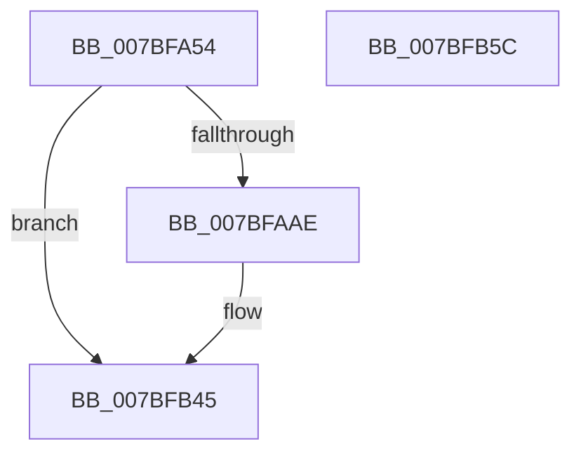

# EtwpTraceSavePersistedLoggerStop

- RVA: `0x007BFA54`–`0x007BFB5D` (길이 `265` bytes)
- VA: `0x00000001407BFA54`
- 실행 섹션: `PAGE`
- PDB 이름 있음: `예`; PDB Function 태그: `아니요`
- unwind 정보 RVA: `0x000D3D28`
- 디코드: `68`개 명령, `265/265` bytes 표시
- 미해석 바이트: `0` (있으면 어셈블리에 `.byte`로 보존)

> 이 문서는 커널 이미지의 기계어와 PDB 기호를 분석해 생성했습니다. 4번과 5번은 함수 원형과 자료형을 바이너리 사용 방식에서 추정한 C 해석이며 원본 소스 복구 결과는 아닙니다.

## 1. Dependencies

- 직접 호출 지점: **3**; 고유 호출 대상: **3**
- 직접 호출자로 확인된 함수: **1**
- RIP 상대 이미지 참조: **5**

### Outgoing calls
- `0x007BFAA1` → [EtwEventEnabled](../../text/39/EtwEventEnabled_function_00392450.md) (function, `0x00392450`)
- `0x007BFB40` → [EtwWrite](../../text/41/EtwWrite_function_0041C720.md) (function, `0x0041C720`)
- `0x007BFB4C` → [_security_check_cookie](../../text/6A/_security_check_cookie_function_006AC640.md) (function, `0x006AC640`)

### Direct callers
- [EtwpSavePersistedLogger](EtwpSavePersistedLogger_function_007BF374.md) at `0x007BF8CF`

### Static image references
- `0x007BFA70` → RVA `0x00E0A740` (`.data`; read)
- `0x007BFA82` → RVA `0x00023508` (`.rdata`; read)
- `0x007BFA8C` → RVA `0x000221C0` (`.rdata`; read)
- `0x007BFA93` → RVA `0x00EFF840` (`.data`; read)
- `0x007BFAE7` → RVA `0x000105E0` (`.rdata`; read)

## 2. Other-region calls and transfers

- 다른 실행 섹션으로 향하는 call: **3**
  - `0x007BFAA1` → [EtwEventEnabled](../../text/39/EtwEventEnabled_function_00392450.md) (`PAGE` → `.text`)
  - `0x007BFB40` → [EtwWrite](../../text/41/EtwWrite_function_0041C720.md) (`PAGE` → `.text`)
  - `0x007BFB4C` → [_security_check_cookie](../../text/6A/_security_check_cookie_function_006AC640.md) (`PAGE` → `.text`)
- 별도 외부 분기/꼬리 이동을 확인하지 못했습니다.

## 3. Assembly (complete function range)

```asm
007BFA54  48 8B C4                        mov rax, rsp
007BFA57  44 89 48 20                     mov dword ptr [rax + 0x20], r9d
007BFA5B  44 89 40 18                     mov dword ptr [rax + 0x18], r8d
007BFA5F  89 50 10                        mov dword ptr [rax + 0x10], edx
007BFA62  55                              push rbp
007BFA63  53                              push rbx
007BFA64  57                              push rdi
007BFA65  48 8D 68 B1                     lea rbp, [rax - 0x4f]
007BFA69  48 81 EC B0 00 00 00            sub rsp, 0xb0
007BFA70  48 8B 05 C9 AC 64 00            mov rax, qword ptr [rip + 0x64acc9]
007BFA77  48 33 C4                        xor rax, rsp
007BFA7A  48 89 45 27                     mov qword ptr [rbp + 0x27], rax
007BFA7E  83 7D 7F 00                     cmp dword ptr [rbp + 0x7f], 0
007BFA82  48 8D 05 7F 3A 86 FF            lea rax, [rip - 0x79c581]
007BFA89  48 8B F9                        mov rdi, rcx
007BFA8C  48 8D 1D 2D 27 86 FF            lea rbx, [rip - 0x79d8d3]
007BFA93  48 8B 0D A6 FD 73 00            mov rcx, qword ptr [rip + 0x73fda6]
007BFA9A  48 0F 4C D8                     cmovl rbx, rax
007BFA9E  48 8B D3                        mov rdx, rbx
007BFAA1  E8 AA 29 BD FF                  call 0x140392450
007BFAA6  84 C0                           test al, al
007BFAA8  0F 84 97 00 00 00               je 0x1407bfb45
007BFAAE  48 8B 47 08                     mov rax, qword ptr [rdi + 8]
007BFAB2  B9 04 00 00 00                  mov ecx, 4
007BFAB7  83 65 C3 00                     and dword ptr [rbp - 0x3d], 0
007BFABB  45 33 C0                        xor r8d, r8d
007BFABE  83 65 D3 00                     and dword ptr [rbp - 0x2d], 0
007BFAC2  48 8B D3                        mov rdx, rbx
007BFAC5  83 65 E3 00                     and dword ptr [rbp - 0x1d], 0
007BFAC9  83 65 F3 00                     and dword ptr [rbp - 0xd], 0
007BFACD  44 8D 49 03                     lea r9d, [rcx + 3]
007BFAD1  83 65 03 00                     and dword ptr [rbp + 3], 0
007BFAD5  83 65 13 00                     and dword ptr [rbp + 0x13], 0
007BFAD9  83 65 23 00                     and dword ptr [rbp + 0x23], 0
007BFADD  48 89 45 B7                     mov qword ptr [rbp - 0x49], rax
007BFAE1  0F B7 07                        movzx eax, word ptr [rdi]
007BFAE4  89 45 BF                        mov dword ptr [rbp - 0x41], eax
007BFAE7  48 8D 05 F2 0A 85 FF            lea rax, [rip - 0x7af50e]
007BFAEE  48 89 45 C7                     mov qword ptr [rbp - 0x39], rax
007BFAF2  48 8D 45 5F                     lea rax, [rbp + 0x5f]
007BFAF6  48 89 45 D7                     mov qword ptr [rbp - 0x29], rax
007BFAFA  48 8D 45 67                     lea rax, [rbp + 0x67]
007BFAFE  48 89 45 E7                     mov qword ptr [rbp - 0x19], rax
007BFB02  48 8D 45 6F                     lea rax, [rbp + 0x6f]
007BFB06  48 89 45 F7                     mov qword ptr [rbp - 9], rax
007BFB0A  48 8D 45 7F                     lea rax, [rbp + 0x7f]
007BFB0E  48 89 45 07                     mov qword ptr [rbp + 7], rax
007BFB12  48 8D 45 77                     lea rax, [rbp + 0x77]
007BFB16  48 89 45 17                     mov qword ptr [rbp + 0x17], rax
007BFB1A  48 8D 45 B7                     lea rax, [rbp - 0x49]
007BFB1E  89 4D DF                        mov dword ptr [rbp - 0x21], ecx
007BFB21  89 4D EF                        mov dword ptr [rbp - 0x11], ecx
007BFB24  89 4D FF                        mov dword ptr [rbp - 1], ecx
007BFB27  89 4D 0F                        mov dword ptr [rbp + 0xf], ecx
007BFB2A  89 4D 1F                        mov dword ptr [rbp + 0x1f], ecx
007BFB2D  48 8B 0D 0C FD 73 00            mov rcx, qword ptr [rip + 0x73fd0c]
007BFB34  48 89 44 24 20                  mov qword ptr [rsp + 0x20], rax
007BFB39  C7 45 CF 02 00 00 00            mov dword ptr [rbp - 0x31], 2
007BFB40  E8 DB CB C5 FF                  call 0x14041c720
007BFB45  48 8B 4D 27                     mov rcx, qword ptr [rbp + 0x27]
007BFB49  48 33 CC                        xor rcx, rsp
007BFB4C  E8 EF CA EE FF                  call 0x1406ac640
007BFB51  48 81 C4 B0 00 00 00            add rsp, 0xb0
007BFB58  5F                              pop rdi
007BFB59  5B                              pop rbx
007BFB5A  5D                              pop rbp
007BFB5B  C3                              ret
007BFB5C  CC                              int3
```

## 4. C-style interpretation (structured pseudocode)

```c
__int64 __fastcall EtwpTraceSavePersistedLoggerStop(__int64 a1, int a2, int a3, int a4)
{
    __int64 result;
    __int64 v_rbx;
    __int64 v_rsp;
    unsigned __int64 v_stack_mA8;

    *(unsigned int *)(v_rsp + 32) = a4;
    *(unsigned int *)(v_rsp + 24) = a3;
    *(unsigned int *)(v_rsp + 16) = a2;
    v_rsp = (v_rsp) - (176);
    result = (*(unsigned __int64 *)(v_rip + 6597833)) ^ (v_rsp);
    *(unsigned __int64 *)(v_rsp - 79 + 39) = result;
    v_rbx = v_rip - 7985363;
    if ((*(unsigned int *)(v_rsp - 79 + 127)) < 0) { v_rbx = v_rip - 7980417; }
    result = EtwEventEnabled(*(unsigned __int64 *)(v_rip + 7601574), v_rbx, a3, a4);
    if ((unsigned __int8)(result) != 0) {
        result = *(unsigned __int64 *)(a1 + 8);
        a1 = 4;
        a3 = 0;
        a2 = v_rbx;
        a4 = a1 + 3;
        *(unsigned __int64 *)(v_rsp - 79 - 73) = result;
        result = *(unsigned __int16 *)(a1);
        *(unsigned int *)(v_rsp - 79 - 65) = (unsigned int)(result);
        result = v_rip - 8058126;
        *(unsigned __int64 *)(v_rsp - 79 - 57) = result;
        result = v_rsp - 79 + 95;
        *(unsigned __int64 *)(v_rsp - 79 - 41) = result;
        result = v_rsp - 79 + 103;
        *(unsigned __int64 *)(v_rsp - 79 - 25) = result;
        result = v_rsp - 79 + 111;
        *(unsigned __int64 *)(v_rsp - 79 - 9) = result;
        result = v_rsp - 79 + 127;
        *(unsigned __int64 *)(v_rsp - 79 + 7) = result;
        result = v_rsp - 79 + 119;
        *(unsigned __int64 *)(v_rsp - 79 + 23) = result;
        result = v_rsp - 79 - 73;
        *(unsigned int *)(v_rsp - 79 - 33) = (unsigned int)(a1);
        *(unsigned int *)(v_rsp - 79 - 17) = (unsigned int)(a1);
        *(unsigned int *)(v_rsp - 79 - 1) = (unsigned int)(a1);
        *(unsigned int *)(v_rsp - 79 + 15) = (unsigned int)(a1);
        *(unsigned int *)(v_rsp - 79 + 31) = (unsigned int)(a1);
        a1 = *(unsigned __int64 *)(v_rip + 7601420);
        v_stack_mA8 = result;
        *(unsigned int *)(v_rsp - 79 - 49) = 2;
        result = EtwWrite(a1, a2, a3, a4);
    }
    a1 = (*(unsigned __int64 *)(v_rsp - 79 + 39)) ^ (v_rsp);
    result = _security_check_cookie(a1, a2, a3, a4);
    v_rsp = (v_rsp) + (176);
    return result;
}
```

## 5. (Beta) C Style

```c
int64_t EtwpTraceSavePersistedLoggerStop(void *Arg1, int32_t Arg2, int32_t Arg3, int32_t Arg4)
{
    uint8_t *arg1 = (uint8_t *)Arg1;

    int64_t result;
    int64_t local_rbx;
    int64_t local_rsp;
    uint64_t v_stack_mA8;

    *(uint32_t *)(local_rsp + 0x20) = Arg4;
    *(uint32_t *)(local_rsp + 0x18) = Arg3;
    *(uint32_t *)(local_rsp + 0x10) = Arg2;
    local_rsp = (local_rsp) - (176);
    result = (*(uint64_t *)(v_rip + 0x64ACC9)) ^ (local_rsp);
    *(uint64_t *)(local_rsp - 0x4F + 0x27) = result;
    local_rbx = v_rip - 7985363;
    if ((*(uint32_t *)(local_rsp - 0x4F + 0x7F)) < 0) { local_rbx = v_rip - 7980417; }
    result = EtwEventEnabled(*(uint64_t *)(v_rip + 0x73FDA6), local_rbx, Arg3, Arg4);
    if ((uint8_t)(result) != 0) {
        result = *(uint64_t *)(arg1 + 0x8);
        Arg1 = 4;
        Arg3 = 0;
        Arg2 = local_rbx;
        Arg4 = Arg1 + 3;
        *(uint64_t *)(local_rsp - 0x4F - 0x49) = result;
        result = *(uint16_t *)(arg1);
        *(uint32_t *)(local_rsp - 0x4F - 0x41) = (uint32_t)(result);
        result = v_rip - 8058126;
        *(uint64_t *)(local_rsp - 0x4F - 0x39) = result;
        result = local_rsp - 79 + 95;
        *(uint64_t *)(local_rsp - 0x4F - 0x29) = result;
        result = local_rsp - 79 + 103;
        *(uint64_t *)(local_rsp - 0x4F - 0x19) = result;
        result = local_rsp - 79 + 111;
        *(uint64_t *)(local_rsp - 0x4F - 0x9) = result;
        result = local_rsp - 79 + 127;
        *(uint64_t *)(local_rsp - 0x4F + 0x7) = result;
        result = local_rsp - 79 + 119;
        *(uint64_t *)(local_rsp - 0x4F + 0x17) = result;
        result = local_rsp - 79 - 73;
        *(uint32_t *)(local_rsp - 0x4F - 0x21) = (uint32_t)(Arg1);
        *(uint32_t *)(local_rsp - 0x4F - 0x11) = (uint32_t)(Arg1);
        *(uint32_t *)(local_rsp - 0x4F - 0x1) = (uint32_t)(Arg1);
        *(uint32_t *)(local_rsp - 0x4F + 0xF) = (uint32_t)(Arg1);
        *(uint32_t *)(local_rsp - 0x4F + 0x1F) = (uint32_t)(Arg1);
        Arg1 = *(uint64_t *)(v_rip + 0x73FD0C);
        v_stack_mA8 = result;
        *(uint32_t *)(local_rsp - 0x4F - 0x31) = 2;
        result = EtwWrite(Arg1, Arg2, Arg3, Arg4);
    }
    Arg1 = (*(uint64_t *)(local_rsp - 0x4F + 0x27)) ^ (local_rsp);
    result = _security_check_cookie(Arg1, Arg2, Arg3, Arg4);
    local_rsp = (local_rsp) + (176);
    return result;
}
```

### 관측된 메모리 오프셋

구조체 형식이 확인되지 않은 접근은 인자 기준의 오프셋으로만 기록했습니다.

| 기준 인자 | 오프셋 표현 | 폭 (bit) | 접근 |
|---|---:|---:|---|
| `Arg1` | `+ 0x0` | `16` | `R` |
| `Arg1` | `+ 0x8` | `64` | `R` |

## 6. Execution-region graph

[열기: 2D/3D 그래프와 함수 탐색 컨트롤 패널](../../../control-panel.html?section=page&rva=0x007BFA54&view=graph)

- 2D 그래프는 위에서 아래로 흐르고, 3D 그래프는 빈 공간을 드래그해 회전합니다. Shift+드래그는 이동, 휠은 확대·축소, 함수 노드 선택은 대상 보고서 이동입니다.

### Static fallback


