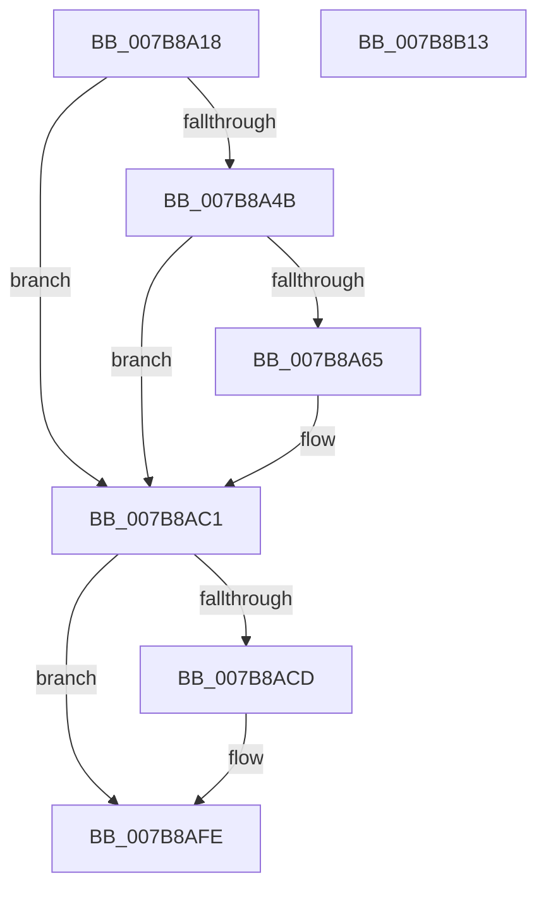

# EtwpTraceSystemShutdown

- RVA: `0x007B8A18`–`0x007B8B14` (길이 `252` bytes)
- VA: `0x00000001407B8A18`
- 실행 섹션: `PAGE`
- PDB 이름 있음: `예`; PDB Function 태그: `아니요`
- unwind 정보 RVA: `0x00079278`
- 디코드: `56`개 명령, `252/252` bytes 표시
- 미해석 바이트: `0` (있으면 어셈블리에 `.byte`로 보존)

> 이 문서는 커널 이미지의 기계어와 PDB 기호를 분석해 생성했습니다. 4번과 5번은 함수 원형과 자료형을 바이너리 사용 방식에서 추정한 C 해석이며 원본 소스 복구 결과는 아닙니다.

## 1. Dependencies

- 직접 호출 지점: **5**; 고유 호출 대상: **5**
- 직접 호출자로 확인된 함수: **1**
- RIP 상대 이미지 참조: **5**

### Outgoing calls
- `0x007B8A3D` → [KeQuerySystemTimePrecise](../../text/37/KeQuerySystemTimePrecise_function_0037DA40.md) (function, `0x0037DA40`)
- `0x007B8A5C` → [tlgKeywordOn](../../text/42/tlgKeywordOn_function_0042EAA0.md) (function, `0x0042EAA0`)
- `0x007B8ABC` → [tlgWriteTransfer_EtwWriteTransfer](../../text/42/tlgWriteTransfer_EtwWriteTransfer_function_004260E0.md) (function, `0x004260E0`)
- `0x007B8AF9` → [EtwWrite](../../text/41/EtwWrite_function_0041C720.md) (function, `0x0041C720`)
- `0x007B8B05` → [_security_check_cookie](../../text/6A/_security_check_cookie_function_006AC640.md) (function, `0x006AC640`)

### Direct callers
- [EtwShutdown](EtwShutdown_function_007B50B0.md) at `0x007B510B`

### Static image references
- `0x007B8A26` → RVA `0x00E0A740` (`.data`; read)
- `0x007B8A42` → RVA `0x00E09168` (`.data`; read)
- `0x007B8AA7` → RVA `0x00054176` (`.rdata`; read)
- `0x007B8AC1` → RVA `0x00EFFA28` (`.data`; read)
- `0x007B8AD9` → RVA `0x00021C50` (`.rdata`; read)

## 2. Other-region calls and transfers

- 다른 실행 섹션으로 향하는 call: **5**
  - `0x007B8A3D` → [KeQuerySystemTimePrecise](../../text/37/KeQuerySystemTimePrecise_function_0037DA40.md) (`PAGE` → `.text`)
  - `0x007B8A5C` → [tlgKeywordOn](../../text/42/tlgKeywordOn_function_0042EAA0.md) (`PAGE` → `.text`)
  - `0x007B8ABC` → [tlgWriteTransfer_EtwWriteTransfer](../../text/42/tlgWriteTransfer_EtwWriteTransfer_function_004260E0.md) (`PAGE` → `.text`)
  - `0x007B8AF9` → [EtwWrite](../../text/41/EtwWrite_function_0041C720.md) (`PAGE` → `.text`)
  - `0x007B8B05` → [_security_check_cookie](../../text/6A/_security_check_cookie_function_006AC640.md) (`PAGE` → `.text`)
- 별도 외부 분기/꼬리 이동을 확인하지 못했습니다.

## 3. Assembly (complete function range)

```asm
007B8A18  40 55                           push rbp
007B8A1A  48 8D 6C 24 A9                  lea rbp, [rsp - 0x57]
007B8A1F  48 81 EC B0 00 00 00            sub rsp, 0xb0
007B8A26  48 8B 05 13 1D 65 00            mov rax, qword ptr [rip + 0x651d13]
007B8A2D  48 33 C4                        xor rax, rsp
007B8A30  48 89 45 47                     mov qword ptr [rbp + 0x47], rax
007B8A34  48 83 65 DF 00                  and qword ptr [rbp - 0x21], 0
007B8A39  48 8D 4D DF                     lea rcx, [rbp - 0x21]
007B8A3D  E8 FE 4F BC FF                  call 0x14037da40
007B8A42  83 3D 1F 07 65 00 05            cmp dword ptr [rip + 0x65071f], 5
007B8A49  76 76                           jbe 0x1407b8ac1
007B8A4B  48 BA 00 00 00 00 00 40 00 00   movabs rdx, 0x400000000000
007B8A55  48 8D 0D 0C 07 65 00            lea rcx, [rip + 0x65070c]
007B8A5C  E8 3F 60 C7 FF                  call 0x14042eaa0
007B8A61  84 C0                           test al, al
007B8A63  74 5C                           je 0x1407b8ac1
007B8A65  83 65 33 00                     and dword ptr [rbp + 0x33], 0
007B8A69  48 8D 45 D7                     lea rax, [rbp - 0x29]
007B8A6D  83 65 43 00                     and dword ptr [rbp + 0x43], 0
007B8A71  48 8D 0D F0 06 65 00            lea rcx, [rip + 0x6506f0]
007B8A78  48 89 45 27                     mov qword ptr [rbp + 0x27], rax
007B8A7C  BA 04 00 00 00                  mov edx, 4
007B8A81  48 8B 45 DF                     mov rax, qword ptr [rbp - 0x21]
007B8A85  45 33 C9                        xor r9d, r9d
007B8A88  48 89 45 E7                     mov qword ptr [rbp - 0x19], rax
007B8A8C  45 33 C0                        xor r8d, r8d
007B8A8F  48 8D 45 E7                     lea rax, [rbp - 0x19]
007B8A93  89 55 2F                        mov dword ptr [rbp + 0x2f], edx
007B8A96  48 89 45 37                     mov qword ptr [rbp + 0x37], rax
007B8A9A  48 8D 45 07                     lea rax, [rbp + 7]
007B8A9E  48 89 44 24 28                  mov qword ptr [rsp + 0x28], rax
007B8AA3  89 54 24 20                     mov dword ptr [rsp + 0x20], edx
007B8AA7  48 8D 15 C8 B6 89 FF            lea rdx, [rip - 0x764938]
007B8AAE  C7 45 D7 02 00 00 00            mov dword ptr [rbp - 0x29], 2
007B8AB5  C7 45 3F 08 00 00 00            mov dword ptr [rbp + 0x3f], 8
007B8ABC  E8 1F D6 C6 FF                  call 0x1404260e0
007B8AC1  48 8B 0D 60 6F 74 00            mov rcx, qword ptr [rip + 0x746f60]
007B8AC8  48 85 C9                        test rcx, rcx
007B8ACB  74 31                           je 0x1407b8afe
007B8ACD  83 65 FB 00                     and dword ptr [rbp - 5], 0
007B8AD1  48 8D 45 DF                     lea rax, [rbp - 0x21]
007B8AD5  48 89 45 EF                     mov qword ptr [rbp - 0x11], rax
007B8AD9  48 8D 15 70 91 86 FF            lea rdx, [rip - 0x796e90]
007B8AE0  48 8D 45 EF                     lea rax, [rbp - 0x11]
007B8AE4  C7 45 F7 08 00 00 00            mov dword ptr [rbp - 9], 8
007B8AEB  41 B9 01 00 00 00               mov r9d, 1
007B8AF1  48 89 44 24 20                  mov qword ptr [rsp + 0x20], rax
007B8AF6  45 33 C0                        xor r8d, r8d
007B8AF9  E8 22 3C C6 FF                  call 0x14041c720
007B8AFE  48 8B 4D 47                     mov rcx, qword ptr [rbp + 0x47]
007B8B02  48 33 CC                        xor rcx, rsp
007B8B05  E8 36 3B EF FF                  call 0x1406ac640
007B8B0A  48 81 C4 B0 00 00 00            add rsp, 0xb0
007B8B11  5D                              pop rbp
007B8B12  C3                              ret
007B8B13  CC                              int3
```

## 4. C-style interpretation (structured pseudocode)

```c
__int64 __fastcall EtwpTraceSystemShutdown(__int64 a1, __int64 a2, int a3, int a4)
{
    __int64 result;
    __int64 v_rsp;
    unsigned __int64 v_stack_m18;
    unsigned int v_stack_m1C;
    unsigned int v_stack_m20;
    unsigned __int64 v_stack_m28;
    unsigned int v_stack_m2C;
    unsigned int v_stack_m30;
    unsigned __int64 v_stack_m38;
    unsigned __int64 v_stack_m58;
    unsigned __int64 v_stack_m5F;
    unsigned int v_stack_m64;
    unsigned int v_stack_m68;
    unsigned __int64 v_stack_m70;
    unsigned __int64 v_stack_m78;
    unsigned __int64 v_stack_m80;
    unsigned __int64 v_stack_m88;
    unsigned __int64 v_stack_m90;
    unsigned int v_stack_m98;

    v_rsp = (v_rsp) - (176);
    result = (*(unsigned __int64 *)(v_rip + 6626579)) ^ (v_rsp);
    v_stack_m18 = result;
    result = KeQuerySystemTimePrecise(v_stack_m80, a2, a3, a4);
    if ((*(unsigned int *)(v_rip + 6620959)) <= 5) goto loc_007B8AC1;
    result = tlgKeywordOn(v_rip + 6620940, a2, a3, a4);
    if ((unsigned __int8)(result) != 0) {
        result = v_stack_m88;
        a1 = v_rip + 6620912;
        v_stack_m38 = result;
        a2 = 4;
        result = v_stack_m80;
        a4 = 0;
        v_stack_m78 = result;
        a3 = 0;
        result = v_stack_m78;
        v_stack_m30 = (unsigned int)(a2);
        v_stack_m28 = result;
        result = v_stack_m58;
        v_stack_m90 = result;
        v_stack_m98 = (unsigned int)(a2);
        a2 = v_rip - 7751992;
        v_stack_m88 = 2;
        v_stack_m20 = 8;
        result = tlgWriteTransfer_EtwWriteTransfer(a1, a2, a3, a4);
    }
    if (*(unsigned __int64 *)(v_rip + 7630688) != 0) {
        result = v_stack_m80;
        v_stack_m70 = result;
        a2 = v_rip - 7958160;
        result = v_stack_m70;
        v_stack_m68 = 8;
        a4 = 1;
        v_stack_m98 = result;
        a3 = 0;
        result = EtwWrite(*(unsigned __int64 *)(v_rip + 7630688), a2, a3, a4);
    }
    a1 = (v_stack_m18) ^ (v_rsp);
    result = _security_check_cookie(a1, a2, a3, a4);
    v_rsp = (v_rsp) + (176);
    return result;
}
```

## 5. (Beta) C Style

```c
int64_t EtwpTraceSystemShutdown(int64_t Arg1, int64_t Arg2, int32_t Arg3, int32_t Arg4)
{
    int64_t result;
    int64_t local_rsp;
    uint64_t v_stack_m18;
    uint32_t v_stack_m1C;
    uint32_t v_stack_m20;
    uint64_t v_stack_m28;
    uint32_t v_stack_m2C;
    uint32_t v_stack_m30;
    uint64_t v_stack_m38;
    uint64_t v_stack_m58;
    uint64_t v_stack_m5F;
    uint32_t v_stack_m64;
    uint32_t v_stack_m68;
    uint64_t v_stack_m70;
    uint64_t v_stack_m78;
    uint64_t v_stack_m80;
    uint64_t v_stack_m88;
    uint64_t v_stack_m90;
    uint32_t v_stack_m98;

    local_rsp = (local_rsp) - (176);
    result = (*(uint64_t *)(v_rip + 0x651D13)) ^ (local_rsp);
    v_stack_m18 = result;
    result = KeQuerySystemTimePrecise(v_stack_m80, Arg2, Arg3, Arg4);
    if ((*(uint32_t *)(v_rip + 0x65071F)) <= 5) goto loc_007B8AC1;
    result = tlgKeywordOn(v_rip + 6620940, Arg2, Arg3, Arg4);
    if ((uint8_t)(result) != 0) {
        result = v_stack_m88;
        Arg1 = v_rip + 6620912;
        v_stack_m38 = result;
        Arg2 = 4;
        result = v_stack_m80;
        Arg4 = 0;
        v_stack_m78 = result;
        Arg3 = 0;
        result = v_stack_m78;
        v_stack_m30 = (uint32_t)(Arg2);
        v_stack_m28 = result;
        result = v_stack_m58;
        v_stack_m90 = result;
        v_stack_m98 = (uint32_t)(Arg2);
        Arg2 = v_rip - 7751992;
        v_stack_m88 = 2;
        v_stack_m20 = 8;
        result = tlgWriteTransfer_EtwWriteTransfer(Arg1, Arg2, Arg3, Arg4);
    }
    if (*(uint64_t *)(v_rip + 0x746F60) != 0) {
        result = v_stack_m80;
        v_stack_m70 = result;
        Arg2 = v_rip - 7958160;
        result = v_stack_m70;
        v_stack_m68 = 8;
        Arg4 = 1;
        v_stack_m98 = result;
        Arg3 = 0;
        result = EtwWrite(*(uint64_t *)(v_rip + 0x746F60), Arg2, Arg3, Arg4);
    }
    Arg1 = (v_stack_m18) ^ (local_rsp);
    result = _security_check_cookie(Arg1, Arg2, Arg3, Arg4);
    local_rsp = (local_rsp) + (176);
    return result;
}
```

## 6. Execution-region graph

[열기: 2D/3D 그래프와 함수 탐색 컨트롤 패널](../../../control-panel.html?section=page&rva=0x007B8A18&view=graph)

- 2D 그래프는 위에서 아래로 흐르고, 3D 그래프는 빈 공간을 드래그해 회전합니다. Shift+드래그는 이동, 휠은 확대·축소, 함수 노드 선택은 대상 보고서 이동입니다.

### Static fallback


