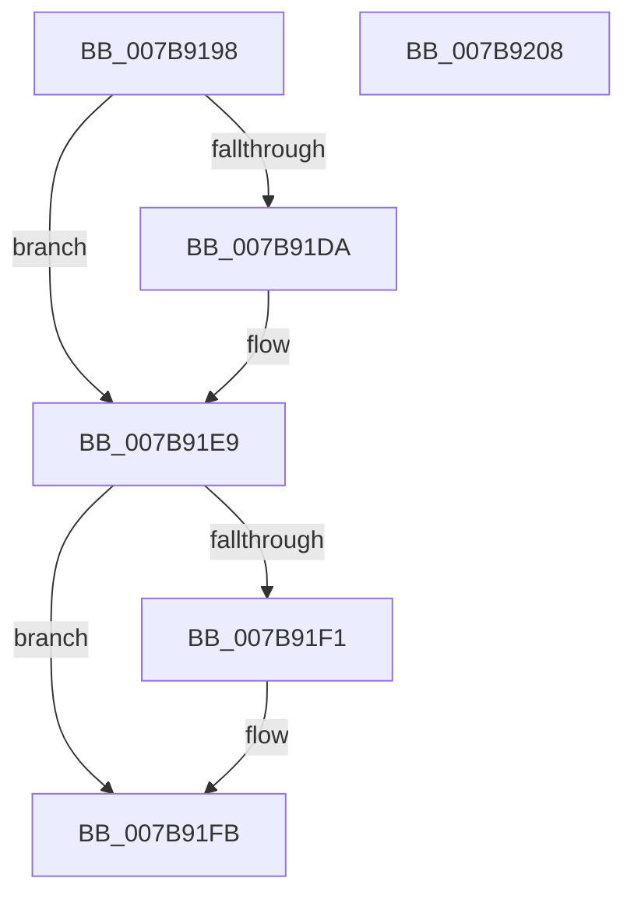

# EtwpTrackProviderBinary

- RVA: `0x007B9198`–`0x007B9209` (길이 `113` bytes)
- VA: `0x00000001407B9198`
- 실행 섹션: `PAGE`
- PDB 이름 있음: `예`; PDB Function 태그: `아니요`
- unwind 정보 RVA: `0x000D39EC`
- 디코드: `32`개 명령, `113/113` bytes 표시
- 미해석 바이트: `0` (있으면 어셈블리에 `.byte`로 보존)

> 이 문서는 커널 이미지의 기계어와 PDB 기호를 분석해 생성했습니다. 4번과 5번은 함수 원형과 자료형을 바이너리 사용 방식에서 추정한 C 해석이며 원본 소스 복구 결과는 아닙니다.

## 1. Dependencies

- 직접 호출 지점: **3**; 고유 호출 대상: **3**
- 직접 호출자로 확인된 함수: **1**
- RIP 상대 이미지 참조: **1**

### Outgoing calls
- `0x007B91CF` → [ObReferenceObjectByHandle](../86/ObReferenceObjectByHandle_function_00868DB0.md) (function, `0x00868DB0`)
- `0x007B91E2` → [EtwpTrackProviderBinaryKm](../6F/EtwpTrackProviderBinaryKm_function_006FD8E8.md) (function, `0x006FD8E8`)
- `0x007B91F6` → [ObfDereferenceObject](../../text/2F/ObfDereferenceObject_function_002F9350.md) (function, `0x002F9350`)

### Direct callers
- [NtTraceControl](../A9/NtTraceControl_function_00A9ED40.md) at `0x00A9F7DE`

### Static image references
- `0x007B91B7` → RVA `0x00FC6D30` (`ALMOSTRO`; read)

## 2. Other-region calls and transfers

- 다른 실행 섹션으로 향하는 call: **1**
  - `0x007B91F6` → [ObfDereferenceObject](../../text/2F/ObfDereferenceObject_function_002F9350.md) (`PAGE` → `.text`)
- 별도 외부 분기/꼬리 이동을 확인하지 못했습니다.

## 3. Assembly (complete function range)

```asm
007B9198  4C 8B DC                        mov r11, rsp
007B919B  49 89 73 10                     mov qword ptr [r11 + 0x10], rsi
007B919F  49 89 4B 08                     mov qword ptr [r11 + 8], rcx
007B91A3  57                              push rdi
007B91A4  48 83 EC 30                     sub rsp, 0x30
007B91A8  48 8B 0A                        mov rcx, qword ptr [rdx]
007B91AB  49 8D 43 08                     lea rax, [r11 + 8]
007B91AF  49 83 63 F0 00                  and qword ptr [r11 - 0x10], 0
007B91B4  41 8A F0                        mov sil, r8b
007B91B7  4C 8B 05 72 DB 80 00            mov r8, qword ptr [rip + 0x80db72]
007B91BE  BA 00 08 00 00                  mov edx, 0x800
007B91C3  49 83 63 08 00                  and qword ptr [r11 + 8], 0
007B91C8  41 B1 01                        mov r9b, 1
007B91CB  49 89 43 E8                     mov qword ptr [r11 - 0x18], rax
007B91CF  E8 DC FB 0A 00                  call 0x140868db0
007B91D4  8B F8                           mov edi, eax
007B91D6  85 C0                           test eax, eax
007B91D8  78 0F                           js 0x1407b91e9
007B91DA  48 8B 4C 24 40                  mov rcx, qword ptr [rsp + 0x40]
007B91DF  44 8A C6                        mov r8b, sil
007B91E2  E8 01 47 F4 FF                  call 0x1406fd8e8
007B91E7  8B F8                           mov edi, eax
007B91E9  48 83 7C 24 40 00               cmp qword ptr [rsp + 0x40], 0
007B91EF  74 0A                           je 0x1407b91fb
007B91F1  48 8B 4C 24 40                  mov rcx, qword ptr [rsp + 0x40]
007B91F6  E8 55 01 B4 FF                  call 0x1402f9350
007B91FB  48 8B 74 24 48                  mov rsi, qword ptr [rsp + 0x48]
007B9200  8B C7                           mov eax, edi
007B9202  48 83 C4 30                     add rsp, 0x30
007B9206  5F                              pop rdi
007B9207  C3                              ret
007B9208  CC                              int3
```

## 4. C-style interpretation (structured pseudocode)

```c
__int64 __fastcall EtwpTrackProviderBinary(__int64 a1, __int64 a2, unsigned __int8 a3)
{
    __int64 result;
    __int64 v_rdi;
    __int64 v_rsp;
    unsigned __int64 v_stack_p10;
    unsigned __int64 v_stack_p8;

    *(unsigned __int64 *)(v_rsp + 16) = v_rsi;
    *(unsigned __int64 *)(v_rsp + 8) = a1;
    v_rsp = (v_rsp) - (48);
    *(unsigned __int64 *)(v_rsp - 24) = v_rsp + 8;
    result = ObReferenceObjectByHandle(*(unsigned __int64 *)(a2), (unsigned int)(0x800ULL), *(unsigned __int64 *)(v_rip + 8444786), 1);
    v_rdi = (unsigned int)((unsigned int)(result));
    if (!(sign_flag)) {
        a1 = v_stack_p8;
        a3 = a3;
        result = EtwpTrackProviderBinaryKm(a1, (unsigned int)(0x800ULL), a3, 1);
        v_rdi = (unsigned int)(result);
    }
    if (v_stack_p8 != 0) {
        a1 = v_stack_p8;
        result = ObfDereferenceObject(a1, (unsigned int)(0x800ULL), a3, 1);
    }
    v_rsp = (v_rsp) + (48);
    return (unsigned int)((unsigned int)(v_rdi));
}
```

## 5. (Beta) C Style

```c
int64_t EtwpTrackProviderBinary(int64_t Arg1, void *Arg2, uint8_t Arg3)
{
    uint8_t *arg2 = (uint8_t *)Arg2;

    int64_t result;
    int64_t local_rdi;
    int64_t local_rsp;
    uint64_t v_stack_p10;
    uint64_t v_stack_p8;

    *(uint64_t *)(local_rsp + 0x10) = local_rsi;
    *(uint64_t *)(local_rsp + 0x8) = Arg1;
    local_rsp = (local_rsp) - (48);
    *(uint64_t *)(local_rsp - 0x18) = local_rsp + 8;
    result = ObReferenceObjectByHandle(*(uint64_t *)(arg2), (uint32_t)(0x800ULL), *(uint64_t *)(v_rip + 0x80DB72), 1);
    local_rdi = (uint32_t)((uint32_t)(result));
    if (!(sign_flag)) {
        Arg1 = v_stack_p8;
        Arg3 = Arg3;
        result = EtwpTrackProviderBinaryKm(Arg1, (uint32_t)(0x800ULL), Arg3, 1);
        local_rdi = (uint32_t)(result);
    }
    if (v_stack_p8 != 0) {
        Arg1 = v_stack_p8;
        result = ObfDereferenceObject(Arg1, (uint32_t)(0x800ULL), Arg3, 1);
    }
    local_rsp = (local_rsp) + (48);
    return (uint32_t)((uint32_t)(local_rdi));
}
```

### 관측된 메모리 오프셋

구조체 형식이 확인되지 않은 접근은 인자 기준의 오프셋으로만 기록했습니다.

| 기준 인자 | 오프셋 표현 | 폭 (bit) | 접근 |
|---|---:|---:|---|
| `Arg2` | `+ 0x0` | `64` | `R` |

## 6. Execution-region graph

[열기: 2D/3D 그래프와 함수 탐색 컨트롤 패널](../../../control-panel.html?section=page&rva=0x007B9198&view=graph)

- 2D 그래프는 위에서 아래로 흐르고, 3D 그래프는 빈 공간을 드래그해 회전합니다. Shift+드래그는 이동, 휠은 확대·축소, 함수 노드 선택은 대상 보고서 이동입니다.

### Static fallback


