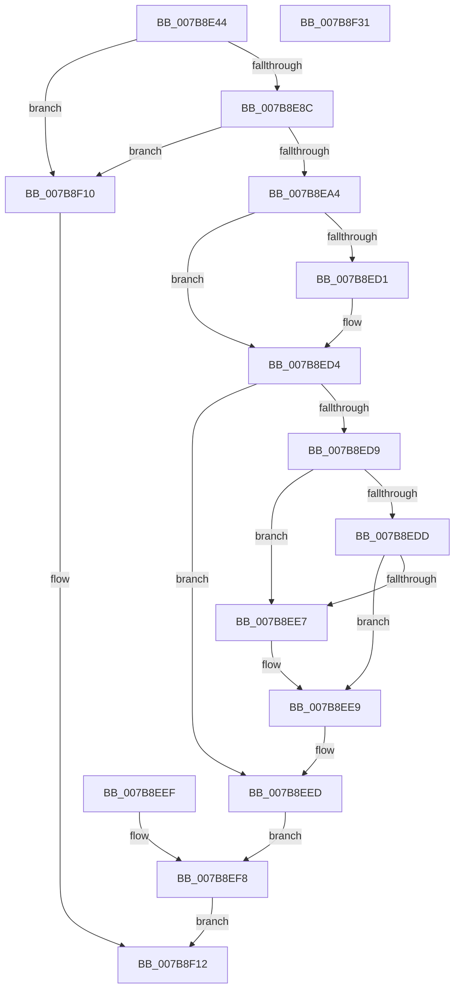

# EtwpUMGLEnabled

- RVA: `0x007B8E44`–`0x007B8F32` (길이 `238` bytes)
- VA: `0x00000001407B8E44`
- 실행 섹션: `PAGE`
- PDB 이름 있음: `예`; PDB Function 태그: `아니요`
- unwind 정보 RVA: `0x000D39BC`
- 디코드: `64`개 명령, `238/238` bytes 표시
- 미해석 바이트: `0` (있으면 어셈블리에 `.byte`로 보존)

> 이 문서는 커널 이미지의 기계어와 PDB 기호를 분석해 생성했습니다. 4번과 5번은 함수 원형과 자료형을 바이너리 사용 방식에서 추정한 C 해석이며 원본 소스 복구 결과는 아닙니다.

## 1. Dependencies

- 직접 호출 지점: **5**; 고유 호출 대상: **5**
- 직접 호출자로 확인된 함수: **1**
- RIP 상대 이미지 참조: **1**

### Outgoing calls
- `0x007B8E9B` → [ExAcquireRundownProtection](../../text/21/ExAcquireRundownProtection_function_00216620.md) (function, `0x00216620`)
- `0x007B8EAE` → [KiStackAttachProcess](../../text/21/KiStackAttachProcess_function_00216820.md) (function, `0x00216820`)
- `0x007B8EFF` → [KiUnstackDetachProcess](../../text/21/KiUnstackDetachProcess_function_00217D30.md) (function, `0x00217D30`)
- `0x007B8F07` → [ExReleaseRundownProtection](../../text/34/ExReleaseRundownProtection_function_00349E80.md) (function, `0x00349E80`)
- `0x007B8F1A` → [_security_check_cookie](../../text/6A/_security_check_cookie_function_006AC640.md) (function, `0x006AC640`)

### Direct callers
- [EtwQueryPerformanceTraceInformation](../AF/EtwQueryPerformanceTraceInformation_function_00AF28A4.md) at `0x00AF2EB5`

### Static image references
- `0x007B8E53` → RVA `0x00E0A740` (`.data`; read)

## 2. Other-region calls and transfers

- 다른 실행 섹션으로 향하는 call: **5**
  - `0x007B8E9B` → [ExAcquireRundownProtection](../../text/21/ExAcquireRundownProtection_function_00216620.md) (`PAGE` → `.text`)
  - `0x007B8EAE` → [KiStackAttachProcess](../../text/21/KiStackAttachProcess_function_00216820.md) (`PAGE` → `.text`)
  - `0x007B8EFF` → [KiUnstackDetachProcess](../../text/21/KiUnstackDetachProcess_function_00217D30.md) (`PAGE` → `.text`)
  - `0x007B8F07` → [ExReleaseRundownProtection](../../text/34/ExReleaseRundownProtection_function_00349E80.md) (`PAGE` → `.text`)
  - `0x007B8F1A` → [_security_check_cookie](../../text/6A/_security_check_cookie_function_006AC640.md) (`PAGE` → `.text`)
- 별도 외부 분기/꼬리 이동을 확인하지 못했습니다.

## 3. Assembly (complete function range)

```asm
007B8E44  48 89 5C 24 10                  mov qword ptr [rsp + 0x10], rbx
007B8E49  48 89 74 24 18                  mov qword ptr [rsp + 0x18], rsi
007B8E4E  57                              push rdi
007B8E4F  48 83 EC 70                     sub rsp, 0x70
007B8E53  48 8B 05 E6 18 65 00            mov rax, qword ptr [rip + 0x6518e6]
007B8E5A  48 33 C4                        xor rax, rsp
007B8E5D  48 89 44 24 60                  mov qword ptr [rsp + 0x60], rax
007B8E62  48 8B F1                        mov rsi, rcx
007B8E65  0F 57 C0                        xorps xmm0, xmm0
007B8E68  0F 11 44 24 30                  movups xmmword ptr [rsp + 0x30], xmm0
007B8E6D  0F 11 44 24 40                  movups xmmword ptr [rsp + 0x40], xmm0
007B8E72  0F 11 44 24 50                  movups xmmword ptr [rsp + 0x50], xmm0
007B8E77  C6 44 24 20 00                  mov byte ptr [rsp + 0x20], 0
007B8E7C  48 8B 99 E0 02 00 00            mov rbx, qword ptr [rcx + 0x2e0]
007B8E83  48 85 DB                        test rbx, rbx
007B8E86  0F 84 84 00 00 00               je 0x1407b8f10
007B8E8C  48 8D B9 E8 01 00 00            lea rdi, [rcx + 0x1e8]
007B8E93  48 89 7C 24 28                  mov qword ptr [rsp + 0x28], rdi
007B8E98  48 8B CF                        mov rcx, rdi
007B8E9B  E8 80 D7 A5 FF                  call 0x140216620
007B8EA0  84 C0                           test al, al
007B8EA2  74 6C                           je 0x1407b8f10
007B8EA4  4C 8D 44 24 30                  lea r8, [rsp + 0x30]
007B8EA9  33 D2                           xor edx, edx
007B8EAB  48 8B CE                        mov rcx, rsi
007B8EAE  E8 6D D9 A5 FF                  call 0x140216820
007B8EB3  90                              nop
007B8EB4  0F BA A3 78 03 00 00 00         bt dword ptr [rbx + 0x378], 0
007B8EBC  0F 92 C3                        setb bl
007B8EBF  88 5C 24 20                     mov byte ptr [rsp + 0x20], bl
007B8EC3  33 C0                           xor eax, eax
007B8EC5  48 8B 8E 10 03 00 00            mov rcx, qword ptr [rsi + 0x310]
007B8ECC  48 85 C9                        test rcx, rcx
007B8ECF  74 03                           je 0x1407b8ed4
007B8ED1  48 8B 01                        mov rax, qword ptr [rcx]
007B8ED4  48 85 C0                        test rax, rax
007B8ED7  74 14                           je 0x1407b8eed
007B8ED9  84 DB                           test bl, bl
007B8EDB  75 0A                           jne 0x1407b8ee7
007B8EDD  0F BA A0 40 02 00 00 00         bt dword ptr [rax + 0x240], 0
007B8EE5  73 02                           jae 0x1407b8ee9
007B8EE7  B3 01                           mov bl, 1
007B8EE9  88 5C 24 20                     mov byte ptr [rsp + 0x20], bl
007B8EED  EB 09                           jmp 0x1407b8ef8
007B8EEF  8A 5C 24 20                     mov bl, byte ptr [rsp + 0x20]
007B8EF3  48 8B 7C 24 28                  mov rdi, qword ptr [rsp + 0x28]
007B8EF8  33 D2                           xor edx, edx
007B8EFA  48 8D 4C 24 30                  lea rcx, [rsp + 0x30]
007B8EFF  E8 2C EE A5 FF                  call 0x140217d30
007B8F04  48 8B CF                        mov rcx, rdi
007B8F07  E8 74 0F B9 FF                  call 0x140349e80
007B8F0C  8A C3                           mov al, bl
007B8F0E  EB 02                           jmp 0x1407b8f12
007B8F10  32 C0                           xor al, al
007B8F12  48 8B 4C 24 60                  mov rcx, qword ptr [rsp + 0x60]
007B8F17  48 33 CC                        xor rcx, rsp
007B8F1A  E8 21 37 EF FF                  call 0x1406ac640
007B8F1F  4C 8D 5C 24 70                  lea r11, [rsp + 0x70]
007B8F24  49 8B 5B 18                     mov rbx, qword ptr [r11 + 0x18]
007B8F28  49 8B 73 20                     mov rsi, qword ptr [r11 + 0x20]
007B8F2C  49 8B E3                        mov rsp, r11
007B8F2F  5F                              pop rdi
007B8F30  C3                              ret
007B8F31  CC                              int3
```

## 4. C-style interpretation (structured pseudocode)

```c
__int64 __fastcall EtwpUMGLEnabled(__int64 a1, int a2)
{
    __int64 result;
    __int64 v_rbx;
    __int64 v_rsp;
    unsigned __int64 v_stack_m18;
    unsigned __int64 v_stack_m28;
    unsigned __int64 v_stack_m38;
    unsigned __int64 v_stack_m48;
    unsigned __int64 v_stack_m50;
    unsigned __int8 v_stack_m58;
    unsigned __int64 v_stack_m8;
    unsigned __int64 v_stack_p10;
    unsigned __int64 v_stack_p18;

    v_stack_p10 = v_rbx;
    v_stack_p18 = v_rsi;
    v_rsp = (v_rsp) - (112);
    result = (*(unsigned __int64 *)(v_rip + 6625510)) ^ (v_rsp);
    v_stack_m18 = result;
    v_stack_m48 = v_xmm0;
    v_stack_m38 = v_xmm0;
    v_stack_m28 = v_xmm0;
    v_stack_m58 = 0;
    if (*(unsigned __int64 *)(a1 + 736) == 0) goto loc_007B8F10;
    v_stack_m50 = a1 + 488;
    result = ExAcquireRundownProtection(a1 + 488, a2, a3, a4);
    if ((unsigned __int8)(result) == 0) goto loc_007B8F10;
    a2 = 0;
    result = KiStackAttachProcess(a1, a2, v_stack_m48, a4);
    v_rbx = (condition_is_below) ? 1 : 0;
    v_stack_m58 = (unsigned __int8)(v_rbx);
    result = 0;
    if (*(unsigned __int64 *)(a1 + 784) != 0) {
        result = *(unsigned __int64 *)(*(unsigned __int64 *)(a1 + 784));
    }
    if (result == 0) goto loc_007B8EED;
    if ((unsigned __int8)(v_rbx) != 0) goto loc_007B8EE7;
    if (!(condition_is_above_or_equal)) {
        v_rbx = 1;
    }
    v_stack_m58 = (unsigned __int8)(v_rbx);
loc_007B8EED:
    goto loc_007B8EF8;
loc_007B8EF8:
    a2 = 0;
    result = KiUnstackDetachProcess(v_stack_m48, a2, v_stack_m48, a4);
    result = ExReleaseRundownProtection(a1 + 488, a2, v_stack_m48, a4);
    goto loc_007B8F12;
loc_007B8F10:
    result = 0;
loc_007B8F12:
    a1 = (v_stack_m18) ^ (v_rsp);
    result = _security_check_cookie(a1, a2, v_stack_m48, a4);
    return result;
}
```

## 5. (Beta) C Style

```c
int64_t EtwpUMGLEnabled(void *Arg1, int32_t Arg2)
{
    uint8_t *arg1 = (uint8_t *)Arg1;

    int64_t result;
    int64_t local_rbx;
    int64_t local_rsp;
    uint64_t v_stack_m18;
    uint64_t v_stack_m28;
    uint64_t v_stack_m38;
    uint64_t v_stack_m48;
    uint64_t v_stack_m50;
    uint8_t v_stack_m58;
    uint64_t v_stack_m8;
    uint64_t v_stack_p10;
    uint64_t v_stack_p18;

    v_stack_p10 = local_rbx;
    v_stack_p18 = local_rsi;
    local_rsp = (local_rsp) - (112);
    result = (*(uint64_t *)(v_rip + 0x6518E6)) ^ (local_rsp);
    v_stack_m18 = result;
    v_stack_m48 = v_xmm0;
    v_stack_m38 = v_xmm0;
    v_stack_m28 = v_xmm0;
    v_stack_m58 = 0;
    if (*(uint64_t *)(arg1 + 0x2E0) == 0) goto loc_007B8F10;
    v_stack_m50 = Arg1 + 488;
    result = ExAcquireRundownProtection(Arg1 + 488, Arg2, a3, a4);
    if ((uint8_t)(result) == 0) goto loc_007B8F10;
    Arg2 = 0;
    result = KiStackAttachProcess(Arg1, Arg2, v_stack_m48, a4);
    local_rbx = (condition_is_below) ? 1 : 0;
    v_stack_m58 = (uint8_t)(local_rbx);
    result = 0;
    if (*(uint64_t *)(arg1 + 0x310) != 0) {
        result = *(uint64_t *)(*(uint64_t *)(arg1 + 0x310));
    }
    if (result == 0) goto loc_007B8EED;
    if ((uint8_t)(local_rbx) != 0) goto loc_007B8EE7;
    if (!(condition_is_above_or_equal)) {
        local_rbx = 1;
    }
    v_stack_m58 = (uint8_t)(local_rbx);
loc_007B8EED:
    goto loc_007B8EF8;
loc_007B8EF8:
    Arg2 = 0;
    result = KiUnstackDetachProcess(v_stack_m48, Arg2, v_stack_m48, a4);
    result = ExReleaseRundownProtection(Arg1 + 488, Arg2, v_stack_m48, a4);
    goto loc_007B8F12;
loc_007B8F10:
    result = 0;
loc_007B8F12:
    Arg1 = (v_stack_m18) ^ (local_rsp);
    result = _security_check_cookie(Arg1, Arg2, v_stack_m48, a4);
    return result;
}
```

### 관측된 메모리 오프셋

구조체 형식이 확인되지 않은 접근은 인자 기준의 오프셋으로만 기록했습니다.

| 기준 인자 | 오프셋 표현 | 폭 (bit) | 접근 |
|---|---:|---:|---|
| `Arg1` | `+ 0x1E8` | `64` | `R` |
| `Arg1` | `+ 0x2E0` | `64` | `R` |
| `Arg1` | `+ 0x310` | `64` | `R` |

## 6. Execution-region graph

[열기: 2D/3D 그래프와 함수 탐색 컨트롤 패널](../../../control-panel.html?section=page&rva=0x007B8E44&view=graph)

- 2D 그래프는 위에서 아래로 흐르고, 3D 그래프는 빈 공간을 드래그해 회전합니다. Shift+드래그는 이동, 휠은 확대·축소, 함수 노드 선택은 대상 보고서 이동입니다.

### Static fallback


