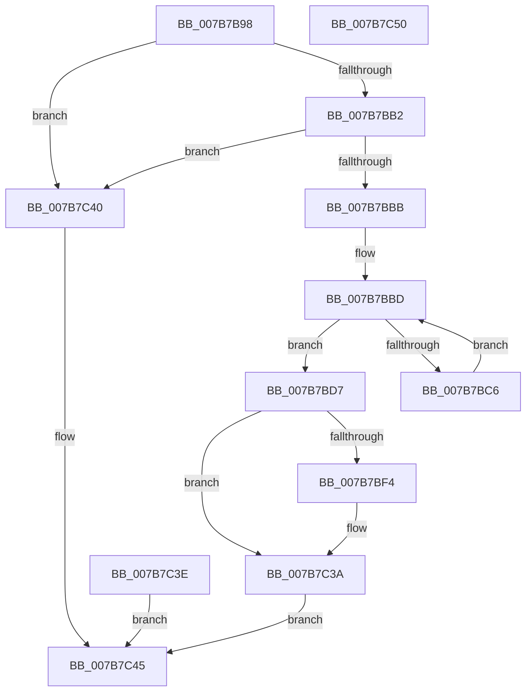

# EtwpUpdateContextRegisterTraceEvents

- RVA: `0x007B7B98`–`0x007B7C51` (길이 `185` bytes)
- VA: `0x00000001407B7B98`
- 실행 섹션: `PAGE`
- PDB 이름 있음: `예`; PDB Function 태그: `아니요`
- unwind 정보 RVA: `0x000D3314`
- 디코드: `47`개 명령, `185/185` bytes 표시
- 미해석 바이트: `0` (있으면 어셈블리에 `.byte`로 보존)

> 이 문서는 커널 이미지의 기계어와 PDB 기호를 분석해 생성했습니다. 4번과 5번은 함수 원형과 자료형을 바이너리 사용 방식에서 추정한 C 해석이며 원본 소스 복구 결과는 아닙니다.

## 1. Dependencies

- 직접 호출 지점: **3**; 고유 호출 대상: **3**
- 직접 호출자로 확인된 함수: **1**
- RIP 상대 이미지 참조: **0**

### Outgoing calls
- `0x007B7BF4` → [EtwpQueryUsedProcessorCount](../../text/3E/EtwpQueryUsedProcessorCount_function_003EB940.md) (function, `0x003EB940`)
- `0x007B7C25` → [EtwpInitializeApcPool](../../text/46/EtwpInitializeApcPool_function_00467FA0.md) (function, `0x00467FA0`)
- `0x007B7C2D` → [EtwpPreallocateApcPool](../A6/EtwpPreallocateApcPool_function_00A67908.md) (function, `0x00A67908`)

### Direct callers
- [sub_00B3C988](../B3/Unknown_function_00B3C988.md) at `0x00B3D418`

### Static image references
- 디코드된 RIP-relative 메모리 참조가 없습니다.

## 2. Other-region calls and transfers

- 다른 실행 섹션으로 향하는 call: **2**
  - `0x007B7BF4` → [EtwpQueryUsedProcessorCount](../../text/3E/EtwpQueryUsedProcessorCount_function_003EB940.md) (`PAGE` → `.text`)
  - `0x007B7C25` → [EtwpInitializeApcPool](../../text/46/EtwpInitializeApcPool_function_00467FA0.md) (`PAGE` → `.text`)
- 별도 외부 분기/꼬리 이동을 확인하지 못했습니다.

## 3. Assembly (complete function range)

```asm
007B7B98  48 89 5C 24 08                  mov qword ptr [rsp + 8], rbx
007B7B9D  57                              push rdi
007B7B9E  48 83 EC 30                     sub rsp, 0x30
007B7BA2  44 8B D2                        mov r10d, edx
007B7BA5  48 8B F9                        mov rdi, rcx
007B7BA8  41 83 F9 08                     cmp r9d, 8
007B7BAC  0F 87 8E 00 00 00               ja 0x1407b7c40
007B7BB2  83 FA 03                        cmp edx, 3
007B7BB5  0F 85 85 00 00 00               jne 0x1407b7c40
007B7BBB  33 D2                           xor edx, edx
007B7BBD  89 54 24 20                     mov dword ptr [rsp + 0x20], edx
007B7BC1  41 3B D1                        cmp edx, r9d
007B7BC4  73 11                           jae 0x1407b7bd7
007B7BC6  41 0F B7 04 90                  movzx eax, word ptr [r8 + rdx*4]
007B7BCB  66 89 84 51 08 05 00 00         mov word ptr [rcx + rdx*2 + 0x508], ax
007B7BD3  FF C2                           inc edx
007B7BD5  EB E6                           jmp 0x1407b7bbd
007B7BD7  44 89 91 00 05 00 00            mov dword ptr [rcx + 0x500], r10d
007B7BDE  F0 83 0C 24 00                  lock or dword ptr [rsp], 0
007B7BE3  44 89 89 04 05 00 00            mov dword ptr [rcx + 0x504], r9d
007B7BEA  8B 81 34 03 00 00               mov eax, dword ptr [rcx + 0x334]
007B7BF0  A8 02                           test al, 2
007B7BF2  75 46                           jne 0x1407b7c3a
007B7BF4  E8 47 3D C3 FF                  call 0x1403eb940
007B7BF9  44 8D 04 85 00 00 00 00         lea r8d, [rax*4]
007B7C01  C1 E0 04                        shl eax, 4
007B7C04  41 B9 10 00 00 00               mov r9d, 0x10
007B7C0A  45 3B C1                        cmp r8d, r9d
007B7C0D  45 0F 42 C1                     cmovb r8d, r9d
007B7C11  48 8D 99 40 04 00 00            lea rbx, [rcx + 0x440]
007B7C18  41 3B C1                        cmp eax, r9d
007B7C1B  44 0F 43 C8                     cmovae r9d, eax
007B7C1F  48 8B D7                        mov rdx, rdi
007B7C22  48 8B CB                        mov rcx, rbx
007B7C25  E8 76 03 CB FF                  call 0x140467fa0
007B7C2A  48 8B CB                        mov rcx, rbx
007B7C2D  E8 D6 FC 2A 00                  call 0x140a67908
007B7C32  F0 83 8F 34 03 00 00 02         lock or dword ptr [rdi + 0x334], 2
007B7C3A  33 C0                           xor eax, eax
007B7C3C  EB 07                           jmp 0x1407b7c45
007B7C3E  EB 05                           jmp 0x1407b7c45
007B7C40  B8 0D 00 00 C0                  mov eax, 0xc000000d
007B7C45  48 8B 5C 24 40                  mov rbx, qword ptr [rsp + 0x40]
007B7C4A  48 83 C4 30                     add rsp, 0x30
007B7C4E  5F                              pop rdi
007B7C4F  C3                              ret
007B7C50  CC                              int3
```

## 4. C-style interpretation (structured pseudocode)

```c
__int64 __fastcall EtwpUpdateContextRegisterTraceEvents(__int64 a1, int a2, __int64 a3, int a4)
{
    __int64 result;
    __int64 v_rbx;
    __int64 v_rsp;
    unsigned int v_stack_m18;
    unsigned int v_stack_m38;
    unsigned __int64 v_stack_p8;

    v_stack_p8 = v_rbx;
    v_rsp = (v_rsp) - (48);
    if (a4 > 8) goto loc_007B7C40;
    if (a2 != 3) goto loc_007B7C40;
    a2 = 0;
loc_007B7BBD:
    v_stack_m18 = 0;
    if (0 >= a4) goto loc_007B7BD7;
    *(unsigned __int16 *)(a1 + a2 * 2 + 1288) = (unsigned __int16)(*(unsigned __int16 *)(a3 + a2 * 4));
    a2 = (unsigned int)((a2) + 1);
    goto loc_007B7BBD;
loc_007B7BD7:
    *(unsigned int *)(a1 + 1280) = (unsigned int)((unsigned int)(a2));
    *(unsigned int *)(a1 + 1284) = a4;
    result = (unsigned int)(*(unsigned int *)(a1 + 820));
    if ((((unsigned __int8)((unsigned int)(*(unsigned int *)(a1 + 820)))) & (2)) == 0) {
        result = EtwpQueryUsedProcessorCount(a1, a2, a3, a4);
        a3 = result * 4;
        result = (unsigned int)((result) << (4));
        a4 = 16;
        if (((unsigned int)(a3)) < a4) { a3 = a4; }
        v_rbx = a1 + 1088;
        if (((unsigned int)(result)) >= a4) { a4 = (unsigned int)(result); }
        a2 = a1;
        a1 = v_rbx;
        result = EtwpInitializeApcPool(a1, a2, a3, a4);
        a1 = v_rbx;
        result = EtwpPreallocateApcPool(a1, a2, a3, a4);
    }
    result = 0;
    goto loc_007B7C45;
loc_007B7C40:
loc_007B7C45:
    v_rsp = (v_rsp) + (48);
    return (unsigned int)(0xC000000DULL);
}
```

## 5. (Beta) C Style

```c
int64_t EtwpUpdateContextRegisterTraceEvents(void *Arg1, int32_t Arg2, void *Arg3, int32_t Arg4)
{
    uint8_t *arg1 = (uint8_t *)Arg1;
    uint8_t *arg3 = (uint8_t *)Arg3;

    int64_t result;
    int64_t local_rbx;
    int64_t local_rsp;
    uint32_t v_stack_m18;
    uint32_t v_stack_m38;
    uint64_t v_stack_p8;

    v_stack_p8 = local_rbx;
    local_rsp = (local_rsp) - (48);
    if (Arg4 > 8) goto loc_007B7C40;
    if (Arg2 != 3) goto loc_007B7C40;
    Arg2 = 0;
loc_007B7BBD:
    v_stack_m18 = 0;
    if (0 >= Arg4) goto loc_007B7BD7;
    *(uint16_t *)(arg1 + Arg2 * 2 + 0x508) = (uint16_t)(*(uint16_t *)(arg3 + Arg2 * 4));
    Arg2 = (uint32_t)((Arg2) + 1);
    goto loc_007B7BBD;
loc_007B7BD7:
    *(uint32_t *)(arg1 + 0x500) = (uint32_t)((uint32_t)(Arg2));
    *(uint32_t *)(arg1 + 0x504) = Arg4;
    result = (uint32_t)(*(uint32_t *)(arg1 + 0x334));
    if ((((uint8_t)((uint32_t)(*(uint32_t *)(arg1 + 0x334)))) & (2)) == 0) {
        result = EtwpQueryUsedProcessorCount(Arg1, Arg2, Arg3, Arg4);
        Arg3 = result * 4;
        result = (uint32_t)((result) << (4));
        Arg4 = 16;
        if (((uint32_t)(Arg3)) < Arg4) { Arg3 = Arg4; }
        local_rbx = Arg1 + 1088;
        if (((uint32_t)(result)) >= Arg4) { Arg4 = (uint32_t)(result); }
        Arg2 = Arg1;
        Arg1 = local_rbx;
        result = EtwpInitializeApcPool(Arg1, Arg2, Arg3, Arg4);
        Arg1 = local_rbx;
        result = EtwpPreallocateApcPool(Arg1, Arg2, Arg3, Arg4);
    }
    result = 0;
    goto loc_007B7C45;
loc_007B7C40:
loc_007B7C45:
    local_rsp = (local_rsp) + (48);
    return (uint32_t)(0xC000000DULL);
}
```

### 관측된 메모리 오프셋

구조체 형식이 확인되지 않은 접근은 인자 기준의 오프셋으로만 기록했습니다.

| 기준 인자 | 오프셋 표현 | 폭 (bit) | 접근 |
|---|---:|---:|---|
| `Arg1` | `+ 0x334` | `32` | `R` |
| `Arg1` | `+ 0x334` | `32` | `R/W` |
| `Arg1` | `+ 0x500` | `32` | `W` |
| `Arg1` | `+ 0x504` | `32` | `W` |
| `Arg1` | `+ 0x508 + rdx*2` | `16` | `W` |
| `Arg3` | `+ 0x0 + rdx*4` | `16` | `R` |

## 6. Execution-region graph

[열기: 2D/3D 그래프와 함수 탐색 컨트롤 패널](../../../control-panel.html?section=page&rva=0x007B7B98&view=graph)

- 2D 그래프는 위에서 아래로 흐르고, 3D 그래프는 빈 공간을 드래그해 회전합니다. Shift+드래그는 이동, 휠은 확대·축소, 함수 노드 선택은 대상 보고서 이동입니다.

### Static fallback


