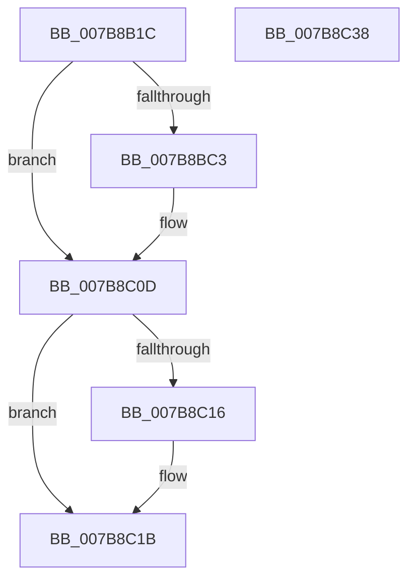

# EtwpUpdateFileInfoDriverRegistration

- RVA: `0x007B8B1C`–`0x007B8C39` (길이 `285` bytes)
- VA: `0x00000001407B8B1C`
- 실행 섹션: `PAGE`
- PDB 이름 있음: `예`; PDB Function 태그: `아니요`
- unwind 정보 RVA: `0x000D3768`
- 디코드: `71`개 명령, `285/285` bytes 표시
- 미해석 바이트: `0` (있으면 어셈블리에 `.byte`로 보존)

> 이 문서는 커널 이미지의 기계어와 PDB 기호를 분석해 생성했습니다. 4번과 5번은 함수 원형과 자료형을 바이너리 사용 방식에서 추정한 C 해석이며 원본 소스 복구 결과는 아닙니다.

## 1. Dependencies

- 직접 호출 지점: **7**; 고유 호출 대상: **7**
- 직접 호출자로 확인된 함수: **3**
- RIP 상대 이미지 참조: **1**

### Outgoing calls
- `0x007B8B54` → [HalAdjustResourceList](../../text/48/HalAdjustResourceList_function_0048FDC0.md) (function, `0x0048FDC0`)
- `0x007B8B5C` → [PsAttachSiloToCurrentThread](../../text/44/PsAttachSiloToCurrentThread_function_004428C0.md) (function, `0x004428C0`)
- `0x007B8B6F` → [RtlInitUnicodeString](../../text/42/RtlInitUnicodeString_function_0042A780.md) (function, `0x0042A780`)
- `0x007B8BB8` → [ZwOpenFile](../../text/6A/ZwOpenFile_function_006AD730.md) (function, `0x006AD730`)
- `0x007B8C06` → [ZwDeviceIoControlFile](../../text/6A/ZwDeviceIoControlFile_function_006AD1B0.md) (function, `0x006AD1B0`)
- `0x007B8C16` → [ZwClose](../../text/6A/ZwClose_function_006AD2B0.md) (function, `0x006AD2B0`)
- `0x007B8C1E` → [PsDetachSiloFromCurrentThread](../../text/44/PsDetachSiloFromCurrentThread_function_00449AC0.md) (function, `0x00449AC0`)

### Direct callers
- [EtwpDisableKernelTrace](../A4/EtwpDisableKernelTrace_function_00A4F7D8.md) at `0x00A4FB97`
- [EtwpUpdateFileInfoDriverState](../A5/EtwpUpdateFileInfoDriverState_function_00A501BC.md) at `0x00A501F8`
- [sub_00B3C5FE](../B3/Unknown_function_00B3C5FE.md) at `0x00B3C608`

### Static image references
- `0x007B8B61` → RVA `0x00B075F0` (` ?? ::NNGAKEGL::`string'`; read)

## 2. Other-region calls and transfers

- 다른 실행 섹션으로 향하는 call: **7**
  - `0x007B8B54` → [HalAdjustResourceList](../../text/48/HalAdjustResourceList_function_0048FDC0.md) (`PAGE` → `.text`)
  - `0x007B8B5C` → [PsAttachSiloToCurrentThread](../../text/44/PsAttachSiloToCurrentThread_function_004428C0.md) (`PAGE` → `.text`)
  - `0x007B8B6F` → [RtlInitUnicodeString](../../text/42/RtlInitUnicodeString_function_0042A780.md) (`PAGE` → `.text`)
  - `0x007B8BB8` → [ZwOpenFile](../../text/6A/ZwOpenFile_function_006AD730.md) (`PAGE` → `.text`)
  - `0x007B8C06` → [ZwDeviceIoControlFile](../../text/6A/ZwDeviceIoControlFile_function_006AD1B0.md) (`PAGE` → `.text`)
  - `0x007B8C16` → [ZwClose](../../text/6A/ZwClose_function_006AD2B0.md) (`PAGE` → `.text`)
  - `0x007B8C1E` → [PsDetachSiloFromCurrentThread](../../text/44/PsDetachSiloFromCurrentThread_function_00449AC0.md) (`PAGE` → `.text`)
- 별도 외부 분기/꼬리 이동을 확인하지 못했습니다.

## 3. Assembly (complete function range)

```asm
007B8B1C  48 89 5C 24 08                  mov qword ptr [rsp + 8], rbx
007B8B21  55                              push rbp
007B8B22  56                              push rsi
007B8B23  57                              push rdi
007B8B24  48 8D 6C 24 B9                  lea rbp, [rsp - 0x47]
007B8B29  48 81 EC A0 00 00 00            sub rsp, 0xa0
007B8B30  48 83 65 6F 00                  and qword ptr [rbp + 0x6f], 0
007B8B35  33 C0                           xor eax, eax
007B8B37  21 45 33                        and dword ptr [rbp + 0x33], eax
007B8B3A  0F 57 C0                        xorps xmm0, xmm0
007B8B3D  48 21 45 77                     and qword ptr [rbp + 0x77], rax
007B8B41  0F 57 C9                        xorps xmm1, xmm1
007B8B44  89 45 1B                        mov dword ptr [rbp + 0x1b], eax
007B8B47  8B F1                           mov esi, ecx
007B8B49  21 45 1B                        and dword ptr [rbp + 0x1b], eax
007B8B4C  0F 11 45 07                     movups xmmword ptr [rbp + 7], xmm0
007B8B50  0F 11 4D F7                     movups xmmword ptr [rbp - 9], xmm1
007B8B54  E8 67 72 CD FF                  call 0x14048fdc0
007B8B59  48 8B C8                        mov rcx, rax
007B8B5C  E8 5F 9D C8 FF                  call 0x1404428c0
007B8B61  48 8D 15 88 EA 34 00            lea rdx, [rip + 0x34ea88]
007B8B68  48 8B F8                        mov rdi, rax
007B8B6B  48 8D 4D F7                     lea rcx, [rbp - 9]
007B8B6F  E8 0C 1C C7 FF                  call 0x14042a780
007B8B74  48 83 65 1F 00                  and qword ptr [rbp + 0x1f], 0
007B8B79  48 8D 45 F7                     lea rax, [rbp - 9]
007B8B7D  0F 57 C0                        xorps xmm0, xmm0
007B8B80  C7 44 24 28 20 00 00 00         mov dword ptr [rsp + 0x28], 0x20
007B8B88  4C 8D 4D 07                     lea r9, [rbp + 7]
007B8B8C  48 89 45 27                     mov qword ptr [rbp + 0x27], rax
007B8B90  4C 8D 45 17                     lea r8, [rbp + 0x17]
007B8B94  C7 45 17 30 00 00 00            mov dword ptr [rbp + 0x17], 0x30
007B8B9B  BA 89 00 12 00                  mov edx, 0x120089
007B8BA0  C7 45 2F 40 02 00 00            mov dword ptr [rbp + 0x2f], 0x240
007B8BA7  48 8D 4D 77                     lea rcx, [rbp + 0x77]
007B8BAB  C7 44 24 20 07 00 00 00         mov dword ptr [rsp + 0x20], 7
007B8BB3  F3 0F 7F 45 37                  movdqu xmmword ptr [rbp + 0x37], xmm0
007B8BB8  E8 73 4B EF FF                  call 0x1406ad730
007B8BBD  8B D8                           mov ebx, eax
007B8BBF  85 C0                           test eax, eax
007B8BC1  78 4A                           js 0x1407b8c0d
007B8BC3  83 64 24 48 00                  and dword ptr [rsp + 0x48], 0
007B8BC8  48 8D 45 6F                     lea rax, [rbp + 0x6f]
007B8BCC  48 83 64 24 40 00               and qword ptr [rsp + 0x40], 0
007B8BD2  45 33 C9                        xor r9d, r9d
007B8BD5  48 8B 4D 77                     mov rcx, qword ptr [rbp + 0x77]
007B8BD9  45 33 C0                        xor r8d, r8d
007B8BDC  C7 44 24 38 08 00 00 00         mov dword ptr [rsp + 0x38], 8
007B8BE4  33 D2                           xor edx, edx
007B8BE6  48 89 44 24 30                  mov qword ptr [rsp + 0x30], rax
007B8BEB  48 8D 45 07                     lea rax, [rbp + 7]
007B8BEF  C7 44 24 28 20 00 22 00         mov dword ptr [rsp + 0x28], 0x220020
007B8BF7  48 89 44 24 20                  mov qword ptr [rsp + 0x20], rax
007B8BFC  C7 45 6F 01 00 00 00            mov dword ptr [rbp + 0x6f], 1
007B8C03  89 75 73                        mov dword ptr [rbp + 0x73], esi
007B8C06  E8 A5 45 EF FF                  call 0x1406ad1b0
007B8C0B  8B D8                           mov ebx, eax
007B8C0D  48 8B 4D 77                     mov rcx, qword ptr [rbp + 0x77]
007B8C11  48 85 C9                        test rcx, rcx
007B8C14  74 05                           je 0x1407b8c1b
007B8C16  E8 95 46 EF FF                  call 0x1406ad2b0
007B8C1B  48 8B CF                        mov rcx, rdi
007B8C1E  E8 9D 0E C9 FF                  call 0x140449ac0
007B8C23  8B C3                           mov eax, ebx
007B8C25  48 8B 9C 24 C0 00 00 00         mov rbx, qword ptr [rsp + 0xc0]
007B8C2D  48 81 C4 A0 00 00 00            add rsp, 0xa0
007B8C34  5F                              pop rdi
007B8C35  5E                              pop rsi
007B8C36  5D                              pop rbp
007B8C37  C3                              ret
007B8C38  CC                              int3
```

## 4. C-style interpretation (structured pseudocode)

```c
__int64 __fastcall EtwpUpdateFileInfoDriverRegistration(int a1)
{
    __int64 result;
    __int64 v_rbx;
    __int64 v_rsp;
    unsigned __int64 v_stack_m28;
    unsigned int v_stack_m2C;
    unsigned int v_stack_m30;
    unsigned __int64 v_stack_m38;
    unsigned __int64 v_stack_m40;
    unsigned int v_stack_m44;
    unsigned __int64 v_stack_m48;
    unsigned __int64 v_stack_m58;
    unsigned __int64 v_stack_m5F;
    unsigned __int64 v_stack_m68;
    unsigned int v_stack_m70;
    unsigned __int64 v_stack_m78;
    unsigned int v_stack_m80;
    unsigned __int64 v_stack_m88;
    unsigned int v_stack_m90;
    unsigned int v_stack_m98;
    unsigned __int64 v_stack_p10;
    unsigned int v_stack_p14;
    unsigned __int64 v_stack_p18;
    unsigned __int64 v_stack_p8;

    v_stack_p8 = v_rbx;
    v_rsp = (v_rsp) - (160);
    result = 0;
    v_stack_m44 = 0;
    v_stack_m58 = v_xmm0;
    v_stack_m68 = v_xmm1;
    result = HalAdjustResourceList(a1, a2, a3, a4);
    result = PsAttachSiloToCurrentThread(result, a2, a3, a4);
    result = RtlInitUnicodeString(v_stack_m68, v_rip + 3467912, a3, a4);
    v_stack_m90 = 32;
    v_stack_m38 = v_stack_m68;
    v_stack_m48 = 48;
    v_stack_m30 = 576;
    v_stack_m98 = 7;
    v_stack_m28 = v_xmm0;
    result = ZwOpenFile(v_stack_p18, (unsigned int)(0x120089ULL), v_stack_m48, v_stack_m58);
    v_rbx = (unsigned int)((unsigned int)(result));
    if (!(sign_flag)) {
        result = v_stack_p10;
        a4 = 0;
        a1 = v_stack_p18;
        a3 = 0;
        v_stack_m80 = 8;
        a2 = 0;
        v_stack_m88 = result;
        result = v_stack_m58;
        v_stack_m90 = 0x220020ULL;
        v_stack_m98 = result;
        v_stack_p10 = 1;
        v_stack_p14 = (unsigned int)((unsigned int)(a1));
        result = ZwDeviceIoControlFile(a1, a2, a3, a4);
        v_rbx = (unsigned int)(result);
    }
    if (v_stack_p18 != 0) {
        result = ZwClose(v_stack_p18, a2, a3, a4);
    }
    result = PsDetachSiloFromCurrentThread(result, a2, a3, a4);
    v_rsp = (v_rsp) + (160);
    return (unsigned int)((unsigned int)(v_rbx));
}
```

## 5. (Beta) C Style

```c
int64_t EtwpUpdateFileInfoDriverRegistration(int32_t Arg1)
{
    int64_t result;
    int64_t local_rbx;
    int64_t local_rsp;
    uint64_t v_stack_m28;
    uint32_t v_stack_m2C;
    uint32_t v_stack_m30;
    uint64_t v_stack_m38;
    uint64_t v_stack_m40;
    uint32_t v_stack_m44;
    uint64_t v_stack_m48;
    uint64_t v_stack_m58;
    uint64_t v_stack_m5F;
    uint64_t v_stack_m68;
    uint32_t v_stack_m70;
    uint64_t v_stack_m78;
    uint32_t v_stack_m80;
    uint64_t v_stack_m88;
    uint32_t v_stack_m90;
    uint32_t v_stack_m98;
    uint64_t v_stack_p10;
    uint32_t v_stack_p14;
    uint64_t v_stack_p18;
    uint64_t v_stack_p8;

    v_stack_p8 = local_rbx;
    local_rsp = (local_rsp) - (160);
    result = 0;
    v_stack_m44 = 0;
    v_stack_m58 = v_xmm0;
    v_stack_m68 = v_xmm1;
    result = HalAdjustResourceList(Arg1, a2, a3, a4);
    result = PsAttachSiloToCurrentThread(result, a2, a3, a4);
    result = RtlInitUnicodeString(v_stack_m68, v_rip + 3467912, a3, a4);
    v_stack_m90 = 32;
    v_stack_m38 = v_stack_m68;
    v_stack_m48 = 48;
    v_stack_m30 = 576;
    v_stack_m98 = 7;
    v_stack_m28 = v_xmm0;
    result = ZwOpenFile(v_stack_p18, (uint32_t)(0x120089ULL), v_stack_m48, v_stack_m58);
    local_rbx = (uint32_t)((uint32_t)(result));
    if (!(sign_flag)) {
        result = v_stack_p10;
        a4 = 0;
        Arg1 = v_stack_p18;
        a3 = 0;
        v_stack_m80 = 8;
        a2 = 0;
        v_stack_m88 = result;
        result = v_stack_m58;
        v_stack_m90 = 0x220020ULL;
        v_stack_m98 = result;
        v_stack_p10 = 1;
        v_stack_p14 = (uint32_t)((uint32_t)(Arg1));
        result = ZwDeviceIoControlFile(Arg1, a2, a3, a4);
        local_rbx = (uint32_t)(result);
    }
    if (v_stack_p18 != 0) {
        result = ZwClose(v_stack_p18, a2, a3, a4);
    }
    result = PsDetachSiloFromCurrentThread(result, a2, a3, a4);
    local_rsp = (local_rsp) + (160);
    return (uint32_t)((uint32_t)(local_rbx));
}
```

## 6. Execution-region graph

[열기: 2D/3D 그래프와 함수 탐색 컨트롤 패널](../../../control-panel.html?section=page&rva=0x007B8B1C&view=graph)

- 2D 그래프는 위에서 아래로 흐르고, 3D 그래프는 빈 공간을 드래그해 회전합니다. Shift+드래그는 이동, 휠은 확대·축소, 함수 노드 선택은 대상 보고서 이동입니다.

### Static fallback


