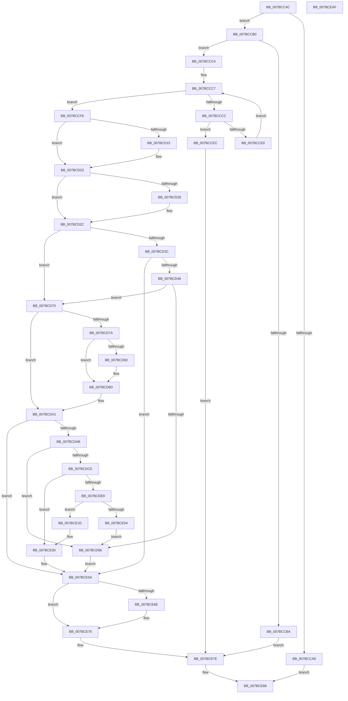

# EtwpUpdatePeriodicCaptureState

- RVA: `0x007BCC4C`–`0x007BCEB0` (길이 `612` bytes)
- VA: `0x00000001407BCC4C`
- 실행 섹션: `PAGE`
- PDB 이름 있음: `예`; PDB Function 태그: `아니요`
- unwind 정보 RVA: `0x000D3C0C`
- 디코드: `166`개 명령, `612/612` bytes 표시
- 미해석 바이트: `0` (있으면 어셈블리에 `.byte`로 보존)

> 이 문서는 커널 이미지의 기계어와 PDB 기호를 분석해 생성했습니다. 4번과 5번은 함수 원형과 자료형을 바이너리 사용 방식에서 추정한 C 해석이며 원본 소스 복구 결과는 아닙니다.

## 1. Dependencies

- 직접 호출 지점: **17**; 고유 호출 대상: **15**
- 직접 호출자로 확인된 함수: **1**
- RIP 상대 이미지 참조: **3**

### Outgoing calls
- `0x007BCC8A` → [PsGetCurrentServerSiloGlobals](../../text/2F/PsGetCurrentServerSiloGlobals_function_002FE1F0.md) (function, `0x002FE1F0`)
- `0x007BCC99` → [EtwpAcquireLoggerContextByLoggerId](../93/EtwpAcquireLoggerContextByLoggerId_function_00932920.md) (function, `0x00932920`)
- `0x007BCCDD` → [EtwpCheckNotificationAccess](../8C/EtwpCheckNotificationAccess_function_008C770C.md) (function, `0x008C770C`)
- `0x007BCD05` → [KeAbPreAcquire](../../text/21/KeAbPreAcquire_function_00210230.md) (function, `0x00210230`)
- `0x007BCD1E` → [ExfAcquirePushLockExclusiveEx](../../text/20/ExfAcquirePushLockExclusiveEx_function_0020FC90.md) (function, `0x0020FC90`)
- `0x007BCD52` → [ExAllocatePool2](../../poolcode/B8/ExAllocatePool2_function_00B820F0.md) (function, `0x00B820F0`)
- `0x007BCD84` → [ExCancelTimer](../../text/3A/ExCancelTimer_function_003A01A0.md) (function, `0x003A01A0`)
- `0x007BCD93` → [ExFreePoolWithTag](../../poolcode/B8/ExFreePoolWithTag_function_00B82870.md) (function, `0x00B82870`)
- `0x007BCDC0` → [ExAllocatePool2](../../poolcode/B8/ExAllocatePool2_function_00B820F0.md) (function, `0x00B820F0`)
- `0x007BCDDC` → [memcpy](../../text/6C/memcpy_function_006C6840.md) (function, `0x006C6840`)
- `0x007BCDF7` → [ExAllocateTimer](../../text/3A/ExAllocateTimer_function_003A30D0.md) (function, `0x003A30D0`)
- `0x007BCE0A` → [ExFreePoolWithTag](../../poolcode/B8/ExFreePoolWithTag_function_00B82870.md) (function, `0x00B82870`)
- `0x007BCE4E` → [ExSetTimer](../../text/3A/ExSetTimer_function_003A0800.md) (function, `0x003A0800`)
- `0x007BCE71` → [ExfTryToWakePushLock](../../text/26/ExfTryToWakePushLock_function_00265DD0.md) (function, `0x00265DD0`)
- `0x007BCE79` → [KeAbPostRelease](../../text/2E/KeAbPostRelease_function_002E1600.md) (function, `0x002E1600`)
- `0x007BCE83` → [EtwpReleaseLoggerContext](../A0/EtwpReleaseLoggerContext_function_00A04160.md) (function, `0x00A04160`)
- `0x007BCE92` → [_security_check_cookie](../../text/6A/_security_check_cookie_function_006AC640.md) (function, `0x006AC640`)

### Direct callers
- [NtTraceControl](../A9/NtTraceControl_function_00A9ED40.md) at `0x00A9F63A`

### Static image references
- `0x007BCC60` → RVA `0x00E0A740` (`.data`; read)
- `0x007BCDF0` → RVA `0x007BCEC0` (`PeriodicCaptureStateTimerCallback`; read)
- `0x007BCE1D` → RVA `0x007BCF30` (`SendCaptureStateNotificationsWorker`; read)

## 2. Other-region calls and transfers

- 다른 실행 섹션으로 향하는 call: **14**
  - `0x007BCC8A` → [PsGetCurrentServerSiloGlobals](../../text/2F/PsGetCurrentServerSiloGlobals_function_002FE1F0.md) (`PAGE` → `.text`)
  - `0x007BCD05` → [KeAbPreAcquire](../../text/21/KeAbPreAcquire_function_00210230.md) (`PAGE` → `.text`)
  - `0x007BCD1E` → [ExfAcquirePushLockExclusiveEx](../../text/20/ExfAcquirePushLockExclusiveEx_function_0020FC90.md) (`PAGE` → `.text`)
  - `0x007BCD52` → [ExAllocatePool2](../../poolcode/B8/ExAllocatePool2_function_00B820F0.md) (`PAGE` → `POOLCODE`)
  - `0x007BCD84` → [ExCancelTimer](../../text/3A/ExCancelTimer_function_003A01A0.md) (`PAGE` → `.text`)
  - `0x007BCD93` → [ExFreePoolWithTag](../../poolcode/B8/ExFreePoolWithTag_function_00B82870.md) (`PAGE` → `POOLCODE`)
  - `0x007BCDC0` → [ExAllocatePool2](../../poolcode/B8/ExAllocatePool2_function_00B820F0.md) (`PAGE` → `POOLCODE`)
  - `0x007BCDDC` → [memcpy](../../text/6C/memcpy_function_006C6840.md) (`PAGE` → `.text`)
  - `0x007BCDF7` → [ExAllocateTimer](../../text/3A/ExAllocateTimer_function_003A30D0.md) (`PAGE` → `.text`)
  - `0x007BCE0A` → [ExFreePoolWithTag](../../poolcode/B8/ExFreePoolWithTag_function_00B82870.md) (`PAGE` → `POOLCODE`)
  - `0x007BCE4E` → [ExSetTimer](../../text/3A/ExSetTimer_function_003A0800.md) (`PAGE` → `.text`)
  - `0x007BCE71` → [ExfTryToWakePushLock](../../text/26/ExfTryToWakePushLock_function_00265DD0.md) (`PAGE` → `.text`)
  - `0x007BCE79` → [KeAbPostRelease](../../text/2E/KeAbPostRelease_function_002E1600.md) (`PAGE` → `.text`)
  - `0x007BCE92` → [_security_check_cookie](../../text/6A/_security_check_cookie_function_006AC640.md) (`PAGE` → `.text`)
- 별도 외부 분기/꼬리 이동을 확인하지 못했습니다.

## 3. Assembly (complete function range)

```asm
007BCC4C  48 89 5C 24 10                  mov qword ptr [rsp + 0x10], rbx
007BCC51  55                              push rbp
007BCC52  56                              push rsi
007BCC53  57                              push rdi
007BCC54  41 54                           push r12
007BCC56  41 55                           push r13
007BCC58  41 56                           push r14
007BCC5A  41 57                           push r15
007BCC5C  48 83 EC 40                     sub rsp, 0x40
007BCC60  48 8B 05 D9 DA 64 00            mov rax, qword ptr [rip + 0x64dad9]
007BCC67  48 33 C4                        xor rax, rsp
007BCC6A  48 89 44 24 38                  mov qword ptr [rsp + 0x38], rax
007BCC6F  0F 57 C0                        xorps xmm0, xmm0
007BCC72  89 54 24 20                     mov dword ptr [rsp + 0x20], edx
007BCC76  45 33 E4                        xor r12d, r12d
007BCC79  45 0F B7 F8                     movzx r15d, r8w
007BCC7D  0F 11 44 24 28                  movups xmmword ptr [rsp + 0x28], xmm0
007BCC82  41 8B F4                        mov esi, r12d
007BCC85  4D 8B E9                        mov r13, r9
007BCC88  8B D1                           mov edx, ecx
007BCC8A  E8 61 15 B4 FF                  call 0x1402fe1f0
007BCC8F  45 33 C0                        xor r8d, r8d
007BCC92  48 8B 88 40 03 00 00            mov rcx, qword ptr [rax + 0x340]
007BCC99  E8 82 5C 17 00                  call 0x140932920
007BCC9E  48 8B E8                        mov rbp, rax
007BCCA1  48 85 C0                        test rax, rax
007BCCA4  75 0A                           jne 0x1407bccb0
007BCCA6  BE 0D 00 00 C0                  mov esi, 0xc000000d
007BCCAB  E9 D8 01 00 00                  jmp 0x1407bce88
007BCCB0  8B 80 30 03 00 00               mov eax, dword ptr [rax + 0x330]
007BCCB6  A8 40                           test al, 0x40
007BCCB8  74 0A                           je 0x1407bccc4
007BCCBA  BE 96 02 00 C0                  mov esi, 0xc0000296
007BCCBF  E9 BA 01 00 00                  jmp 0x1407bce7e
007BCCC4  41 8B DC                        mov ebx, r12d
007BCCC7  41 3B DF                        cmp ebx, r15d
007BCCCA  7D 2A                           jge 0x1407bccf6
007BCCCC  48 63 CB                        movsxd rcx, ebx
007BCCCF  48 8D 95 14 01 00 00            lea rdx, [rbp + 0x114]
007BCCD6  48 C1 E1 04                     shl rcx, 4
007BCCDA  49 03 CD                        add rcx, r13
007BCCDD  E8 2A AA 10 00                  call 0x1408c770c
007BCCE2  8B F0                           mov esi, eax
007BCCE4  85 C0                           test eax, eax
007BCCE6  78 04                           js 0x1407bccec
007BCCE8  FF C3                           inc ebx
007BCCEA  EB DB                           jmp 0x1407bccc7
007BCCEC  BE 22 00 00 C0                  mov esi, 0xc0000022
007BCCF1  E9 88 01 00 00                  jmp 0x1407bce7e
007BCCF6  48 8D 9D B0 02 00 00            lea rbx, [rbp + 0x2b0]
007BCCFD  45 33 C0                        xor r8d, r8d
007BCD00  48 8B CB                        mov rcx, rbx
007BCD03  33 D2                           xor edx, edx
007BCD05  E8 26 35 A5 FF                  call 0x140210230
007BCD0A  F0 48 0F BA 2B 00               lock bts qword ptr [rbx], 0
007BCD10  48 8B F8                        mov rdi, rax
007BCD13  73 0E                           jae 0x1407bcd23
007BCD15  4C 8B C3                        mov r8, rbx
007BCD18  48 8B D0                        mov rdx, rax
007BCD1B  48 8B CB                        mov rcx, rbx
007BCD1E  E8 6D 2F A5 FF                  call 0x14020fc90
007BCD23  48 85 FF                        test rdi, rdi
007BCD26  74 04                           je 0x1407bcd2c
007BCD28  C6 47 0A 01                     mov byte ptr [rdi + 0xa], 1
007BCD2C  48 8B BD 40 05 00 00            mov rdi, qword ptr [rbp + 0x540]
007BCD33  48 83 CB FF                     or rbx, 0xffffffffffffffff
007BCD37  48 85 FF                        test rdi, rdi
007BCD3A  75 34                           jne 0x1407bcd70
007BCD3C  66 45 85 FF                     test r15w, r15w
007BCD40  0F 84 14 01 00 00               je 0x1407bce5a
007BCD46  8D 57 48                        lea edx, [rdi + 0x48]
007BCD49  41 B8 45 74 77 55               mov r8d, 0x55777445
007BCD4F  8D 4F 40                        lea ecx, [rdi + 0x40]
007BCD52  E8 99 53 3C 00                  call 0x140b820f0
007BCD57  48 89 85 40 05 00 00            mov qword ptr [rbp + 0x540], rax
007BCD5E  48 8B F8                        mov rdi, rax
007BCD61  48 85 C0                        test rax, rax
007BCD64  75 0A                           jne 0x1407bcd70
007BCD66  BE 17 00 00 C0                  mov esi, 0xc0000017
007BCD6B  E9 EA 00 00 00                  jmp 0x1407bce5a
007BCD70  4C 8D 77 08                     lea r14, [rdi + 8]
007BCD74  4C 39 67 18                     cmp qword ptr [rdi + 0x18], r12
007BCD78  74 27                           je 0x1407bcda1
007BCD7A  49 8B 0E                        mov rcx, qword ptr [r14]
007BCD7D  48 85 C9                        test rcx, rcx
007BCD80  74 0B                           je 0x1407bcd8d
007BCD82  33 D2                           xor edx, edx
007BCD84  E8 17 34 BE FF                  call 0x1403a01a0
007BCD89  44 89 67 40                     mov dword ptr [rdi + 0x40], r12d
007BCD8D  48 8B 4F 18                     mov rcx, qword ptr [rdi + 0x18]
007BCD91  33 D2                           xor edx, edx
007BCD93  E8 D8 5A 3C 00                  call 0x140b82870
007BCD98  4C 89 67 18                     mov qword ptr [rdi + 0x18], r12
007BCD9C  66 44 89 67 10                  mov word ptr [rdi + 0x10], r12w
007BCDA1  66 45 85 FF                     test r15w, r15w
007BCDA5  0F 84 AF 00 00 00               je 0x1407bce5a
007BCDAB  4D 8B E7                        mov r12, r15
007BCDAE  41 B8 45 74 77 55               mov r8d, 0x55777445
007BCDB4  49 C1 E4 04                     shl r12, 4
007BCDB8  B9 00 01 00 00                  mov ecx, 0x100
007BCDBD  49 8B D4                        mov rdx, r12
007BCDC0  E8 2B 53 3C 00                  call 0x140b820f0
007BCDC5  48 89 47 18                     mov qword ptr [rdi + 0x18], rax
007BCDC9  48 85 C0                        test rax, rax
007BCDCC  74 98                           je 0x1407bcd66
007BCDCE  4D 8B C4                        mov r8, r12
007BCDD1  66 44 89 7F 10                  mov word ptr [rdi + 0x10], r15w
007BCDD6  49 8B D5                        mov rdx, r13
007BCDD9  48 8B C8                        mov rcx, rax
007BCDDC  E8 5F 9A F0 FF                  call 0x1406c6840
007BCDE1  45 33 FF                        xor r15d, r15d
007BCDE4  4D 39 3E                        cmp qword ptr [r14], r15
007BCDE7  75 47                           jne 0x1407bce30
007BCDE9  45 8D 47 08                     lea r8d, [r15 + 8]
007BCDED  48 8B D5                        mov rdx, rbp
007BCDF0  48 8D 0D C9 00 00 00            lea rcx, [rip + 0xc9]
007BCDF7  E8 D4 62 BE FF                  call 0x1403a30d0
007BCDFC  49 89 06                        mov qword ptr [r14], rax
007BCDFF  48 85 C0                        test rax, rax
007BCE02  75 19                           jne 0x1407bce1d
007BCE04  48 8B 4F 18                     mov rcx, qword ptr [rdi + 0x18]
007BCE08  33 D2                           xor edx, edx
007BCE0A  E8 61 5A 3C 00                  call 0x140b82870
007BCE0F  4C 89 7F 18                     mov qword ptr [rdi + 0x18], r15
007BCE13  66 44 89 7F 10                  mov word ptr [rdi + 0x10], r15w
007BCE18  E9 49 FF FF FF                  jmp 0x1407bcd66
007BCE1D  48 8D 05 0C 01 00 00            lea rax, [rip + 0x10c]
007BCE24  48 89 6F 38                     mov qword ptr [rdi + 0x38], rbp
007BCE28  48 89 47 30                     mov qword ptr [rdi + 0x30], rax
007BCE2C  4C 89 7F 20                     mov qword ptr [rdi + 0x20], r15
007BCE30  8B 44 24 20                     mov eax, dword ptr [rsp + 0x20]
007BCE34  4C 8D 4C 24 28                  lea r9, [rsp + 0x28]
007BCE39  48 89 5C 24 30                  mov qword ptr [rsp + 0x30], rbx
007BCE3E  45 33 C0                        xor r8d, r8d
007BCE41  49 8B 0E                        mov rcx, qword ptr [r14]
007BCE44  48 69 D0 80 69 67 FF            imul rdx, rax, -0x989680
007BCE4B  48 89 17                        mov qword ptr [rdi], rdx
007BCE4E  E8 AD 39 BE FF                  call 0x1403a0800
007BCE53  C7 47 40 01 00 00 00            mov dword ptr [rdi + 0x40], 1
007BCE5A  48 8D BD B0 02 00 00            lea rdi, [rbp + 0x2b0]
007BCE61  F0 48 0F C1 1F                  lock xadd qword ptr [rdi], rbx
007BCE66  80 E3 06                        and bl, 6
007BCE69  80 FB 02                        cmp bl, 2
007BCE6C  75 08                           jne 0x1407bce76
007BCE6E  48 8B CF                        mov rcx, rdi
007BCE71  E8 5A 8F AA FF                  call 0x140265dd0
007BCE76  48 8B CF                        mov rcx, rdi
007BCE79  E8 82 47 B2 FF                  call 0x1402e1600
007BCE7E  33 D2                           xor edx, edx
007BCE80  48 8B CD                        mov rcx, rbp
007BCE83  E8 D8 72 24 00                  call 0x140a04160
007BCE88  8B C6                           mov eax, esi
007BCE8A  48 8B 4C 24 38                  mov rcx, qword ptr [rsp + 0x38]
007BCE8F  48 33 CC                        xor rcx, rsp
007BCE92  E8 A9 F7 EE FF                  call 0x1406ac640
007BCE97  48 8B 9C 24 88 00 00 00         mov rbx, qword ptr [rsp + 0x88]
007BCE9F  48 83 C4 40                     add rsp, 0x40
007BCEA3  41 5F                           pop r15
007BCEA5  41 5E                           pop r14
007BCEA7  41 5D                           pop r13
007BCEA9  41 5C                           pop r12
007BCEAB  5F                              pop rdi
007BCEAC  5E                              pop rsi
007BCEAD  5D                              pop rbp
007BCEAE  C3                              ret
007BCEAF  CC                              int3
```

## 4. C-style interpretation (structured pseudocode)

```c
__int64 __fastcall EtwpUpdatePeriodicCaptureState(int a1, int a2, int a3, __int64 a4)
{
    __int64 result;
    __int64 v_r12;
    __int64 v_r15;
    __int64 v_rbx;
    __int64 v_rsp;
    unsigned __int64 v_stack_m40;
    unsigned __int64 v_stack_m48;
    unsigned __int64 v_stack_m50;
    unsigned int v_stack_m58;
    unsigned __int64 v_stack_p10;

    v_stack_p10 = v_rbx;
    v_rsp = (v_rsp) - (64);
    result = (*(unsigned __int64 *)(v_rip + 6609625)) ^ (v_rsp);
    v_stack_m40 = result;
    v_stack_m58 = a2;
    v_r12 = 0;
    v_stack_m50 = v_xmm0;
    result = PsGetCurrentServerSiloGlobals(a1, (unsigned int)(a1), a3, a4);
    a3 = 0;
    result = EtwpAcquireLoggerContextByLoggerId(*(unsigned __int64 *)(result + 832), (unsigned int)(a1), a3, a4);
    if (result != 0) goto loc_007BCCB0;
    goto loc_007BCE88;
loc_007BCCB0:
    if ((((unsigned __int8)((unsigned int)(*(unsigned int *)(result + 816)))) & (64)) == 0) goto loc_007BCCC4;
    goto loc_007BCE7E;
loc_007BCCC4:
loc_007BCCC7:
    if (0 >= ((unsigned int)((unsigned __int16)(a3)))) goto loc_007BCCF6;
    a1 = ((int)(0)) << (4);
    a1 = (a1) + (a4);
    result = EtwpCheckNotificationAccess(a1, result + 276, a3, a4);
    if (sign_flag) goto loc_007BCCEC;
    v_rbx = (unsigned int)((0) + 1);
    goto loc_007BCCC7;
loc_007BCCEC:
    goto loc_007BCE7E;
loc_007BCCF6:
    a3 = 0;
    a2 = 0;
    result = KeAbPreAcquire(result + 688, a2, a3, a4);
    if (!(condition_is_above_or_equal)) {
        a3 = result + 688;
        a2 = result;
        a1 = result + 688;
        result = ExfAcquirePushLockExclusiveEx(a1, a2, a3, a4);
    }
    if (result != 0) {
        *(unsigned __int8 *)(result + 10) = 1;
    }
    v_rbx = (result + 688) | (-1);
    if (*(unsigned __int64 *)(result + 1344) != 0) goto loc_007BCD70;
    if ((unsigned __int16)((unsigned __int16)(a3)) == 0) goto loc_007BCE5A;
    result = ExAllocatePool2(*(unsigned __int64 *)(result + 1344) + 64, *(unsigned __int64 *)(result + 1344) + 72, (unsigned int)(0x55777445ULL), a4);
    *(unsigned __int64 *)(result + 1344) = result;
    if (result != 0) goto loc_007BCD70;
loc_007BCD66:
    goto loc_007BCE5A;
loc_007BCD70:
    if ((*(unsigned __int64 *)(result + 24)) == 0) goto loc_007BCDA1;
    if (*(unsigned __int64 *)(result + 8) != 0) {
        a2 = 0;
        result = ExCancelTimer(*(unsigned __int64 *)(result + 8), a2, (unsigned int)(0x55777445ULL), a4);
        *(unsigned int *)(result + 64) = 0;
    }
    a2 = 0;
    result = ExFreePoolWithTag(*(unsigned __int64 *)(result + 24), a2, (unsigned int)(0x55777445ULL), a4);
    *(unsigned __int64 *)(result + 24) = 0;
    *(unsigned __int16 *)(result + 16) = 0;
loc_007BCDA1:
    if ((unsigned __int16)((unsigned __int16)(a3)) == 0) goto loc_007BCE5A;
    v_r12 = ((unsigned __int16)(a3)) << (4);
    result = ExAllocatePool2(256, v_r12, (unsigned int)(0x55777445ULL), a4);
    *(unsigned __int64 *)(result + 24) = result;
    if (result == 0) goto loc_007BCD66;
    *(unsigned __int16 *)(result + 16) = (unsigned __int16)((unsigned __int16)(a3));
    result = memcpy(result, a4, v_r12, a4);
    v_r15 = 0;
    if ((*(unsigned __int64 *)(result + 8)) != 0) goto loc_007BCE30;
    result = ExAllocateTimer(v_rip + 201, result, v_r15 + 8, a4);
    *(unsigned __int64 *)(result + 8) = result;
    if (result != 0) goto loc_007BCE1D;
    a2 = 0;
    result = ExFreePoolWithTag(*(unsigned __int64 *)(result + 24), a2, v_r15 + 8, a4);
    *(unsigned __int64 *)(result + 24) = 0;
    *(unsigned __int16 *)(result + 16) = 0;
    goto loc_007BCD66;
loc_007BCE1D:
    *(unsigned __int64 *)(result + 56) = result;
    *(unsigned __int64 *)(result + 48) = v_rip + 268;
    *(unsigned __int64 *)(result + 32) = 0;
loc_007BCE30:
    v_stack_m48 = v_rbx;
    a3 = 0;
    a2 = (a2) * ((unsigned int)(v_stack_m58));
    *(unsigned __int64 *)(result) = a2;
    result = ExSetTimer(*(unsigned __int64 *)(result + 8), a2, a3, v_stack_m50);
    *(unsigned int *)(result + 64) = 1;
loc_007BCE5A:
    v_rbx = (unsigned __int8)((v_rbx) & (6));
    if (((unsigned __int8)(v_rbx)) == 2) {
        a1 = result + 688;
        result = ExfTryToWakePushLock(a1, a2, a3, v_stack_m50);
    }
    result = KeAbPostRelease(result + 688, a2, a3, v_stack_m50);
loc_007BCE7E:
    a2 = 0;
    result = EtwpReleaseLoggerContext(result, a2, a3, v_stack_m50);
loc_007BCE88:
    a1 = (v_stack_m40) ^ (v_rsp);
    result = _security_check_cookie(a1, a2, a3, v_stack_m50);
    v_rsp = (v_rsp) + (64);
    return result;
}
```

## 5. (Beta) C Style

```c
int64_t EtwpUpdatePeriodicCaptureState(int32_t Arg1, int32_t Arg2, int32_t Arg3, int64_t Arg4)
{
    int64_t result;
    int64_t local_r12;
    int64_t local_r15;
    int64_t local_rbx;
    int64_t local_rsp;
    uint64_t v_stack_m40;
    uint64_t v_stack_m48;
    uint64_t v_stack_m50;
    uint32_t v_stack_m58;
    uint64_t v_stack_p10;

    v_stack_p10 = local_rbx;
    local_rsp = (local_rsp) - (64);
    result = (*(uint64_t *)(v_rip + 0x64DAD9)) ^ (local_rsp);
    v_stack_m40 = result;
    v_stack_m58 = Arg2;
    local_r12 = 0;
    v_stack_m50 = v_xmm0;
    result = PsGetCurrentServerSiloGlobals(Arg1, (uint32_t)(Arg1), Arg3, Arg4);
    Arg3 = 0;
    result = EtwpAcquireLoggerContextByLoggerId(*(uint64_t *)(result + 0x340), (uint32_t)(Arg1), Arg3, Arg4);
    if (result != 0) goto loc_007BCCB0;
    goto loc_007BCE88;
loc_007BCCB0:
    if ((((uint8_t)((uint32_t)(*(uint32_t *)(result + 0x330)))) & (64)) == 0) goto loc_007BCCC4;
    goto loc_007BCE7E;
loc_007BCCC4:
loc_007BCCC7:
    if (0 >= ((uint32_t)((uint16_t)(Arg3)))) goto loc_007BCCF6;
    Arg1 = ((int32_t)(0)) << (4);
    Arg1 = (Arg1) + (Arg4);
    result = EtwpCheckNotificationAccess(Arg1, result + 276, Arg3, Arg4);
    if (sign_flag) goto loc_007BCCEC;
    local_rbx = (uint32_t)((0) + 1);
    goto loc_007BCCC7;
loc_007BCCEC:
    goto loc_007BCE7E;
loc_007BCCF6:
    Arg3 = 0;
    Arg2 = 0;
    result = KeAbPreAcquire(result + 688, Arg2, Arg3, Arg4);
    if (!(condition_is_above_or_equal)) {
        Arg3 = result + 688;
        Arg2 = result;
        Arg1 = result + 688;
        result = ExfAcquirePushLockExclusiveEx(Arg1, Arg2, Arg3, Arg4);
    }
    if (result != 0) {
        *(uint8_t *)(result + 0xA) = 1;
    }
    local_rbx = (result + 688) | (-1);
    if (*(uint64_t *)(result + 0x540) != 0) goto loc_007BCD70;
    if ((uint16_t)((uint16_t)(Arg3)) == 0) goto loc_007BCE5A;
    result = ExAllocatePool2(*(uint64_t *)(result + 0x540) + 64, *(uint64_t *)(result + 0x540) + 72, (uint32_t)(0x55777445ULL), Arg4);
    *(uint64_t *)(result + 0x540) = result;
    if (result != 0) goto loc_007BCD70;
loc_007BCD66:
    goto loc_007BCE5A;
loc_007BCD70:
    if ((*(uint64_t *)(result + 0x18)) == 0) goto loc_007BCDA1;
    if (*(uint64_t *)(result + 0x8) != 0) {
        Arg2 = 0;
        result = ExCancelTimer(*(uint64_t *)(result + 0x8), Arg2, (uint32_t)(0x55777445ULL), Arg4);
        *(uint32_t *)(result + 0x40) = 0;
    }
    Arg2 = 0;
    result = ExFreePoolWithTag(*(uint64_t *)(result + 0x18), Arg2, (uint32_t)(0x55777445ULL), Arg4);
    *(uint64_t *)(result + 0x18) = 0;
    *(uint16_t *)(result + 0x10) = 0;
loc_007BCDA1:
    if ((uint16_t)((uint16_t)(Arg3)) == 0) goto loc_007BCE5A;
    local_r12 = ((uint16_t)(Arg3)) << (4);
    result = ExAllocatePool2(256, local_r12, (uint32_t)(0x55777445ULL), Arg4);
    *(uint64_t *)(result + 0x18) = result;
    if (result == 0) goto loc_007BCD66;
    *(uint16_t *)(result + 0x10) = (uint16_t)((uint16_t)(Arg3));
    result = memcpy(result, Arg4, local_r12, Arg4);
    local_r15 = 0;
    if ((*(uint64_t *)(result + 0x8)) != 0) goto loc_007BCE30;
    result = ExAllocateTimer(v_rip + 201, result, local_r15 + 8, Arg4);
    *(uint64_t *)(result + 0x8) = result;
    if (result != 0) goto loc_007BCE1D;
    Arg2 = 0;
    result = ExFreePoolWithTag(*(uint64_t *)(result + 0x18), Arg2, local_r15 + 8, Arg4);
    *(uint64_t *)(result + 0x18) = 0;
    *(uint16_t *)(result + 0x10) = 0;
    goto loc_007BCD66;
loc_007BCE1D:
    *(uint64_t *)(result + 0x38) = result;
    *(uint64_t *)(result + 0x30) = v_rip + 268;
    *(uint64_t *)(result + 0x20) = 0;
loc_007BCE30:
    v_stack_m48 = local_rbx;
    Arg3 = 0;
    Arg2 = (Arg2) * ((uint32_t)(v_stack_m58));
    *(uint64_t *)(result) = Arg2;
    result = ExSetTimer(*(uint64_t *)(result + 0x8), Arg2, Arg3, v_stack_m50);
    *(uint32_t *)(result + 0x40) = 1;
loc_007BCE5A:
    local_rbx = (uint8_t)((local_rbx) & (6));
    if (((uint8_t)(local_rbx)) == 2) {
        Arg1 = result + 688;
        result = ExfTryToWakePushLock(Arg1, Arg2, Arg3, v_stack_m50);
    }
    result = KeAbPostRelease(result + 688, Arg2, Arg3, v_stack_m50);
loc_007BCE7E:
    Arg2 = 0;
    result = EtwpReleaseLoggerContext(result, Arg2, Arg3, v_stack_m50);
loc_007BCE88:
    Arg1 = (v_stack_m40) ^ (local_rsp);
    result = _security_check_cookie(Arg1, Arg2, Arg3, v_stack_m50);
    local_rsp = (local_rsp) + (64);
    return result;
}
```

## 6. Execution-region graph

[열기: 2D/3D 그래프와 함수 탐색 컨트롤 패널](../../../control-panel.html?section=page&rva=0x007BCC4C&view=graph)

- 2D 그래프는 위에서 아래로 흐르고, 3D 그래프는 빈 공간을 드래그해 회전합니다. Shift+드래그는 이동, 휠은 확대·축소, 함수 노드 선택은 대상 보고서 이동입니다.

### Static fallback


