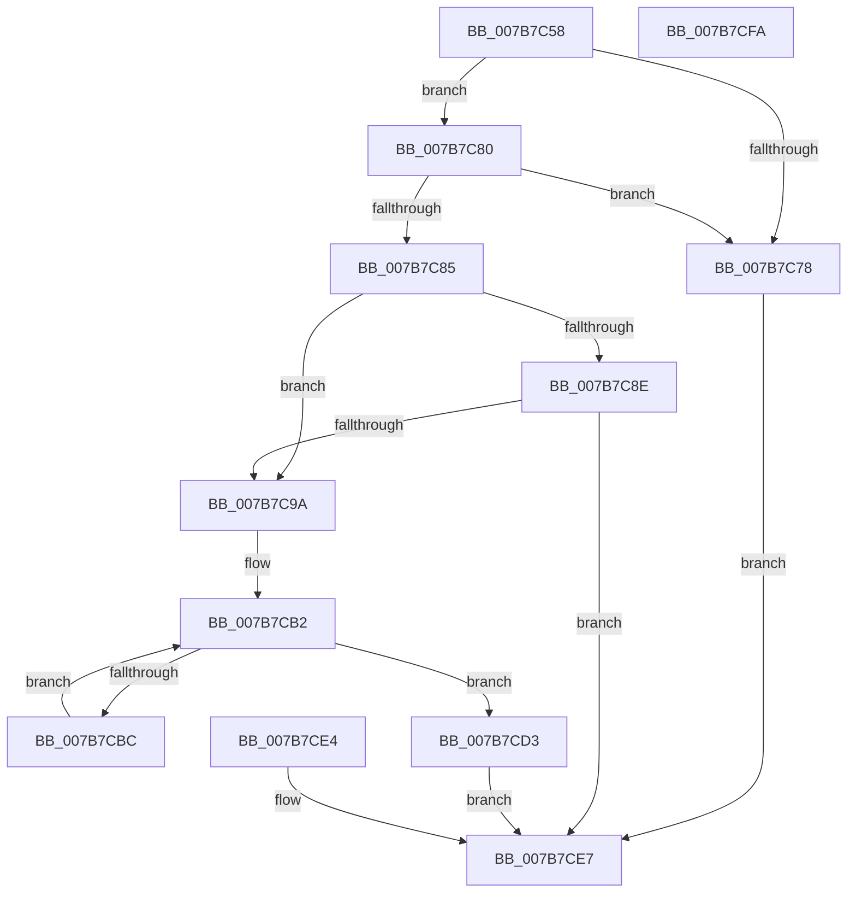

# EtwpUpdatePmcEvents

- RVA: `0x007B7C58`–`0x007B7CFB` (길이 `163` bytes)
- VA: `0x00000001407B7C58`
- 실행 섹션: `PAGE`
- PDB 이름 있음: `예`; PDB Function 태그: `아니요`
- unwind 정보 RVA: `0x000D34D4`
- 디코드: `46`개 명령, `163/163` bytes 표시
- 미해석 바이트: `0` (있으면 어셈블리에 `.byte`로 보존)

> 이 문서는 커널 이미지의 기계어와 PDB 기호를 분석해 생성했습니다. 4번과 5번은 함수 원형과 자료형을 바이너리 사용 방식에서 추정한 C 해석이며 원본 소스 복구 결과는 아닙니다.

## 1. Dependencies

- 직접 호출 지점: **1**; 고유 호출 대상: **1**
- 직접 호출자로 확인된 함수: **1**
- RIP 상대 이미지 참조: **0**

### Outgoing calls
- `0x007B7C8E` → [EtwpAllocatePmcData](EtwpAllocatePmcData_function_007B5944.md) (function, `0x007B5944`)

### Direct callers
- [sub_00B3C988](../B3/Unknown_function_00B3C988.md) at `0x00B3D460`

### Static image references
- 디코드된 RIP-relative 메모리 참조가 없습니다.

## 2. Other-region calls and transfers

- 다른 실행 섹션으로 향하는 call: **0**
- 별도 외부 분기/꼬리 이동을 확인하지 못했습니다.

## 3. Assembly (complete function range)

```asm
007B7C58  48 89 5C 24 08                  mov qword ptr [rsp + 8], rbx
007B7C5D  48 89 74 24 10                  mov qword ptr [rsp + 0x10], rsi
007B7C62  57                              push rdi
007B7C63  48 83 EC 30                     sub rsp, 0x30
007B7C67  41 8B F8                        mov edi, r8d
007B7C6A  48 8B F2                        mov rsi, rdx
007B7C6D  48 8B D9                        mov rbx, rcx
007B7C70  45 33 C9                        xor r9d, r9d
007B7C73  45 85 C0                        test r8d, r8d
007B7C76  75 08                           jne 0x1407b7c80
007B7C78  41 B9 0D 00 00 C0               mov r9d, 0xc000000d
007B7C7E  EB 67                           jmp 0x1407b7ce7
007B7C80  83 FF 04                        cmp edi, 4
007B7C83  77 F3                           ja 0x1407b7c78
007B7C85  4C 39 89 28 04 00 00            cmp qword ptr [rcx + 0x428], r9
007B7C8C  75 0C                           jne 0x1407b7c9a
007B7C8E  E8 B1 DC FF FF                  call 0x1407b5944
007B7C93  44 8B C8                        mov r9d, eax
007B7C96  85 C0                           test eax, eax
007B7C98  75 4D                           jne 0x1407b7ce7
007B7C9A  48 8B 8B 28 04 00 00            mov rcx, qword ptr [rbx + 0x428]
007B7CA1  8B 51 08                        mov edx, dword ptr [rcx + 8]
007B7CA4  B8 03 03 00 C0                  mov eax, 0xc0000303
007B7CA9  85 D2                           test edx, edx
007B7CAB  44 0F 45 C8                     cmovne r9d, eax
007B7CAF  45 33 C0                        xor r8d, r8d
007B7CB2  44 89 44 24 20                  mov dword ptr [rsp + 0x20], r8d
007B7CB7  44 3B C7                        cmp r8d, edi
007B7CBA  73 17                           jae 0x1407b7cd3
007B7CBC  42 0F B7 0C 86                  movzx ecx, word ptr [rsi + r8*4]
007B7CC1  48 8B 83 28 04 00 00            mov rax, qword ptr [rbx + 0x428]
007B7CC8  66 42 89 4C 40 0C               mov word ptr [rax + r8*2 + 0xc], cx
007B7CCE  41 FF C0                        inc r8d
007B7CD1  EB DF                           jmp 0x1407b7cb2
007B7CD3  F0 83 0C 24 00                  lock or dword ptr [rsp], 0
007B7CD8  48 8B 83 28 04 00 00            mov rax, qword ptr [rbx + 0x428]
007B7CDF  89 78 08                        mov dword ptr [rax + 8], edi
007B7CE2  EB 03                           jmp 0x1407b7ce7
007B7CE4  44 8B C8                        mov r9d, eax
007B7CE7  41 8B C1                        mov eax, r9d
007B7CEA  48 8B 5C 24 40                  mov rbx, qword ptr [rsp + 0x40]
007B7CEF  48 8B 74 24 48                  mov rsi, qword ptr [rsp + 0x48]
007B7CF4  48 83 C4 30                     add rsp, 0x30
007B7CF8  5F                              pop rdi
007B7CF9  C3                              ret
007B7CFA  CC                              int3
```

## 4. C-style interpretation (structured pseudocode)

```c
__int64 __fastcall EtwpUpdatePmcEvents(__int64 a1, __int64 a2, int a3, int a4)
{
    __int64 result;
    __int64 v_rsp;
    unsigned int v_stack_m18;
    unsigned int v_stack_m38;
    unsigned __int64 v_stack_p10;
    unsigned __int64 v_stack_p8;

    v_stack_p8 = v_rbx;
    v_stack_p10 = v_rsi;
    v_rsp = (v_rsp) - (48);
    a4 = 0;
    if (a3 != 0) goto loc_007B7C80;
loc_007B7C78:
    goto loc_007B7CE7;
loc_007B7C80:
    if (((unsigned int)((unsigned int)(a3))) > 4) goto loc_007B7C78;
    if ((*(unsigned __int64 *)(a1 + 1064)) != ((unsigned int)(0xC000000DULL))) goto loc_007B7C9A;
    result = EtwpAllocatePmcData(a1, a2, a3, (unsigned int)(0xC000000DULL));
    if ((unsigned int)(result) != 0) goto loc_007B7CE7;
loc_007B7C9A:
    a4 = (unsigned int)((unsigned int)(result));
    if ((unsigned int)((unsigned int)(*(unsigned int *)(*(unsigned __int64 *)(a1 + 1064) + 8))) != 0) { a4 = (unsigned int)((unsigned int)(0xC0000303ULL)); }
    a3 = 0;
loc_007B7CB2:
    v_stack_m18 = 0;
    if (0 >= ((unsigned int)((unsigned int)(a3)))) goto loc_007B7CD3;
    *(unsigned __int16 *)(*(unsigned __int64 *)(a1 + 1064) + a3 * 2 + 12) = (unsigned __int16)(*(unsigned __int16 *)(a2 + a3 * 4));
    a3 = (unsigned int)((a3) + 1);
    goto loc_007B7CB2;
loc_007B7CD3:
    *(unsigned int *)(*(unsigned __int64 *)(a1 + 1064) + 8) = (unsigned int)((unsigned int)(a3));
    goto loc_007B7CE7;
loc_007B7CE7:
    v_rsp = (v_rsp) + (48);
    return (unsigned int)(a4);
}
```

## 5. (Beta) C Style

```c
int64_t EtwpUpdatePmcEvents(void *Arg1, void *Arg2, int32_t Arg3, int32_t Arg4)
{
    uint8_t *arg1 = (uint8_t *)Arg1;
    uint8_t *arg2 = (uint8_t *)Arg2;

    int64_t result;
    int64_t local_rsp;
    uint32_t v_stack_m18;
    uint32_t v_stack_m38;
    uint64_t v_stack_p10;
    uint64_t v_stack_p8;

    v_stack_p8 = local_rbx;
    v_stack_p10 = local_rsi;
    local_rsp = (local_rsp) - (48);
    Arg4 = 0;
    if (Arg3 != 0) goto loc_007B7C80;
loc_007B7C78:
    goto loc_007B7CE7;
loc_007B7C80:
    if (((uint32_t)((uint32_t)(Arg3))) > 4) goto loc_007B7C78;
    if ((*(uint64_t *)(arg1 + 0x428)) != ((uint32_t)(0xC000000DULL))) goto loc_007B7C9A;
    result = EtwpAllocatePmcData(Arg1, Arg2, Arg3, (uint32_t)(0xC000000DULL));
    if ((uint32_t)(result) != 0) goto loc_007B7CE7;
loc_007B7C9A:
    Arg4 = (uint32_t)((uint32_t)(result));
    if ((uint32_t)((uint32_t)(*(uint32_t *)(*(uint64_t *)(arg1 + 0x428) + 0x8))) != 0) { Arg4 = (uint32_t)((uint32_t)(0xC0000303ULL)); }
    Arg3 = 0;
loc_007B7CB2:
    v_stack_m18 = 0;
    if (0 >= ((uint32_t)((uint32_t)(Arg3)))) goto loc_007B7CD3;
    *(uint16_t *)(*(uint64_t *)(arg1 + 0x428) + Arg3 * 2 + 0xC) = (uint16_t)(*(uint16_t *)(arg2 + Arg3 * 4));
    Arg3 = (uint32_t)((Arg3) + 1);
    goto loc_007B7CB2;
loc_007B7CD3:
    *(uint32_t *)(*(uint64_t *)(arg1 + 0x428) + 0x8) = (uint32_t)((uint32_t)(Arg3));
    goto loc_007B7CE7;
loc_007B7CE7:
    local_rsp = (local_rsp) + (48);
    return (uint32_t)(Arg4);
}
```

### 관측된 메모리 오프셋

구조체 형식이 확인되지 않은 접근은 인자 기준의 오프셋으로만 기록했습니다.

| 기준 인자 | 오프셋 표현 | 폭 (bit) | 접근 |
|---|---:|---:|---|
| `Arg1` | `+ 0x428` | `64` | `R` |
| `Arg2` | `+ 0x0 + r8*4` | `16` | `R` |

## 6. Execution-region graph

[열기: 2D/3D 그래프와 함수 탐색 컨트롤 패널](../../../control-panel.html?section=page&rva=0x007B7C58&view=graph)

- 2D 그래프는 위에서 아래로 흐르고, 3D 그래프는 빈 공간을 드래그해 회전합니다. Shift+드래그는 이동, 휠은 확대·축소, 함수 노드 선택은 대상 보고서 이동입니다.

### Static fallback


