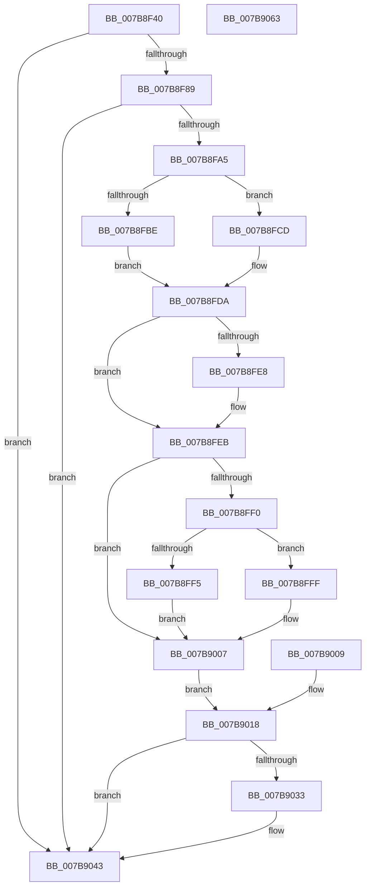

# EtwpUpdateProcessTracingCallback

- RVA: `0x007B8F40`–`0x007B9064` (길이 `292` bytes)
- VA: `0x00000001407B8F40`
- 실행 섹션: `PAGE`
- PDB 이름 있음: `예`; PDB Function 태그: `아니요`
- unwind 정보 RVA: `0x000D397C`
- 디코드: `74`개 명령, `292/292` bytes 표시
- 미해석 바이트: `0` (있으면 어셈블리에 `.byte`로 보존)

> 이 문서는 커널 이미지의 기계어와 PDB 기호를 분석해 생성했습니다. 4번과 5번은 함수 원형과 자료형을 바이너리 사용 방식에서 추정한 C 해석이며 원본 소스 복구 결과는 아닙니다.

## 1. Dependencies

- 직접 호출 지점: **7**; 고유 호출 대상: **7**
- 직접 호출자로 확인된 함수: **2**
- RIP 상대 이미지 참조: **1**

### Outgoing calls
- `0x007B8F98` → [ExAcquireRundownProtection](../../text/21/ExAcquireRundownProtection_function_00216620.md) (function, `0x00216620`)
- `0x007B8FAD` → [KeStackAttachProcess](../../text/21/KeStackAttachProcess_function_00216800.md) (function, `0x00216800`)
- `0x007B901F` → [KiUnstackDetachProcess](../../text/21/KiUnstackDetachProcess_function_00217D30.md) (function, `0x00217D30`)
- `0x007B9027` → [ExReleaseRundownProtection](../../text/34/ExReleaseRundownProtection_function_00349E80.md) (function, `0x00349E80`)
- `0x007B9036` → [PsGetProcessId](../../text/43/PsGetProcessId_function_0043D910.md) (function, `0x0043D910`)
- `0x007B903E` → [EtwpNotifyProcessTracingChange](EtwpNotifyProcessTracingChange_function_007B8D90.md) (function, `0x007B8D90`)
- `0x007B904D` → [_security_check_cookie](../../text/6A/_security_check_cookie_function_006AC640.md) (function, `0x006AC640`)

### Direct callers
- [EtwpEnableDisableUMGL](../9E/EtwpEnableDisableUMGL_function_009E3C88.md) at `0x009E3D95`
- [EtwpUpdatePerProcessTracing](../A6/EtwpUpdatePerProcessTracing_function_00A67374.md) at `0x00A67449`

### Static image references
- `0x007B8F4D` → RVA `0x00E0A740` (`.data`; read)

## 2. Other-region calls and transfers

- 다른 실행 섹션으로 향하는 call: **6**
  - `0x007B8F98` → [ExAcquireRundownProtection](../../text/21/ExAcquireRundownProtection_function_00216620.md) (`PAGE` → `.text`)
  - `0x007B8FAD` → [KeStackAttachProcess](../../text/21/KeStackAttachProcess_function_00216800.md) (`PAGE` → `.text`)
  - `0x007B901F` → [KiUnstackDetachProcess](../../text/21/KiUnstackDetachProcess_function_00217D30.md) (`PAGE` → `.text`)
  - `0x007B9027` → [ExReleaseRundownProtection](../../text/34/ExReleaseRundownProtection_function_00349E80.md) (`PAGE` → `.text`)
  - `0x007B9036` → [PsGetProcessId](../../text/43/PsGetProcessId_function_0043D910.md) (`PAGE` → `.text`)
  - `0x007B904D` → [_security_check_cookie](../../text/6A/_security_check_cookie_function_006AC640.md) (`PAGE` → `.text`)
- 별도 외부 분기/꼬리 이동을 확인하지 못했습니다.

## 3. Assembly (complete function range)

```asm
007B8F40  48 89 5C 24 18                  mov qword ptr [rsp + 0x18], rbx
007B8F45  56                              push rsi
007B8F46  57                              push rdi
007B8F47  41 56                           push r14
007B8F49  48 83 EC 70                     sub rsp, 0x70
007B8F4D  48 8B 05 EC 17 65 00            mov rax, qword ptr [rip + 0x6517ec]
007B8F54  48 33 C4                        xor rax, rsp
007B8F57  48 89 44 24 68                  mov qword ptr [rsp + 0x68], rax
007B8F5C  4C 8B F2                        mov r14, rdx
007B8F5F  48 8B D9                        mov rbx, rcx
007B8F62  48 89 4C 24 28                  mov qword ptr [rsp + 0x28], rcx
007B8F67  0F 57 C0                        xorps xmm0, xmm0
007B8F6A  0F 11 44 24 38                  movups xmmword ptr [rsp + 0x38], xmm0
007B8F6F  0F 11 44 24 48                  movups xmmword ptr [rsp + 0x48], xmm0
007B8F74  0F 11 44 24 58                  movups xmmword ptr [rsp + 0x58], xmm0
007B8F79  48 8B B1 E0 02 00 00            mov rsi, qword ptr [rcx + 0x2e0]
007B8F80  48 85 F6                        test rsi, rsi
007B8F83  0F 84 BA 00 00 00               je 0x1407b9043
007B8F89  48 8D B9 E8 01 00 00            lea rdi, [rcx + 0x1e8]
007B8F90  48 89 7C 24 30                  mov qword ptr [rsp + 0x30], rdi
007B8F95  48 8B CF                        mov rcx, rdi
007B8F98  E8 83 D6 A5 FF                  call 0x140216620
007B8F9D  84 C0                           test al, al
007B8F9F  0F 84 9E 00 00 00               je 0x1407b9043
007B8FA5  48 8D 54 24 38                  lea rdx, [rsp + 0x38]
007B8FAA  48 8B CB                        mov rcx, rbx
007B8FAD  E8 4E D8 A5 FF                  call 0x140216800
007B8FB2  45 8A 46 04                     mov r8b, byte ptr [r14 + 4]
007B8FB6  41 8B 16                        mov edx, dword ptr [r14]
007B8FB9  45 84 C0                        test r8b, r8b
007B8FBC  74 0F                           je 0x1407b8fcd
007B8FBE  F0 0F AB 96 78 03 00 00         lock bts dword ptr [rsi + 0x378], edx
007B8FC6  0F 93 44 24 20                  setae byte ptr [rsp + 0x20]
007B8FCB  EB 0D                           jmp 0x1407b8fda
007B8FCD  F0 0F B3 96 78 03 00 00         lock btr dword ptr [rsi + 0x378], edx
007B8FD5  0F 92 44 24 20                  setb byte ptr [rsp + 0x20]
007B8FDA  33 C0                           xor eax, eax
007B8FDC  48 8B 8B 10 03 00 00            mov rcx, qword ptr [rbx + 0x310]
007B8FE3  48 85 C9                        test rcx, rcx
007B8FE6  74 03                           je 0x1407b8feb
007B8FE8  48 8B 01                        mov rax, qword ptr [rcx]
007B8FEB  48 85 C0                        test rax, rax
007B8FEE  74 17                           je 0x1407b9007
007B8FF0  45 84 C0                        test r8b, r8b
007B8FF3  74 0A                           je 0x1407b8fff
007B8FF5  F0 0F AB 90 40 02 00 00         lock bts dword ptr [rax + 0x240], edx
007B8FFD  EB 08                           jmp 0x1407b9007
007B8FFF  F0 0F B3 90 40 02 00 00         lock btr dword ptr [rax + 0x240], edx
007B9007  EB 0F                           jmp 0x1407b9018
007B9009  C6 44 24 20 00                  mov byte ptr [rsp + 0x20], 0
007B900E  48 8B 5C 24 28                  mov rbx, qword ptr [rsp + 0x28]
007B9013  48 8B 7C 24 30                  mov rdi, qword ptr [rsp + 0x30]
007B9018  33 D2                           xor edx, edx
007B901A  48 8D 4C 24 38                  lea rcx, [rsp + 0x38]
007B901F  E8 0C ED A5 FF                  call 0x140217d30
007B9024  48 8B CF                        mov rcx, rdi
007B9027  E8 54 0E B9 FF                  call 0x140349e80
007B902C  80 7C 24 20 00                  cmp byte ptr [rsp + 0x20], 0
007B9031  74 10                           je 0x1407b9043
007B9033  48 8B CB                        mov rcx, rbx
007B9036  E8 D5 48 C8 FF                  call 0x14043d910
007B903B  48 8B C8                        mov rcx, rax
007B903E  E8 4D FD FF FF                  call 0x1407b8d90
007B9043  33 C0                           xor eax, eax
007B9045  48 8B 4C 24 68                  mov rcx, qword ptr [rsp + 0x68]
007B904A  48 33 CC                        xor rcx, rsp
007B904D  E8 EE 35 EF FF                  call 0x1406ac640
007B9052  48 8B 9C 24 A0 00 00 00         mov rbx, qword ptr [rsp + 0xa0]
007B905A  48 83 C4 70                     add rsp, 0x70
007B905E  41 5E                           pop r14
007B9060  5F                              pop rdi
007B9061  5E                              pop rsi
007B9062  C3                              ret
007B9063  CC                              int3
```

## 4. C-style interpretation (structured pseudocode)

```c
__int64 __fastcall EtwpUpdateProcessTracingCallback(__int64 a1, __int64 a2)
{
    __int64 result;
    __int64 v_rsp;
    unsigned __int64 v_stack_m20;
    unsigned __int64 v_stack_m30;
    unsigned __int64 v_stack_m40;
    unsigned __int64 v_stack_m50;
    unsigned __int64 v_stack_m58;
    unsigned __int64 v_stack_m60;
    unsigned __int8 v_stack_m68;
    unsigned __int64 v_stack_p18;

    v_stack_p18 = v_rbx;
    v_rsp = (v_rsp) - (112);
    result = (*(unsigned __int64 *)(v_rip + 6625260)) ^ (v_rsp);
    v_stack_m20 = result;
    v_stack_m60 = a1;
    v_stack_m50 = v_xmm0;
    v_stack_m40 = v_xmm0;
    v_stack_m30 = v_xmm0;
    if (*(unsigned __int64 *)(a1 + 736) == 0) goto loc_007B9043;
    v_stack_m58 = a1 + 488;
    result = ExAcquireRundownProtection(a1 + 488, a2, a3, a4);
    if ((unsigned __int8)(result) == 0) goto loc_007B9043;
    result = KeStackAttachProcess(a1, v_stack_m50, a3, a4);
    if ((unsigned __int8)(*(unsigned __int8 *)(a2 + 4)) == 0) goto loc_007B8FCD;
    goto loc_007B8FDA;
loc_007B8FCD:
loc_007B8FDA:
    result = 0;
    if (*(unsigned __int64 *)(a1 + 784) != 0) {
        result = *(unsigned __int64 *)(*(unsigned __int64 *)(a1 + 784));
    }
    if (result == 0) goto loc_007B9007;
    if ((unsigned __int8)(*(unsigned __int8 *)(a2 + 4)) == 0) goto loc_007B8FFF;
    goto loc_007B9007;
loc_007B8FFF:
loc_007B9007:
    goto loc_007B9018;
loc_007B9018:
    a2 = 0;
    result = KiUnstackDetachProcess(v_stack_m50, a2, *(unsigned __int8 *)(a2 + 4), a4);
    result = ExReleaseRundownProtection(a1 + 488, a2, *(unsigned __int8 *)(a2 + 4), a4);
    if (v_stack_m68 != 0) {
        a1 = a1;
        result = PsGetProcessId(a1, a2, *(unsigned __int8 *)(a2 + 4), a4);
        a1 = result;
        result = EtwpNotifyProcessTracingChange(a1, a2, *(unsigned __int8 *)(a2 + 4), a4);
    }
    result = 0;
    a1 = (v_stack_m20) ^ (v_rsp);
    result = _security_check_cookie(a1, a2, *(unsigned __int8 *)(a2 + 4), a4);
    v_rsp = (v_rsp) + (112);
    return result;
}
```

## 5. (Beta) C Style

```c
int64_t EtwpUpdateProcessTracingCallback(void *Arg1, void *Arg2)
{
    uint8_t *arg1 = (uint8_t *)Arg1;
    uint8_t *arg2 = (uint8_t *)Arg2;

    int64_t result;
    int64_t local_rsp;
    uint64_t v_stack_m20;
    uint64_t v_stack_m30;
    uint64_t v_stack_m40;
    uint64_t v_stack_m50;
    uint64_t v_stack_m58;
    uint64_t v_stack_m60;
    uint8_t v_stack_m68;
    uint64_t v_stack_p18;

    v_stack_p18 = local_rbx;
    local_rsp = (local_rsp) - (112);
    result = (*(uint64_t *)(v_rip + 0x6517EC)) ^ (local_rsp);
    v_stack_m20 = result;
    v_stack_m60 = Arg1;
    v_stack_m50 = v_xmm0;
    v_stack_m40 = v_xmm0;
    v_stack_m30 = v_xmm0;
    if (*(uint64_t *)(arg1 + 0x2E0) == 0) goto loc_007B9043;
    v_stack_m58 = Arg1 + 488;
    result = ExAcquireRundownProtection(Arg1 + 488, Arg2, a3, a4);
    if ((uint8_t)(result) == 0) goto loc_007B9043;
    result = KeStackAttachProcess(Arg1, v_stack_m50, a3, a4);
    if ((uint8_t)(*(uint8_t *)(arg2 + 0x4)) == 0) goto loc_007B8FCD;
    goto loc_007B8FDA;
loc_007B8FCD:
loc_007B8FDA:
    result = 0;
    if (*(uint64_t *)(arg1 + 0x310) != 0) {
        result = *(uint64_t *)(*(uint64_t *)(arg1 + 0x310));
    }
    if (result == 0) goto loc_007B9007;
    if ((uint8_t)(*(uint8_t *)(arg2 + 0x4)) == 0) goto loc_007B8FFF;
    goto loc_007B9007;
loc_007B8FFF:
loc_007B9007:
    goto loc_007B9018;
loc_007B9018:
    Arg2 = 0;
    result = KiUnstackDetachProcess(v_stack_m50, Arg2, *(uint8_t *)(arg2 + 0x4), a4);
    result = ExReleaseRundownProtection(Arg1 + 488, Arg2, *(uint8_t *)(arg2 + 0x4), a4);
    if (v_stack_m68 != 0) {
        Arg1 = Arg1;
        result = PsGetProcessId(Arg1, Arg2, *(uint8_t *)(arg2 + 0x4), a4);
        Arg1 = result;
        result = EtwpNotifyProcessTracingChange(Arg1, Arg2, *(uint8_t *)(arg2 + 0x4), a4);
    }
    result = 0;
    Arg1 = (v_stack_m20) ^ (local_rsp);
    result = _security_check_cookie(Arg1, Arg2, *(uint8_t *)(arg2 + 0x4), a4);
    local_rsp = (local_rsp) + (112);
    return result;
}
```

### 관측된 메모리 오프셋

구조체 형식이 확인되지 않은 접근은 인자 기준의 오프셋으로만 기록했습니다.

| 기준 인자 | 오프셋 표현 | 폭 (bit) | 접근 |
|---|---:|---:|---|
| `Arg1` | `+ 0x1E8` | `64` | `R` |
| `Arg1` | `+ 0x2E0` | `64` | `R` |
| `Arg1` | `+ 0x310` | `64` | `R` |
| `Arg2` | `+ 0x0` | `32` | `R` |
| `Arg2` | `+ 0x4` | `8` | `R` |

## 6. Execution-region graph

[열기: 2D/3D 그래프와 함수 탐색 컨트롤 패널](../../../control-panel.html?section=page&rva=0x007B8F40&view=graph)

- 2D 그래프는 위에서 아래로 흐르고, 3D 그래프는 빈 공간을 드래그해 회전합니다. Shift+드래그는 이동, 휠은 확대·축소, 함수 노드 선택은 대상 보고서 이동입니다.

### Static fallback


