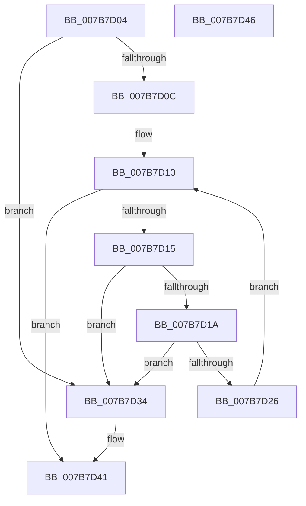

# EtwpUpdateTagFilter

- RVA: `0x007B7D04`–`0x007B7D47` (길이 `67` bytes)
- VA: `0x00000001407B7D04`
- 실행 섹션: `PAGE`
- PDB 이름 있음: `예`; PDB Function 태그: `아니요`
- unwind 정보 RVA: `0x000DB714`
- 디코드: `20`개 명령, `67/67` bytes 표시
- 미해석 바이트: `0` (있으면 어셈블리에 `.byte`로 보존)

> 이 문서는 커널 이미지의 기계어와 PDB 기호를 분석해 생성했습니다. 4번과 5번은 함수 원형과 자료형을 바이너리 사용 방식에서 추정한 C 해석이며 원본 소스 복구 결과는 아닙니다.

## 1. Dependencies

- 직접 호출 지점: **0**; 고유 호출 대상: **0**
- 직접 호출자로 확인된 함수: **3**
- RIP 상대 이미지 참조: **0**

### Outgoing calls
- 직접 디코드된 call 명령이 없습니다.

### Direct callers
- [sub_006EF0FC](../../text/6E/Unknown_function_006EF0FC.md) at `0x006EF1BE`
- [EtwpCheckForPoolTagFilterExtension](../A6/EtwpCheckForPoolTagFilterExtension_function_00A676B0.md) at `0x00A6771E`
- [sub_00B3C988](../B3/Unknown_function_00B3C988.md) at `0x00B3CF04`

### Static image references
- 디코드된 RIP-relative 메모리 참조가 없습니다.

## 2. Other-region calls and transfers

- 다른 실행 섹션으로 향하는 call: **0**
- 별도 외부 분기/꼬리 이동을 확인하지 못했습니다.

## 3. Assembly (complete function range)

```asm
007B7D04  45 33 C9                        xor r9d, r9d
007B7D07  66 85 D2                        test dx, dx
007B7D0A  74 28                           je 0x1407b7d34
007B7D0C  44 0F B7 DA                     movzx r11d, dx
007B7D10  45 3B CB                        cmp r9d, r11d
007B7D13  73 2C                           jae 0x1407b7d41
007B7D15  80 39 2A                        cmp byte ptr [rcx], 0x2a
007B7D18  74 1A                           je 0x1407b7d34
007B7D1A  44 8B 11                        mov r10d, dword ptr [rcx]
007B7D1D  41 81 FA 3F 3F 3F 3F            cmp r10d, 0x3f3f3f3f
007B7D24  74 0E                           je 0x1407b7d34
007B7D26  48 83 C1 04                     add rcx, 4
007B7D2A  47 89 54 88 04                  mov dword ptr [r8 + r9*4 + 4], r10d
007B7D2F  41 FF C1                        inc r9d
007B7D32  EB DC                           jmp 0x1407b7d10
007B7D34  41 C7 40 04 2A 00 00 00         mov dword ptr [r8 + 4], 0x2a
007B7D3C  BA 01 00 00 00                  mov edx, 1
007B7D41  66 41 89 10                     mov word ptr [r8], dx
007B7D45  C3                              ret
007B7D46  CC                              int3
```

## 4. C-style interpretation (structured pseudocode)

```c
void __fastcall EtwpUpdateTagFilter(__int64 a1, unsigned __int16 a2, __int64 a3, int a4)
{
    a4 = 0;
    if (a2 == 0) goto loc_007B7D34;
loc_007B7D10:
    if (0 >= a2) goto loc_007B7D41;
    if ((*(unsigned __int8 *)(a1)) == 42) goto loc_007B7D34;
    if (((unsigned int)((unsigned int)(*(unsigned int *)(a1)))) == 0x3F3F3F3FULL) goto loc_007B7D34;
    a1 = (a1) + (4);
    *(unsigned int *)(a3 + a4 * 4 + 4) = (unsigned int)((unsigned int)(*(unsigned int *)(a1)));
    a4 = (unsigned int)((a4) + 1);
    goto loc_007B7D10;
loc_007B7D34:
    *(unsigned int *)(a3 + 4) = 42;
loc_007B7D41:
    *(unsigned __int16 *)(a3) = 1;
    return;
}
```

## 5. (Beta) C Style

```c
void EtwpUpdateTagFilter(void *Arg1, uint16_t Arg2, void *Arg3, int32_t Arg4)
{
    uint8_t *arg1 = (uint8_t *)Arg1;
    uint8_t *arg3 = (uint8_t *)Arg3;

    Arg4 = 0;
    if (Arg2 == 0) goto loc_007B7D34;
loc_007B7D10:
    if (0 >= Arg2) goto loc_007B7D41;
    if ((*(uint8_t *)(arg1)) == 42) goto loc_007B7D34;
    if (((uint32_t)((uint32_t)(*(uint32_t *)(arg1)))) == 0x3F3F3F3FULL) goto loc_007B7D34;
    Arg1 = (Arg1) + (4);
    *(uint32_t *)(arg3 + Arg4 * 4 + 0x4) = (uint32_t)((uint32_t)(*(uint32_t *)(arg1)));
    Arg4 = (uint32_t)((Arg4) + 1);
    goto loc_007B7D10;
loc_007B7D34:
    *(uint32_t *)(arg3 + 0x4) = 42;
loc_007B7D41:
    *(uint16_t *)(arg3) = 1;
    return;
}
```

### 관측된 메모리 오프셋

구조체 형식이 확인되지 않은 접근은 인자 기준의 오프셋으로만 기록했습니다.

| 기준 인자 | 오프셋 표현 | 폭 (bit) | 접근 |
|---|---:|---:|---|
| `Arg1` | `+ 0x0` | `8` | `R` |
| `Arg1` | `+ 0x0` | `32` | `R` |
| `Arg3` | `+ 0x0` | `16` | `W` |
| `Arg3` | `+ 0x4` | `32` | `W` |
| `Arg3` | `+ 0x4 + r9*4` | `32` | `W` |

## 6. Execution-region graph

[열기: 2D/3D 그래프와 함수 탐색 컨트롤 패널](../../../control-panel.html?section=page&rva=0x007B7D04&view=graph)

- 2D 그래프는 위에서 아래로 흐르고, 3D 그래프는 빈 공간을 드래그해 회전합니다. Shift+드래그는 이동, 휠은 확대·축소, 함수 노드 선택은 대상 보고서 이동입니다.

### Static fallback


