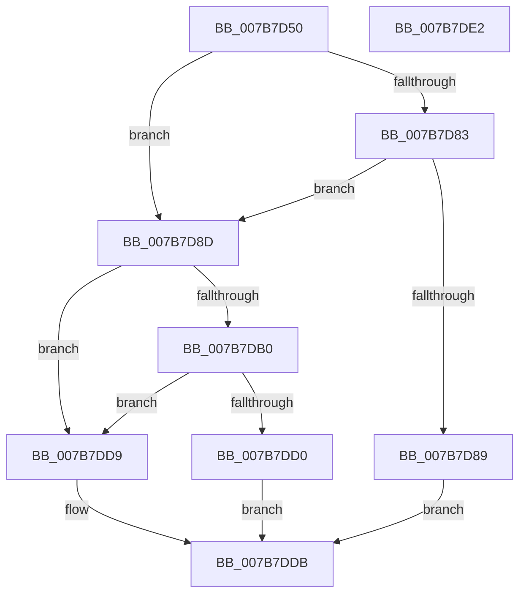

# EtwpUserInAdminOrLogUsersGroup

- RVA: `0x007B7D50`–`0x007B7DE3` (길이 `147` bytes)
- VA: `0x00000001407B7D50`
- 실행 섹션: `PAGE`
- PDB 이름 있음: `예`; PDB Function 태그: `아니요`
- unwind 정보 RVA: `0x000D3360`
- 디코드: `45`개 명령, `147/147` bytes 표시
- 미해석 바이트: `0` (있으면 어셈블리에 `.byte`로 보존)

> 이 문서는 커널 이미지의 기계어와 PDB 기호를 분석해 생성했습니다. 4번과 5번은 함수 원형과 자료형을 바이너리 사용 방식에서 추정한 C 해석이며 원본 소스 복구 결과는 아닙니다.

## 1. Dependencies

- 직접 호출 지점: **4**; 고유 호출 대상: **3**
- 직접 호출자로 확인된 함수: **1**
- RIP 상대 이미지 참조: **1**

### Outgoing calls
- `0x007B7D7A` → [RtlCheckTokenMembership](../../text/3A/RtlCheckTokenMembership_function_003A5A10.md) (function, `0x003A5A10`)
- `0x007B7DA7` → [RtlAllocateAndInitializeSidEx](../78/RtlAllocateAndInitializeSidEx_function_0078E36C.md) (function, `0x0078E36C`)
- `0x007B7DBA` → [RtlCheckTokenMembership](../../text/3A/RtlCheckTokenMembership_function_003A5A10.md) (function, `0x003A5A10`)
- `0x007B7DC7` → [ExFreePoolWithTag](../../poolcode/B8/ExFreePoolWithTag_function_00B82870.md) (function, `0x00B82870`)

### Direct callers
- [sub_00B3C988](../B3/Unknown_function_00B3C988.md) at `0x00B3CF6A`
- [sub_00B3C988](../B3/Unknown_function_00B3C988.md) at `0x00B3D0A9`

### Static image references
- `0x007B7D5A` → RVA `0x00FD9A68` (`PAGEDATA`; read)

## 2. Other-region calls and transfers

- 다른 실행 섹션으로 향하는 call: **3**
  - `0x007B7D7A` → [RtlCheckTokenMembership](../../text/3A/RtlCheckTokenMembership_function_003A5A10.md) (`PAGE` → `.text`)
  - `0x007B7DBA` → [RtlCheckTokenMembership](../../text/3A/RtlCheckTokenMembership_function_003A5A10.md) (`PAGE` → `.text`)
  - `0x007B7DC7` → [ExFreePoolWithTag](../../poolcode/B8/ExFreePoolWithTag_function_00B82870.md) (`PAGE` → `POOLCODE`)
- 별도 외부 분기/꼬리 이동을 확인하지 못했습니다.

## 3. Assembly (complete function range)

```asm
007B7D50  40 55                           push rbp
007B7D52  53                              push rbx
007B7D53  48 8B EC                        mov rbp, rsp
007B7D56  48 83 EC 28                     sub rsp, 0x28
007B7D5A  48 8B 15 07 1D 82 00            mov rdx, qword ptr [rip + 0x821d07]
007B7D61  4C 8D 45 18                     lea r8, [rbp + 0x18]
007B7D65  83 65 20 00                     and dword ptr [rbp + 0x20], 0
007B7D69  33 C9                           xor ecx, ecx
007B7D6B  48 83 65 28 00                  and qword ptr [rbp + 0x28], 0
007B7D70  C6 45 18 00                     mov byte ptr [rbp + 0x18], 0
007B7D74  66 C7 45 24 00 05               mov word ptr [rbp + 0x24], 0x500
007B7D7A  E8 91 DC BE FF                  call 0x1403a5a10
007B7D7F  85 C0                           test eax, eax
007B7D81  78 0A                           js 0x1407b7d8d
007B7D83  80 7D 18 00                     cmp byte ptr [rbp + 0x18], 0
007B7D87  74 04                           je 0x1407b7d8d
007B7D89  B0 01                           mov al, 1
007B7D8B  EB 4E                           jmp 0x1407b7ddb
007B7D8D  4C 8D 4D 28                     lea r9, [rbp + 0x28]
007B7D91  C7 45 30 20 00 00 00            mov dword ptr [rbp + 0x30], 0x20
007B7D98  4C 8D 45 30                     lea r8, [rbp + 0x30]
007B7D9C  C7 45 34 2E 02 00 00            mov dword ptr [rbp + 0x34], 0x22e
007B7DA3  48 8D 4D 20                     lea rcx, [rbp + 0x20]
007B7DA7  E8 C0 65 FD FF                  call 0x14078e36c
007B7DAC  85 C0                           test eax, eax
007B7DAE  78 29                           js 0x1407b7dd9
007B7DB0  48 8B 55 28                     mov rdx, qword ptr [rbp + 0x28]
007B7DB4  4C 8D 45 18                     lea r8, [rbp + 0x18]
007B7DB8  33 C9                           xor ecx, ecx
007B7DBA  E8 51 DC BE FF                  call 0x1403a5a10
007B7DBF  48 8B 4D 28                     mov rcx, qword ptr [rbp + 0x28]
007B7DC3  33 D2                           xor edx, edx
007B7DC5  8B D8                           mov ebx, eax
007B7DC7  E8 A4 AA 3C 00                  call 0x140b82870
007B7DCC  85 DB                           test ebx, ebx
007B7DCE  78 09                           js 0x1407b7dd9
007B7DD0  80 7D 18 00                     cmp byte ptr [rbp + 0x18], 0
007B7DD4  0F 95 C0                        setne al
007B7DD7  EB 02                           jmp 0x1407b7ddb
007B7DD9  32 C0                           xor al, al
007B7DDB  48 83 C4 28                     add rsp, 0x28
007B7DDF  5B                              pop rbx
007B7DE0  5D                              pop rbp
007B7DE1  C3                              ret
007B7DE2  CC                              int3
```

## 4. C-style interpretation (structured pseudocode)

```c
__int64 __fastcall EtwpUserInAdminOrLogUsersGroup(int a1)
{
    __int64 result;
    __int64 v_rsp;
    unsigned int v_stack_p10;
    unsigned __int16 v_stack_p14;
    unsigned __int64 v_stack_p18;
    unsigned int v_stack_p20;
    unsigned int v_stack_p24;
    unsigned __int64 v_stack_p8;

    v_rsp = (v_rsp) - (40);
    a1 = 0;
    v_stack_p8 = 0;
    v_stack_p14 = 0x500ULL;
    result = RtlCheckTokenMembership(a1, *(unsigned __int64 *)(v_rip + 8527111), v_stack_p8, a4);
    if (sign_flag) goto loc_007B7D8D;
    if (v_stack_p8 == 0) goto loc_007B7D8D;
    goto loc_007B7DDB;
loc_007B7D8D:
    v_stack_p20 = 32;
    v_stack_p24 = 558;
    result = RtlAllocateAndInitializeSidEx(v_stack_p10, *(unsigned __int64 *)(v_rip + 8527111), v_stack_p20, v_stack_p18);
    if (sign_flag) goto loc_007B7DD9;
    a1 = 0;
    result = RtlCheckTokenMembership(a1, v_stack_p18, v_stack_p8, v_stack_p18);
    a2 = 0;
    result = ExFreePoolWithTag(v_stack_p18, a2, v_stack_p8, v_stack_p18);
    if (sign_flag) goto loc_007B7DD9;
    result = (v_stack_p8 != 0) ? 1 : 0;
    goto loc_007B7DDB;
loc_007B7DD9:
    result = 0;
loc_007B7DDB:
    v_rsp = (v_rsp) + (40);
    return result;
}
```

## 5. (Beta) C Style

```c
int64_t EtwpUserInAdminOrLogUsersGroup(int32_t Arg1)
{
    int64_t result;
    int64_t local_rsp;
    uint32_t v_stack_p10;
    uint16_t v_stack_p14;
    uint64_t v_stack_p18;
    uint32_t v_stack_p20;
    uint32_t v_stack_p24;
    uint64_t v_stack_p8;

    local_rsp = (local_rsp) - (40);
    Arg1 = 0;
    v_stack_p8 = 0;
    v_stack_p14 = 0x500ULL;
    result = RtlCheckTokenMembership(Arg1, *(uint64_t *)(v_rip + 0x821D07), v_stack_p8, a4);
    if (sign_flag) goto loc_007B7D8D;
    if (v_stack_p8 == 0) goto loc_007B7D8D;
    goto loc_007B7DDB;
loc_007B7D8D:
    v_stack_p20 = 32;
    v_stack_p24 = 558;
    result = RtlAllocateAndInitializeSidEx(v_stack_p10, *(uint64_t *)(v_rip + 0x821D07), v_stack_p20, v_stack_p18);
    if (sign_flag) goto loc_007B7DD9;
    Arg1 = 0;
    result = RtlCheckTokenMembership(Arg1, v_stack_p18, v_stack_p8, v_stack_p18);
    a2 = 0;
    result = ExFreePoolWithTag(v_stack_p18, a2, v_stack_p8, v_stack_p18);
    if (sign_flag) goto loc_007B7DD9;
    result = (v_stack_p8 != 0) ? 1 : 0;
    goto loc_007B7DDB;
loc_007B7DD9:
    result = 0;
loc_007B7DDB:
    local_rsp = (local_rsp) + (40);
    return result;
}
```

## 6. Execution-region graph

[열기: 2D/3D 그래프와 함수 탐색 컨트롤 패널](../../../control-panel.html?section=page&rva=0x007B7D50&view=graph)

- 2D 그래프는 위에서 아래로 흐르고, 3D 그래프는 빈 공간을 드래그해 회전합니다. Shift+드래그는 이동, 휠은 확대·축소, 함수 노드 선택은 대상 보고서 이동입니다.

### Static fallback


