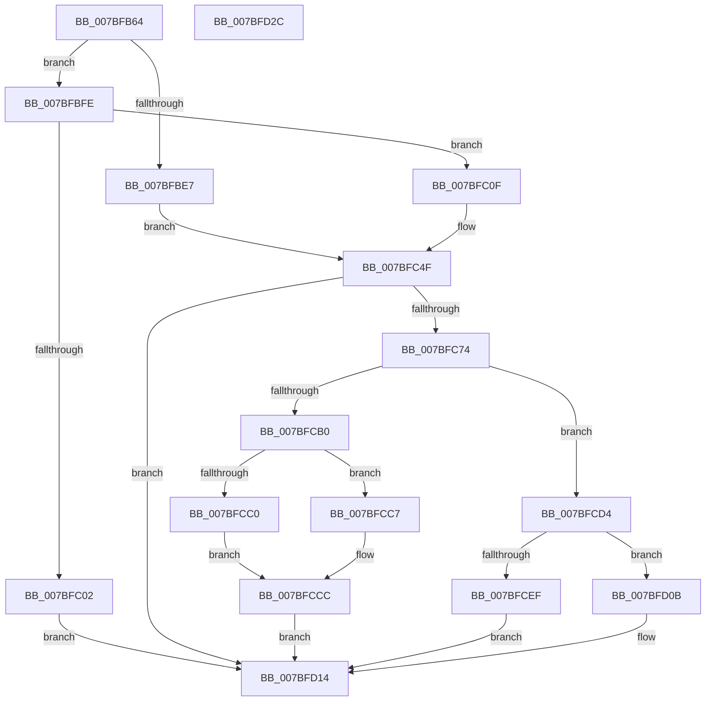

# EtwpWriteBufferCompressed

- RVA: `0x007BFB64`–`0x007BFD2D` (길이 `457` bytes)
- VA: `0x00000001407BFB64`
- 실행 섹션: `PAGE`
- PDB 이름 있음: `예`; PDB Function 태그: `아니요`
- unwind 정보 RVA: `0x000D3D10`
- 디코드: `133`개 명령, `457/457` bytes 표시
- 미해석 바이트: `0` (있으면 어셈블리에 `.byte`로 보존)

> 이 문서는 커널 이미지의 기계어와 PDB 기호를 분석해 생성했습니다. 4번과 5번은 함수 원형과 자료형을 바이너리 사용 방식에서 추정한 C 해석이며 원본 소스 복구 결과는 아닙니다.

## 1. Dependencies

- 직접 호출 지점: **4**; 고유 호출 대상: **3**
- 직접 호출자로 확인된 함수: **1**
- RIP 상대 이미지 참조: **0**

### Outgoing calls
- `0x007BFBD9` → [RtlCompressBuffer](../../text/26/RtlCompressBuffer_function_0026A220.md) (function, `0x0026A220`)
- `0x007BFBF7` → [memcpy](../../text/6C/memcpy_function_006C6840.md) (function, `0x006C6840`)
- `0x007BFCA5` → [ZwWriteFile](../../text/6A/ZwWriteFile_function_006AD1D0.md) (function, `0x006AD1D0`)
- `0x007BFD04` → [memcpy](../../text/6C/memcpy_function_006C6840.md) (function, `0x006C6840`)

### Direct callers
- [EtwpSavePersistedLogger](EtwpSavePersistedLogger_function_007BF374.md) at `0x007BF6B1`

### Static image references
- 디코드된 RIP-relative 메모리 참조가 없습니다.

## 2. Other-region calls and transfers

- 다른 실행 섹션으로 향하는 call: **4**
  - `0x007BFBD9` → [RtlCompressBuffer](../../text/26/RtlCompressBuffer_function_0026A220.md) (`PAGE` → `.text`)
  - `0x007BFBF7` → [memcpy](../../text/6C/memcpy_function_006C6840.md) (`PAGE` → `.text`)
  - `0x007BFCA5` → [ZwWriteFile](../../text/6A/ZwWriteFile_function_006AD1D0.md) (`PAGE` → `.text`)
  - `0x007BFD04` → [memcpy](../../text/6C/memcpy_function_006C6840.md) (`PAGE` → `.text`)
- 별도 외부 분기/꼬리 이동을 확인하지 못했습니다.

## 3. Assembly (complete function range)

```asm
007BFB64  4C 8B DC                        mov r11, rsp
007BFB67  49 89 5B 10                     mov qword ptr [r11 + 0x10], rbx
007BFB6B  49 89 6B 18                     mov qword ptr [r11 + 0x18], rbp
007BFB6F  49 89 73 20                     mov qword ptr [r11 + 0x20], rsi
007BFB73  57                              push rdi
007BFB74  48 83 EC 60                     sub rsp, 0x60
007BFB78  44 8B 41 34                     mov r8d, dword ptr [rcx + 0x34]
007BFB7C  48 8B D9                        mov rbx, rcx
007BFB7F  8B 41 10                        mov eax, dword ptr [rcx + 0x10]
007BFB82  48 8B FA                        mov rdi, rdx
007BFB85  4C 8B 49 28                     mov r9, qword ptr [rcx + 0x28]
007BFB89  0F 57 C0                        xorps xmm0, xmm0
007BFB8C  44 8B 51 30                     mov r10d, dword ptr [rcx + 0x30]
007BFB90  49 83 C1 48                     add r9, 0x48
007BFB94  83 64 24 70 00                  and dword ptr [rsp + 0x70], 0
007BFB99  45 2B D0                        sub r10d, r8d
007BFB9C  4D 03 C8                        add r9, r8
007BFB9F  41 83 C2 B8                     add r10d, -0x48
007BFBA3  44 8B 42 30                     mov r8d, dword ptr [rdx + 0x30]
007BFBA7  44 3B D0                        cmp r10d, eax
007BFBAA  B9 03 00 00 00                  mov ecx, 3
007BFBAF  44 0F 43 D0                     cmovae r10d, eax
007BFBB3  41 83 E8 48                     sub r8d, 0x48
007BFBB7  48 8B 43 20                     mov rax, qword ptr [rbx + 0x20]
007BFBBB  48 83 C2 48                     add rdx, 0x48
007BFBBF  49 89 43 D0                     mov qword ptr [r11 - 0x30], rax
007BFBC3  49 8D 43 08                     lea rax, [r11 + 8]
007BFBC7  49 89 43 C8                     mov qword ptr [r11 - 0x38], rax
007BFBCB  83 64 24 28 00                  and dword ptr [rsp + 0x28], 0
007BFBD0  45 89 53 B8                     mov dword ptr [r11 - 0x48], r10d
007BFBD4  0F 11 44 24 50                  movups xmmword ptr [rsp + 0x50], xmm0
007BFBD9  E8 42 A6 AA FF                  call 0x14026a220
007BFBDE  8B E8                           mov ebp, eax
007BFBE0  3D 23 00 00 C0                  cmp eax, 0xc0000023
007BFBE5  75 17                           jne 0x1407bfbfe
007BFBE7  8B 77 30                        mov esi, dword ptr [rdi + 0x30]
007BFBEA  48 8B D7                        mov rdx, rdi
007BFBED  8B 4B 34                        mov ecx, dword ptr [rbx + 0x34]
007BFBF0  44 8B C6                        mov r8d, esi
007BFBF3  48 03 4B 28                     add rcx, qword ptr [rbx + 0x28]
007BFBF7  E8 44 6C F0 FF                  call 0x1406c6840
007BFBFC  EB 51                           jmp 0x1407bfc4f
007BFBFE  85 C0                           test eax, eax
007BFC00  79 0D                           jns 0x1407bfc0f
007BFC02  BF 01 00 00 00                  mov edi, 1
007BFC07  01 7B 18                        add dword ptr [rbx + 0x18], edi
007BFC0A  E9 05 01 00 00                  jmp 0x1407bfd14
007BFC0F  66 83 4F 34 40                  or word ptr [rdi + 0x34], 0x40
007BFC14  0F 10 07                        movups xmm0, xmmword ptr [rdi]
007BFC17  8B 4B 34                        mov ecx, dword ptr [rbx + 0x34]
007BFC1A  48 8B 43 28                     mov rax, qword ptr [rbx + 0x28]
007BFC1E  0F 11 04 01                     movups xmmword ptr [rcx + rax], xmm0
007BFC22  0F 10 4F 10                     movups xmm1, xmmword ptr [rdi + 0x10]
007BFC26  0F 11 4C 01 10                  movups xmmword ptr [rcx + rax + 0x10], xmm1
007BFC2B  0F 10 47 20                     movups xmm0, xmmword ptr [rdi + 0x20]
007BFC2F  0F 11 44 01 20                  movups xmmword ptr [rcx + rax + 0x20], xmm0
007BFC34  0F 10 4F 30                     movups xmm1, xmmword ptr [rdi + 0x30]
007BFC38  0F 11 4C 01 30                  movups xmmword ptr [rcx + rax + 0x30], xmm1
007BFC3D  F2 0F 10 47 40                  movsd xmm0, qword ptr [rdi + 0x40]
007BFC42  F2 0F 11 44 01 40               movsd qword ptr [rcx + rax + 0x40], xmm0
007BFC48  8B 74 24 70                     mov esi, dword ptr [rsp + 0x70]
007BFC4C  83 C6 48                        add esi, 0x48
007BFC4F  8B 4B 34                        mov ecx, dword ptr [rbx + 0x34]
007BFC52  BF 01 00 00 00                  mov edi, 1
007BFC57  48 8B 43 28                     mov rax, qword ptr [rbx + 0x28]
007BFC5B  89 34 01                        mov dword ptr [rcx + rax], esi
007BFC5E  8B 4B 34                        mov ecx, dword ptr [rbx + 0x34]
007BFC61  01 7B 38                        add dword ptr [rbx + 0x38], edi
007BFC64  03 CE                           add ecx, esi
007BFC66  8B 43 10                        mov eax, dword ptr [rbx + 0x10]
007BFC69  89 4B 34                        mov dword ptr [rbx + 0x34], ecx
007BFC6C  3B C8                           cmp ecx, eax
007BFC6E  0F 82 A0 00 00 00               jb 0x1407bfd14
007BFC74  48 83 64 24 40 00               and qword ptr [rsp + 0x40], 0
007BFC7A  48 8D 73 08                     lea rsi, [rbx + 8]
007BFC7E  48 8B 0B                        mov rcx, qword ptr [rbx]
007BFC81  45 33 C9                        xor r9d, r9d
007BFC84  48 89 74 24 38                  mov qword ptr [rsp + 0x38], rsi
007BFC89  45 33 C0                        xor r8d, r8d
007BFC8C  89 44 24 30                     mov dword ptr [rsp + 0x30], eax
007BFC90  33 D2                           xor edx, edx
007BFC92  48 8B 43 28                     mov rax, qword ptr [rbx + 0x28]
007BFC96  48 89 44 24 28                  mov qword ptr [rsp + 0x28], rax
007BFC9B  48 8D 44 24 50                  lea rax, [rsp + 0x50]
007BFCA0  48 89 44 24 20                  mov qword ptr [rsp + 0x20], rax
007BFCA5  E8 26 D5 EE FF                  call 0x1406ad1d0
007BFCAA  8B E8                           mov ebp, eax
007BFCAC  85 C0                           test eax, eax
007BFCAE  79 24                           jns 0x1407bfcd4
007BFCB0  8B 43 3C                        mov eax, dword ptr [rbx + 0x3c]
007BFCB3  8B 4B 38                        mov ecx, dword ptr [rbx + 0x38]
007BFCB6  8B 53 18                        mov edx, dword ptr [rbx + 0x18]
007BFCB9  89 43 34                        mov dword ptr [rbx + 0x34], eax
007BFCBC  85 C0                           test eax, eax
007BFCBE  74 07                           je 0x1407bfcc7
007BFCC0  8D 41 FF                        lea eax, [rcx - 1]
007BFCC3  03 C2                           add eax, edx
007BFCC5  EB 05                           jmp 0x1407bfccc
007BFCC7  33 FF                           xor edi, edi
007BFCC9  8D 04 0A                        lea eax, [rdx + rcx]
007BFCCC  89 43 18                        mov dword ptr [rbx + 0x18], eax
007BFCCF  89 7B 38                        mov dword ptr [rbx + 0x38], edi
007BFCD2  EB 40                           jmp 0x1407bfd14
007BFCD4  44 8B 4B 10                     mov r9d, dword ptr [rbx + 0x10]
007BFCD8  8B 53 34                        mov edx, dword ptr [rbx + 0x34]
007BFCDB  4C 01 0E                        add qword ptr [rsi], r9
007BFCDE  8B 43 38                        mov eax, dword ptr [rbx + 0x38]
007BFCE1  41 2B D1                        sub edx, r9d
007BFCE4  8B 4B 14                        mov ecx, dword ptr [rbx + 0x14]
007BFCE7  89 53 34                        mov dword ptr [rbx + 0x34], edx
007BFCEA  89 53 3C                        mov dword ptr [rbx + 0x3c], edx
007BFCED  74 1C                           je 0x1407bfd0b
007BFCEF  FF C9                           dec ecx
007BFCF1  44 8B C2                        mov r8d, edx
007BFCF4  03 C1                           add eax, ecx
007BFCF6  89 7B 38                        mov dword ptr [rbx + 0x38], edi
007BFCF9  48 8B 4B 28                     mov rcx, qword ptr [rbx + 0x28]
007BFCFD  89 43 14                        mov dword ptr [rbx + 0x14], eax
007BFD00  49 8D 14 09                     lea rdx, [r9 + rcx]
007BFD04  E8 37 6B F0 FF                  call 0x1406c6840
007BFD09  EB 09                           jmp 0x1407bfd14
007BFD0B  03 C1                           add eax, ecx
007BFD0D  83 63 38 00                     and dword ptr [rbx + 0x38], 0
007BFD11  89 43 14                        mov dword ptr [rbx + 0x14], eax
007BFD14  4C 8D 5C 24 60                  lea r11, [rsp + 0x60]
007BFD19  8B C5                           mov eax, ebp
007BFD1B  49 8B 5B 18                     mov rbx, qword ptr [r11 + 0x18]
007BFD1F  49 8B 6B 20                     mov rbp, qword ptr [r11 + 0x20]
007BFD23  49 8B 73 28                     mov rsi, qword ptr [r11 + 0x28]
007BFD27  49 8B E3                        mov rsp, r11
007BFD2A  5F                              pop rdi
007BFD2B  C3                              ret
007BFD2C  CC                              int3
```

## 4. C-style interpretation (structured pseudocode)

```c
__int64 __fastcall EtwpWriteBufferCompressed(__int64 a1, __int64 a2)
{
    __int64 result;
    __int64 v_r10;
    __int64 v_rdi;
    __int64 v_rsi;
    __int64 v_rsp;
    unsigned __int64 v_stack_m18;
    unsigned __int64 v_stack_m28;
    unsigned __int64 v_stack_m30;
    unsigned int v_stack_m38;
    unsigned int v_stack_m40;
    unsigned __int64 v_stack_m48;
    unsigned __int64 v_stack_m8;
    unsigned int v_stack_p8;

    *(unsigned __int64 *)(v_rsp + 16) = v_rbx;
    *(unsigned __int64 *)(v_rsp + 24) = v_rbp;
    *(unsigned __int64 *)(v_rsp + 32) = v_rsi;
    v_rsp = (v_rsp) - (96);
    a4 = (*(unsigned __int64 *)(a1 + 40)) + (72);
    v_r10 = (unsigned int)(((unsigned int)(*(unsigned int *)(a1 + 48))) - ((unsigned int)((unsigned int)(*(unsigned int *)(a1 + 52)))));
    a4 = (a4) + ((unsigned int)(*(unsigned int *)(a1 + 52)));
    v_r10 = (unsigned int)((v_r10) + (-72));
    if (((unsigned int)(v_r10)) >= ((unsigned int)((unsigned int)(*(unsigned int *)(a1 + 16))))) { v_r10 = (unsigned int)((unsigned int)(*(unsigned int *)(a1 + 16))); }
    a3 = (unsigned int)(((unsigned int)(*(unsigned int *)(a2 + 48))) - (72));
    a2 = (a2) + (72);
    *(unsigned __int64 *)(v_rsp - 48) = *(unsigned __int64 *)(a1 + 32);
    *(unsigned __int64 *)(v_rsp - 56) = v_rsp + 8;
    *(unsigned int *)(v_rsp - 72) = (unsigned int)(v_r10);
    v_stack_m18 = v_xmm0;
    result = RtlCompressBuffer(3, a2, a3, a4);
    if (((unsigned int)(result)) != 0xC0000023ULL) goto loc_007BFBFE;
    a1 = ((unsigned int)(*(unsigned int *)(a1 + 52))) + (*(unsigned __int64 *)(a1 + 40));
    result = memcpy(a1, a2, (unsigned int)((unsigned int)((unsigned int)(*(unsigned int *)(a2 + 48)))), a4);
    goto loc_007BFC4F;
loc_007BFBFE:
    if (!sign_flag) goto loc_007BFC0F;
    goto loc_007BFD14;
loc_007BFC0F:
    *(unsigned __int64 *)((unsigned int)(*(unsigned int *)(a1 + 52)) + *(unsigned __int64 *)(a1 + 40) * 1) = v_xmm0;
    *(unsigned __int64 *)((unsigned int)(*(unsigned int *)(a1 + 52)) + *(unsigned __int64 *)(a1 + 40) * 1 + 16) = v_xmm1;
    *(unsigned __int64 *)((unsigned int)(*(unsigned int *)(a1 + 52)) + *(unsigned __int64 *)(a1 + 40) * 1 + 32) = v_xmm0;
    *(unsigned __int64 *)((unsigned int)(*(unsigned int *)(a1 + 52)) + *(unsigned __int64 *)(a1 + 40) * 1 + 48) = v_xmm1;
    *(unsigned __int64 *)((unsigned int)(*(unsigned int *)(a1 + 52)) + *(unsigned __int64 *)(a1 + 40) * 1 + 64) = v_xmm0;
    v_rsi = (unsigned int)(((unsigned int)(v_stack_p8)) + (72));
loc_007BFC4F:
    *(unsigned int *)((unsigned int)(*(unsigned int *)(a1 + 52)) + *(unsigned __int64 *)(a1 + 40) * 1) = (unsigned int)(v_rsi);
    a1 = (unsigned int)(((unsigned int)(*(unsigned int *)(a1 + 52))) + ((unsigned int)(v_rsi)));
    *(unsigned int *)(a1 + 52) = (unsigned int)(a1);
    if (((unsigned int)(a1)) < ((unsigned int)((unsigned int)(*(unsigned int *)(a1 + 16))))) goto loc_007BFD14;
    a4 = 0;
    v_stack_m30 = a1 + 8;
    a3 = 0;
    v_stack_m38 = (unsigned int)((unsigned int)(*(unsigned int *)(a1 + 16)));
    a2 = 0;
    v_stack_m40 = *(unsigned __int64 *)(a1 + 40);
    v_stack_m48 = v_stack_m18;
    result = ZwWriteFile(*(unsigned __int64 *)(a1), a2, a3, a4);
    if (!sign_flag) goto loc_007BFCD4;
    *(unsigned int *)(a1 + 52) = (unsigned int)((unsigned int)(*(unsigned int *)(a1 + 60)));
    if ((unsigned int)((unsigned int)(*(unsigned int *)(a1 + 60))) == 0) goto loc_007BFCC7;
    result = (unsigned int)(((unsigned int)(*(unsigned int *)(a1 + 56)) - 1) + ((unsigned int)((unsigned int)(*(unsigned int *)(a1 + 24)))));
    goto loc_007BFCCC;
loc_007BFCC7:
    v_rdi = 0;
loc_007BFCCC:
    *(unsigned int *)(a1 + 24) = (unsigned int)((unsigned int)(*(unsigned int *)(a1 + 24)) + (unsigned int)(*(unsigned int *)(a1 + 56)) * 1);
    *(unsigned int *)(a1 + 56) = 0;
    goto loc_007BFD14;
loc_007BFCD4:
    a2 = (unsigned int)(((unsigned int)(*(unsigned int *)(a1 + 52))) - ((unsigned int)((unsigned int)(*(unsigned int *)(a1 + 16)))));
    *(unsigned int *)(a1 + 52) = (unsigned int)(a2);
    *(unsigned int *)(a1 + 60) = (unsigned int)(a2);
    if (condition_is_equal) goto loc_007BFD0B;
    a1 = (unsigned int)(((unsigned int)(*(unsigned int *)(a1 + 20))) - 1);
    result = (unsigned int)(((unsigned int)(*(unsigned int *)(a1 + 56))) + ((unsigned int)(a1)));
    *(unsigned int *)(a1 + 56) = 0;
    *(unsigned int *)(a1 + 20) = (unsigned int)(result);
    result = memcpy(*(unsigned __int64 *)(a1 + 40), (unsigned int)(*(unsigned int *)(a1 + 16)) + *(unsigned __int64 *)(a1 + 40) * 1, (unsigned int)((unsigned int)(a2)), (unsigned int)(*(unsigned int *)(a1 + 16)));
    goto loc_007BFD14;
loc_007BFD0B:
    result = (unsigned int)((result) + ((unsigned int)(*(unsigned __int64 *)(a1 + 40))));
    *(unsigned int *)(a1 + 20) = (unsigned int)(result);
loc_007BFD14:
    return (unsigned int)((unsigned int)((unsigned int)((unsigned int)(result))));
}
```

## 5. (Beta) C Style

```c
int64_t EtwpWriteBufferCompressed(void *Arg1, void *Arg2)
{
    uint8_t *arg1 = (uint8_t *)Arg1;
    uint8_t *arg2 = (uint8_t *)Arg2;

    int64_t result;
    int64_t local_r10;
    int64_t local_rdi;
    int64_t local_rsi;
    int64_t local_rsp;
    uint64_t v_stack_m18;
    uint64_t v_stack_m28;
    uint64_t v_stack_m30;
    uint32_t v_stack_m38;
    uint32_t v_stack_m40;
    uint64_t v_stack_m48;
    uint64_t v_stack_m8;
    uint32_t v_stack_p8;

    *(uint64_t *)(local_rsp + 0x10) = local_rbx;
    *(uint64_t *)(local_rsp + 0x18) = local_rbp;
    *(uint64_t *)(local_rsp + 0x20) = local_rsi;
    local_rsp = (local_rsp) - (96);
    a4 = (*(uint64_t *)(arg1 + 0x28)) + (72);
    local_r10 = (uint32_t)(((uint32_t)(*(uint32_t *)(arg1 + 0x30))) - ((uint32_t)((uint32_t)(*(uint32_t *)(arg1 + 0x34)))));
    a4 = (a4) + ((uint32_t)(*(uint32_t *)(arg1 + 0x34)));
    local_r10 = (uint32_t)((local_r10) + (-72));
    if (((uint32_t)(local_r10)) >= ((uint32_t)((uint32_t)(*(uint32_t *)(arg1 + 0x10))))) { local_r10 = (uint32_t)((uint32_t)(*(uint32_t *)(arg1 + 0x10))); }
    a3 = (uint32_t)(((uint32_t)(*(uint32_t *)(arg2 + 0x30))) - (72));
    Arg2 = (Arg2) + (72);
    *(uint64_t *)(local_rsp - 0x30) = *(uint64_t *)(arg1 + 0x20);
    *(uint64_t *)(local_rsp - 0x38) = local_rsp + 8;
    *(uint32_t *)(local_rsp - 0x48) = (uint32_t)(local_r10);
    v_stack_m18 = v_xmm0;
    result = RtlCompressBuffer(3, Arg2, a3, a4);
    if (((uint32_t)(result)) != 0xC0000023ULL) goto loc_007BFBFE;
    Arg1 = ((uint32_t)(*(uint32_t *)(arg1 + 0x34))) + (*(uint64_t *)(arg1 + 0x28));
    result = memcpy(Arg1, Arg2, (uint32_t)((uint32_t)((uint32_t)(*(uint32_t *)(arg2 + 0x30)))), a4);
    goto loc_007BFC4F;
loc_007BFBFE:
    if (!sign_flag) goto loc_007BFC0F;
    goto loc_007BFD14;
loc_007BFC0F:
    *(uint64_t *)((uint32_t)(*(uint32_t *)(arg1 + 0x34)) + *(uint64_t *)(arg1 + 0x28) * 1) = v_xmm0;
    *(uint64_t *)((uint32_t)(*(uint32_t *)(arg1 + 0x34)) + *(uint64_t *)(arg1 + 0x28) * 1 + 0x10) = v_xmm1;
    *(uint64_t *)((uint32_t)(*(uint32_t *)(arg1 + 0x34)) + *(uint64_t *)(arg1 + 0x28) * 1 + 0x20) = v_xmm0;
    *(uint64_t *)((uint32_t)(*(uint32_t *)(arg1 + 0x34)) + *(uint64_t *)(arg1 + 0x28) * 1 + 0x30) = v_xmm1;
    *(uint64_t *)((uint32_t)(*(uint32_t *)(arg1 + 0x34)) + *(uint64_t *)(arg1 + 0x28) * 1 + 0x40) = v_xmm0;
    local_rsi = (uint32_t)(((uint32_t)(v_stack_p8)) + (72));
loc_007BFC4F:
    *(uint32_t *)((uint32_t)(*(uint32_t *)(arg1 + 0x34)) + *(uint64_t *)(arg1 + 0x28) * 1) = (uint32_t)(local_rsi);
    Arg1 = (uint32_t)(((uint32_t)(*(uint32_t *)(arg1 + 0x34))) + ((uint32_t)(local_rsi)));
    *(uint32_t *)(arg1 + 0x34) = (uint32_t)(Arg1);
    if (((uint32_t)(Arg1)) < ((uint32_t)((uint32_t)(*(uint32_t *)(arg1 + 0x10))))) goto loc_007BFD14;
    a4 = 0;
    v_stack_m30 = Arg1 + 8;
    a3 = 0;
    v_stack_m38 = (uint32_t)((uint32_t)(*(uint32_t *)(arg1 + 0x10)));
    Arg2 = 0;
    v_stack_m40 = *(uint64_t *)(arg1 + 0x28);
    v_stack_m48 = v_stack_m18;
    result = ZwWriteFile(*(uint64_t *)(arg1), Arg2, a3, a4);
    if (!sign_flag) goto loc_007BFCD4;
    *(uint32_t *)(arg1 + 0x34) = (uint32_t)((uint32_t)(*(uint32_t *)(arg1 + 0x3C)));
    if ((uint32_t)((uint32_t)(*(uint32_t *)(arg1 + 0x3C))) == 0) goto loc_007BFCC7;
    result = (uint32_t)(((uint32_t)(*(uint32_t *)(arg1 + 0x38)) - 1) + ((uint32_t)((uint32_t)(*(uint32_t *)(arg1 + 0x18)))));
    goto loc_007BFCCC;
loc_007BFCC7:
    local_rdi = 0;
loc_007BFCCC:
    *(uint32_t *)(arg1 + 0x18) = (uint32_t)((uint32_t)(*(uint32_t *)(arg1 + 0x18)) + (uint32_t)(*(uint32_t *)(arg1 + 0x38)) * 1);
    *(uint32_t *)(arg1 + 0x38) = 0;
    goto loc_007BFD14;
loc_007BFCD4:
    Arg2 = (uint32_t)(((uint32_t)(*(uint32_t *)(arg1 + 0x34))) - ((uint32_t)((uint32_t)(*(uint32_t *)(arg1 + 0x10)))));
    *(uint32_t *)(arg1 + 0x34) = (uint32_t)(Arg2);
    *(uint32_t *)(arg1 + 0x3C) = (uint32_t)(Arg2);
    if (condition_is_equal) goto loc_007BFD0B;
    Arg1 = (uint32_t)(((uint32_t)(*(uint32_t *)(arg1 + 0x14))) - 1);
    result = (uint32_t)(((uint32_t)(*(uint32_t *)(arg1 + 0x38))) + ((uint32_t)(Arg1)));
    *(uint32_t *)(arg1 + 0x38) = 0;
    *(uint32_t *)(arg1 + 0x14) = (uint32_t)(result);
    result = memcpy(*(uint64_t *)(arg1 + 0x28), (uint32_t)(*(uint32_t *)(arg1 + 0x10)) + *(uint64_t *)(arg1 + 0x28) * 1, (uint32_t)((uint32_t)(Arg2)), (uint32_t)(*(uint32_t *)(arg1 + 0x10)));
    goto loc_007BFD14;
loc_007BFD0B:
    result = (uint32_t)((result) + ((uint32_t)(*(uint64_t *)(arg1 + 0x28))));
    *(uint32_t *)(arg1 + 0x14) = (uint32_t)(result);
loc_007BFD14:
    return (uint32_t)((uint32_t)((uint32_t)((uint32_t)(result))));
}
```

### 관측된 메모리 오프셋

구조체 형식이 확인되지 않은 접근은 인자 기준의 오프셋으로만 기록했습니다.

| 기준 인자 | 오프셋 표현 | 폭 (bit) | 접근 |
|---|---:|---:|---|
| `Arg1` | `+ 0x0` | `64` | `R` |
| `Arg1` | `+ 0x0` | `64` | `R/W` |
| `Arg1` | `+ 0x8` | `64` | `R` |
| `Arg1` | `+ 0x10` | `32` | `R` |
| `Arg1` | `+ 0x14` | `32` | `R` |
| `Arg1` | `+ 0x14` | `32` | `W` |
| `Arg1` | `+ 0x18` | `32` | `R` |
| `Arg1` | `+ 0x18` | `32` | `R/W` |
| `Arg1` | `+ 0x18` | `32` | `W` |
| `Arg1` | `+ 0x20` | `64` | `R` |
| `Arg1` | `+ 0x28` | `64` | `R` |
| `Arg1` | `+ 0x30` | `32` | `R` |
| `Arg1` | `+ 0x34` | `32` | `R` |
| `Arg1` | `+ 0x34` | `32` | `W` |
| `Arg1` | `+ 0x38` | `32` | `R` |
| `Arg1` | `+ 0x38` | `32` | `R/W` |
| `Arg1` | `+ 0x38` | `32` | `W` |
| `Arg1` | `+ 0x3C` | `32` | `R` |
| `Arg1` | `+ 0x3C` | `32` | `W` |
| `Arg2` | `+ 0x0` | `128` | `R` |
| `Arg2` | `+ 0x10` | `128` | `R` |
| `Arg2` | `+ 0x20` | `128` | `R` |
| `Arg2` | `+ 0x30` | `32` | `R` |
| `Arg2` | `+ 0x30` | `128` | `R` |
| `Arg2` | `+ 0x34` | `16` | `R/W` |
| `Arg2` | `+ 0x40` | `64` | `R` |

## 6. Execution-region graph

[열기: 2D/3D 그래프와 함수 탐색 컨트롤 패널](../../../control-panel.html?section=page&rva=0x007BFB64&view=graph)

- 2D 그래프는 위에서 아래로 흐르고, 3D 그래프는 빈 공간을 드래그해 회전합니다. Shift+드래그는 이동, 휠은 확대·축소, 함수 노드 선택은 대상 보고서 이동입니다.

### Static fallback


