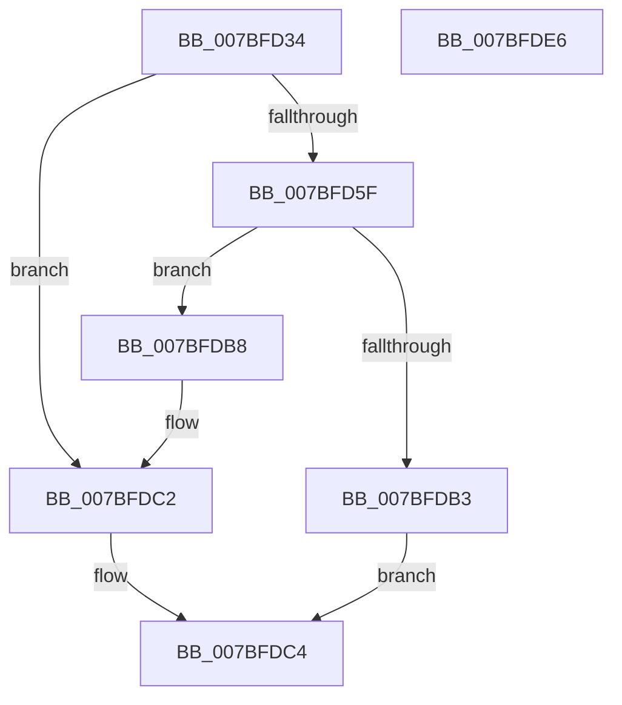

# EtwpWriteRemainingCompressedData

- RVA: `0x007BFD34`–`0x007BFDE7` (길이 `179` bytes)
- VA: `0x00000001407BFD34`
- 실행 섹션: `PAGE`
- PDB 이름 있음: `예`; PDB Function 태그: `아니요`
- unwind 정보 RVA: `0x000BE9D0`
- 디코드: `56`개 명령, `179/179` bytes 표시
- 미해석 바이트: `0` (있으면 어셈블리에 `.byte`로 보존)

> 이 문서는 커널 이미지의 기계어와 PDB 기호를 분석해 생성했습니다. 4번과 5번은 함수 원형과 자료형을 바이너리 사용 방식에서 추정한 C 해석이며 원본 소스 복구 결과는 아닙니다.

## 1. Dependencies

- 직접 호출 지점: **2**; 고유 호출 대상: **2**
- 직접 호출자로 확인된 함수: **1**
- RIP 상대 이미지 참조: **0**

### Outgoing calls
- `0x007BFD6C` → [memset](../../text/6C/memset_function_006C6C40.md) (function, `0x006C6C40`)
- `0x007BFDA5` → [ZwWriteFile](../../text/6A/ZwWriteFile_function_006AD1D0.md) (function, `0x006AD1D0`)

### Direct callers
- [EtwpSavePersistedLogger](EtwpSavePersistedLogger_function_007BF374.md) at `0x007BF70C`

### Static image references
- 디코드된 RIP-relative 메모리 참조가 없습니다.

## 2. Other-region calls and transfers

- 다른 실행 섹션으로 향하는 call: **2**
  - `0x007BFD6C` → [memset](../../text/6C/memset_function_006C6C40.md) (`PAGE` → `.text`)
  - `0x007BFDA5` → [ZwWriteFile](../../text/6A/ZwWriteFile_function_006AD1D0.md) (`PAGE` → `.text`)
- 별도 외부 분기/꼬리 이동을 확인하지 못했습니다.

## 3. Assembly (complete function range)

```asm
007BFD34  48 8B C4                        mov rax, rsp
007BFD37  48 89 58 08                     mov qword ptr [rax + 8], rbx
007BFD3B  48 89 68 10                     mov qword ptr [rax + 0x10], rbp
007BFD3F  48 89 70 18                     mov qword ptr [rax + 0x18], rsi
007BFD43  57                              push rdi
007BFD44  48 83 EC 60                     sub rsp, 0x60
007BFD48  48 8B D9                        mov rbx, rcx
007BFD4B  0F 57 C0                        xorps xmm0, xmm0
007BFD4E  8B 49 34                        mov ecx, dword ptr [rcx + 0x34]
007BFD51  49 8B F8                        mov rdi, r8
007BFD54  48 8B F2                        mov rsi, rdx
007BFD57  0F 11 40 E8                     movups xmmword ptr [rax - 0x18], xmm0
007BFD5B  85 C9                           test ecx, ecx
007BFD5D  74 63                           je 0x1407bfdc2
007BFD5F  44 8B 43 10                     mov r8d, dword ptr [rbx + 0x10]
007BFD63  33 D2                           xor edx, edx
007BFD65  44 2B C1                        sub r8d, ecx
007BFD68  48 03 4B 28                     add rcx, qword ptr [rbx + 0x28]
007BFD6C  E8 CF 6E F0 FF                  call 0x1406c6c40
007BFD71  48 83 64 24 40 00               and qword ptr [rsp + 0x40], 0
007BFD77  48 8D 6B 08                     lea rbp, [rbx + 8]
007BFD7B  8B 43 10                        mov eax, dword ptr [rbx + 0x10]
007BFD7E  45 33 C9                        xor r9d, r9d
007BFD81  48 8B 0B                        mov rcx, qword ptr [rbx]
007BFD84  45 33 C0                        xor r8d, r8d
007BFD87  48 89 6C 24 38                  mov qword ptr [rsp + 0x38], rbp
007BFD8C  33 D2                           xor edx, edx
007BFD8E  89 44 24 30                     mov dword ptr [rsp + 0x30], eax
007BFD92  48 8B 43 28                     mov rax, qword ptr [rbx + 0x28]
007BFD96  48 89 44 24 28                  mov qword ptr [rsp + 0x28], rax
007BFD9B  48 8D 44 24 50                  lea rax, [rsp + 0x50]
007BFDA0  48 89 44 24 20                  mov qword ptr [rsp + 0x20], rax
007BFDA5  E8 26 D4 EE FF                  call 0x1406ad1d0
007BFDAA  8B 53 38                        mov edx, dword ptr [rbx + 0x38]
007BFDAD  8B C8                           mov ecx, eax
007BFDAF  85 C0                           test eax, eax
007BFDB1  79 05                           jns 0x1407bfdb8
007BFDB3  01 53 18                        add dword ptr [rbx + 0x18], edx
007BFDB6  EB 0C                           jmp 0x1407bfdc4
007BFDB8  8B 43 34                        mov eax, dword ptr [rbx + 0x34]
007BFDBB  48 01 45 00                     add qword ptr [rbp], rax
007BFDBF  01 53 14                        add dword ptr [rbx + 0x14], edx
007BFDC2  33 C9                           xor ecx, ecx
007BFDC4  8B 43 14                        mov eax, dword ptr [rbx + 0x14]
007BFDC7  4C 8D 5C 24 60                  lea r11, [rsp + 0x60]
007BFDCC  01 06                           add dword ptr [rsi], eax
007BFDCE  8B 43 18                        mov eax, dword ptr [rbx + 0x18]
007BFDD1  01 07                           add dword ptr [rdi], eax
007BFDD3  8B C1                           mov eax, ecx
007BFDD5  49 8B 5B 10                     mov rbx, qword ptr [r11 + 0x10]
007BFDD9  49 8B 6B 18                     mov rbp, qword ptr [r11 + 0x18]
007BFDDD  49 8B 73 20                     mov rsi, qword ptr [r11 + 0x20]
007BFDE1  49 8B E3                        mov rsp, r11
007BFDE4  5F                              pop rdi
007BFDE5  C3                              ret
007BFDE6  CC                              int3
```

## 4. C-style interpretation (structured pseudocode)

```c
__int64 __fastcall EtwpWriteRemainingCompressedData(__int64 a1, __int64 a2, __int64 a3, int a4)
{
    __int64 result;
    __int64 v_rsp;
    unsigned __int64 v_stack_m18;
    unsigned __int64 v_stack_m28;
    unsigned __int64 v_stack_m30;
    unsigned int v_stack_m38;
    unsigned __int64 v_stack_m40;
    unsigned __int64 v_stack_m48;
    unsigned __int64 v_stack_m8;

    *(unsigned __int64 *)(v_rsp + 8) = v_rbx;
    *(unsigned __int64 *)(v_rsp + 16) = v_rbp;
    *(unsigned __int64 *)(v_rsp + 24) = v_rsi;
    v_rsp = (v_rsp) - (96);
    *(unsigned __int64 *)(v_rsp - 24) = v_xmm0;
    if ((unsigned int)((unsigned int)(*(unsigned int *)(a1 + 52))) == 0) goto loc_007BFDC2;
    a2 = 0;
    a3 = (unsigned int)(((unsigned int)(*(unsigned int *)(a1 + 16))) - ((unsigned int)((unsigned int)(*(unsigned int *)(a1 + 52)))));
    a1 = ((unsigned int)(*(unsigned int *)(a1 + 52))) + (*(unsigned __int64 *)(a1 + 40));
    result = memset(a1, a2, a3, a4);
    a4 = 0;
    a3 = 0;
    v_stack_m30 = a1 + 8;
    a2 = 0;
    v_stack_m38 = (unsigned int)((unsigned int)(*(unsigned int *)(a1 + 16)));
    v_stack_m40 = *(unsigned __int64 *)(a1 + 40);
    v_stack_m48 = v_stack_m18;
    result = ZwWriteFile(*(unsigned __int64 *)(a1), a2, a3, a4);
    if (!sign_flag) goto loc_007BFDB8;
    goto loc_007BFDC4;
loc_007BFDB8:
loc_007BFDC2:
    a1 = 0;
loc_007BFDC4:
    return 0;
}
```

## 5. (Beta) C Style

```c
int64_t EtwpWriteRemainingCompressedData(void *Arg1, void *Arg2, void *Arg3, int32_t Arg4)
{
    uint8_t *arg1 = (uint8_t *)Arg1;
    uint8_t *arg2 = (uint8_t *)Arg2;
    uint8_t *arg3 = (uint8_t *)Arg3;

    int64_t result;
    int64_t local_rsp;
    uint64_t v_stack_m18;
    uint64_t v_stack_m28;
    uint64_t v_stack_m30;
    uint32_t v_stack_m38;
    uint64_t v_stack_m40;
    uint64_t v_stack_m48;
    uint64_t v_stack_m8;

    *(uint64_t *)(local_rsp + 0x8) = local_rbx;
    *(uint64_t *)(local_rsp + 0x10) = local_rbp;
    *(uint64_t *)(local_rsp + 0x18) = local_rsi;
    local_rsp = (local_rsp) - (96);
    *(uint64_t *)(local_rsp - 0x18) = v_xmm0;
    if ((uint32_t)((uint32_t)(*(uint32_t *)(arg1 + 0x34))) == 0) goto loc_007BFDC2;
    Arg2 = 0;
    Arg3 = (uint32_t)(((uint32_t)(*(uint32_t *)(arg1 + 0x10))) - ((uint32_t)((uint32_t)(*(uint32_t *)(arg1 + 0x34)))));
    Arg1 = ((uint32_t)(*(uint32_t *)(arg1 + 0x34))) + (*(uint64_t *)(arg1 + 0x28));
    result = memset(Arg1, Arg2, Arg3, Arg4);
    Arg4 = 0;
    Arg3 = 0;
    v_stack_m30 = Arg1 + 8;
    Arg2 = 0;
    v_stack_m38 = (uint32_t)((uint32_t)(*(uint32_t *)(arg1 + 0x10)));
    v_stack_m40 = *(uint64_t *)(arg1 + 0x28);
    v_stack_m48 = v_stack_m18;
    result = ZwWriteFile(*(uint64_t *)(arg1), Arg2, Arg3, Arg4);
    if (!sign_flag) goto loc_007BFDB8;
    goto loc_007BFDC4;
loc_007BFDB8:
loc_007BFDC2:
    Arg1 = 0;
loc_007BFDC4:
    return 0;
}
```

### 관측된 메모리 오프셋

구조체 형식이 확인되지 않은 접근은 인자 기준의 오프셋으로만 기록했습니다.

| 기준 인자 | 오프셋 표현 | 폭 (bit) | 접근 |
|---|---:|---:|---|
| `Arg1` | `+ 0x0` | `64` | `R` |
| `Arg1` | `+ 0x0` | `64` | `R/W` |
| `Arg1` | `+ 0x8` | `64` | `R` |
| `Arg1` | `+ 0x10` | `32` | `R` |
| `Arg1` | `+ 0x14` | `32` | `R` |
| `Arg1` | `+ 0x14` | `32` | `R/W` |
| `Arg1` | `+ 0x18` | `32` | `R` |
| `Arg1` | `+ 0x18` | `32` | `R/W` |
| `Arg1` | `+ 0x28` | `64` | `R` |
| `Arg1` | `+ 0x34` | `32` | `R` |
| `Arg1` | `+ 0x38` | `32` | `R` |
| `Arg2` | `+ 0x0` | `32` | `R/W` |
| `Arg3` | `+ 0x0` | `32` | `R/W` |

## 6. Execution-region graph

[열기: 2D/3D 그래프와 함수 탐색 컨트롤 패널](../../../control-panel.html?section=page&rva=0x007BFD34&view=graph)

- 2D 그래프는 위에서 아래로 흐르고, 3D 그래프는 빈 공간을 드래그해 회전합니다. Shift+드래그는 이동, 휠은 확대·축소, 함수 노드 선택은 대상 보고서 이동입니다.

### Static fallback


