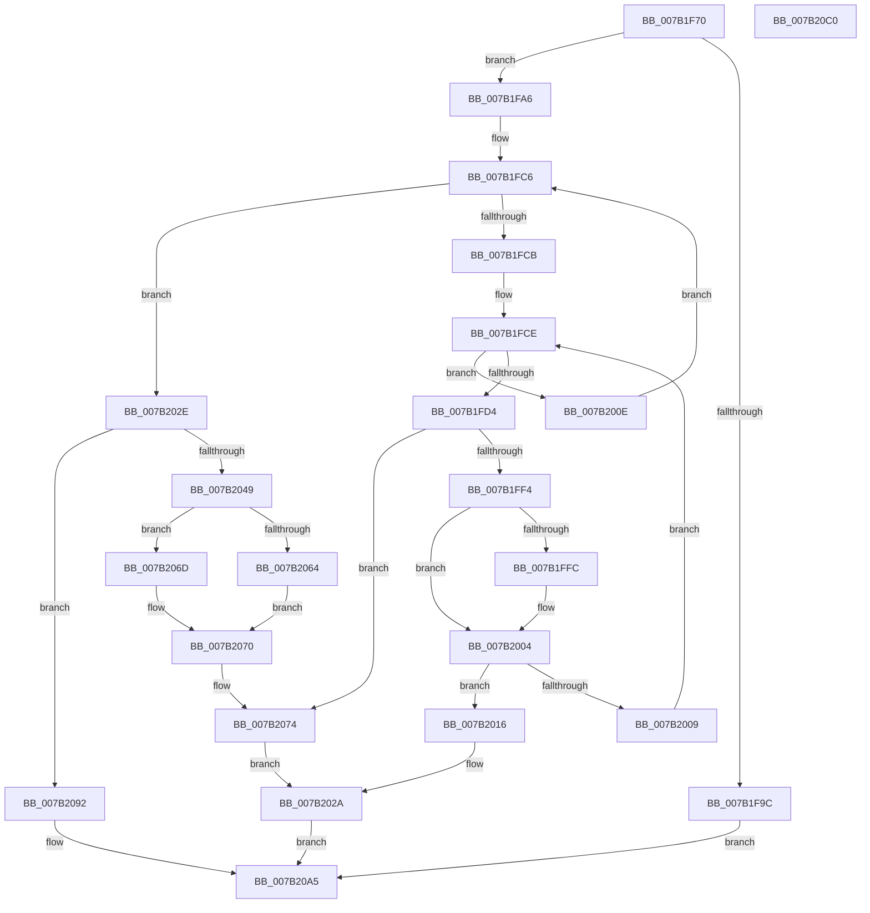

# IoWMIAllocateInstanceIds

- RVA: `0x007B1F70`–`0x007B20C1` (길이 `337` bytes)
- VA: `0x00000001407B1F70`
- 실행 섹션: `PAGE`
- PDB 이름 있음: `예`; PDB Function 태그: `아니요`
- unwind 정보 RVA: `0x0005D7BC`
- 디코드: `91`개 명령, `337/337` bytes 표시
- 미해석 바이트: `0` (있으면 어셈블리에 `.byte`로 보존)

> 이 문서는 커널 이미지의 기계어와 PDB 기호를 분석해 생성했습니다. 4번과 5번은 함수 원형과 자료형을 바이너리 사용 방식에서 추정한 C 해석이며 원본 소스 복구 결과는 아닙니다.

## 1. Dependencies

- 직접 호출 지점: **6**; 고유 호출 대상: **4**
- 직접 호출자로 확인된 함수: **1**
- RIP 상대 이미지 참조: **4**

### Outgoing calls
- `0x007B1FBA` → [KeWaitForSingleObject](../../text/20/KeWaitForSingleObject_function_0020E6B0.md) (function, `0x0020E6B0`)
- `0x007B2025` → [KeReleaseMutex](../../text/39/KeReleaseMutex_function_00396810.md) (function, `0x00396810`)
- `0x007B203C` → [ExAllocatePool2](../../poolcode/B8/ExAllocatePool2_function_00B820F0.md) (function, `0x00B820F0`)
- `0x007B2056` → [memset](../../text/6C/memset_function_006C6C40.md) (function, `0x006C6C40`)
- `0x007B2087` → [KeReleaseMutex](../../text/39/KeReleaseMutex_function_00396810.md) (function, `0x00396810`)
- `0x007B209B` → [KeReleaseMutex](../../text/39/KeReleaseMutex_function_00396810.md) (function, `0x00396810`)

### Direct callers
- [DifIoWMIAllocateInstanceIdsWrapper](../../text/62/DifIoWMIAllocateInstanceIdsWrapper_function_0062D700.md) at `0x0062D7E5`

### Static image references
- `0x007B1F8E` → RVA `0x00EFFA98` (`.data`; read)
- `0x007B1FAB` → RVA `0x00EFFA60` (`.data`; read)
- `0x007B1FBF` → RVA `0x00EFFC30` (`.data`; read)
- `0x007B2064` → RVA `0x00EFFC30` (`.data`; write)

## 2. Other-region calls and transfers

- 다른 실행 섹션으로 향하는 call: **6**
  - `0x007B1FBA` → [KeWaitForSingleObject](../../text/20/KeWaitForSingleObject_function_0020E6B0.md) (`PAGE` → `.text`)
  - `0x007B2025` → [KeReleaseMutex](../../text/39/KeReleaseMutex_function_00396810.md) (`PAGE` → `.text`)
  - `0x007B203C` → [ExAllocatePool2](../../poolcode/B8/ExAllocatePool2_function_00B820F0.md) (`PAGE` → `POOLCODE`)
  - `0x007B2056` → [memset](../../text/6C/memset_function_006C6C40.md) (`PAGE` → `.text`)
  - `0x007B2087` → [KeReleaseMutex](../../text/39/KeReleaseMutex_function_00396810.md) (`PAGE` → `.text`)
  - `0x007B209B` → [KeReleaseMutex](../../text/39/KeReleaseMutex_function_00396810.md) (`PAGE` → `.text`)
- 별도 외부 분기/꼬리 이동을 확인하지 못했습니다.

## 3. Assembly (complete function range)

```asm
007B1F70  48 8B C4                        mov rax, rsp
007B1F73  48 89 58 08                     mov qword ptr [rax + 8], rbx
007B1F77  48 89 68 10                     mov qword ptr [rax + 0x10], rbp
007B1F7B  48 89 70 18                     mov qword ptr [rax + 0x18], rsi
007B1F7F  48 89 78 20                     mov qword ptr [rax + 0x20], rdi
007B1F83  41 56                           push r14
007B1F85  48 83 EC 30                     sub rsp, 0x30
007B1F89  33 FF                           xor edi, edi
007B1F8B  4D 8B F0                        mov r14, r8
007B1F8E  48 39 3D 03 DB 74 00            cmp qword ptr [rip + 0x74db03], rdi
007B1F95  8B EA                           mov ebp, edx
007B1F97  48 8B F1                        mov rsi, rcx
007B1F9A  75 0A                           jne 0x1407b1fa6
007B1F9C  B8 01 00 00 C0                  mov eax, 0xc0000001
007B1FA1  E9 FF 00 00 00                  jmp 0x1407b20a5
007B1FA6  48 21 7C 24 20                  and qword ptr [rsp + 0x20], rdi
007B1FAB  48 8D 0D AE DA 74 00            lea rcx, [rip + 0x74daae]
007B1FB2  45 33 C9                        xor r9d, r9d
007B1FB5  45 33 C0                        xor r8d, r8d
007B1FB8  33 D2                           xor edx, edx
007B1FBA  E8 F1 C6 A5 FF                  call 0x14020e6b0
007B1FBF  4C 8B 05 6A DC 74 00            mov r8, qword ptr [rip + 0x74dc6a]
007B1FC6  4D 85 C0                        test r8, r8
007B1FC9  74 63                           je 0x1407b202e
007B1FCB  45 33 C9                        xor r9d, r9d
007B1FCE  41 83 F9 08                     cmp r9d, 8
007B1FD2  73 3A                           jae 0x1407b200e
007B1FD4  41 8B C1                        mov eax, r9d
007B1FD7  4A 8D 14 8D 02 00 00 00         lea rdx, [r9*4 + 2]
007B1FDF  48 03 D0                        add rdx, rax
007B1FE2  49 8D 14 90                     lea rdx, [r8 + rdx*4]
007B1FE6  44 8B 52 10                     mov r10d, dword ptr [rdx + 0x10]
007B1FEA  41 83 FA FF                     cmp r10d, -1
007B1FEE  0F 84 80 00 00 00               je 0x1407b2074
007B1FF4  48 8B 0E                        mov rcx, qword ptr [rsi]
007B1FF7  48 2B 0A                        sub rcx, qword ptr [rdx]
007B1FFA  75 08                           jne 0x1407b2004
007B1FFC  48 8B 4E 08                     mov rcx, qword ptr [rsi + 8]
007B2000  48 2B 4A 08                     sub rcx, qword ptr [rdx + 8]
007B2004  48 85 C9                        test rcx, rcx
007B2007  74 0D                           je 0x1407b2016
007B2009  41 FF C1                        inc r9d
007B200C  EB C0                           jmp 0x1407b1fce
007B200E  49 8B F8                        mov rdi, r8
007B2011  4D 8B 00                        mov r8, qword ptr [r8]
007B2014  EB B0                           jmp 0x1407b1fc6
007B2016  45 89 16                        mov dword ptr [r14], r10d
007B2019  48 8D 0D 40 DA 74 00            lea rcx, [rip + 0x74da40]
007B2020  01 6A 10                        add dword ptr [rdx + 0x10], ebp
007B2023  33 D2                           xor edx, edx
007B2025  E8 E6 47 BE FF                  call 0x140396810
007B202A  33 C0                           xor eax, eax
007B202C  EB 77                           jmp 0x1407b20a5
007B202E  BA A8 00 00 00                  mov edx, 0xa8
007B2033  41 B8 57 6D 69 69               mov r8d, 0x69696d57
007B2039  8D 4A 58                        lea ecx, [rdx + 0x58]
007B203C  E8 AF 00 3D 00                  call 0x140b820f0
007B2041  48 8B D8                        mov rbx, rax
007B2044  48 85 C0                        test rax, rax
007B2047  74 49                           je 0x1407b2092
007B2049  BA FF 00 00 00                  mov edx, 0xff
007B204E  48 8D 48 08                     lea rcx, [rax + 8]
007B2052  44 8D 42 A1                     lea r8d, [rdx - 0x5f]
007B2056  E8 E5 4B F1 FF                  call 0x1406c6c40
007B205B  48 83 23 00                     and qword ptr [rbx], 0
007B205F  48 85 FF                        test rdi, rdi
007B2062  75 09                           jne 0x1407b206d
007B2064  48 89 1D C5 DB 74 00            mov qword ptr [rip + 0x74dbc5], rbx
007B206B  EB 03                           jmp 0x1407b2070
007B206D  48 89 1F                        mov qword ptr [rdi], rbx
007B2070  48 8D 53 08                     lea rdx, [rbx + 8]
007B2074  0F 10 06                        movups xmm0, xmmword ptr [rsi]
007B2077  89 6A 10                        mov dword ptr [rdx + 0x10], ebp
007B207A  48 8D 0D DF D9 74 00            lea rcx, [rip + 0x74d9df]
007B2081  F3 0F 7F 02                     movdqu xmmword ptr [rdx], xmm0
007B2085  33 D2                           xor edx, edx
007B2087  E8 84 47 BE FF                  call 0x140396810
007B208C  41 83 26 00                     and dword ptr [r14], 0
007B2090  EB 98                           jmp 0x1407b202a
007B2092  33 D2                           xor edx, edx
007B2094  48 8D 0D C5 D9 74 00            lea rcx, [rip + 0x74d9c5]
007B209B  E8 70 47 BE FF                  call 0x140396810
007B20A0  B8 9A 00 00 C0                  mov eax, 0xc000009a
007B20A5  48 8B 5C 24 40                  mov rbx, qword ptr [rsp + 0x40]
007B20AA  48 8B 6C 24 48                  mov rbp, qword ptr [rsp + 0x48]
007B20AF  48 8B 74 24 50                  mov rsi, qword ptr [rsp + 0x50]
007B20B4  48 8B 7C 24 58                  mov rdi, qword ptr [rsp + 0x58]
007B20B9  48 83 C4 30                     add rsp, 0x30
007B20BD  41 5E                           pop r14
007B20BF  C3                              ret
007B20C0  CC                              int3
```

## 4. C-style interpretation (structured pseudocode)

```c
__int64 __fastcall IoWMIAllocateInstanceIds(__int64 a1, int a2, __int64 a3, int a4)
{
    __int64 result;
    __int64 v_rdi;
    __int64 v_rsp;
    unsigned __int64 v_stack_m18;
    unsigned __int64 v_stack_p10;
    unsigned __int64 v_stack_p18;
    unsigned __int64 v_stack_p20;
    unsigned __int64 v_stack_p8;

    *(unsigned __int64 *)(v_rsp + 8) = v_rbx;
    *(unsigned __int64 *)(v_rsp + 16) = v_rbp;
    *(unsigned __int64 *)(v_rsp + 24) = v_rsi;
    *(unsigned __int64 *)(v_rsp + 32) = v_rdi;
    v_rsp = (v_rsp) - (48);
    v_rdi = 0;
    if ((*(unsigned __int64 *)(v_rip + 7658243)) != 0) goto loc_007B1FA6;
    goto loc_007B20A5;
loc_007B1FA6:
    a4 = 0;
    a3 = 0;
    a2 = 0;
    result = KeWaitForSingleObject(v_rip + 7658158, a2, a3, a4);
loc_007B1FC6:
    if (*(unsigned __int64 *)(v_rip + 7658602) == 0) goto loc_007B202E;
    a4 = 0;
loc_007B1FCE:
    if (0 >= 8) goto loc_007B200E;
    a2 = (a4 * 4 + 2) + (0);
    if (((unsigned int)((unsigned int)(*(unsigned int *)(*(unsigned __int64 *)(v_rip + 7658602) + a2 * 4 + 16)))) == -1) goto loc_007B2074;
    a1 = (*(unsigned __int64 *)(a1)) - (*(unsigned __int64 *)(*(unsigned __int64 *)(v_rip + 7658602) + a2 * 4));
    if (!(condition_is_not_equal)) {
        a1 = *(unsigned __int64 *)(a1 + 8);
        a1 = (a1) - (*(unsigned __int64 *)(*(unsigned __int64 *)(v_rip + 7658602) + a2 * 4 + 8));
    }
    if (a1 == 0) goto loc_007B2016;
    a4 = (unsigned int)((a4) + 1);
    goto loc_007B1FCE;
loc_007B200E:
    goto loc_007B1FC6;
loc_007B2016:
    *(unsigned int *)(a3) = (unsigned int)((unsigned int)(*(unsigned int *)(*(unsigned __int64 *)(v_rip + 7658602) + a2 * 4 + 16)));
    a2 = 0;
    result = KeReleaseMutex(v_rip + 7658048, a2, *(unsigned __int64 *)(*(unsigned __int64 *)(v_rip + 7658602)), a4);
loc_007B202A:
    result = 0;
    goto loc_007B20A5;
loc_007B202E:
    result = ExAllocatePool2(168 + 88, 168, (unsigned int)(0x69696D57ULL), a4);
    if (result == 0) goto loc_007B2092;
    result = memset(result + 8, 255, 255 - 95, a4);
    if (*(unsigned __int64 *)(v_rip + 7658602) != 0) goto loc_007B206D;
    *(unsigned __int64 *)(v_rip + 7658437) = result;
    goto loc_007B2070;
loc_007B206D:
    *(unsigned __int64 *)(*(unsigned __int64 *)(v_rip + 7658602)) = result;
loc_007B2070:
loc_007B2074:
    *(unsigned int *)(result + 8 + 16) = (unsigned int)((unsigned int)(a2));
    *(unsigned __int64 *)(result + 8) = v_xmm0;
    a2 = 0;
    result = KeReleaseMutex(v_rip + 7657951, a2, 255 - 95, a4);
    goto loc_007B202A;
loc_007B2092:
    a2 = 0;
    result = KeReleaseMutex(v_rip + 7657925, a2, 255 - 95, a4);
loc_007B20A5:
    v_rsp = (v_rsp) + (48);
    return (unsigned int)(0xC000009AULL);
}
```

## 5. (Beta) C Style

```c
int64_t IoWMIAllocateInstanceIds(void *Arg1, int32_t Arg2, void *Arg3, int32_t Arg4)
{
    uint8_t *arg1 = (uint8_t *)Arg1;
    uint8_t *arg3 = (uint8_t *)Arg3;

    int64_t result;
    int64_t local_rdi;
    int64_t local_rsp;
    uint64_t v_stack_m18;
    uint64_t v_stack_p10;
    uint64_t v_stack_p18;
    uint64_t v_stack_p20;
    uint64_t v_stack_p8;

    *(uint64_t *)(local_rsp + 0x8) = local_rbx;
    *(uint64_t *)(local_rsp + 0x10) = local_rbp;
    *(uint64_t *)(local_rsp + 0x18) = local_rsi;
    *(uint64_t *)(local_rsp + 0x20) = local_rdi;
    local_rsp = (local_rsp) - (48);
    local_rdi = 0;
    if ((*(uint64_t *)(v_rip + 0x74DB03)) != 0) goto loc_007B1FA6;
    goto loc_007B20A5;
loc_007B1FA6:
    Arg4 = 0;
    Arg3 = 0;
    Arg2 = 0;
    result = KeWaitForSingleObject(v_rip + 7658158, Arg2, Arg3, Arg4);
loc_007B1FC6:
    if (*(uint64_t *)(v_rip + 0x74DC6A) == 0) goto loc_007B202E;
    Arg4 = 0;
loc_007B1FCE:
    if (0 >= 8) goto loc_007B200E;
    Arg2 = (Arg4 * 4 + 2) + (0);
    if (((uint32_t)((uint32_t)(*(uint32_t *)(*(uint64_t *)(v_rip + 0x74DC6A) + Arg2 * 4 + 0x10)))) == -1) goto loc_007B2074;
    Arg1 = (*(uint64_t *)(arg1)) - (*(uint64_t *)(*(uint64_t *)(v_rip + 0x74DC6A) + Arg2 * 4));
    if (!(condition_is_not_equal)) {
        Arg1 = *(uint64_t *)(arg1 + 0x8);
        Arg1 = (Arg1) - (*(uint64_t *)(*(uint64_t *)(v_rip + 0x74DC6A) + Arg2 * 4 + 0x8));
    }
    if (Arg1 == NULL) goto loc_007B2016;
    Arg4 = (uint32_t)((Arg4) + 1);
    goto loc_007B1FCE;
loc_007B200E:
    goto loc_007B1FC6;
loc_007B2016:
    *(uint32_t *)(arg3) = (uint32_t)((uint32_t)(*(uint32_t *)(*(uint64_t *)(v_rip + 0x74DC6A) + Arg2 * 4 + 0x10)));
    Arg2 = 0;
    result = KeReleaseMutex(v_rip + 7658048, Arg2, *(uint64_t *)(*(uint64_t *)(v_rip + 0x74DC6A)), Arg4);
loc_007B202A:
    result = 0;
    goto loc_007B20A5;
loc_007B202E:
    result = ExAllocatePool2(168 + 88, 168, (uint32_t)(0x69696D57ULL), Arg4);
    if (result == 0) goto loc_007B2092;
    result = memset(result + 8, 255, 255 - 95, Arg4);
    if (*(uint64_t *)(v_rip + 0x74DC6A) != 0) goto loc_007B206D;
    *(uint64_t *)(v_rip + 0x74DBC5) = result;
    goto loc_007B2070;
loc_007B206D:
    *(uint64_t *)(*(uint64_t *)(v_rip + 0x74DC6A)) = result;
loc_007B2070:
loc_007B2074:
    *(uint32_t *)(result + 0x8 + 0x10) = (uint32_t)((uint32_t)(Arg2));
    *(uint64_t *)(result + 0x8) = v_xmm0;
    Arg2 = 0;
    result = KeReleaseMutex(v_rip + 7657951, Arg2, 255 - 95, Arg4);
    goto loc_007B202A;
loc_007B2092:
    Arg2 = 0;
    result = KeReleaseMutex(v_rip + 7657925, Arg2, 255 - 95, Arg4);
loc_007B20A5:
    local_rsp = (local_rsp) + (48);
    return (uint32_t)(0xC000009AULL);
}
```

### 관측된 메모리 오프셋

구조체 형식이 확인되지 않은 접근은 인자 기준의 오프셋으로만 기록했습니다.

| 기준 인자 | 오프셋 표현 | 폭 (bit) | 접근 |
|---|---:|---:|---|
| `Arg1` | `+ 0x0` | `64` | `R` |
| `Arg1` | `+ 0x0` | `128` | `R` |
| `Arg1` | `+ 0x8` | `64` | `R` |
| `Arg3` | `+ 0x0` | `32` | `R/W` |
| `Arg3` | `+ 0x0` | `32` | `W` |

## 6. Execution-region graph

[열기: 2D/3D 그래프와 함수 탐색 컨트롤 패널](../../../control-panel.html?section=page&rva=0x007B1F70&view=graph)

- 2D 그래프는 위에서 아래로 흐르고, 3D 그래프는 빈 공간을 드래그해 회전합니다. Shift+드래그는 이동, 휠은 확대·축소, 함수 노드 선택은 대상 보고서 이동입니다.

### Static fallback


