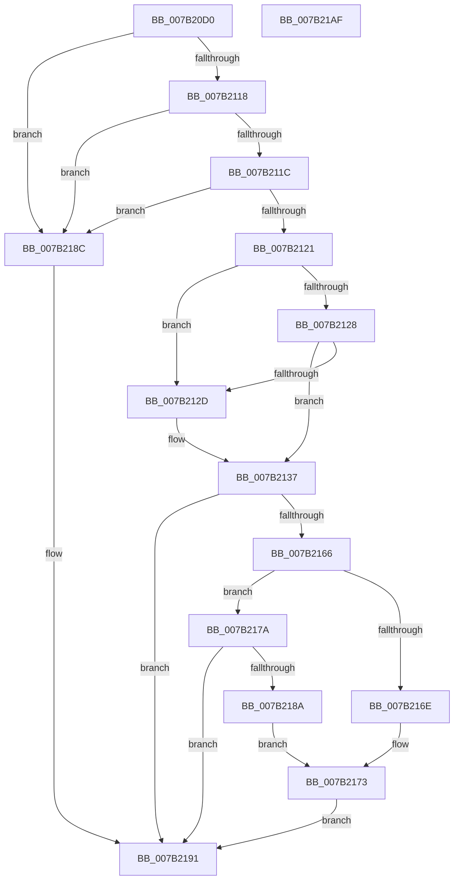

# IoWMIQueryAllDataMultiple

- RVA: `0x007B20D0`–`0x007B21B0` (길이 `224` bytes)
- VA: `0x00000001407B20D0`
- 실행 섹션: `PAGE`
- PDB 이름 있음: `예`; PDB Function 태그: `아니요`
- unwind 정보 RVA: `0x000D2580`
- 디코드: `69`개 명령, `224/224` bytes 표시
- 미해석 바이트: `0` (있으면 어셈블리에 `.byte`로 보존)

> 이 문서는 커널 이미지의 기계어와 PDB 기호를 분석해 생성했습니다. 4번과 5번은 함수 원형과 자료형을 바이너리 사용 방식에서 추정한 C 해석이며 원본 소스 복구 결과는 아닙니다.

## 1. Dependencies

- 직접 호출 지점: **3**; 고유 호출 대상: **3**
- 직접 호출자로 확인된 함수: **0**
- RIP 상대 이미지 참조: **1**

### Outgoing calls
- `0x007B2109` → [memset](../../text/6C/memset_function_006C6C40.md) (function, `0x006C6C40`)
- `0x007B215B` → [WmipQueryAllDataMultiple](../9D/WmipQueryAllDataMultiple_function_009DF11C.md) (function, `0x009DF11C`)
- `0x007B219E` → [_security_check_cookie](../../text/6A/_security_check_cookie_function_006AC640.md) (function, `0x006AC640`)

### Direct callers
- 이 함수 시작 RVA로 연결되는 직접 call은 확인되지 않았습니다. 간접 호출은 완전히 역산할 수 없습니다.

### Static image references
- `0x007B20DC` → RVA `0x00E0A740` (`.data`; read)

## 2. Other-region calls and transfers

- 다른 실행 섹션으로 향하는 call: **2**
  - `0x007B2109` → [memset](../../text/6C/memset_function_006C6C40.md) (`PAGE` → `.text`)
  - `0x007B219E` → [_security_check_cookie](../../text/6A/_security_check_cookie_function_006AC640.md) (`PAGE` → `.text`)
- 별도 외부 분기/꼬리 이동을 확인하지 못했습니다.

## 3. Assembly (complete function range)

```asm
007B20D0  40 53                           push rbx
007B20D2  55                              push rbp
007B20D3  56                              push rsi
007B20D4  57                              push rdi
007B20D5  48 81 EC B8 00 00 00            sub rsp, 0xb8
007B20DC  48 8B 05 5D 86 65 00            mov rax, qword ptr [rip + 0x65865d]
007B20E3  48 33 C4                        xor rax, rsp
007B20E6  48 89 84 24 A0 00 00 00         mov qword ptr [rsp + 0xa0], rax
007B20EE  83 64 24 50 00                  and dword ptr [rsp + 0x50], 0
007B20F3  8B F2                           mov esi, edx
007B20F5  33 D2                           xor edx, edx
007B20F7  49 8B F8                        mov rdi, r8
007B20FA  48 8B E9                        mov rbp, rcx
007B20FD  49 8B D9                        mov rbx, r9
007B2100  48 8D 4C 24 54                  lea rcx, [rsp + 0x54]
007B2105  44 8D 42 44                     lea r8d, [rdx + 0x44]
007B2109  E8 32 4B F1 FF                  call 0x1406c6c40
007B210E  83 64 24 40 00                  and dword ptr [rsp + 0x40], 0
007B2113  48 85 ED                        test rbp, rbp
007B2116  74 74                           je 0x1407b218c
007B2118  85 F6                           test esi, esi
007B211A  74 70                           je 0x1407b218c
007B211C  48 85 FF                        test rdi, rdi
007B211F  74 6B                           je 0x1407b218c
007B2121  8B 07                           mov eax, dword ptr [rdi]
007B2123  48 85 DB                        test rbx, rbx
007B2126  74 05                           je 0x1407b212d
007B2128  83 F8 48                        cmp eax, 0x48
007B212B  73 0A                           jae 0x1407b2137
007B212D  48 8D 5C 24 50                  lea rbx, [rsp + 0x50]
007B2132  B8 48 00 00 00                  mov eax, 0x48
007B2137  48 8D 4C 24 40                  lea rcx, [rsp + 0x40]
007B213C  45 33 C9                        xor r9d, r9d
007B213F  48 89 4C 24 38                  mov qword ptr [rsp + 0x38], rcx
007B2144  45 33 C0                        xor r8d, r8d
007B2147  48 83 64 24 30 00               and qword ptr [rsp + 0x30], 0
007B214D  48 8B D5                        mov rdx, rbp
007B2150  89 44 24 28                     mov dword ptr [rsp + 0x28], eax
007B2154  8B CE                           mov ecx, esi
007B2156  48 89 5C 24 20                  mov qword ptr [rsp + 0x20], rbx
007B215B  E8 BC CF 22 00                  call 0x1409df11c
007B2160  8B D0                           mov edx, eax
007B2162  85 C0                           test eax, eax
007B2164  78 2B                           js 0x1407b2191
007B2166  8B 4B 2C                        mov ecx, dword ptr [rbx + 0x2c]
007B2169  F6 C1 20                        test cl, 0x20
007B216C  74 0C                           je 0x1407b217a
007B216E  8B 43 30                        mov eax, dword ptr [rbx + 0x30]
007B2171  89 07                           mov dword ptr [rdi], eax
007B2173  BA 23 00 00 C0                  mov edx, 0xc0000023
007B2178  EB 17                           jmp 0x1407b2191
007B217A  8B 44 24 40                     mov eax, dword ptr [rsp + 0x40]
007B217E  89 07                           mov dword ptr [rdi], eax
007B2180  48 8D 44 24 50                  lea rax, [rsp + 0x50]
007B2185  48 3B D8                        cmp rbx, rax
007B2188  75 07                           jne 0x1407b2191
007B218A  EB E7                           jmp 0x1407b2173
007B218C  BA 0D 00 00 C0                  mov edx, 0xc000000d
007B2191  8B C2                           mov eax, edx
007B2193  48 8B 8C 24 A0 00 00 00         mov rcx, qword ptr [rsp + 0xa0]
007B219B  48 33 CC                        xor rcx, rsp
007B219E  E8 9D A4 EF FF                  call 0x1406ac640
007B21A3  48 81 C4 B8 00 00 00            add rsp, 0xb8
007B21AA  5F                              pop rdi
007B21AB  5E                              pop rsi
007B21AC  5D                              pop rbp
007B21AD  5B                              pop rbx
007B21AE  C3                              ret
007B21AF  CC                              int3
```

## 4. C-style interpretation (structured pseudocode)

```c
__int64 __fastcall IoWMIQueryAllDataMultiple(__int64 a1, int a2, __int64 a3, __int64 a4)
{
    __int64 result;
    __int64 v_rbx;
    __int64 v_rsp;
    unsigned __int64 v_stack_m38;
    unsigned __int64 v_stack_m84;
    unsigned int v_stack_m88;
    unsigned int v_stack_m98;
    unsigned __int64 v_stack_mA0;
    unsigned __int64 v_stack_mA8;
    unsigned int v_stack_mB0;
    unsigned __int64 v_stack_mB8;

    v_rsp = (v_rsp) - (184);
    result = (*(unsigned __int64 *)(v_rip + 6653533)) ^ (v_rsp);
    v_stack_m38 = result;
    a2 = 0;
    result = memset(v_stack_m84, a2, a2 + 68, a4);
    if (a1 == 0) goto loc_007B218C;
    if ((unsigned int)((unsigned int)(a2)) == 0) goto loc_007B218C;
    if (a3 == 0) goto loc_007B218C;
    if (a4 == 0) goto loc_007B212D;
    result = (unsigned int)(*(unsigned int *)(a3));
    v_rbx = a4;
    if (((unsigned int)((unsigned int)(*(unsigned int *)(a3)))) < 72) {
        v_rbx = v_stack_m88;
        result = 72;
    }
    a4 = 0;
    v_stack_mA0 = v_stack_m98;
    a3 = 0;
    v_stack_mB0 = (unsigned int)(result);
    v_stack_mB8 = v_rbx;
    result = WmipQueryAllDataMultiple((unsigned int)((unsigned int)((unsigned int)(a2))), a1, a3, a4);
    if (sign_flag) goto loc_007B2191;
    if ((((unsigned __int8)((unsigned int)(*(unsigned int *)(v_rbx + 44)))) & (32)) == 0) goto loc_007B217A;
    *(unsigned int *)(a3) = (unsigned int)((unsigned int)(*(unsigned int *)(v_rbx + 48)));
loc_007B2173:
    goto loc_007B2191;
loc_007B217A:
    *(unsigned int *)(a3) = (unsigned int)((unsigned int)(v_stack_m98));
    if (v_rbx != v_stack_m88) goto loc_007B2191;
    goto loc_007B2173;
loc_007B218C:
loc_007B2191:
    a1 = (v_stack_m38) ^ (v_rsp);
    result = _security_check_cookie(a1, (unsigned int)(0xC000000DULL), a3, a4);
    v_rsp = (v_rsp) + (184);
    return result;
}
```

## 5. (Beta) C Style

```c
int64_t IoWMIQueryAllDataMultiple(int64_t Arg1, int32_t Arg2, int64_t Arg3, int64_t Arg4)
{
    int64_t result;
    int64_t local_rbx;
    int64_t local_rsp;
    uint64_t v_stack_m38;
    uint64_t v_stack_m84;
    uint32_t v_stack_m88;
    uint32_t v_stack_m98;
    uint64_t v_stack_mA0;
    uint64_t v_stack_mA8;
    uint32_t v_stack_mB0;
    uint64_t v_stack_mB8;

    local_rsp = (local_rsp) - (184);
    result = (*(uint64_t *)(v_rip + 0x65865D)) ^ (local_rsp);
    v_stack_m38 = result;
    Arg2 = 0;
    result = memset(v_stack_m84, Arg2, Arg2 + 68, Arg4);
    if (Arg1 == 0) goto loc_007B218C;
    if ((uint32_t)((uint32_t)(Arg2)) == 0) goto loc_007B218C;
    if (Arg3 == 0) goto loc_007B218C;
    if (Arg4 == 0) goto loc_007B212D;
    result = (uint32_t)(*(uint32_t *)(Arg3));
    local_rbx = Arg4;
    if (((uint32_t)((uint32_t)(*(uint32_t *)(Arg3)))) < 72) {
        local_rbx = v_stack_m88;
        result = 72;
    }
    Arg4 = 0;
    v_stack_mA0 = v_stack_m98;
    Arg3 = 0;
    v_stack_mB0 = (uint32_t)(result);
    v_stack_mB8 = local_rbx;
    result = WmipQueryAllDataMultiple((uint32_t)((uint32_t)((uint32_t)(Arg2))), Arg1, Arg3, Arg4);
    if (sign_flag) goto loc_007B2191;
    if ((((uint8_t)((uint32_t)(*(uint32_t *)(local_rbx + 0x2C)))) & (32)) == 0) goto loc_007B217A;
    *(uint32_t *)(Arg3) = (uint32_t)((uint32_t)(*(uint32_t *)(local_rbx + 0x30)));
loc_007B2173:
    goto loc_007B2191;
loc_007B217A:
    *(uint32_t *)(Arg3) = (uint32_t)((uint32_t)(v_stack_m98));
    if (local_rbx != v_stack_m88) goto loc_007B2191;
    goto loc_007B2173;
loc_007B218C:
loc_007B2191:
    Arg1 = (v_stack_m38) ^ (local_rsp);
    result = _security_check_cookie(Arg1, (uint32_t)(0xC000000DULL), Arg3, Arg4);
    local_rsp = (local_rsp) + (184);
    return result;
}
```

## 6. Execution-region graph

[열기: 2D/3D 그래프와 함수 탐색 컨트롤 패널](../../../control-panel.html?section=page&rva=0x007B20D0&view=graph)

- 2D 그래프는 위에서 아래로 흐르고, 3D 그래프는 빈 공간을 드래그해 회전합니다. Shift+드래그는 이동, 휠은 확대·축소, 함수 노드 선택은 대상 보고서 이동입니다.

### Static fallback


