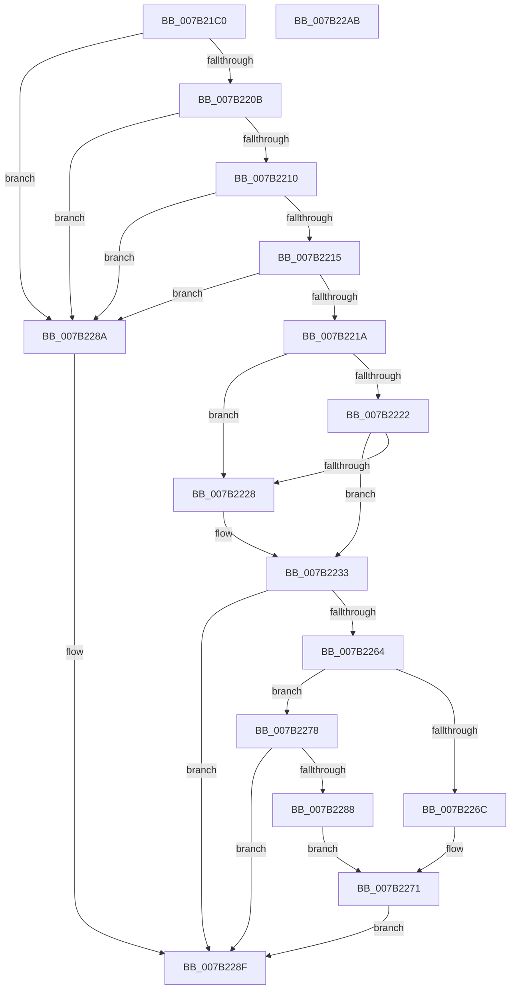

# IoWMIQuerySingleInstanceMultiple

- RVA: `0x007B21C0`–`0x007B22AC` (길이 `236` bytes)
- VA: `0x00000001407B21C0`
- 실행 섹션: `PAGE`
- PDB 이름 있음: `예`; PDB Function 태그: `아니요`
- unwind 정보 RVA: `0x000D312C`
- 디코드: `67`개 명령, `236/236` bytes 표시
- 미해석 바이트: `0` (있으면 어셈블리에 `.byte`로 보존)

> 이 문서는 커널 이미지의 기계어와 PDB 기호를 분석해 생성했습니다. 4번과 5번은 함수 원형과 자료형을 바이너리 사용 방식에서 추정한 C 해석이며 원본 소스 복구 결과는 아닙니다.

## 1. Dependencies

- 직접 호출 지점: **2**; 고유 호출 대상: **2**
- 직접 호출자로 확인된 함수: **0**
- RIP 상대 이미지 참조: **1**

### Outgoing calls
- `0x007B2259` → [WmipQuerySingleMultiple](WmipQuerySingleMultiple_function_007B36F0.md) (function, `0x007B36F0`)
- `0x007B229C` → [_security_check_cookie](../../text/6A/_security_check_cookie_function_006AC640.md) (function, `0x006AC640`)

### Direct callers
- 이 함수 시작 RVA로 연결되는 직접 call은 확인되지 않았습니다. 간접 호출은 완전히 역산할 수 없습니다.

### Static image references
- `0x007B21CC` → RVA `0x00E0A740` (`.data`; read)

## 2. Other-region calls and transfers

- 다른 실행 섹션으로 향하는 call: **1**
  - `0x007B229C` → [_security_check_cookie](../../text/6A/_security_check_cookie_function_006AC640.md) (`PAGE` → `.text`)
- 별도 외부 분기/꼬리 이동을 확인하지 못했습니다.

## 3. Assembly (complete function range)

```asm
007B21C0  4C 8B DC                        mov r11, rsp
007B21C3  53                              push rbx
007B21C4  57                              push rdi
007B21C5  48 81 EC A8 00 00 00            sub rsp, 0xa8
007B21CC  48 8B 05 6D 85 65 00            mov rax, qword ptr [rip + 0x65856d]
007B21D3  48 33 C4                        xor rax, rsp
007B21D6  48 89 84 24 90 00 00 00         mov qword ptr [rsp + 0x90], rax
007B21DE  83 64 24 50 00                  and dword ptr [rsp + 0x50], 0
007B21E3  0F 57 C0                        xorps xmm0, xmm0
007B21E6  48 8B 9C 24 E0 00 00 00         mov rbx, qword ptr [rsp + 0xe0]
007B21EE  33 C0                           xor eax, eax
007B21F0  49 8B F9                        mov rdi, r9
007B21F3  0F 11 44 24 58                  movups xmmword ptr [rsp + 0x58], xmm0
007B21F8  0F 11 44 24 68                  movups xmmword ptr [rsp + 0x68], xmm0
007B21FD  0F 11 44 24 78                  movups xmmword ptr [rsp + 0x78], xmm0
007B2202  49 89 43 D0                     mov qword ptr [r11 - 0x30], rax
007B2206  48 85 C9                        test rcx, rcx
007B2209  74 7F                           je 0x1407b228a
007B220B  48 85 D2                        test rdx, rdx
007B220E  74 7A                           je 0x1407b228a
007B2210  45 85 C0                        test r8d, r8d
007B2213  74 75                           je 0x1407b228a
007B2215  4D 85 C9                        test r9, r9
007B2218  74 70                           je 0x1407b228a
007B221A  45 8B 09                        mov r9d, dword ptr [r9]
007B221D  48 85 DB                        test rbx, rbx
007B2220  74 06                           je 0x1407b2228
007B2222  41 83 F9 38                     cmp r9d, 0x38
007B2226  73 0B                           jae 0x1407b2233
007B2228  48 8D 5C 24 58                  lea rbx, [rsp + 0x58]
007B222D  41 B9 38 00 00 00               mov r9d, 0x38
007B2233  48 8D 44 24 50                  lea rax, [rsp + 0x50]
007B2238  48 89 44 24 40                  mov qword ptr [rsp + 0x40], rax
007B223D  48 89 54 24 38                  mov qword ptr [rsp + 0x38], rdx
007B2242  33 D2                           xor edx, edx
007B2244  48 89 4C 24 30                  mov qword ptr [rsp + 0x30], rcx
007B2249  33 C9                           xor ecx, ecx
007B224B  44 89 44 24 28                  mov dword ptr [rsp + 0x28], r8d
007B2250  4C 8B C3                        mov r8, rbx
007B2253  48 83 64 24 20 00               and qword ptr [rsp + 0x20], 0
007B2259  E8 92 14 00 00                  call 0x1407b36f0
007B225E  8B D0                           mov edx, eax
007B2260  85 C0                           test eax, eax
007B2262  78 2B                           js 0x1407b228f
007B2264  8B 4B 2C                        mov ecx, dword ptr [rbx + 0x2c]
007B2267  F6 C1 20                        test cl, 0x20
007B226A  74 0C                           je 0x1407b2278
007B226C  8B 43 30                        mov eax, dword ptr [rbx + 0x30]
007B226F  89 07                           mov dword ptr [rdi], eax
007B2271  BA 23 00 00 C0                  mov edx, 0xc0000023
007B2276  EB 17                           jmp 0x1407b228f
007B2278  8B 44 24 50                     mov eax, dword ptr [rsp + 0x50]
007B227C  89 07                           mov dword ptr [rdi], eax
007B227E  48 8D 44 24 58                  lea rax, [rsp + 0x58]
007B2283  48 3B D8                        cmp rbx, rax
007B2286  75 07                           jne 0x1407b228f
007B2288  EB E7                           jmp 0x1407b2271
007B228A  BA 0D 00 00 C0                  mov edx, 0xc000000d
007B228F  8B C2                           mov eax, edx
007B2291  48 8B 8C 24 90 00 00 00         mov rcx, qword ptr [rsp + 0x90]
007B2299  48 33 CC                        xor rcx, rsp
007B229C  E8 9F A3 EF FF                  call 0x1406ac640
007B22A1  48 81 C4 A8 00 00 00            add rsp, 0xa8
007B22A8  5F                              pop rdi
007B22A9  5B                              pop rbx
007B22AA  C3                              ret
007B22AB  CC                              int3
```

## 4. C-style interpretation (structured pseudocode)

```c
__int64 __fastcall IoWMIQuerySingleInstanceMultiple(__int64 a1, __int64 a2, int a3, __int64 a4, __int64 a5)
{
    __int64 result;
    __int64 v_rbx;
    __int64 v_rsp;
    unsigned __int64 v_stack_m28;
    unsigned __int64 v_stack_m40;
    unsigned __int64 v_stack_m50;
    unsigned __int64 v_stack_m60;
    unsigned int v_stack_m68;
    unsigned __int64 v_stack_m78;
    unsigned __int64 v_stack_m80;
    unsigned __int64 v_stack_m88;
    unsigned int v_stack_m90;
    unsigned __int64 v_stack_m98;

    v_rsp = (v_rsp) - (168);
    result = (*(unsigned __int64 *)(v_rip + 6653293)) ^ (v_rsp);
    v_stack_m28 = result;
    result = 0;
    v_stack_m60 = v_xmm0;
    v_stack_m50 = v_xmm0;
    v_stack_m40 = v_xmm0;
    *(unsigned __int64 *)(v_rsp - 48) = 0;
    if (a1 == 0) goto loc_007B228A;
    if (a2 == 0) goto loc_007B228A;
    if (a3 == 0) goto loc_007B228A;
    if (a4 == 0) goto loc_007B228A;
    if (a5 == 0) goto loc_007B2228;
    v_rbx = a5;
    if (((unsigned int)((unsigned int)(*(unsigned int *)(a4)))) < 56) {
        v_rbx = v_stack_m60;
        a4 = 56;
    }
    v_stack_m78 = v_stack_m68;
    v_stack_m80 = a2;
    a2 = 0;
    v_stack_m88 = a1;
    a1 = 0;
    v_stack_m90 = a3;
    result = WmipQuerySingleMultiple(a1, a2, v_rbx, a4);
    if (sign_flag) goto loc_007B228F;
    if ((((unsigned __int8)((unsigned int)(*(unsigned int *)(v_rbx + 44)))) & (32)) == 0) goto loc_007B2278;
    *(unsigned int *)(a4) = (unsigned int)((unsigned int)(*(unsigned int *)(v_rbx + 48)));
loc_007B2271:
    goto loc_007B228F;
loc_007B2278:
    *(unsigned int *)(a4) = (unsigned int)((unsigned int)(v_stack_m68));
    if (v_rbx != v_stack_m60) goto loc_007B228F;
    goto loc_007B2271;
loc_007B228A:
loc_007B228F:
    a1 = (v_stack_m28) ^ (v_rsp);
    result = _security_check_cookie(a1, (unsigned int)(0xC000000DULL), v_rbx, a4);
    v_rsp = (v_rsp) + (168);
    return result;
}
```

## 5. (Beta) C Style

```c
int64_t IoWMIQuerySingleInstanceMultiple(int64_t Arg1, int64_t Arg2, int32_t Arg3, void *Arg4, int64_t Arg5)
{
    uint8_t *arg4 = (uint8_t *)Arg4;

    int64_t result;
    int64_t local_rbx;
    int64_t local_rsp;
    uint64_t v_stack_m28;
    uint64_t v_stack_m40;
    uint64_t v_stack_m50;
    uint64_t v_stack_m60;
    uint32_t v_stack_m68;
    uint64_t v_stack_m78;
    uint64_t v_stack_m80;
    uint64_t v_stack_m88;
    uint32_t v_stack_m90;
    uint64_t v_stack_m98;

    local_rsp = (local_rsp) - (168);
    result = (*(uint64_t *)(v_rip + 0x65856D)) ^ (local_rsp);
    v_stack_m28 = result;
    result = 0;
    v_stack_m60 = v_xmm0;
    v_stack_m50 = v_xmm0;
    v_stack_m40 = v_xmm0;
    *(uint64_t *)(local_rsp - 0x30) = 0;
    if (Arg1 == 0) goto loc_007B228A;
    if (Arg2 == 0) goto loc_007B228A;
    if (Arg3 == 0) goto loc_007B228A;
    if (Arg4 == NULL) goto loc_007B228A;
    if (Arg5 == 0) goto loc_007B2228;
    local_rbx = Arg5;
    if (((uint32_t)((uint32_t)(*(uint32_t *)(arg4)))) < 56) {
        local_rbx = v_stack_m60;
        Arg4 = 56;
    }
    v_stack_m78 = v_stack_m68;
    v_stack_m80 = Arg2;
    Arg2 = 0;
    v_stack_m88 = Arg1;
    Arg1 = 0;
    v_stack_m90 = Arg3;
    result = WmipQuerySingleMultiple(Arg1, Arg2, local_rbx, Arg4);
    if (sign_flag) goto loc_007B228F;
    if ((((uint8_t)((uint32_t)(*(uint32_t *)(local_rbx + 0x2C)))) & (32)) == 0) goto loc_007B2278;
    *(uint32_t *)(arg4) = (uint32_t)((uint32_t)(*(uint32_t *)(local_rbx + 0x30)));
loc_007B2271:
    goto loc_007B228F;
loc_007B2278:
    *(uint32_t *)(arg4) = (uint32_t)((uint32_t)(v_stack_m68));
    if (local_rbx != v_stack_m60) goto loc_007B228F;
    goto loc_007B2271;
loc_007B228A:
loc_007B228F:
    Arg1 = (v_stack_m28) ^ (local_rsp);
    result = _security_check_cookie(Arg1, (uint32_t)(0xC000000DULL), local_rbx, Arg4);
    local_rsp = (local_rsp) + (168);
    return result;
}
```

### 관측된 메모리 오프셋

구조체 형식이 확인되지 않은 접근은 인자 기준의 오프셋으로만 기록했습니다.

| 기준 인자 | 오프셋 표현 | 폭 (bit) | 접근 |
|---|---:|---:|---|
| `Arg4` | `+ 0x0` | `32` | `W` |

## 6. Execution-region graph

[열기: 2D/3D 그래프와 함수 탐색 컨트롤 패널](../../../control-panel.html?section=page&rva=0x007B21C0&view=graph)

- 2D 그래프는 위에서 아래로 흐르고, 3D 그래프는 빈 공간을 드래그해 회전합니다. Shift+드래그는 이동, 휠은 확대·축소, 함수 노드 선택은 대상 보고서 이동입니다.

### Static fallback


