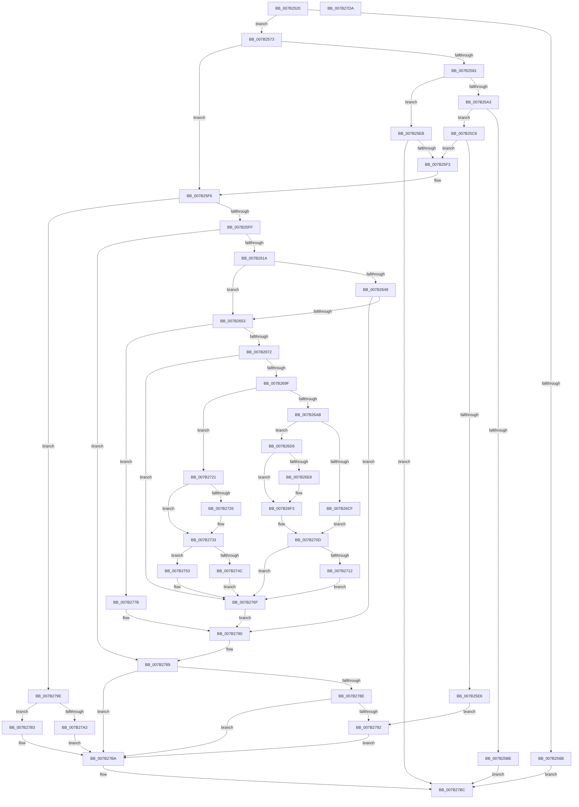

# IoWMISuggestInstanceName

- RVA: `0x007B2520`–`0x007B27DB` (길이 `699` bytes)
- VA: `0x00000001407B2520`
- 실행 섹션: `PAGE`
- PDB 이름 있음: `예`; PDB Function 태그: `아니요`
- unwind 정보 RVA: `0x000A9A64`
- 디코드: `198`개 명령, `699/699` bytes 표시
- 미해석 바이트: `0` (있으면 어셈블리에 `.byte`로 보존)

> 이 문서는 커널 이미지의 기계어와 PDB 기호를 분석해 생성했습니다. 4번과 5번은 함수 원형과 자료형을 바이너리 사용 방식에서 추정한 C 해석이며 원본 소스 복구 결과는 아닙니다.

## 1. Dependencies

- 직접 호출 지점: **18**; 고유 호출 대상: **7**
- 직접 호출자로 확인된 함수: **0**
- RIP 상대 이미지 참조: **2**

### Outgoing calls
- `0x007B2595` → [IoGetDeviceProperty](../8F/IoGetDeviceProperty_function_008FA720.md) (function, `0x008FA720`)
- `0x007B25B1` → [ExAllocatePool2](../../poolcode/B8/ExAllocatePool2_function_00B820F0.md) (function, `0x00B820F0`)
- `0x007B25DB` → [IoGetDeviceProperty](../8F/IoGetDeviceProperty_function_008FA720.md) (function, `0x008FA720`)
- `0x007B260B` → [IoOpenDeviceInterfaceRegistryKey](../AC/IoOpenDeviceInterfaceRegistryKey_function_00AC5C60.md) (function, `0x00AC5C60`)
- `0x007B263A` → [ZwQueryValueKey](../../text/6A/ZwQueryValueKey_function_006AD3B0.md) (function, `0x006AD3B0`)
- `0x007B2661` → [ExAllocatePool2](../../poolcode/B8/ExAllocatePool2_function_00B820F0.md) (function, `0x00B820F0`)
- `0x007B2690` → [ZwQueryValueKey](../../text/6A/ZwQueryValueKey_function_006AD3B0.md) (function, `0x006AD3B0`)
- `0x007B26C5` → [ExAllocatePool2](../../poolcode/B8/ExAllocatePool2_function_00B820F0.md) (function, `0x00B820F0`)
- `0x007B26EE` → [RtlAppendUnicodeToString](../../text/40/RtlAppendUnicodeToString_function_0040F990.md) (function, `0x0040F990`)
- `0x007B26FD` → [RtlAppendUnicodeToString](../../text/40/RtlAppendUnicodeToString_function_0040F990.md) (function, `0x0040F990`)
- `0x007B2708` → [RtlAppendUnicodeToString](../../text/40/RtlAppendUnicodeToString_function_0040F990.md) (function, `0x0040F990`)
- `0x007B2717` → [ExFreePoolWithTag](../../poolcode/B8/ExFreePoolWithTag_function_00B82870.md) (function, `0x00B82870`)
- `0x007B272B` → [ExFreePoolWithTag](../../poolcode/B8/ExFreePoolWithTag_function_00B82870.md) (function, `0x00B82870`)
- `0x007B2742` → [ExAllocatePool2](../../poolcode/B8/ExAllocatePool2_function_00B820F0.md) (function, `0x00B820F0`)
- `0x007B276A` → [RtlAppendUnicodeToString](../../text/40/RtlAppendUnicodeToString_function_0040F990.md) (function, `0x0040F990`)
- `0x007B2774` → [ExFreePoolWithTag](../../poolcode/B8/ExFreePoolWithTag_function_00B82870.md) (function, `0x00B82870`)
- `0x007B2784` → [ZwClose](../../text/6A/ZwClose_function_006AD2B0.md) (function, `0x006AD2B0`)
- `0x007B2797` → [ExFreePoolWithTag](../../poolcode/B8/ExFreePoolWithTag_function_00B82870.md) (function, `0x00B82870`)

### Direct callers
- 이 함수 시작 RVA로 연결되는 직접 call은 확인되지 않았습니다. 간접 호출은 완전히 역산할 수 없습니다.

### Static image references
- `0x007B2545` → RVA `0x00EFFA98` (`.data`; read)
- `0x007B26F3` → RVA `0x00B06E30` (` ?? ::NNGAKEGL::`string'`; read)

## 2. Other-region calls and transfers

- 다른 실행 섹션으로 향하는 call: **15**
  - `0x007B25B1` → [ExAllocatePool2](../../poolcode/B8/ExAllocatePool2_function_00B820F0.md) (`PAGE` → `POOLCODE`)
  - `0x007B263A` → [ZwQueryValueKey](../../text/6A/ZwQueryValueKey_function_006AD3B0.md) (`PAGE` → `.text`)
  - `0x007B2661` → [ExAllocatePool2](../../poolcode/B8/ExAllocatePool2_function_00B820F0.md) (`PAGE` → `POOLCODE`)
  - `0x007B2690` → [ZwQueryValueKey](../../text/6A/ZwQueryValueKey_function_006AD3B0.md) (`PAGE` → `.text`)
  - `0x007B26C5` → [ExAllocatePool2](../../poolcode/B8/ExAllocatePool2_function_00B820F0.md) (`PAGE` → `POOLCODE`)
  - `0x007B26EE` → [RtlAppendUnicodeToString](../../text/40/RtlAppendUnicodeToString_function_0040F990.md) (`PAGE` → `.text`)
  - `0x007B26FD` → [RtlAppendUnicodeToString](../../text/40/RtlAppendUnicodeToString_function_0040F990.md) (`PAGE` → `.text`)
  - `0x007B2708` → [RtlAppendUnicodeToString](../../text/40/RtlAppendUnicodeToString_function_0040F990.md) (`PAGE` → `.text`)
  - `0x007B2717` → [ExFreePoolWithTag](../../poolcode/B8/ExFreePoolWithTag_function_00B82870.md) (`PAGE` → `POOLCODE`)
  - `0x007B272B` → [ExFreePoolWithTag](../../poolcode/B8/ExFreePoolWithTag_function_00B82870.md) (`PAGE` → `POOLCODE`)
  - `0x007B2742` → [ExAllocatePool2](../../poolcode/B8/ExAllocatePool2_function_00B820F0.md) (`PAGE` → `POOLCODE`)
  - `0x007B276A` → [RtlAppendUnicodeToString](../../text/40/RtlAppendUnicodeToString_function_0040F990.md) (`PAGE` → `.text`)
  - `0x007B2774` → [ExFreePoolWithTag](../../poolcode/B8/ExFreePoolWithTag_function_00B82870.md) (`PAGE` → `POOLCODE`)
  - `0x007B2784` → [ZwClose](../../text/6A/ZwClose_function_006AD2B0.md) (`PAGE` → `.text`)
  - `0x007B2797` → [ExFreePoolWithTag](../../poolcode/B8/ExFreePoolWithTag_function_00B82870.md) (`PAGE` → `POOLCODE`)
- 별도 외부 분기/꼬리 이동을 확인하지 못했습니다.

## 3. Assembly (complete function range)

```asm
007B2520  48 89 5C 24 08                  mov qword ptr [rsp + 8], rbx
007B2525  48 89 74 24 10                  mov qword ptr [rsp + 0x10], rsi
007B252A  48 89 7C 24 18                  mov qword ptr [rsp + 0x18], rdi
007B252F  55                              push rbp
007B2530  41 54                           push r12
007B2532  41 55                           push r13
007B2534  41 56                           push r14
007B2536  41 57                           push r15
007B2538  48 8B EC                        mov rbp, rsp
007B253B  48 83 EC 50                     sub rsp, 0x50
007B253F  45 33 ED                        xor r13d, r13d
007B2542  0F 57 C0                        xorps xmm0, xmm0
007B2545  4C 39 2D 4C D5 74 00            cmp qword ptr [rip + 0x74d54c], r13
007B254C  49 8B F1                        mov rsi, r9
007B254F  45 8A E0                        mov r12b, r8b
007B2552  4C 89 6D E8                     mov qword ptr [rbp - 0x18], r13
007B2556  4C 8B FA                        mov r15, rdx
007B2559  44 89 6D E4                     mov dword ptr [rbp - 0x1c], r13d
007B255D  4C 8B F1                        mov r14, rcx
007B2560  BB 30 00 00 C0                  mov ebx, 0xc0000030
007B2565  0F 11 45 F0                     movups xmmword ptr [rbp - 0x10], xmm0
007B2569  75 08                           jne 0x1407b2573
007B256B  8D 43 D1                        lea eax, [rbx - 0x2f]
007B256E  E9 49 02 00 00                  jmp 0x1407b27bc
007B2573  41 8B CD                        mov ecx, r13d
007B2576  49 8B FD                        mov rdi, r13
007B2579  89 4D E0                        mov dword ptr [rbp - 0x20], ecx
007B257C  4D 85 F6                        test r14, r14
007B257F  74 75                           je 0x1407b25f6
007B2581  48 8D 45 E0                     lea rax, [rbp - 0x20]
007B2585  45 33 C9                        xor r9d, r9d
007B2588  45 33 C0                        xor r8d, r8d
007B258B  48 89 44 24 20                  mov qword ptr [rsp + 0x20], rax
007B2590  33 D2                           xor edx, edx
007B2592  49 8B CE                        mov rcx, r14
007B2595  E8 86 81 14 00                  call 0x1408fa720
007B259A  8B D8                           mov ebx, eax
007B259C  3D 23 00 00 C0                  cmp eax, 0xc0000023
007B25A1  75 48                           jne 0x1407b25eb
007B25A3  8B 55 E0                        mov edx, dword ptr [rbp - 0x20]
007B25A6  B9 00 01 00 00                  mov ecx, 0x100
007B25AB  41 B8 57 6D 69 70               mov r8d, 0x70696d57
007B25B1  E8 3A FB 3C 00                  call 0x140b820f0
007B25B6  48 8B F8                        mov rdi, rax
007B25B9  48 85 C0                        test rax, rax
007B25BC  75 08                           jne 0x1407b25c6
007B25BE  8D 43 77                        lea eax, [rbx + 0x77]
007B25C1  E9 F6 01 00 00                  jmp 0x1407b27bc
007B25C6  44 8B 45 E0                     mov r8d, dword ptr [rbp - 0x20]
007B25CA  48 8D 45 E0                     lea rax, [rbp - 0x20]
007B25CE  4C 8B CF                        mov r9, rdi
007B25D1  48 89 44 24 20                  mov qword ptr [rsp + 0x20], rax
007B25D6  33 D2                           xor edx, edx
007B25D8  49 8B CE                        mov rcx, r14
007B25DB  E8 40 81 14 00                  call 0x1408fa720
007B25E0  8B D8                           mov ebx, eax
007B25E2  85 C0                           test eax, eax
007B25E4  79 0D                           jns 0x1407b25f3
007B25E6  E9 A7 01 00 00                  jmp 0x1407b2792
007B25EB  85 C0                           test eax, eax
007B25ED  0F 88 C9 01 00 00               js 0x1407b27bc
007B25F3  8B 4D E0                        mov ecx, dword ptr [rbp - 0x20]
007B25F6  4D 85 FF                        test r15, r15
007B25F9  0F 84 9F 01 00 00               je 0x1407b279e
007B25FF  4C 8D 45 E8                     lea r8, [rbp - 0x18]
007B2603  BA 3F 00 0F 00                  mov edx, 0xf003f
007B2608  49 8B CF                        mov rcx, r15
007B260B  E8 50 36 31 00                  call 0x140ac5c60
007B2610  8B D8                           mov ebx, eax
007B2612  85 C0                           test eax, eax
007B2614  0F 88 6F 01 00 00               js 0x1407b2789
007B261A  48 8B 4D E8                     mov rcx, qword ptr [rbp - 0x18]
007B261E  48 8D 45 E4                     lea rax, [rbp - 0x1c]
007B2622  45 33 C9                        xor r9d, r9d
007B2625  48 89 44 24 28                  mov qword ptr [rsp + 0x28], rax
007B262A  48 8D 55 F0                     lea rdx, [rbp - 0x10]
007B262E  44 89 6C 24 20                  mov dword ptr [rsp + 0x20], r13d
007B2633  45 8D 79 01                     lea r15d, [r9 + 1]
007B2637  45 8B C7                        mov r8d, r15d
007B263A  E8 71 AD EF FF                  call 0x1406ad3b0
007B263F  8B D8                           mov ebx, eax
007B2641  3D 05 00 00 80                  cmp eax, 0x80000005
007B2646  74 0B                           je 0x1407b2653
007B2648  3D 23 00 00 C0                  cmp eax, 0xc0000023
007B264D  0F 85 2D 01 00 00               jne 0x1407b2780
007B2653  8B 55 E4                        mov edx, dword ptr [rbp - 0x1c]
007B2656  B9 00 01 00 00                  mov ecx, 0x100
007B265B  41 B8 57 6D 69 70               mov r8d, 0x70696d57
007B2661  E8 8A FA 3C 00                  call 0x140b820f0
007B2666  4C 8B F0                        mov r14, rax
007B2669  48 85 C0                        test rax, rax
007B266C  0F 84 09 01 00 00               je 0x1407b277b
007B2672  8B 4D E4                        mov ecx, dword ptr [rbp - 0x1c]
007B2675  48 8D 45 E4                     lea rax, [rbp - 0x1c]
007B2679  48 89 44 24 28                  mov qword ptr [rsp + 0x28], rax
007B267E  48 8D 55 F0                     lea rdx, [rbp - 0x10]
007B2682  89 4C 24 20                     mov dword ptr [rsp + 0x20], ecx
007B2686  4D 8B CE                        mov r9, r14
007B2689  48 8B 4D E8                     mov rcx, qword ptr [rbp - 0x18]
007B268D  45 8B C7                        mov r8d, r15d
007B2690  E8 1B AD EF FF                  call 0x1406ad3b0
007B2695  8B D8                           mov ebx, eax
007B2697  85 C0                           test eax, eax
007B2699  0F 88 D0 00 00 00               js 0x1407b276f
007B269F  45 8B 7E 08                     mov r15d, dword ptr [r14 + 8]
007B26A3  4D 03 FE                        add r15, r14
007B26A6  45 84 E4                        test r12b, r12b
007B26A9  74 76                           je 0x1407b2721
007B26AB  44 8B 65 E0                     mov r12d, dword ptr [rbp - 0x20]
007B26AF  B9 00 01 00 00                  mov ecx, 0x100
007B26B4  41 83 C4 02                     add r12d, 2
007B26B8  41 B8 57 6D 69 70               mov r8d, 0x70696d57
007B26BE  45 03 66 0C                     add r12d, dword ptr [r14 + 0xc]
007B26C2  41 8B D4                        mov edx, r12d
007B26C5  E8 26 FA 3C 00                  call 0x140b820f0
007B26CA  48 85 C0                        test rax, rax
007B26CD  75 07                           jne 0x1407b26d6
007B26CF  BB 9A 00 00 C0                  mov ebx, 0xc000009a
007B26D4  EB 37                           jmp 0x1407b270d
007B26D6  48 89 46 08                     mov qword ptr [rsi + 8], rax
007B26DA  66 44 89 2E                     mov word ptr [rsi], r13w
007B26DE  66 44 89 66 02                  mov word ptr [rsi + 2], r12w
007B26E3  48 85 FF                        test rdi, rdi
007B26E6  74 0B                           je 0x1407b26f3
007B26E8  48 8B D7                        mov rdx, rdi
007B26EB  48 8B CE                        mov rcx, rsi
007B26EE  E8 9D D2 C5 FF                  call 0x14040f990
007B26F3  48 8D 15 36 47 35 00            lea rdx, [rip + 0x354736]
007B26FA  48 8B CE                        mov rcx, rsi
007B26FD  E8 8E D2 C5 FF                  call 0x14040f990
007B2702  49 8B D7                        mov rdx, r15
007B2705  48 8B CE                        mov rcx, rsi
007B2708  E8 83 D2 C5 FF                  call 0x14040f990
007B270D  48 85 FF                        test rdi, rdi
007B2710  74 5D                           je 0x1407b276f
007B2712  33 D2                           xor edx, edx
007B2714  48 8B CF                        mov rcx, rdi
007B2717  E8 54 01 3D 00                  call 0x140b82870
007B271C  49 8B FD                        mov rdi, r13
007B271F  EB 4E                           jmp 0x1407b276f
007B2721  48 85 FF                        test rdi, rdi
007B2724  74 0D                           je 0x1407b2733
007B2726  33 D2                           xor edx, edx
007B2728  48 8B CF                        mov rcx, rdi
007B272B  E8 40 01 3D 00                  call 0x140b82870
007B2730  49 8B FD                        mov rdi, r13
007B2733  41 8B 56 0C                     mov edx, dword ptr [r14 + 0xc]
007B2737  B9 00 01 00 00                  mov ecx, 0x100
007B273C  41 B8 57 6D 69 70               mov r8d, 0x70696d57
007B2742  E8 A9 F9 3C 00                  call 0x140b820f0
007B2747  48 85 C0                        test rax, rax
007B274A  75 07                           jne 0x1407b2753
007B274C  BB 9A 00 00 C0                  mov ebx, 0xc000009a
007B2751  EB 1C                           jmp 0x1407b276f
007B2753  48 89 46 08                     mov qword ptr [rsi + 8], rax
007B2757  49 8B D7                        mov rdx, r15
007B275A  66 44 89 2E                     mov word ptr [rsi], r13w
007B275E  48 8B CE                        mov rcx, rsi
007B2761  41 0F B7 46 0C                  movzx eax, word ptr [r14 + 0xc]
007B2766  66 89 46 02                     mov word ptr [rsi + 2], ax
007B276A  E8 21 D2 C5 FF                  call 0x14040f990
007B276F  33 D2                           xor edx, edx
007B2771  49 8B CE                        mov rcx, r14
007B2774  E8 F7 00 3D 00                  call 0x140b82870
007B2779  EB 05                           jmp 0x1407b2780
007B277B  BB 9A 00 00 C0                  mov ebx, 0xc000009a
007B2780  48 8B 4D E8                     mov rcx, qword ptr [rbp - 0x18]
007B2784  E8 27 AB EF FF                  call 0x1406ad2b0
007B2789  48 85 FF                        test rdi, rdi
007B278C  74 2C                           je 0x1407b27ba
007B278E  85 DB                           test ebx, ebx
007B2790  79 28                           jns 0x1407b27ba
007B2792  33 D2                           xor edx, edx
007B2794  48 8B CF                        mov rcx, rdi
007B2797  E8 D4 00 3D 00                  call 0x140b82870
007B279C  EB 1C                           jmp 0x1407b27ba
007B279E  48 85 FF                        test rdi, rdi
007B27A1  74 10                           je 0x1407b27b3
007B27A3  8D 41 FE                        lea eax, [rcx - 2]
007B27A6  48 89 7E 08                     mov qword ptr [rsi + 8], rdi
007B27AA  66 89 06                        mov word ptr [rsi], ax
007B27AD  66 89 4E 02                     mov word ptr [rsi + 2], cx
007B27B1  EB 07                           jmp 0x1407b27ba
007B27B3  4C 89 6E 08                     mov qword ptr [rsi + 8], r13
007B27B7  44 89 2E                        mov dword ptr [rsi], r13d
007B27BA  8B C3                           mov eax, ebx
007B27BC  4C 8D 5C 24 50                  lea r11, [rsp + 0x50]
007B27C1  49 8B 5B 30                     mov rbx, qword ptr [r11 + 0x30]
007B27C5  49 8B 73 38                     mov rsi, qword ptr [r11 + 0x38]
007B27C9  49 8B 7B 40                     mov rdi, qword ptr [r11 + 0x40]
007B27CD  49 8B E3                        mov rsp, r11
007B27D0  41 5F                           pop r15
007B27D2  41 5E                           pop r14
007B27D4  41 5D                           pop r13
007B27D6  41 5C                           pop r12
007B27D8  5D                              pop rbp
007B27D9  C3                              ret
007B27DA  CC                              int3
```

## 4. C-style interpretation (structured pseudocode)

```c
__int64 __fastcall IoWMISuggestInstanceName(__int64 a1, __int64 a2, int a3, __int64 a4)
{
    __int64 result;
    __int64 v_r12;
    __int64 v_r13;
    __int64 v_r15;
    __int64 v_rdi;
    __int64 v_rsp;
    unsigned __int64 v_stack_m28;
    unsigned __int64 v_stack_m38;
    unsigned __int64 v_stack_m40;
    unsigned int v_stack_m44;
    unsigned int v_stack_m48;
    unsigned __int64 v_stack_m50;
    unsigned __int64 v_stack_m58;
    unsigned __int64 v_stack_p10;
    unsigned __int64 v_stack_p18;
    unsigned __int64 v_stack_p8;

    v_stack_p8 = v_rbx;
    v_stack_p10 = v_rsi;
    v_stack_p18 = v_rdi;
    v_rsp = (v_rsp) - (80);
    v_r13 = 0;
    v_stack_m40 = 0;
    v_stack_m44 = 0;
    v_stack_m38 = v_xmm0;
    if ((*(unsigned __int64 *)(v_rip + 7656780)) != 0) goto loc_007B2573;
    goto loc_007B27BC;
loc_007B2573:
    v_stack_m48 = 0;
    if (a1 == 0) goto loc_007B25F6;
    a4 = 0;
    a3 = 0;
    v_stack_m58 = v_stack_m48;
    a2 = 0;
    result = IoGetDeviceProperty(a1, a2, a3, a4);
    if (((unsigned int)(result)) != 0xC0000023ULL) goto loc_007B25EB;
    result = ExAllocatePool2(256, (unsigned int)(v_stack_m48), (unsigned int)(0x70696D57ULL), a4);
    if (result != 0) goto loc_007B25C6;
    goto loc_007B27BC;
loc_007B25C6:
    v_stack_m58 = v_stack_m48;
    a2 = 0;
    result = IoGetDeviceProperty(a1, a2, (unsigned int)(v_stack_m48), result);
    if (!sign_flag) goto loc_007B25F3;
    goto loc_007B2792;
loc_007B25EB:
    if (sign_flag) goto loc_007B27BC;
loc_007B25F3:
loc_007B25F6:
    if (0 == 0) goto loc_007B279E;
    result = IoOpenDeviceInterfaceRegistryKey(0, (unsigned int)(0xF003FULL), v_stack_m40, result);
    if (sign_flag) goto loc_007B2789;
    a4 = 0;
    v_stack_m50 = v_stack_m44;
    v_stack_m58 = 0;
    result = ZwQueryValueKey(v_stack_m40, v_stack_m38, (unsigned int)((unsigned int)(a4 + 1)), a4);
    if (((unsigned int)(result)) == 0x80000005ULL) goto loc_007B2653;
    if (((unsigned int)(result)) != 0xC0000023ULL) goto loc_007B2780;
loc_007B2653:
    result = ExAllocatePool2(256, (unsigned int)(v_stack_m44), (unsigned int)(0x70696D57ULL), a4);
    if (result == 0) goto loc_007B277B;
    v_stack_m50 = v_stack_m44;
    v_stack_m58 = (unsigned int)((unsigned int)(v_stack_m44));
    result = ZwQueryValueKey(v_stack_m40, v_stack_m38, (unsigned int)((unsigned int)(a4 + 1)), result);
    if (sign_flag) goto loc_007B276F;
    v_r15 = ((unsigned int)(*(unsigned int *)(result + 8))) + (result);
    if ((unsigned __int8)((unsigned __int8)(a3)) == 0) goto loc_007B2721;
    v_r12 = (unsigned int)(((unsigned int)(v_stack_m48)) + (2));
    v_r12 = (unsigned int)((v_r12) + (*(unsigned int *)(result + 12)));
    result = ExAllocatePool2(256, (unsigned int)((unsigned int)(v_r12)), (unsigned int)(0x70696D57ULL), result);
    if (result != 0) goto loc_007B26D6;
    goto loc_007B270D;
loc_007B26D6:
    *(unsigned __int64 *)(a4 + 8) = result;
    *(unsigned __int16 *)(a4) = 0;
    *(unsigned __int16 *)(a4 + 2) = (unsigned __int16)(v_r12);
    if (result != 0) {
        a2 = result;
        a1 = 0;
        result = RtlAppendUnicodeToString(a1, a2, (unsigned int)(0x70696D57ULL), result);
    }
    result = RtlAppendUnicodeToString(0, v_rip + 3491638, (unsigned int)(0x70696D57ULL), result);
    result = RtlAppendUnicodeToString(0, v_r15, (unsigned int)(0x70696D57ULL), result);
loc_007B270D:
    if (result == 0) goto loc_007B276F;
    a2 = 0;
    result = ExFreePoolWithTag(result, a2, (unsigned int)(0x70696D57ULL), result);
    goto loc_007B276F;
loc_007B2721:
    v_rdi = 0;
    if (0 != 0) {
        a2 = 0;
        a1 = 0;
        result = ExFreePoolWithTag(a1, a2, (unsigned int)(0x70696D57ULL), result);
        v_rdi = 0;
    }
    result = ExAllocatePool2(256, (unsigned int)(*(unsigned int *)(result + 12)), (unsigned int)(0x70696D57ULL), result);
    if (result != 0) goto loc_007B2753;
    goto loc_007B276F;
loc_007B2753:
    *(unsigned __int64 *)(a4 + 8) = result;
    *(unsigned __int16 *)(a4) = 0;
    *(unsigned __int16 *)(a4 + 2) = (unsigned __int16)(*(unsigned __int16 *)(result + 12));
    result = RtlAppendUnicodeToString(0, v_r15, (unsigned int)(0x70696D57ULL), result);
loc_007B276F:
    a2 = 0;
    result = ExFreePoolWithTag(result, a2, (unsigned int)(0x70696D57ULL), result);
    goto loc_007B2780;
loc_007B277B:
loc_007B2780:
    result = ZwClose(v_stack_m40, a2, (unsigned int)(0x70696D57ULL), result);
loc_007B2789:
    if (v_rdi == 0) goto loc_007B27BA;
    if (!sign_flag) goto loc_007B27BA;
loc_007B2792:
    a2 = 0;
    result = ExFreePoolWithTag(v_rdi, a2, (unsigned int)(0x70696D57ULL), result);
    goto loc_007B27BA;
loc_007B279E:
    if (v_rdi == 0) goto loc_007B27B3;
    *(unsigned __int64 *)(a4 + 8) = v_rdi;
    *(unsigned __int16 *)(a4) = (unsigned __int16)(v_rdi - 2);
    *(unsigned __int16 *)(a4 + 2) = (unsigned __int16)(v_rdi);
    goto loc_007B27BA;
loc_007B27B3:
    *(unsigned __int64 *)(a4 + 8) = 0;
    *(unsigned int *)(a4) = 0;
loc_007B27BA:
loc_007B27BC:
    return (unsigned int)((unsigned int)((unsigned int)(0xC000009AULL)));
}
```

## 5. (Beta) C Style

```c
int64_t IoWMISuggestInstanceName(int64_t Arg1, int64_t Arg2, int32_t Arg3, void *Arg4)
{
    uint8_t *arg4 = (uint8_t *)Arg4;

    int64_t result;
    int64_t local_r12;
    int64_t local_r13;
    int64_t local_r15;
    int64_t local_rdi;
    int64_t local_rsp;
    uint64_t v_stack_m28;
    uint64_t v_stack_m38;
    uint64_t v_stack_m40;
    uint32_t v_stack_m44;
    uint32_t v_stack_m48;
    uint64_t v_stack_m50;
    uint64_t v_stack_m58;
    uint64_t v_stack_p10;
    uint64_t v_stack_p18;
    uint64_t v_stack_p8;

    v_stack_p8 = local_rbx;
    v_stack_p10 = local_rsi;
    v_stack_p18 = local_rdi;
    local_rsp = (local_rsp) - (80);
    local_r13 = 0;
    v_stack_m40 = 0;
    v_stack_m44 = 0;
    v_stack_m38 = v_xmm0;
    if ((*(uint64_t *)(v_rip + 0x74D54C)) != 0) goto loc_007B2573;
    goto loc_007B27BC;
loc_007B2573:
    v_stack_m48 = 0;
    if (Arg1 == 0) goto loc_007B25F6;
    Arg4 = 0;
    Arg3 = 0;
    v_stack_m58 = v_stack_m48;
    Arg2 = 0;
    result = IoGetDeviceProperty(Arg1, Arg2, Arg3, Arg4);
    if (((uint32_t)(result)) != 0xC0000023ULL) goto loc_007B25EB;
    result = ExAllocatePool2(256, (uint32_t)(v_stack_m48), (uint32_t)(0x70696D57ULL), Arg4);
    if (result != 0) goto loc_007B25C6;
    goto loc_007B27BC;
loc_007B25C6:
    v_stack_m58 = v_stack_m48;
    Arg2 = 0;
    result = IoGetDeviceProperty(Arg1, Arg2, (uint32_t)(v_stack_m48), result);
    if (!sign_flag) goto loc_007B25F3;
    goto loc_007B2792;
loc_007B25EB:
    if (sign_flag) goto loc_007B27BC;
loc_007B25F3:
loc_007B25F6:
    if (0 == 0) goto loc_007B279E;
    result = IoOpenDeviceInterfaceRegistryKey(0, (uint32_t)(0xF003FULL), v_stack_m40, result);
    if (sign_flag) goto loc_007B2789;
    Arg4 = 0;
    v_stack_m50 = v_stack_m44;
    v_stack_m58 = 0;
    result = ZwQueryValueKey(v_stack_m40, v_stack_m38, (uint32_t)((uint32_t)(Arg4 + 1)), Arg4);
    if (((uint32_t)(result)) == 0x80000005ULL) goto loc_007B2653;
    if (((uint32_t)(result)) != 0xC0000023ULL) goto loc_007B2780;
loc_007B2653:
    result = ExAllocatePool2(256, (uint32_t)(v_stack_m44), (uint32_t)(0x70696D57ULL), Arg4);
    if (result == 0) goto loc_007B277B;
    v_stack_m50 = v_stack_m44;
    v_stack_m58 = (uint32_t)((uint32_t)(v_stack_m44));
    result = ZwQueryValueKey(v_stack_m40, v_stack_m38, (uint32_t)((uint32_t)(Arg4 + 1)), result);
    if (sign_flag) goto loc_007B276F;
    local_r15 = ((uint32_t)(*(uint32_t *)(result + 0x8))) + (result);
    if ((uint8_t)((uint8_t)(Arg3)) == 0) goto loc_007B2721;
    local_r12 = (uint32_t)(((uint32_t)(v_stack_m48)) + (2));
    local_r12 = (uint32_t)((local_r12) + (*(uint32_t *)(result + 0xC)));
    result = ExAllocatePool2(256, (uint32_t)((uint32_t)(local_r12)), (uint32_t)(0x70696D57ULL), result);
    if (result != 0) goto loc_007B26D6;
    goto loc_007B270D;
loc_007B26D6:
    *(uint64_t *)(arg4 + 0x8) = result;
    *(uint16_t *)(arg4) = 0;
    *(uint16_t *)(arg4 + 0x2) = (uint16_t)(local_r12);
    if (result != 0) {
        Arg2 = result;
        Arg1 = 0;
        result = RtlAppendUnicodeToString(Arg1, Arg2, (uint32_t)(0x70696D57ULL), result);
    }
    result = RtlAppendUnicodeToString(0, v_rip + 3491638, (uint32_t)(0x70696D57ULL), result);
    result = RtlAppendUnicodeToString(0, local_r15, (uint32_t)(0x70696D57ULL), result);
loc_007B270D:
    if (result == 0) goto loc_007B276F;
    Arg2 = 0;
    result = ExFreePoolWithTag(result, Arg2, (uint32_t)(0x70696D57ULL), result);
    goto loc_007B276F;
loc_007B2721:
    local_rdi = 0;
    if (0 != 0) {
        Arg2 = 0;
        Arg1 = 0;
        result = ExFreePoolWithTag(Arg1, Arg2, (uint32_t)(0x70696D57ULL), result);
        local_rdi = 0;
    }
    result = ExAllocatePool2(256, (uint32_t)(*(uint32_t *)(result + 0xC)), (uint32_t)(0x70696D57ULL), result);
    if (result != 0) goto loc_007B2753;
    goto loc_007B276F;
loc_007B2753:
    *(uint64_t *)(arg4 + 0x8) = result;
    *(uint16_t *)(arg4) = 0;
    *(uint16_t *)(arg4 + 0x2) = (uint16_t)(*(uint16_t *)(result + 0xC));
    result = RtlAppendUnicodeToString(0, local_r15, (uint32_t)(0x70696D57ULL), result);
loc_007B276F:
    Arg2 = 0;
    result = ExFreePoolWithTag(result, Arg2, (uint32_t)(0x70696D57ULL), result);
    goto loc_007B2780;
loc_007B277B:
loc_007B2780:
    result = ZwClose(v_stack_m40, Arg2, (uint32_t)(0x70696D57ULL), result);
loc_007B2789:
    if (local_rdi == 0) goto loc_007B27BA;
    if (!sign_flag) goto loc_007B27BA;
loc_007B2792:
    Arg2 = 0;
    result = ExFreePoolWithTag(local_rdi, Arg2, (uint32_t)(0x70696D57ULL), result);
    goto loc_007B27BA;
loc_007B279E:
    if (local_rdi == 0) goto loc_007B27B3;
    *(uint64_t *)(arg4 + 0x8) = local_rdi;
    *(uint16_t *)(arg4) = (uint16_t)(local_rdi - 2);
    *(uint16_t *)(arg4 + 0x2) = (uint16_t)(local_rdi);
    goto loc_007B27BA;
loc_007B27B3:
    *(uint64_t *)(arg4 + 0x8) = 0;
    *(uint32_t *)(arg4) = 0;
loc_007B27BA:
loc_007B27BC:
    return (uint32_t)((uint32_t)((uint32_t)(0xC000009AULL)));
}
```

### 관측된 메모리 오프셋

구조체 형식이 확인되지 않은 접근은 인자 기준의 오프셋으로만 기록했습니다.

| 기준 인자 | 오프셋 표현 | 폭 (bit) | 접근 |
|---|---:|---:|---|
| `Arg4` | `+ 0x0` | `16` | `W` |
| `Arg4` | `+ 0x0` | `32` | `W` |
| `Arg4` | `+ 0x2` | `16` | `W` |
| `Arg4` | `+ 0x8` | `64` | `W` |

## 6. Execution-region graph

[열기: 2D/3D 그래프와 함수 탐색 컨트롤 패널](../../../control-panel.html?section=page&rva=0x007B2520&view=graph)

- 2D 그래프는 위에서 아래로 흐르고, 3D 그래프는 빈 공간을 드래그해 회전합니다. Shift+드래그는 이동, 휠은 확대·축소, 함수 노드 선택은 대상 보고서 이동입니다.

### Static fallback


