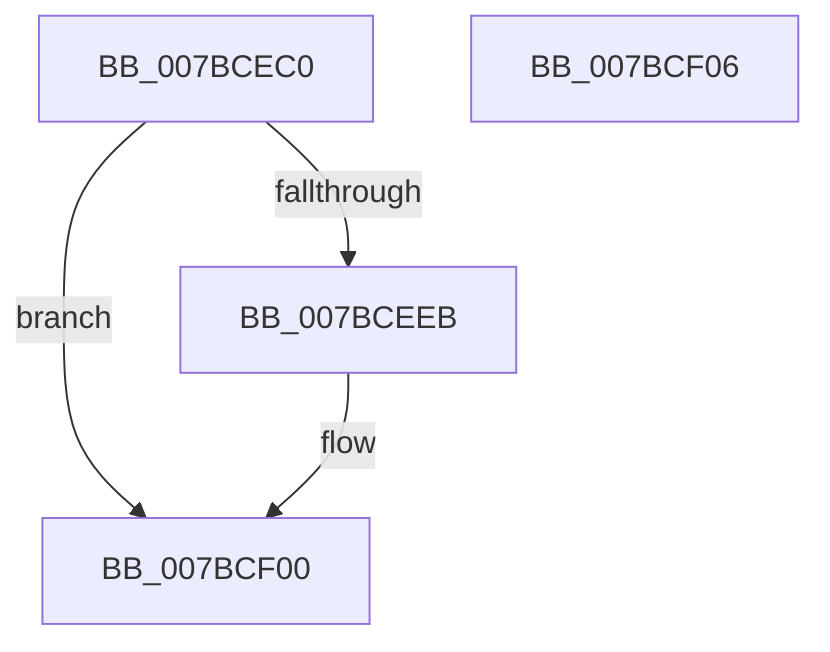

# PeriodicCaptureStateTimerCallback

- RVA: `0x007BCEC0`–`0x007BCF07` (길이 `71` bytes)
- VA: `0x00000001407BCEC0`
- 실행 섹션: `PAGE`
- PDB 이름 있음: `예`; PDB Function 태그: `아니요`
- unwind 정보 RVA: `0x0005CF00`
- 디코드: `19`개 명령, `71/71` bytes 표시
- 미해석 바이트: `0` (있으면 어셈블리에 `.byte`로 보존)

> 이 문서는 커널 이미지의 기계어와 PDB 기호를 분석해 생성했습니다. 4번과 5번은 함수 원형과 자료형을 바이너리 사용 방식에서 추정한 C 해석이며 원본 소스 복구 결과는 아닙니다.

## 1. Dependencies

- 직접 호출 지점: **2**; 고유 호출 대상: **2**
- 직접 호출자로 확인된 함수: **0**
- RIP 상대 이미지 참조: **0**

### Outgoing calls
- `0x007BCEE2` → [ExAcquireRundownProtectionCacheAwareEx](../../text/41/ExAcquireRundownProtectionCacheAwareEx_function_00411F50.md) (function, `0x00411F50`)
- `0x007BCEFB` → [ExQueueWorkItem](../../text/2F/ExQueueWorkItem_function_002F9520.md) (function, `0x002F9520`)

### Direct callers
- 이 함수 시작 RVA로 연결되는 직접 call은 확인되지 않았습니다. 간접 호출은 완전히 역산할 수 없습니다.

### Static image references
- 디코드된 RIP-relative 메모리 참조가 없습니다.

## 2. Other-region calls and transfers

- 다른 실행 섹션으로 향하는 call: **2**
  - `0x007BCEE2` → [ExAcquireRundownProtectionCacheAwareEx](../../text/41/ExAcquireRundownProtectionCacheAwareEx_function_00411F50.md) (`PAGE` → `.text`)
  - `0x007BCEFB` → [ExQueueWorkItem](../../text/2F/ExQueueWorkItem_function_002F9520.md) (`PAGE` → `.text`)
- 별도 외부 분기/꼬리 이동을 확인하지 못했습니다.

## 3. Assembly (complete function range)

```asm
007BCEC0  40 53                           push rbx
007BCEC2  48 83 EC 20                     sub rsp, 0x20
007BCEC6  4C 8B 82 50 05 00 00            mov r8, qword ptr [rdx + 0x550]
007BCECD  48 8B DA                        mov rbx, rdx
007BCED0  8B 02                           mov eax, dword ptr [rdx]
007BCED2  BA 01 00 00 00                  mov edx, 1
007BCED7  49 8B 88 C0 02 00 00            mov rcx, qword ptr [r8 + 0x2c0]
007BCEDE  48 8B 0C C1                     mov rcx, qword ptr [rcx + rax*8]
007BCEE2  E8 69 50 C5 FF                  call 0x140411f50
007BCEE7  84 C0                           test al, al
007BCEE9  74 15                           je 0x1407bcf00
007BCEEB  48 8B 8B 40 05 00 00            mov rcx, qword ptr [rbx + 0x540]
007BCEF2  BA 03 00 00 00                  mov edx, 3
007BCEF7  48 83 C1 20                     add rcx, 0x20
007BCEFB  E8 20 C6 B3 FF                  call 0x1402f9520
007BCF00  48 83 C4 20                     add rsp, 0x20
007BCF04  5B                              pop rbx
007BCF05  C3                              ret
007BCF06  CC                              int3
```

## 4. C-style interpretation (structured pseudocode)

```c
__int64 __fastcall PeriodicCaptureStateTimerCallback(__int64 a1, __int64 a2)
{
    __int64 result;
    __int64 v_rsp;

    v_rsp = (v_rsp) - (32);
    result = ExAcquireRundownProtectionCacheAwareEx(*(unsigned __int64 *)(*(unsigned __int64 *)(*(unsigned __int64 *)(a2 + 1360) + 704) + (unsigned int)(*(unsigned int *)(a2)) * 8), 1, *(unsigned __int64 *)(a2 + 1360), a4);
    if ((unsigned __int8)(result) != 0) {
        a1 = *(unsigned __int64 *)(a2 + 1344);
        a2 = 3;
        a1 = (a1) + (32);
        result = ExQueueWorkItem(a1, a2, *(unsigned __int64 *)(a2 + 1360), a4);
    }
    v_rsp = (v_rsp) + (32);
    return result;
}
```

## 5. (Beta) C Style

```c
int64_t PeriodicCaptureStateTimerCallback(int64_t Arg1, void *Arg2)
{
    uint8_t *arg2 = (uint8_t *)Arg2;

    int64_t result;
    int64_t local_rsp;

    local_rsp = (local_rsp) - (32);
    result = ExAcquireRundownProtectionCacheAwareEx(*(uint64_t *)(*(uint64_t *)(*(uint64_t *)(arg2 + 0x550) + 0x2C0) + (uint32_t)(*(uint32_t *)(arg2)) * 8), 1, *(uint64_t *)(arg2 + 0x550), a4);
    if ((uint8_t)(result) != 0) {
        Arg1 = *(uint64_t *)(arg2 + 0x540);
        Arg2 = 3;
        Arg1 = (Arg1) + (32);
        result = ExQueueWorkItem(Arg1, Arg2, *(uint64_t *)(arg2 + 0x550), a4);
    }
    local_rsp = (local_rsp) + (32);
    return result;
}
```

### 관측된 메모리 오프셋

구조체 형식이 확인되지 않은 접근은 인자 기준의 오프셋으로만 기록했습니다.

| 기준 인자 | 오프셋 표현 | 폭 (bit) | 접근 |
|---|---:|---:|---|
| `Arg2` | `+ 0x0` | `32` | `R` |
| `Arg2` | `+ 0x540` | `64` | `R` |
| `Arg2` | `+ 0x550` | `64` | `R` |

## 6. Execution-region graph

[열기: 2D/3D 그래프와 함수 탐색 컨트롤 패널](../../../control-panel.html?section=page&rva=0x007BCEC0&view=graph)

- 2D 그래프는 위에서 아래로 흐르고, 3D 그래프는 빈 공간을 드래그해 회전합니다. Shift+드래그는 이동, 휠은 확대·축소, 함수 노드 선택은 대상 보고서 이동입니다.

### Static fallback


