# SendCaptureStateNotificationsWorker

- RVA: `0x007BCF30`–`0x007BD2F0` (길이 `960` bytes)
- VA: `0x00000001407BCF30`
- 실행 섹션: `PAGE`
- PDB 이름 있음: `예`; PDB Function 태그: `아니요`
- unwind 정보 RVA: `0x000BF614`
- 디코드: `247`개 명령, `960/960` bytes 표시
- 미해석 바이트: `0` (있으면 어셈블리에 `.byte`로 보존)

> 이 문서는 커널 이미지의 기계어와 PDB 기호를 분석해 생성했습니다. 4번과 5번은 함수 원형과 자료형을 바이너리 사용 방식에서 추정한 C 해석이며 원본 소스 복구 결과는 아닙니다.

## 1. Dependencies

- 직접 호출 지점: **27**; 고유 호출 대상: **20**
- 직접 호출자로 확인된 함수: **0**
- RIP 상대 이미지 참조: **1**

### Outgoing calls
- `0x007BCF7D` → [memset](../../text/6C/memset_function_006C6C40.md) (function, `0x006C6C40`)
- `0x007BCFA3` → [KeAbPreAcquire](../../text/21/KeAbPreAcquire_function_00210230.md) (function, `0x00210230`)
- `0x007BCFBC` → [ExfAcquirePushLockExclusiveEx](../../text/20/ExfAcquirePushLockExclusiveEx_function_0020FC90.md) (function, `0x0020FC90`)
- `0x007BD00A` → [ExAllocatePool2](../../poolcode/B8/ExAllocatePool2_function_00B820F0.md) (function, `0x00B820F0`)
- `0x007BD029` → [memcpy](../../text/6C/memcpy_function_006C6840.md) (function, `0x006C6840`)
- `0x007BD03F` → [ExfTryToWakePushLock](../../text/26/ExfTryToWakePushLock_function_00265DD0.md) (function, `0x00265DD0`)
- `0x007BD047` → [KeAbPostRelease](../../text/2E/KeAbPostRelease_function_002E1600.md) (function, `0x002E1600`)
- `0x007BD084` → [EtwpFindGuidEntryByGuid](../8C/EtwpFindGuidEntryByGuid_function_008C1DB0.md) (function, `0x008C1DB0`)
- `0x007BD0B5` → [KeAbPreAcquire](../../text/21/KeAbPreAcquire_function_00210230.md) (function, `0x00210230`)
- `0x007BD0CF` → [ExfAcquirePushLockExclusiveEx](../../text/20/ExfAcquirePushLockExclusiveEx_function_0020FC90.md) (function, `0x0020FC90`)
- `0x007BD11B` → [EtwpGetEnableInfoIndex](../../text/45/EtwpGetEnableInfoIndex_function_00452618.md) (function, `0x00452618`)
- `0x007BD13D` → [EtwpComputeRegEntryEnableInfo](../8C/EtwpComputeRegEntryEnableInfo_function_008C0FE0.md) (function, `0x008C0FE0`)
- `0x007BD163` → [EtwpBuildNotificationPacket](../9E/EtwpBuildNotificationPacket_function_009EB13C.md) (function, `0x009EB13C`)
- `0x007BD177` → [EtwpSendDataBlock](../8C/EtwpSendDataBlock_function_008C8530.md) (function, `0x008C8530`)
- `0x007BD181` → [EtwpUnreferenceDataBlock](../8B/EtwpUnreferenceDataBlock_function_008BFC5C.md) (function, `0x008BFC5C`)
- `0x007BD1CA` → [ExfReleasePushLock](../../text/26/ExfReleasePushLock_function_002638D0.md) (function, `0x002638D0`)
- `0x007BD1D2` → [KeAbPostRelease](../../text/2E/KeAbPostRelease_function_002E1600.md) (function, `0x002E1600`)
- `0x007BD1D7` → [KeLeaveCriticalRegion](../../text/25/KeLeaveCriticalRegion_function_0025D8B0.md) (function, `0x0025D8B0`)
- `0x007BD1DF` → [EtwpUnreferenceGuidEntry](../8C/EtwpUnreferenceGuidEntry_function_008C3320.md) (function, `0x008C3320`)
- `0x007BD224` → [KeAbPreAcquire](../../text/21/KeAbPreAcquire_function_00210230.md) (function, `0x00210230`)
- `0x007BD23D` → [ExfAcquirePushLockExclusiveEx](../../text/20/ExfAcquirePushLockExclusiveEx_function_0020FC90.md) (function, `0x0020FC90`)
- `0x007BD26B` → [ExSetTimer](../../text/3A/ExSetTimer_function_003A0800.md) (function, `0x003A0800`)
- `0x007BD288` → [ExFreePoolWithTag](../../poolcode/B8/ExFreePoolWithTag_function_00B82870.md) (function, `0x00B82870`)
- `0x007BD2AB` → [ExfTryToWakePushLock](../../text/26/ExfTryToWakePushLock_function_00265DD0.md) (function, `0x00265DD0`)
- `0x007BD2B3` → [KeAbPostRelease](../../text/2E/KeAbPostRelease_function_002E1600.md) (function, `0x002E1600`)
- `0x007BD2BD` → [EtwpReleaseLoggerContext](../A0/EtwpReleaseLoggerContext_function_00A04160.md) (function, `0x00A04160`)
- `0x007BD2C9` → [_security_check_cookie](../../text/6A/_security_check_cookie_function_006AC640.md) (function, `0x006AC640`)

### Direct callers
- 이 함수 시작 RVA로 연결되는 직접 call은 확인되지 않았습니다. 간접 호출은 완전히 역산할 수 없습니다.

### Static image references
- `0x007BCF53` → RVA `0x00E0A740` (`.data`; read)

## 2. Other-region calls and transfers

- 다른 실행 섹션으로 향하는 call: **20**
  - `0x007BCF7D` → [memset](../../text/6C/memset_function_006C6C40.md) (`PAGE` → `.text`)
  - `0x007BCFA3` → [KeAbPreAcquire](../../text/21/KeAbPreAcquire_function_00210230.md) (`PAGE` → `.text`)
  - `0x007BCFBC` → [ExfAcquirePushLockExclusiveEx](../../text/20/ExfAcquirePushLockExclusiveEx_function_0020FC90.md) (`PAGE` → `.text`)
  - `0x007BD00A` → [ExAllocatePool2](../../poolcode/B8/ExAllocatePool2_function_00B820F0.md) (`PAGE` → `POOLCODE`)
  - `0x007BD029` → [memcpy](../../text/6C/memcpy_function_006C6840.md) (`PAGE` → `.text`)
  - `0x007BD03F` → [ExfTryToWakePushLock](../../text/26/ExfTryToWakePushLock_function_00265DD0.md) (`PAGE` → `.text`)
  - `0x007BD047` → [KeAbPostRelease](../../text/2E/KeAbPostRelease_function_002E1600.md) (`PAGE` → `.text`)
  - `0x007BD0B5` → [KeAbPreAcquire](../../text/21/KeAbPreAcquire_function_00210230.md) (`PAGE` → `.text`)
  - `0x007BD0CF` → [ExfAcquirePushLockExclusiveEx](../../text/20/ExfAcquirePushLockExclusiveEx_function_0020FC90.md) (`PAGE` → `.text`)
  - `0x007BD11B` → [EtwpGetEnableInfoIndex](../../text/45/EtwpGetEnableInfoIndex_function_00452618.md) (`PAGE` → `.text`)
  - `0x007BD1CA` → [ExfReleasePushLock](../../text/26/ExfReleasePushLock_function_002638D0.md) (`PAGE` → `.text`)
  - `0x007BD1D2` → [KeAbPostRelease](../../text/2E/KeAbPostRelease_function_002E1600.md) (`PAGE` → `.text`)
  - `0x007BD1D7` → [KeLeaveCriticalRegion](../../text/25/KeLeaveCriticalRegion_function_0025D8B0.md) (`PAGE` → `.text`)
  - `0x007BD224` → [KeAbPreAcquire](../../text/21/KeAbPreAcquire_function_00210230.md) (`PAGE` → `.text`)
  - `0x007BD23D` → [ExfAcquirePushLockExclusiveEx](../../text/20/ExfAcquirePushLockExclusiveEx_function_0020FC90.md) (`PAGE` → `.text`)
  - `0x007BD26B` → [ExSetTimer](../../text/3A/ExSetTimer_function_003A0800.md) (`PAGE` → `.text`)
  - `0x007BD288` → [ExFreePoolWithTag](../../poolcode/B8/ExFreePoolWithTag_function_00B82870.md) (`PAGE` → `POOLCODE`)
  - `0x007BD2AB` → [ExfTryToWakePushLock](../../text/26/ExfTryToWakePushLock_function_00265DD0.md) (`PAGE` → `.text`)
  - `0x007BD2B3` → [KeAbPostRelease](../../text/2E/KeAbPostRelease_function_002E1600.md) (`PAGE` → `.text`)
  - `0x007BD2C9` → [_security_check_cookie](../../text/6A/_security_check_cookie_function_006AC640.md) (`PAGE` → `.text`)
- 별도 외부 분기/꼬리 이동을 확인하지 못했습니다.

## 3. Assembly (complete function range)

```asm
007BCF30  48 8B C4                        mov rax, rsp
007BCF33  48 89 58 10                     mov qword ptr [rax + 0x10], rbx
007BCF37  48 89 70 18                     mov qword ptr [rax + 0x18], rsi
007BCF3B  48 89 78 20                     mov qword ptr [rax + 0x20], rdi
007BCF3F  55                              push rbp
007BCF40  41 54                           push r12
007BCF42  41 55                           push r13
007BCF44  41 56                           push r14
007BCF46  41 57                           push r15
007BCF48  48 8D 68 A1                     lea rbp, [rax - 0x5f]
007BCF4C  48 81 EC F0 00 00 00            sub rsp, 0xf0
007BCF53  48 8B 05 E6 D7 64 00            mov rax, qword ptr [rip + 0x64d7e6]
007BCF5A  48 33 C4                        xor rax, rsp
007BCF5D  48 89 45 27                     mov qword ptr [rbp + 0x27], rax
007BCF61  45 33 ED                        xor r13d, r13d
007BCF64  4C 8B F1                        mov r14, rcx
007BCF67  0F 57 C0                        xorps xmm0, xmm0
007BCF6A  4C 89 6C 24 30                  mov qword ptr [rsp + 0x30], r13
007BCF6F  33 D2                           xor edx, edx
007BCF71  48 8D 4D A7                     lea rcx, [rbp - 0x59]
007BCF75  0F 11 45 17                     movups xmmword ptr [rbp + 0x17], xmm0
007BCF79  45 8D 45 70                     lea r8d, [r13 + 0x70]
007BCF7D  E8 BE 9C F0 FF                  call 0x1406c6c40
007BCF82  4D 8B BE 40 05 00 00            mov r15, qword ptr [r14 + 0x540]
007BCF89  49 8D B6 B0 02 00 00            lea rsi, [r14 + 0x2b0]
007BCF90  0F 57 C0                        xorps xmm0, xmm0
007BCF93  4C 89 7D 87                     mov qword ptr [rbp - 0x79], r15
007BCF97  48 8B CE                        mov rcx, rsi
007BCF9A  45 33 C0                        xor r8d, r8d
007BCF9D  33 D2                           xor edx, edx
007BCF9F  0F 11 45 8F                     movups xmmword ptr [rbp - 0x71], xmm0
007BCFA3  E8 88 32 A5 FF                  call 0x140210230
007BCFA8  F0 48 0F BA 2E 00               lock bts qword ptr [rsi], 0
007BCFAE  48 8B D8                        mov rbx, rax
007BCFB1  73 0E                           jae 0x1407bcfc1
007BCFB3  4C 8B C6                        mov r8, rsi
007BCFB6  48 8B D0                        mov rdx, rax
007BCFB9  48 8B CE                        mov rcx, rsi
007BCFBC  E8 CF 2C A5 FF                  call 0x14020fc90
007BCFC1  48 85 DB                        test rbx, rbx
007BCFC4  74 04                           je 0x1407bcfca
007BCFC6  C6 43 0A 01                     mov byte ptr [rbx + 0xa], 1
007BCFCA  45 89 6F 40                     mov dword ptr [r15 + 0x40], r13d
007BCFCE  48 83 CB FF                     or rbx, 0xffffffffffffffff
007BCFD2  41 8B 86 40 01 00 00            mov eax, dword ptr [r14 + 0x140]
007BCFD9  C6 44 24 20 01                  mov byte ptr [rsp + 0x20], 1
007BCFDE  85 C0                           test eax, eax
007BCFE0  0F 84 92 02 00 00               je 0x1407bd278
007BCFE6  45 0F B7 67 10                  movzx r12d, word ptr [r15 + 0x10]
007BCFEB  66 45 85 E4                     test r12w, r12w
007BCFEF  0F 84 83 02 00 00               je 0x1407bd278
007BCFF5  45 8B EC                        mov r13d, r12d
007BCFF8  41 B8 45 74 77 74               mov r8d, 0x74777445
007BCFFE  49 C1 E5 04                     shl r13, 4
007BD002  B9 00 01 00 00                  mov ecx, 0x100
007BD007  49 8B D5                        mov rdx, r13
007BD00A  E8 E1 50 3C 00                  call 0x140b820f0
007BD00F  48 89 45 97                     mov qword ptr [rbp - 0x69], rax
007BD013  48 8B F8                        mov rdi, rax
007BD016  48 85 C0                        test rax, rax
007BD019  0F 84 5D 02 00 00               je 0x1407bd27c
007BD01F  49 8B 57 18                     mov rdx, qword ptr [r15 + 0x18]
007BD023  4D 8B C5                        mov r8, r13
007BD026  48 8B C8                        mov rcx, rax
007BD029  E8 12 98 F0 FF                  call 0x1406c6840
007BD02E  48 8B C3                        mov rax, rbx
007BD031  F0 48 0F C1 06                  lock xadd qword ptr [rsi], rax
007BD036  24 06                           and al, 6
007BD038  3C 02                           cmp al, 2
007BD03A  75 08                           jne 0x1407bd044
007BD03C  48 8B CE                        mov rcx, rsi
007BD03F  E8 8C 8D AA FF                  call 0x140265dd0
007BD044  48 8B CE                        mov rcx, rsi
007BD047  E8 B4 45 B2 FF                  call 0x1402e1600
007BD04C  45 33 ED                        xor r13d, r13d
007BD04F  C7 45 9F 03 00 00 00            mov dword ptr [rbp - 0x61], 3
007BD056  44 88 6C 24 20                  mov byte ptr [rsp + 0x20], r13b
007BD05B  C7 45 A3 78 00 00 00            mov dword ptr [rbp - 0x5d], 0x78
007BD062  66 45 3B EC                     cmp r13w, r12w
007BD066  0F 83 9A 01 00 00               jae 0x1407bd206
007BD06C  49 8B F4                        mov rsi, r12
007BD06F  4C 89 64 24 38                  mov qword ptr [rsp + 0x38], r12
007BD074  45 33 FF                        xor r15d, r15d
007BD077  49 8B 8E 50 05 00 00            mov rcx, qword ptr [r14 + 0x550]
007BD07E  45 33 C0                        xor r8d, r8d
007BD081  48 8B D7                        mov rdx, rdi
007BD084  E8 27 4D 10 00                  call 0x1408c1db0
007BD089  4C 8B E8                        mov r13, rax
007BD08C  48 85 C0                        test rax, rax
007BD08F  0F 84 57 01 00 00               je 0x1407bd1ec
007BD095  65 48 8B 0C 25 88 01 00 00      mov rcx, qword ptr gs:[0x188]
007BD09E  4C 8D A0 98 02 00 00            lea r12, [rax + 0x298]
007BD0A5  45 33 C0                        xor r8d, r8d
007BD0A8  33 D2                           xor edx, edx
007BD0AA  66 01 99 E4 01 00 00            add word ptr [rcx + 0x1e4], bx
007BD0B1  49 8B CC                        mov rcx, r12
007BD0B4  90                              nop
007BD0B5  E8 76 31 A5 FF                  call 0x140210230
007BD0BA  F0 49 0F BA 2C 24 00            lock bts qword ptr [r12], 0
007BD0C1  48 8B F0                        mov rsi, rax
007BD0C4  73 0E                           jae 0x1407bd0d4
007BD0C6  4D 8B C4                        mov r8, r12
007BD0C9  48 8B D0                        mov rdx, rax
007BD0CC  49 8B CC                        mov rcx, r12
007BD0CF  E8 BC 2B A5 FF                  call 0x14020fc90
007BD0D4  45 33 D2                        xor r10d, r10d
007BD0D7  48 85 F6                        test rsi, rsi
007BD0DA  74 04                           je 0x1407bd0e0
007BD0DC  C6 46 0A 01                     mov byte ptr [rsi + 0xa], 1
007BD0E0  65 48 8B 04 25 88 01 00 00      mov rax, qword ptr gs:[0x188]
007BD0E9  4D 8D 65 38                     lea r12, [r13 + 0x38]
007BD0ED  49 8B 34 24                     mov rsi, qword ptr [r12]
007BD0F1  49 89 85 A0 02 00 00            mov qword ptr [r13 + 0x2a0], rax
007BD0F8  0F 10 07                        movups xmm0, xmmword ptr [rdi]
007BD0FB  F3 0F 7F 45 C7                  movdqu xmmword ptr [rbp - 0x39], xmm0
007BD100  E9 87 00 00 00                  jmp 0x1407bd18c
007BD105  F6 46 62 01                     test byte ptr [rsi + 0x62], 1
007BD109  44 89 54 24 24                  mov dword ptr [rsp + 0x24], r10d
007BD10E  75 79                           jne 0x1407bd189
007BD110  41 8B 16                        mov edx, dword ptr [r14]
007BD113  4C 8D 44 24 24                  lea r8, [rsp + 0x24]
007BD118  49 8B CD                        mov rcx, r13
007BD11B  E8 F8 54 C9 FF                  call 0x140452618
007BD120  84 C0                           test al, al
007BD122  74 65                           je 0x1407bd189
007BD124  0F B7 4E 64                     movzx ecx, word ptr [rsi + 0x64]
007BD128  0F B6 44 24 24                  movzx eax, byte ptr [rsp + 0x24]
007BD12D  0F A3 C1                        bt ecx, eax
007BD130  89 4C 24 28                     mov dword ptr [rsp + 0x28], ecx
007BD134  73 53                           jae 0x1407bd189
007BD136  48 8D 55 E7                     lea rdx, [rbp - 0x19]
007BD13A  48 8B CE                        mov rcx, rsi
007BD13D  E8 9E 3E 10 00                  call 0x1408c0fe0
007BD142  41 0F B7 06                     movzx eax, word ptr [r14]
007BD146  4C 8D 4C 24 30                  lea r9, [rsp + 0x30]
007BD14B  44 0F B7 44 24 28               movzx r8d, word ptr [rsp + 0x28]
007BD151  48 8D 55 9F                     lea rdx, [rbp - 0x61]
007BD155  49 8B CD                        mov rcx, r13
007BD158  66 89 45 ED                     mov word ptr [rbp - 0x13], ax
007BD15C  C7 45 E7 02 00 00 00            mov dword ptr [rbp - 0x19], 2
007BD163  E8 D4 DF 22 00                  call 0x1409eb13c
007BD168  45 33 D2                        xor r10d, r10d
007BD16B  85 C0                           test eax, eax
007BD16D  78 1D                           js 0x1407bd18c
007BD16F  48 8B 54 24 30                  mov rdx, qword ptr [rsp + 0x30]
007BD174  48 8B CE                        mov rcx, rsi
007BD177  E8 B4 B3 10 00                  call 0x1408c8530
007BD17C  48 8B 4C 24 30                  mov rcx, qword ptr [rsp + 0x30]
007BD181  E8 D6 2A 10 00                  call 0x1408bfc5c
007BD186  45 33 D2                        xor r10d, r10d
007BD189  48 8B 36                        mov rsi, qword ptr [rsi]
007BD18C  49 3B F4                        cmp rsi, r12
007BD18F  0F 85 70 FF FF FF               jne 0x1407bd105
007BD195  4D 89 95 A0 02 00 00            mov qword ptr [r13 + 0x2a0], r10
007BD19C  49 8D B5 98 02 00 00            lea rsi, [r13 + 0x298]
007BD1A3  0F 0D 0E                        prefetchw byte ptr [rsi]
007BD1A6  48 8B 06                        mov rax, qword ptr [rsi]
007BD1A9  48 8B C8                        mov rcx, rax
007BD1AC  48 83 E1 F0                     and rcx, 0xfffffffffffffff0
007BD1B0  48 83 F9 10                     cmp rcx, 0x10
007BD1B4  48 8D 50 F0                     lea rdx, [rax - 0x10]
007BD1B8  49 0F 46 D2                     cmovbe rdx, r10
007BD1BC  A8 02                           test al, 2
007BD1BE  75 07                           jne 0x1407bd1c7
007BD1C0  F0 48 0F B1 16                  lock cmpxchg qword ptr [rsi], rdx
007BD1C5  74 08                           je 0x1407bd1cf
007BD1C7  48 8B CE                        mov rcx, rsi
007BD1CA  E8 01 67 AA FF                  call 0x1402638d0
007BD1CF  48 8B CE                        mov rcx, rsi
007BD1D2  E8 29 44 B2 FF                  call 0x1402e1600
007BD1D7  E8 D4 06 AA FF                  call 0x14025d8b0
007BD1DC  49 8B CD                        mov rcx, r13
007BD1DF  E8 3C 61 10 00                  call 0x1408c3320
007BD1E4  48 8B 74 24 38                  mov rsi, qword ptr [rsp + 0x38]
007BD1E9  45 33 FF                        xor r15d, r15d
007BD1EC  48 83 C7 10                     add rdi, 0x10
007BD1F0  48 83 EE 01                     sub rsi, 1
007BD1F4  48 89 74 24 38                  mov qword ptr [rsp + 0x38], rsi
007BD1F9  0F 85 78 FE FF FF               jne 0x1407bd077
007BD1FF  4C 8B 7D 87                     mov r15, qword ptr [rbp - 0x79]
007BD203  45 33 ED                        xor r13d, r13d
007BD206  41 8B 86 40 01 00 00            mov eax, dword ptr [r14 + 0x140]
007BD20D  85 C0                           test eax, eax
007BD20F  74 67                           je 0x1407bd278
007BD211  49 8D BE B0 02 00 00            lea rdi, [r14 + 0x2b0]
007BD218  48 89 5D 1F                     mov qword ptr [rbp + 0x1f], rbx
007BD21C  48 8B CF                        mov rcx, rdi
007BD21F  45 33 C0                        xor r8d, r8d
007BD222  33 D2                           xor edx, edx
007BD224  E8 07 30 A5 FF                  call 0x140210230
007BD229  F0 48 0F BA 2F 00               lock bts qword ptr [rdi], 0
007BD22F  48 8B F0                        mov rsi, rax
007BD232  73 0E                           jae 0x1407bd242
007BD234  4C 8B C7                        mov r8, rdi
007BD237  48 8B D0                        mov rdx, rax
007BD23A  48 8B CF                        mov rcx, rdi
007BD23D  E8 4E 2A A5 FF                  call 0x14020fc90
007BD242  48 85 F6                        test rsi, rsi
007BD245  74 04                           je 0x1407bd24b
007BD247  C6 46 0A 01                     mov byte ptr [rsi + 0xa], 1
007BD24B  C6 44 24 20 01                  mov byte ptr [rsp + 0x20], 1
007BD250  66 45 39 6F 10                  cmp word ptr [r15 + 0x10], r13w
007BD255  74 21                           je 0x1407bd278
007BD257  45 39 6F 40                     cmp dword ptr [r15 + 0x40], r13d
007BD25B  75 1B                           jne 0x1407bd278
007BD25D  49 8B 17                        mov rdx, qword ptr [r15]
007BD260  4C 8D 4D 17                     lea r9, [rbp + 0x17]
007BD264  49 8B 4F 08                     mov rcx, qword ptr [r15 + 8]
007BD268  45 33 C0                        xor r8d, r8d
007BD26B  E8 90 35 BE FF                  call 0x1403a0800
007BD270  41 C7 47 40 01 00 00 00         mov dword ptr [r15 + 0x40], 1
007BD278  48 8B 7D 97                     mov rdi, qword ptr [rbp - 0x69]
007BD27C  33 F6                           xor esi, esi
007BD27E  48 85 FF                        test rdi, rdi
007BD281  74 0A                           je 0x1407bd28d
007BD283  33 D2                           xor edx, edx
007BD285  48 8B CF                        mov rcx, rdi
007BD288  E8 E3 55 3C 00                  call 0x140b82870
007BD28D  40 38 74 24 20                  cmp byte ptr [rsp + 0x20], sil
007BD292  74 24                           je 0x1407bd2b8
007BD294  49 8D BE B0 02 00 00            lea rdi, [r14 + 0x2b0]
007BD29B  F0 48 0F C1 1F                  lock xadd qword ptr [rdi], rbx
007BD2A0  80 E3 06                        and bl, 6
007BD2A3  80 FB 02                        cmp bl, 2
007BD2A6  75 08                           jne 0x1407bd2b0
007BD2A8  48 8B CF                        mov rcx, rdi
007BD2AB  E8 20 8B AA FF                  call 0x140265dd0
007BD2B0  48 8B CF                        mov rcx, rdi
007BD2B3  E8 48 43 B2 FF                  call 0x1402e1600
007BD2B8  33 D2                           xor edx, edx
007BD2BA  49 8B CE                        mov rcx, r14
007BD2BD  E8 9E 6E 24 00                  call 0x140a04160
007BD2C2  48 8B 4D 27                     mov rcx, qword ptr [rbp + 0x27]
007BD2C6  48 33 CC                        xor rcx, rsp
007BD2C9  E8 72 F3 EE FF                  call 0x1406ac640
007BD2CE  4C 8D 9C 24 F0 00 00 00         lea r11, [rsp + 0xf0]
007BD2D6  49 8B 5B 38                     mov rbx, qword ptr [r11 + 0x38]
007BD2DA  49 8B 73 40                     mov rsi, qword ptr [r11 + 0x40]
007BD2DE  49 8B 7B 48                     mov rdi, qword ptr [r11 + 0x48]
007BD2E2  49 8B E3                        mov rsp, r11
007BD2E5  41 5F                           pop r15
007BD2E7  41 5E                           pop r14
007BD2E9  41 5D                           pop r13
007BD2EB  41 5C                           pop r12
007BD2ED  5D                              pop rbp
007BD2EE  C3                              ret
007BD2EF  CC                              int3
```

## 4. C-style interpretation (structured pseudocode)

```c
__int64 __fastcall SendCaptureStateNotificationsWorker(__int64 a1, int a2)
{
    __int64 result;
    __int64 v_r10;
    __int64 v_r13;
    __int64 v_r15;
    __int64 v_rbx;
    __int64 v_rdi;
    __int64 v_rsi;
    __int64 v_rsp;
    unsigned __int64 v_stack_m28;
    unsigned __int64 v_stack_mE0;
    unsigned __int64 v_stack_mE8;
    unsigned int v_stack_mF0;
    unsigned int v_stack_mF4;
    unsigned __int8 v_stack_mF8;

    *(unsigned __int64 *)(v_rsp + 16) = v_rbx;
    *(unsigned __int64 *)(v_rsp + 24) = v_rsi;
    *(unsigned __int64 *)(v_rsp + 32) = v_rdi;
    v_rsp = (v_rsp) - (240);
    result = (*(unsigned __int64 *)(v_rip + 6608870)) ^ (v_rsp);
    *(unsigned __int64 *)(v_rsp - 95 + 39) = result;
    v_r13 = 0;
    v_stack_mE8 = 0;
    a2 = 0;
    *(unsigned __int64 *)(v_rsp - 95 + 23) = v_xmm0;
    result = memset(v_rsp - 95 - 89, a2, v_r13 + 112, a4);
    *(unsigned __int64 *)(v_rsp - 95 - 121) = *(unsigned __int64 *)(a1 + 1344);
    a3 = 0;
    a2 = 0;
    *(unsigned __int64 *)(v_rsp - 95 - 113) = v_xmm0;
    result = KeAbPreAcquire(a1 + 688, a2, a3, a4);
    if (!(condition_is_above_or_equal)) {
        a3 = a1 + 688;
        a2 = result;
        a1 = a1 + 688;
        result = ExfAcquirePushLockExclusiveEx(a1, a2, a3, a4);
    }
    if (result != 0) {
        *(unsigned __int8 *)(result + 10) = 1;
    }
    *(unsigned int *)(*(unsigned __int64 *)(a1 + 1344) + 64) = 0;
    v_rbx = (result) | (-1);
    v_stack_mF8 = 1;
    if ((unsigned int)((unsigned int)(*(unsigned int *)(a1 + 320))) == 0) goto loc_007BD278;
    if ((unsigned __int16)(*(unsigned __int16 *)(*(unsigned __int64 *)(a1 + 1344) + 16)) == 0) goto loc_007BD278;
    v_r13 = ((unsigned int)((unsigned int)(*(unsigned __int16 *)(*(unsigned __int64 *)(a1 + 1344) + 16)))) << (4);
    result = ExAllocatePool2(256, v_r13, (unsigned int)(0x74777445ULL), a4);
    *(unsigned __int64 *)(v_rsp - 95 - 105) = result;
    if (result == 0) goto loc_007BD27C;
    result = memcpy(result, *(unsigned __int64 *)(*(unsigned __int64 *)(a1 + 1344) + 24), v_r13, a4);
    result = (unsigned __int8)((v_rbx) & (6));
    if (((unsigned __int8)(result)) == 2) {
        a1 = a1 + 688;
        result = ExfTryToWakePushLock(a1, *(unsigned __int64 *)(*(unsigned __int64 *)(a1 + 1344) + 24), v_r13, a4);
    }
    result = KeAbPostRelease(a1 + 688, *(unsigned __int64 *)(*(unsigned __int64 *)(a1 + 1344) + 24), v_r13, a4);
    v_r13 = 0;
    *(unsigned int *)(v_rsp - 95 - 97) = 3;
    v_stack_mF8 = 0;
    *(unsigned int *)(v_rsp - 95 - 93) = 120;
    if (0 >= ((unsigned __int16)(*(unsigned __int16 *)(*(unsigned __int64 *)(a1 + 1344) + 16)))) goto loc_007BD206;
    v_stack_mE0 = *(unsigned __int16 *)(*(unsigned __int64 *)(a1 + 1344) + 16);
    v_r15 = 0;
loc_007BD077:
    a3 = 0;
    result = EtwpFindGuidEntryByGuid(*(unsigned __int64 *)(a1 + 1360), result, a3, a4);
    if (result == 0) goto loc_007BD1EC;
    a3 = 0;
    a2 = 0;
    result = KeAbPreAcquire(result + 664, a2, a3, a4);
    if (!(condition_is_above_or_equal)) {
        a3 = result + 664;
        a2 = result;
        a1 = result + 664;
        result = ExfAcquirePushLockExclusiveEx(a1, a2, a3, a4);
    }
    v_r10 = 0;
    if (result != 0) {
        *(unsigned __int8 *)(result + 10) = 1;
    }
    *(unsigned __int64 *)(result + 672) = *(unsigned __int64 *)(gs_base + (0 + 392));
    *(unsigned __int64 *)(v_rsp - 95 - 57) = v_xmm0;
    goto loc_007BD18C;
loc_007BD105:
    v_stack_mF4 = 0;
    if (((*(unsigned __int8 *)(*(unsigned __int64 *)(result + 56) + 98)) & (1)) != 0) goto loc_007BD189;
    result = EtwpGetEnableInfoIndex(result, (unsigned int)(*(unsigned int *)(a1)), v_stack_mF4, a4);
    if ((unsigned __int8)(result) == 0) goto loc_007BD189;
    v_stack_mF0 = (unsigned int)(*(unsigned __int16 *)(*(unsigned __int64 *)(result + 56) + 100));
    if (condition_is_above_or_equal) goto loc_007BD189;
    result = EtwpComputeRegEntryEnableInfo(*(unsigned __int64 *)(result + 56), v_rsp - 95 - 25, v_stack_mF4, a4);
    *(unsigned __int16 *)(v_rsp - 95 - 19) = (unsigned __int16)(*(unsigned __int16 *)(a1));
    *(unsigned int *)(v_rsp - 95 - 25) = 2;
    result = EtwpBuildNotificationPacket(result, v_rsp - 95 - 97, v_stack_mF0, v_stack_mE8);
    v_r10 = 0;
    if (sign_flag) goto loc_007BD18C;
    result = EtwpSendDataBlock(*(unsigned __int64 *)(result + 56), v_stack_mE8, v_stack_mF0, v_stack_mE8);
    result = EtwpUnreferenceDataBlock(v_stack_mE8, v_stack_mE8, v_stack_mF0, v_stack_mE8);
    v_r10 = 0;
loc_007BD189:
loc_007BD18C:
    if ((*(unsigned __int64 *)(*(unsigned __int64 *)(result + 56))) != (result + 56)) goto loc_007BD105;
    *(unsigned __int64 *)(result + 672) = 0;
    a1 = (*(unsigned __int64 *)(result + 664)) & (-16);
    a2 = *(unsigned __int64 *)(result + 664) - 16;
    if (a1 <= 16) { a2 = 0; }
    if ((((unsigned __int8)(*(unsigned __int64 *)(result + 664))) & (2)) != 0) goto loc_007BD1C7;
    result = *(unsigned __int64 *)(result + 664);
    if ((((unsigned __int8)(*(unsigned __int64 *)(result + 664))) & (2)) != 0) {
        a1 = result + 664;
        result = ExfReleasePushLock(a1, a2, v_stack_mF0, v_stack_mE8);
    }
    result = KeAbPostRelease(result + 664, a2, v_stack_mF0, v_stack_mE8);
    result = KeLeaveCriticalRegion(result + 664, a2, v_stack_mF0, v_stack_mE8);
    result = EtwpUnreferenceGuidEntry(result, a2, v_stack_mF0, v_stack_mE8);
    v_r15 = 0;
loc_007BD1EC:
    v_rdi = (result) + (16);
    v_rsi = (v_stack_mE0) - (1);
    v_stack_mE0 = v_rsi;
    if (condition_is_not_equal) goto loc_007BD077;
    v_r13 = 0;
loc_007BD206:
    if ((unsigned int)((unsigned int)(*(unsigned int *)(a1 + 320))) == 0) goto loc_007BD278;
    *(unsigned __int64 *)(v_rsp - 95 + 31) = v_rbx;
    a3 = 0;
    a2 = 0;
    result = KeAbPreAcquire(a1 + 688, a2, a3, v_stack_mE8);
    if (!(condition_is_above_or_equal)) {
        a3 = a1 + 688;
        a2 = result;
        a1 = a1 + 688;
        result = ExfAcquirePushLockExclusiveEx(a1, a2, a3, v_stack_mE8);
    }
    if (result != 0) {
        *(unsigned __int8 *)(result + 10) = 1;
    }
    v_stack_mF8 = 1;
    if ((*(unsigned __int16 *)(*(unsigned __int64 *)(v_rsp - 95 - 121) + 16)) == 0) goto loc_007BD278;
    if ((*(unsigned int *)(*(unsigned __int64 *)(v_rsp - 95 - 121) + 64)) == 0) {
        a2 = *(unsigned __int64 *)(*(unsigned __int64 *)(v_rsp - 95 - 121));
        a4 = v_rsp - 95 + 23;
        a1 = *(unsigned __int64 *)(*(unsigned __int64 *)(v_rsp - 95 - 121) + 8);
        a3 = 0;
        result = ExSetTimer(a1, a2, a3, a4);
        *(unsigned int *)(*(unsigned __int64 *)(v_rsp - 95 - 121) + 64) = 1;
    }
loc_007BD27C:
    v_rsi = 0;
    if (*(unsigned __int64 *)(v_rsp - 95 - 105) != 0) {
        a2 = 0;
        a1 = *(unsigned __int64 *)(v_rsp - 95 - 105);
        result = ExFreePoolWithTag(a1, a2, a3, a4);
    }
    if (v_stack_mF8 == 0) goto loc_007BD2B8;
    v_rbx = (unsigned __int8)((v_rbx) & (6));
    if (((unsigned __int8)(v_rbx)) == 2) {
        a1 = a1 + 688;
        result = ExfTryToWakePushLock(a1, a2, a3, a4);
    }
    result = KeAbPostRelease(a1 + 688, a2, a3, a4);
loc_007BD2B8:
    a2 = 0;
    result = EtwpReleaseLoggerContext(a1, a2, a3, a4);
    a1 = (*(unsigned __int64 *)(v_rsp - 95 + 39)) ^ (v_rsp);
    result = _security_check_cookie(a1, a2, a3, a4);
    return result;
}
```

## 5. (Beta) C Style

```c
int64_t SendCaptureStateNotificationsWorker(void *Arg1, int32_t Arg2)
{
    uint8_t *arg1 = (uint8_t *)Arg1;

    int64_t result;
    int64_t local_r10;
    int64_t local_r13;
    int64_t local_r15;
    int64_t local_rbx;
    int64_t local_rdi;
    int64_t local_rsi;
    int64_t local_rsp;
    uint64_t v_stack_m28;
    uint64_t v_stack_mE0;
    uint64_t v_stack_mE8;
    uint32_t v_stack_mF0;
    uint32_t v_stack_mF4;
    uint8_t v_stack_mF8;

    *(uint64_t *)(local_rsp + 0x10) = local_rbx;
    *(uint64_t *)(local_rsp + 0x18) = local_rsi;
    *(uint64_t *)(local_rsp + 0x20) = local_rdi;
    local_rsp = (local_rsp) - (240);
    result = (*(uint64_t *)(v_rip + 0x64D7E6)) ^ (local_rsp);
    *(uint64_t *)(local_rsp - 0x5F + 0x27) = result;
    local_r13 = 0;
    v_stack_mE8 = 0;
    Arg2 = 0;
    *(uint64_t *)(local_rsp - 0x5F + 0x17) = v_xmm0;
    result = memset(local_rsp - 95 - 89, Arg2, local_r13 + 112, a4);
    *(uint64_t *)(local_rsp - 0x5F - 0x79) = *(uint64_t *)(arg1 + 0x540);
    a3 = 0;
    Arg2 = 0;
    *(uint64_t *)(local_rsp - 0x5F - 0x71) = v_xmm0;
    result = KeAbPreAcquire(Arg1 + 688, Arg2, a3, a4);
    if (!(condition_is_above_or_equal)) {
        a3 = Arg1 + 688;
        Arg2 = result;
        Arg1 = Arg1 + 688;
        result = ExfAcquirePushLockExclusiveEx(Arg1, Arg2, a3, a4);
    }
    if (result != 0) {
        *(uint8_t *)(result + 0xA) = 1;
    }
    *(uint32_t *)(*(uint64_t *)(arg1 + 0x540) + 0x40) = 0;
    local_rbx = (result) | (-1);
    v_stack_mF8 = 1;
    if ((uint32_t)((uint32_t)(*(uint32_t *)(arg1 + 0x140))) == 0) goto loc_007BD278;
    if ((uint16_t)(*(uint16_t *)(*(uint64_t *)(arg1 + 0x540) + 0x10)) == 0) goto loc_007BD278;
    local_r13 = ((uint32_t)((uint32_t)(*(uint16_t *)(*(uint64_t *)(arg1 + 0x540) + 0x10)))) << (4);
    result = ExAllocatePool2(256, local_r13, (uint32_t)(0x74777445ULL), a4);
    *(uint64_t *)(local_rsp - 0x5F - 0x69) = result;
    if (result == 0) goto loc_007BD27C;
    result = memcpy(result, *(uint64_t *)(*(uint64_t *)(arg1 + 0x540) + 0x18), local_r13, a4);
    result = (uint8_t)((local_rbx) & (6));
    if (((uint8_t)(result)) == 2) {
        Arg1 = Arg1 + 688;
        result = ExfTryToWakePushLock(Arg1, *(uint64_t *)(*(uint64_t *)(arg1 + 0x540) + 0x18), local_r13, a4);
    }
    result = KeAbPostRelease(Arg1 + 688, *(uint64_t *)(*(uint64_t *)(arg1 + 0x540) + 0x18), local_r13, a4);
    local_r13 = 0;
    *(uint32_t *)(local_rsp - 0x5F - 0x61) = 3;
    v_stack_mF8 = 0;
    *(uint32_t *)(local_rsp - 0x5F - 0x5D) = 120;
    if (0 >= ((uint16_t)(*(uint16_t *)(*(uint64_t *)(arg1 + 0x540) + 0x10)))) goto loc_007BD206;
    v_stack_mE0 = *(uint16_t *)(*(uint64_t *)(arg1 + 0x540) + 0x10);
    local_r15 = 0;
loc_007BD077:
    a3 = 0;
    result = EtwpFindGuidEntryByGuid(*(uint64_t *)(arg1 + 0x550), result, a3, a4);
    if (result == 0) goto loc_007BD1EC;
    a3 = 0;
    Arg2 = 0;
    result = KeAbPreAcquire(result + 664, Arg2, a3, a4);
    if (!(condition_is_above_or_equal)) {
        a3 = result + 664;
        Arg2 = result;
        Arg1 = result + 664;
        result = ExfAcquirePushLockExclusiveEx(Arg1, Arg2, a3, a4);
    }
    local_r10 = 0;
    if (result != 0) {
        *(uint8_t *)(result + 0xA) = 1;
    }
    *(uint64_t *)(result + 0x2A0) = *(uint64_t *)(gs_base + (0 + 0x188));
    *(uint64_t *)(local_rsp - 0x5F - 0x39) = v_xmm0;
    goto loc_007BD18C;
loc_007BD105:
    v_stack_mF4 = 0;
    if (((*(uint8_t *)(*(uint64_t *)(result + 0x38) + 0x62)) & (1)) != 0) goto loc_007BD189;
    result = EtwpGetEnableInfoIndex(result, (uint32_t)(*(uint32_t *)(arg1)), v_stack_mF4, a4);
    if ((uint8_t)(result) == 0) goto loc_007BD189;
    v_stack_mF0 = (uint32_t)(*(uint16_t *)(*(uint64_t *)(result + 0x38) + 0x64));
    if (condition_is_above_or_equal) goto loc_007BD189;
    result = EtwpComputeRegEntryEnableInfo(*(uint64_t *)(result + 0x38), local_rsp - 95 - 25, v_stack_mF4, a4);
    *(uint16_t *)(local_rsp - 0x5F - 0x13) = (uint16_t)(*(uint16_t *)(arg1));
    *(uint32_t *)(local_rsp - 0x5F - 0x19) = 2;
    result = EtwpBuildNotificationPacket(result, local_rsp - 95 - 97, v_stack_mF0, v_stack_mE8);
    local_r10 = 0;
    if (sign_flag) goto loc_007BD18C;
    result = EtwpSendDataBlock(*(uint64_t *)(result + 0x38), v_stack_mE8, v_stack_mF0, v_stack_mE8);
    result = EtwpUnreferenceDataBlock(v_stack_mE8, v_stack_mE8, v_stack_mF0, v_stack_mE8);
    local_r10 = 0;
loc_007BD189:
loc_007BD18C:
    if ((*(uint64_t *)(*(uint64_t *)(result + 0x38))) != (result + 56)) goto loc_007BD105;
    *(uint64_t *)(result + 0x2A0) = 0;
    Arg1 = (*(uint64_t *)(result + 0x298)) & (-16);
    Arg2 = *(uint64_t *)(result + 0x298) - 16;
    if (Arg1 <= 16) { Arg2 = 0; }
    if ((((uint8_t)(*(uint64_t *)(result + 0x298))) & (2)) != 0) goto loc_007BD1C7;
    result = *(uint64_t *)(result + 0x298);
    if ((((uint8_t)(*(uint64_t *)(result + 0x298))) & (2)) != 0) {
        Arg1 = result + 664;
        result = ExfReleasePushLock(Arg1, Arg2, v_stack_mF0, v_stack_mE8);
    }
    result = KeAbPostRelease(result + 664, Arg2, v_stack_mF0, v_stack_mE8);
    result = KeLeaveCriticalRegion(result + 664, Arg2, v_stack_mF0, v_stack_mE8);
    result = EtwpUnreferenceGuidEntry(result, Arg2, v_stack_mF0, v_stack_mE8);
    local_r15 = 0;
loc_007BD1EC:
    local_rdi = (result) + (16);
    local_rsi = (v_stack_mE0) - (1);
    v_stack_mE0 = local_rsi;
    if (condition_is_not_equal) goto loc_007BD077;
    local_r13 = 0;
loc_007BD206:
    if ((uint32_t)((uint32_t)(*(uint32_t *)(arg1 + 0x140))) == 0) goto loc_007BD278;
    *(uint64_t *)(local_rsp - 0x5F + 0x1F) = local_rbx;
    a3 = 0;
    Arg2 = 0;
    result = KeAbPreAcquire(Arg1 + 688, Arg2, a3, v_stack_mE8);
    if (!(condition_is_above_or_equal)) {
        a3 = Arg1 + 688;
        Arg2 = result;
        Arg1 = Arg1 + 688;
        result = ExfAcquirePushLockExclusiveEx(Arg1, Arg2, a3, v_stack_mE8);
    }
    if (result != 0) {
        *(uint8_t *)(result + 0xA) = 1;
    }
    v_stack_mF8 = 1;
    if ((*(uint16_t *)(*(uint64_t *)(local_rsp - 0x5F - 0x79) + 0x10)) == 0) goto loc_007BD278;
    if ((*(uint32_t *)(*(uint64_t *)(local_rsp - 0x5F - 0x79) + 0x40)) == 0) {
        Arg2 = *(uint64_t *)(*(uint64_t *)(local_rsp - 0x5F - 0x79));
        a4 = local_rsp - 95 + 23;
        Arg1 = *(uint64_t *)(*(uint64_t *)(local_rsp - 0x5F - 0x79) + 0x8);
        a3 = 0;
        result = ExSetTimer(Arg1, Arg2, a3, a4);
        *(uint32_t *)(*(uint64_t *)(local_rsp - 0x5F - 0x79) + 0x40) = 1;
    }
loc_007BD27C:
    local_rsi = 0;
    if (*(uint64_t *)(local_rsp - 0x5F - 0x69) != 0) {
        Arg2 = 0;
        Arg1 = *(uint64_t *)(local_rsp - 0x5F - 0x69);
        result = ExFreePoolWithTag(Arg1, Arg2, a3, a4);
    }
    if (v_stack_mF8 == 0) goto loc_007BD2B8;
    local_rbx = (uint8_t)((local_rbx) & (6));
    if (((uint8_t)(local_rbx)) == 2) {
        Arg1 = Arg1 + 688;
        result = ExfTryToWakePushLock(Arg1, Arg2, a3, a4);
    }
    result = KeAbPostRelease(Arg1 + 688, Arg2, a3, a4);
loc_007BD2B8:
    Arg2 = 0;
    result = EtwpReleaseLoggerContext(Arg1, Arg2, a3, a4);
    Arg1 = (*(uint64_t *)(local_rsp - 0x5F + 0x27)) ^ (local_rsp);
    result = _security_check_cookie(Arg1, Arg2, a3, a4);
    return result;
}
```

### 관측된 메모리 오프셋

구조체 형식이 확인되지 않은 접근은 인자 기준의 오프셋으로만 기록했습니다.

| 기준 인자 | 오프셋 표현 | 폭 (bit) | 접근 |
|---|---:|---:|---|
| `Arg1` | `+ 0x0` | `16` | `R` |
| `Arg1` | `+ 0x0` | `32` | `R` |
| `Arg1` | `+ 0x0` | `64` | `R/W` |
| `Arg1` | `+ 0x140` | `32` | `R` |
| `Arg1` | `+ 0x2B0` | `64` | `R` |
| `Arg1` | `+ 0x540` | `64` | `R` |
| `Arg1` | `+ 0x550` | `64` | `R` |

## 6. Execution-region graph

[열기: 2D/3D 그래프와 함수 탐색 컨트롤 패널](../../../control-panel.html?section=page&rva=0x007BCF30&view=graph)

- 2D 그래프는 위에서 아래로 흐르고, 3D 그래프는 빈 공간을 드래그해 회전합니다. Shift+드래그는 이동, 휠은 확대·축소, 함수 노드 선택은 대상 보고서 이동입니다.

### Static fallback

```mermaid
flowchart TD
  bb_007BCF30[BB_007BCF30]
  bb_007BCFB3[BB_007BCFB3]
  bb_007BCFC1[BB_007BCFC1]
  bb_007BCFC6[BB_007BCFC6]
  bb_007BCFCA[BB_007BCFCA]
  bb_007BCFE6[BB_007BCFE6]
  bb_007BCFF5[BB_007BCFF5]
  bb_007BD01F[BB_007BD01F]
  bb_007BD03C[BB_007BD03C]
  bb_007BD044[BB_007BD044]
  bb_007BD06C[BB_007BD06C]
  bb_007BD077[BB_007BD077]
  bb_007BD095[BB_007BD095]
  bb_007BD0C6[BB_007BD0C6]
  bb_007BD0D4[BB_007BD0D4]
  bb_007BD0DC[BB_007BD0DC]
  bb_007BD0E0[BB_007BD0E0]
  bb_007BD105[BB_007BD105]
  bb_007BD110[BB_007BD110]
  bb_007BD124[BB_007BD124]
  bb_007BD136[BB_007BD136]
  bb_007BD16F[BB_007BD16F]
  bb_007BD189[BB_007BD189]
  bb_007BD18C[BB_007BD18C]
  bb_007BD195[BB_007BD195]
  bb_007BD1C0[BB_007BD1C0]
  bb_007BD1C7[BB_007BD1C7]
  bb_007BD1CF[BB_007BD1CF]
  bb_007BD1EC[BB_007BD1EC]
  bb_007BD1FF[BB_007BD1FF]
  bb_007BD206[BB_007BD206]
  bb_007BD211[BB_007BD211]
  bb_007BD234[BB_007BD234]
  bb_007BD242[BB_007BD242]
  bb_007BD247[BB_007BD247]
  bb_007BD24B[BB_007BD24B]
  bb_007BD257[BB_007BD257]
  bb_007BD25D[BB_007BD25D]
  bb_007BD278[BB_007BD278]
  bb_007BD27C[BB_007BD27C]
  bb_007BD283[BB_007BD283]
  bb_007BD28D[BB_007BD28D]
  bb_007BD294[BB_007BD294]
  bb_007BD2A8[BB_007BD2A8]
  bb_007BD2B0[BB_007BD2B0]
  bb_007BD2B8[BB_007BD2B8]
  bb_007BD2EF[BB_007BD2EF]
  bb_007BCF30 -->|branch| bb_007BCFC1
  bb_007BCF30 -->|fallthrough| bb_007BCFB3
  bb_007BCFB3 -->|flow| bb_007BCFC1
  bb_007BCFC1 -->|branch| bb_007BCFCA
  bb_007BCFC1 -->|fallthrough| bb_007BCFC6
  bb_007BCFC6 -->|flow| bb_007BCFCA
  bb_007BCFCA -->|branch| bb_007BD278
  bb_007BCFCA -->|fallthrough| bb_007BCFE6
  bb_007BCFE6 -->|branch| bb_007BD278
  bb_007BCFE6 -->|fallthrough| bb_007BCFF5
  bb_007BCFF5 -->|branch| bb_007BD27C
  bb_007BCFF5 -->|fallthrough| bb_007BD01F
  bb_007BD01F -->|branch| bb_007BD044
  bb_007BD01F -->|fallthrough| bb_007BD03C
  bb_007BD03C -->|flow| bb_007BD044
  bb_007BD044 -->|branch| bb_007BD206
  bb_007BD044 -->|fallthrough| bb_007BD06C
  bb_007BD06C -->|flow| bb_007BD077
  bb_007BD077 -->|branch| bb_007BD1EC
  bb_007BD077 -->|fallthrough| bb_007BD095
  bb_007BD095 -->|branch| bb_007BD0D4
  bb_007BD095 -->|fallthrough| bb_007BD0C6
  bb_007BD0C6 -->|flow| bb_007BD0D4
  bb_007BD0D4 -->|branch| bb_007BD0E0
  bb_007BD0D4 -->|fallthrough| bb_007BD0DC
  bb_007BD0DC -->|flow| bb_007BD0E0
  bb_007BD0E0 -->|branch| bb_007BD18C
  bb_007BD105 -->|branch| bb_007BD189
  bb_007BD105 -->|fallthrough| bb_007BD110
  bb_007BD110 -->|branch| bb_007BD189
  bb_007BD110 -->|fallthrough| bb_007BD124
  bb_007BD124 -->|branch| bb_007BD189
  bb_007BD124 -->|fallthrough| bb_007BD136
  bb_007BD136 -->|branch| bb_007BD18C
  bb_007BD136 -->|fallthrough| bb_007BD16F
  bb_007BD16F -->|flow| bb_007BD189
  bb_007BD189 -->|flow| bb_007BD18C
  bb_007BD18C -->|branch| bb_007BD105
  bb_007BD18C -->|fallthrough| bb_007BD195
  bb_007BD195 -->|branch| bb_007BD1C7
  bb_007BD195 -->|fallthrough| bb_007BD1C0
  bb_007BD1C0 -->|branch| bb_007BD1CF
  bb_007BD1C0 -->|fallthrough| bb_007BD1C7
  bb_007BD1C7 -->|flow| bb_007BD1CF
  bb_007BD1CF -->|flow| bb_007BD1EC
  bb_007BD1EC -->|branch| bb_007BD077
  bb_007BD1EC -->|fallthrough| bb_007BD1FF
  bb_007BD1FF -->|flow| bb_007BD206
  bb_007BD206 -->|branch| bb_007BD278
  bb_007BD206 -->|fallthrough| bb_007BD211
  bb_007BD211 -->|branch| bb_007BD242
  bb_007BD211 -->|fallthrough| bb_007BD234
  bb_007BD234 -->|flow| bb_007BD242
  bb_007BD242 -->|branch| bb_007BD24B
  bb_007BD242 -->|fallthrough| bb_007BD247
  bb_007BD247 -->|flow| bb_007BD24B
  bb_007BD24B -->|branch| bb_007BD278
  bb_007BD24B -->|fallthrough| bb_007BD257
  bb_007BD257 -->|branch| bb_007BD278
  bb_007BD257 -->|fallthrough| bb_007BD25D
  bb_007BD25D -->|flow| bb_007BD278
  bb_007BD278 -->|flow| bb_007BD27C
  bb_007BD27C -->|branch| bb_007BD28D
  bb_007BD27C -->|fallthrough| bb_007BD283
  bb_007BD283 -->|flow| bb_007BD28D
  bb_007BD28D -->|branch| bb_007BD2B8
  bb_007BD28D -->|fallthrough| bb_007BD294
  bb_007BD294 -->|branch| bb_007BD2B0
  bb_007BD294 -->|fallthrough| bb_007BD2A8
  bb_007BD2A8 -->|flow| bb_007BD2B0
  bb_007BD2B0 -->|flow| bb_007BD2B8
```


