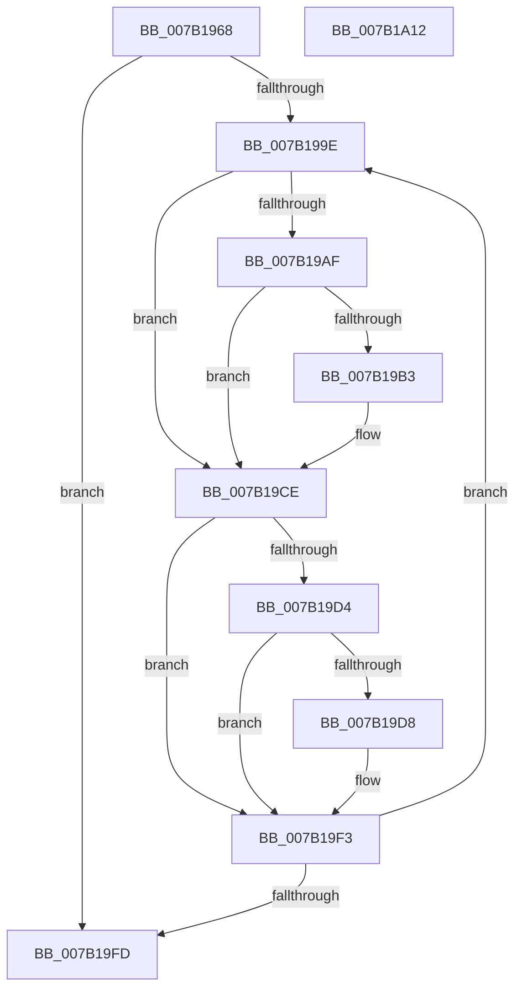

# WdipSemDisableAllProviders

- RVA: `0x007B1968`–`0x007B1A13` (길이 `171` bytes)
- VA: `0x00000001407B1968`
- 실행 섹션: `PAGE`
- PDB 이름 있음: `예`; PDB Function 태그: `아니요`
- unwind 정보 RVA: `0x00066400`
- 디코드: `46`개 명령, `171/171` bytes 표시
- 미해석 바이트: `0` (있으면 어셈블리에 `.byte`로 보존)

> 이 문서는 커널 이미지의 기계어와 PDB 기호를 분석해 생성했습니다. 4번과 5번은 함수 원형과 자료형을 바이너리 사용 방식에서 추정한 C 해석이며 원본 소스 복구 결과는 아닙니다.

## 1. Dependencies

- 직접 호출 지점: **2**; 고유 호출 대상: **1**
- 직접 호출자로 확인된 함수: **1**
- RIP 상대 이미지 참조: **6**

### Outgoing calls
- `0x007B19C9` → [WdipSemEnableDisableTrace](../A5/WdipSemEnableDisableTrace_function_00A5C7F8.md) (function, `0x00A5C7F8`)
- `0x007B19EE` → [WdipSemEnableDisableTrace](../A5/WdipSemEnableDisableTrace_function_00A5C7F8.md) (function, `0x00A5C7F8`)

### Direct callers
- [WdipSemShutdown](WdipSemShutdown_function_007B0954.md) at `0x007B0978`

### Static image references
- `0x007B197C` → RVA `0x00F02450` (`.data`; read)
- `0x007B1984` → RVA `0x00F02450` (`.data`; read/write)
- `0x007B198A` → RVA `0x00F02454` (`.data`; read)
- `0x007B1990` → RVA `0x00F02454` (`.data`; read/write)
- `0x007B1996` → RVA `0x00F01DC0` (`.data`; read)
- `0x007B199E` → RVA `0x00EFFDC0` (`.data`; read)

## 2. Other-region calls and transfers

- 다른 실행 섹션으로 향하는 call: **0**
- 별도 외부 분기/꼬리 이동을 확인하지 못했습니다.

## 3. Assembly (complete function range)

```asm
007B1968  48 89 5C 24 08                  mov qword ptr [rsp + 8], rbx
007B196D  48 89 6C 24 10                  mov qword ptr [rsp + 0x10], rbp
007B1972  48 89 74 24 18                  mov qword ptr [rsp + 0x18], rsi
007B1977  57                              push rdi
007B1978  48 83 EC 30                     sub rsp, 0x30
007B197C  8B 35 CE 0A 75 00               mov esi, dword ptr [rip + 0x750ace]
007B1982  33 DB                           xor ebx, ebx
007B1984  87 35 C6 0A 75 00               xchg dword ptr [rip + 0x750ac6], esi
007B198A  8B 2D C4 0A 75 00               mov ebp, dword ptr [rip + 0x750ac4]
007B1990  87 2D BE 0A 75 00               xchg dword ptr [rip + 0x750abe], ebp
007B1996  39 1D 24 04 75 00               cmp dword ptr [rip + 0x750424], ebx
007B199C  74 5F                           je 0x1407b19fd
007B199E  48 8D 3D 1B E4 74 00            lea rdi, [rip + 0x74e41b]
007B19A5  48 8B 3C DF                     mov rdi, qword ptr [rdi + rbx*8]
007B19A9  80 7F 25 00                     cmp byte ptr [rdi + 0x25], 0
007B19AD  74 1F                           je 0x1407b19ce
007B19AF  85 F6                           test esi, esi
007B19B1  74 1B                           je 0x1407b19ce
007B19B3  83 64 24 28 00                  and dword ptr [rsp + 0x28], 0
007B19B8  45 33 C9                        xor r9d, r9d
007B19BB  83 64 24 20 00                  and dword ptr [rsp + 0x20], 0
007B19C0  45 33 C0                        xor r8d, r8d
007B19C3  48 8B D7                        mov rdx, rdi
007B19C6  0F B7 CE                        movzx ecx, si
007B19C9  E8 2A AE 2A 00                  call 0x140a5c7f8
007B19CE  80 7F 45 00                     cmp byte ptr [rdi + 0x45], 0
007B19D2  74 1F                           je 0x1407b19f3
007B19D4  85 ED                           test ebp, ebp
007B19D6  74 1B                           je 0x1407b19f3
007B19D8  83 64 24 28 00                  and dword ptr [rsp + 0x28], 0
007B19DD  45 33 C9                        xor r9d, r9d
007B19E0  83 64 24 20 00                  and dword ptr [rsp + 0x20], 0
007B19E5  45 33 C0                        xor r8d, r8d
007B19E8  48 8B D7                        mov rdx, rdi
007B19EB  0F B7 CD                        movzx ecx, bp
007B19EE  E8 05 AE 2A 00                  call 0x140a5c7f8
007B19F3  FF C3                           inc ebx
007B19F5  3B 1D C5 03 75 00               cmp ebx, dword ptr [rip + 0x7503c5]
007B19FB  72 A1                           jb 0x1407b199e
007B19FD  48 8B 5C 24 40                  mov rbx, qword ptr [rsp + 0x40]
007B1A02  48 8B 6C 24 48                  mov rbp, qword ptr [rsp + 0x48]
007B1A07  48 8B 74 24 50                  mov rsi, qword ptr [rsp + 0x50]
007B1A0C  48 83 C4 30                     add rsp, 0x30
007B1A10  5F                              pop rdi
007B1A11  C3                              ret
007B1A12  CC                              int3
```

## 4. C-style interpretation (structured pseudocode)

```c
__int64 __fastcall WdipSemDisableAllProviders(__int64 a1, __int64 a2, int a3, int a4)
{
    __int64 result;
    __int64 v_rbx;
    __int64 v_rsp;
    unsigned int v_stack_m10;
    unsigned int v_stack_m18;
    unsigned __int64 v_stack_p10;
    unsigned __int64 v_stack_p18;
    unsigned __int64 v_stack_p8;

    v_stack_p8 = v_rbx;
    v_stack_p10 = v_rbp;
    v_stack_p18 = v_rsi;
    v_rsp = (v_rsp) - (48);
    v_rbx = 0;
    if ((*(unsigned int *)(v_rip + 7668772)) == 0) goto loc_007B19FD;
loc_007B199E:
    if ((*(unsigned __int8 *)(*(unsigned __int64 *)(v_rip + 7660571 + v_rbx * 8) + 37)) == 0) goto loc_007B19CE;
    if ((unsigned int)((unsigned int)(*(unsigned int *)(v_rip + 7670478))) != 0) {
        a4 = 0;
        a3 = 0;
        a2 = *(unsigned __int64 *)(v_rip + 7660571 + v_rbx * 8);
        a1 = (unsigned __int16)((unsigned int)(*(unsigned int *)(v_rip + 7670478)));
        result = WdipSemEnableDisableTrace(a1, a2, a3, a4);
    }
    if ((*(unsigned __int8 *)(*(unsigned __int64 *)(v_rip + 7660571 + v_rbx * 8) + 69)) == 0) goto loc_007B19F3;
    if ((unsigned int)((unsigned int)(*(unsigned int *)(v_rip + 7670468))) != 0) {
        a4 = 0;
        a3 = 0;
        a2 = *(unsigned __int64 *)(v_rip + 7660571 + v_rbx * 8);
        a1 = (unsigned __int16)((unsigned int)(*(unsigned int *)(v_rip + 7670468)));
        result = WdipSemEnableDisableTrace(a1, a2, a3, a4);
    }
    v_rbx = (unsigned int)((v_rbx) + 1);
    if (((unsigned int)(v_rbx)) < (*(unsigned int *)(v_rip + 7668677))) goto loc_007B199E;
loc_007B19FD:
    v_rsp = (v_rsp) + (48);
    return result;
}
```

## 5. (Beta) C Style

```c
int64_t WdipSemDisableAllProviders(int64_t Arg1, int64_t Arg2, int32_t Arg3, int32_t Arg4)
{
    int64_t result;
    int64_t local_rbx;
    int64_t local_rsp;
    uint32_t v_stack_m10;
    uint32_t v_stack_m18;
    uint64_t v_stack_p10;
    uint64_t v_stack_p18;
    uint64_t v_stack_p8;

    v_stack_p8 = local_rbx;
    v_stack_p10 = local_rbp;
    v_stack_p18 = local_rsi;
    local_rsp = (local_rsp) - (48);
    local_rbx = 0;
    if ((*(uint32_t *)(v_rip + 0x750424)) == 0) goto loc_007B19FD;
loc_007B199E:
    if ((*(uint8_t *)(*(uint64_t *)(v_rip + 0x74E41B + local_rbx * 8) + 0x25)) == 0) goto loc_007B19CE;
    if ((uint32_t)((uint32_t)(*(uint32_t *)(v_rip + 0x750ACE))) != 0) {
        Arg4 = 0;
        Arg3 = 0;
        Arg2 = *(uint64_t *)(v_rip + 0x74E41B + local_rbx * 8);
        Arg1 = (uint16_t)((uint32_t)(*(uint32_t *)(v_rip + 0x750ACE)));
        result = WdipSemEnableDisableTrace(Arg1, Arg2, Arg3, Arg4);
    }
    if ((*(uint8_t *)(*(uint64_t *)(v_rip + 0x74E41B + local_rbx * 8) + 0x45)) == 0) goto loc_007B19F3;
    if ((uint32_t)((uint32_t)(*(uint32_t *)(v_rip + 0x750AC4))) != 0) {
        Arg4 = 0;
        Arg3 = 0;
        Arg2 = *(uint64_t *)(v_rip + 0x74E41B + local_rbx * 8);
        Arg1 = (uint16_t)((uint32_t)(*(uint32_t *)(v_rip + 0x750AC4)));
        result = WdipSemEnableDisableTrace(Arg1, Arg2, Arg3, Arg4);
    }
    local_rbx = (uint32_t)((local_rbx) + 1);
    if (((uint32_t)(local_rbx)) < (*(uint32_t *)(v_rip + 0x7503C5))) goto loc_007B199E;
loc_007B19FD:
    local_rsp = (local_rsp) + (48);
    return result;
}
```

## 6. Execution-region graph

[열기: 2D/3D 그래프와 함수 탐색 컨트롤 패널](../../../control-panel.html?section=page&rva=0x007B1968&view=graph)

- 2D 그래프는 위에서 아래로 흐르고, 3D 그래프는 빈 공간을 드래그해 회전합니다. Shift+드래그는 이동, 휠은 확대·축소, 함수 노드 선택은 대상 보고서 이동입니다.

### Static fallback


