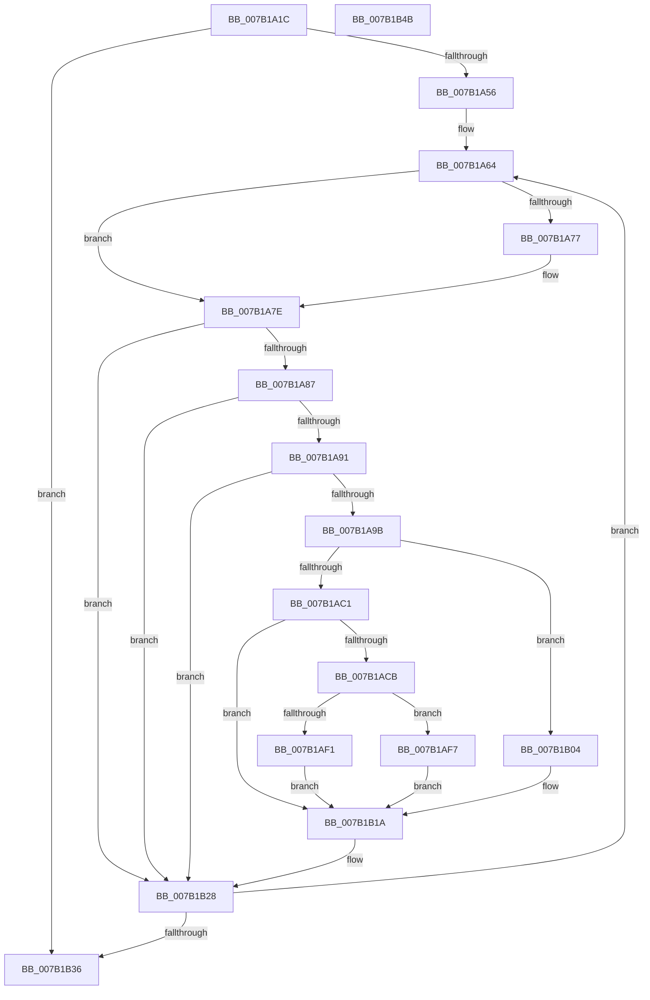

# WdipSemEnableAllProviders

- RVA: `0x007B1A1C`–`0x007B1B4C` (길이 `304` bytes)
- VA: `0x00000001407B1A1C`
- 실행 섹션: `PAGE`
- PDB 이름 있음: `예`; PDB Function 태그: `아니요`
- unwind 정보 RVA: `0x00066400`
- 디코드: `74`개 명령, `304/304` bytes 표시
- 미해석 바이트: `0` (있으면 어셈블리에 `.byte`로 보존)

> 이 문서는 커널 이미지의 기계어와 PDB 기호를 분석해 생성했습니다. 4번과 5번은 함수 원형과 자료형을 바이너리 사용 방식에서 추정한 C 해석이며 원본 소스 복구 결과는 아닙니다.

## 1. Dependencies

- 직접 호출 지점: **2**; 고유 호출 대상: **1**
- 직접 호출자로 확인된 함수: **1**
- RIP 상대 이미지 참조: **8**

### Outgoing calls
- `0x007B1AB8` → [WdipSemEnableDisableTrace](../A5/WdipSemEnableDisableTrace_function_00A5C7F8.md) (function, `0x00A5C7F8`)
- `0x007B1AE8` → [WdipSemEnableDisableTrace](../A5/WdipSemEnableDisableTrace_function_00A5C7F8.md) (function, `0x00A5C7F8`)

### Direct callers
- [WdipSemLoadScenarioTable](WdipSemLoadScenarioTable_function_007B02D8.md) at `0x007B078D`

### Static image references
- `0x007B1A30` → RVA `0x00F02450` (`.data`; read)
- `0x007B1A38` → RVA `0x00F02450` (`.data`; read/write)
- `0x007B1A3E` → RVA `0x00F02454` (`.data`; read)
- `0x007B1A44` → RVA `0x00F02454` (`.data`; read/write)
- `0x007B1A4A` → RVA `0x00F01DC0` (`.data`; read)
- `0x007B1A56` → RVA `0x000221A0` (`.rdata`; read)
- `0x007B1A5D` → RVA `0x00022198` (`.rdata`; read)
- `0x007B1A64` → RVA `0x00EFFDC0` (`.data`; read)

## 2. Other-region calls and transfers

- 다른 실행 섹션으로 향하는 call: **0**
- 별도 외부 분기/꼬리 이동을 확인하지 못했습니다.

## 3. Assembly (complete function range)

```asm
007B1A1C  48 89 5C 24 08                  mov qword ptr [rsp + 8], rbx
007B1A21  48 89 6C 24 10                  mov qword ptr [rsp + 0x10], rbp
007B1A26  48 89 74 24 18                  mov qword ptr [rsp + 0x18], rsi
007B1A2B  57                              push rdi
007B1A2C  48 83 EC 30                     sub rsp, 0x30
007B1A30  8B 2D 1A 0A 75 00               mov ebp, dword ptr [rip + 0x750a1a]
007B1A36  33 FF                           xor edi, edi
007B1A38  87 2D 12 0A 75 00               xchg dword ptr [rip + 0x750a12], ebp
007B1A3E  8B 35 10 0A 75 00               mov esi, dword ptr [rip + 0x750a10]
007B1A44  87 35 0A 0A 75 00               xchg dword ptr [rip + 0x750a0a], esi
007B1A4A  39 3D 70 03 75 00               cmp dword ptr [rip + 0x750370], edi
007B1A50  0F 84 E0 00 00 00               je 0x1407b1b36
007B1A56  48 8B 0D 43 07 87 FF            mov rcx, qword ptr [rip - 0x78f8bd]
007B1A5D  48 8B 15 34 07 87 FF            mov rdx, qword ptr [rip - 0x78f8cc]
007B1A64  48 8D 1D 55 E3 74 00            lea rbx, [rip + 0x74e355]
007B1A6B  48 8B 1C FB                     mov rbx, qword ptr [rbx + rdi*8]
007B1A6F  48 8B 03                        mov rax, qword ptr [rbx]
007B1A72  48 2B C2                        sub rax, rdx
007B1A75  75 07                           jne 0x1407b1a7e
007B1A77  48 8B 43 08                     mov rax, qword ptr [rbx + 8]
007B1A7B  48 2B C1                        sub rax, rcx
007B1A7E  48 85 C0                        test rax, rax
007B1A81  0F 84 A1 00 00 00               je 0x1407b1b28
007B1A87  83 7B 28 00                     cmp dword ptr [rbx + 0x28], 0
007B1A8B  0F 84 97 00 00 00               je 0x1407b1b28
007B1A91  80 7B 24 00                     cmp byte ptr [rbx + 0x24], 0
007B1A95  0F 84 8D 00 00 00               je 0x1407b1b28
007B1A9B  8B 43 20                        mov eax, dword ptr [rbx + 0x20]
007B1A9E  48 8B D3                        mov rdx, rbx
007B1AA1  4C 8B 4B 18                     mov r9, qword ptr [rbx + 0x18]
007B1AA5  0F B7 CD                        movzx ecx, bp
007B1AA8  44 8A 43 10                     mov r8b, byte ptr [rbx + 0x10]
007B1AAC  C7 44 24 28 01 00 00 00         mov dword ptr [rsp + 0x28], 1
007B1AB4  89 44 24 20                     mov dword ptr [rsp + 0x20], eax
007B1AB8  E8 3B AD 2A 00                  call 0x140a5c7f8
007B1ABD  85 C0                           test eax, eax
007B1ABF  78 43                           js 0x1407b1b04
007B1AC1  C6 43 25 01                     mov byte ptr [rbx + 0x25], 1
007B1AC5  80 7B 44 00                     cmp byte ptr [rbx + 0x44], 0
007B1AC9  74 4F                           je 0x1407b1b1a
007B1ACB  8B 43 40                        mov eax, dword ptr [rbx + 0x40]
007B1ACE  48 8B D3                        mov rdx, rbx
007B1AD1  4C 8B 4B 38                     mov r9, qword ptr [rbx + 0x38]
007B1AD5  0F B7 CE                        movzx ecx, si
007B1AD8  44 8A 43 30                     mov r8b, byte ptr [rbx + 0x30]
007B1ADC  C7 44 24 28 01 00 00 00         mov dword ptr [rsp + 0x28], 1
007B1AE4  89 44 24 20                     mov dword ptr [rsp + 0x20], eax
007B1AE8  E8 0B AD 2A 00                  call 0x140a5c7f8
007B1AED  85 C0                           test eax, eax
007B1AEF  78 06                           js 0x1407b1af7
007B1AF1  C6 43 45 01                     mov byte ptr [rbx + 0x45], 1
007B1AF5  EB 23                           jmp 0x1407b1b1a
007B1AF7  0F 57 C0                        xorps xmm0, xmm0
007B1AFA  0F 11 43 30                     movups xmmword ptr [rbx + 0x30], xmm0
007B1AFE  0F 11 43 40                     movups xmmword ptr [rbx + 0x40], xmm0
007B1B02  EB 16                           jmp 0x1407b1b1a
007B1B04  0F 57 C0                        xorps xmm0, xmm0
007B1B07  0F 57 C9                        xorps xmm1, xmm1
007B1B0A  0F 11 43 10                     movups xmmword ptr [rbx + 0x10], xmm0
007B1B0E  0F 11 43 20                     movups xmmword ptr [rbx + 0x20], xmm0
007B1B12  0F 11 4B 30                     movups xmmword ptr [rbx + 0x30], xmm1
007B1B16  0F 11 4B 40                     movups xmmword ptr [rbx + 0x40], xmm1
007B1B1A  48 8B 15 77 06 87 FF            mov rdx, qword ptr [rip - 0x78f989]
007B1B21  48 8B 0D 78 06 87 FF            mov rcx, qword ptr [rip - 0x78f988]
007B1B28  FF C7                           inc edi
007B1B2A  3B 3D 90 02 75 00               cmp edi, dword ptr [rip + 0x750290]
007B1B30  0F 82 2E FF FF FF               jb 0x1407b1a64
007B1B36  48 8B 5C 24 40                  mov rbx, qword ptr [rsp + 0x40]
007B1B3B  48 8B 6C 24 48                  mov rbp, qword ptr [rsp + 0x48]
007B1B40  48 8B 74 24 50                  mov rsi, qword ptr [rsp + 0x50]
007B1B45  48 83 C4 30                     add rsp, 0x30
007B1B49  5F                              pop rdi
007B1B4A  C3                              ret
007B1B4B  CC                              int3
```

## 4. C-style interpretation (structured pseudocode)

```c
__int64 __fastcall WdipSemEnableAllProviders(void)
{
    __int64 result;
    __int64 v_rdi;
    __int64 v_rsp;
    unsigned int v_stack_m10;
    unsigned int v_stack_m18;
    unsigned __int64 v_stack_p10;
    unsigned __int64 v_stack_p18;
    unsigned __int64 v_stack_p8;

    v_stack_p8 = v_rbx;
    v_stack_p10 = v_rbp;
    v_stack_p18 = v_rsi;
    v_rsp = (v_rsp) - (48);
    v_rdi = 0;
    if ((*(unsigned int *)(v_rip + 7668592)) == 0) goto loc_007B1B36;
loc_007B1A64:
    result = (*(unsigned __int64 *)(*(unsigned __int64 *)(v_rip + 7660373 + v_rdi * 8))) - (*(unsigned __int64 *)(v_rip - 7928012));
    if (!(condition_is_not_equal)) {
        result = *(unsigned __int64 *)(*(unsigned __int64 *)(v_rip + 7660373 + v_rdi * 8) + 8);
        result = (result) - (*(unsigned __int64 *)(v_rip - 7927997));
    }
    if (result == 0) goto loc_007B1B28;
    if ((*(unsigned int *)(*(unsigned __int64 *)(v_rip + 7660373 + v_rdi * 8) + 40)) == 0) goto loc_007B1B28;
    if ((*(unsigned __int8 *)(*(unsigned __int64 *)(v_rip + 7660373 + v_rdi * 8) + 36)) == 0) goto loc_007B1B28;
    v_stack_m10 = 1;
    v_stack_m18 = (unsigned int)((unsigned int)(*(unsigned int *)(*(unsigned __int64 *)(v_rip + 7660373 + v_rdi * 8) + 32)));
    result = WdipSemEnableDisableTrace((unsigned __int16)((unsigned int)(*(unsigned int *)(v_rip + 7670298))), *(unsigned __int64 *)(v_rip + 7660373 + v_rdi * 8), *(unsigned __int8 *)(*(unsigned __int64 *)(v_rip + 7660373 + v_rdi * 8) + 16), *(unsigned __int64 *)(*(unsigned __int64 *)(v_rip + 7660373 + v_rdi * 8) + 24));
    if (sign_flag) goto loc_007B1B04;
    *(unsigned __int8 *)(*(unsigned __int64 *)(v_rip + 7660373 + v_rdi * 8) + 37) = 1;
    if ((*(unsigned __int8 *)(*(unsigned __int64 *)(v_rip + 7660373 + v_rdi * 8) + 68)) == 0) goto loc_007B1B1A;
    v_stack_m10 = 1;
    v_stack_m18 = (unsigned int)((unsigned int)(*(unsigned int *)(*(unsigned __int64 *)(v_rip + 7660373 + v_rdi * 8) + 64)));
    result = WdipSemEnableDisableTrace((unsigned __int16)((unsigned int)(*(unsigned int *)(v_rip + 7670288))), *(unsigned __int64 *)(v_rip + 7660373 + v_rdi * 8), *(unsigned __int8 *)(*(unsigned __int64 *)(v_rip + 7660373 + v_rdi * 8) + 48), *(unsigned __int64 *)(*(unsigned __int64 *)(v_rip + 7660373 + v_rdi * 8) + 56));
    if (sign_flag) goto loc_007B1AF7;
    *(unsigned __int8 *)(*(unsigned __int64 *)(v_rip + 7660373 + v_rdi * 8) + 69) = 1;
    goto loc_007B1B1A;
loc_007B1AF7:
    *(unsigned __int64 *)(*(unsigned __int64 *)(v_rip + 7660373 + v_rdi * 8) + 48) = v_xmm0;
    *(unsigned __int64 *)(*(unsigned __int64 *)(v_rip + 7660373 + v_rdi * 8) + 64) = v_xmm0;
    goto loc_007B1B1A;
loc_007B1B04:
    *(unsigned __int64 *)(*(unsigned __int64 *)(v_rip + 7660373 + v_rdi * 8) + 16) = v_xmm0;
    *(unsigned __int64 *)(*(unsigned __int64 *)(v_rip + 7660373 + v_rdi * 8) + 32) = v_xmm0;
    *(unsigned __int64 *)(*(unsigned __int64 *)(v_rip + 7660373 + v_rdi * 8) + 48) = v_xmm1;
    *(unsigned __int64 *)(*(unsigned __int64 *)(v_rip + 7660373 + v_rdi * 8) + 64) = v_xmm1;
loc_007B1B1A:
loc_007B1B28:
    v_rdi = (unsigned int)((v_rdi) + 1);
    if (((unsigned int)(v_rdi)) < (*(unsigned int *)(v_rip + 7668368))) goto loc_007B1A64;
loc_007B1B36:
    v_rsp = (v_rsp) + (48);
    return result;
}
```

## 5. (Beta) C Style

```c
void WdipSemEnableAllProviders(void)
{
    int64_t result;
    int64_t local_rdi;
    int64_t local_rsp;
    uint32_t v_stack_m10;
    uint32_t v_stack_m18;
    uint64_t v_stack_p10;
    uint64_t v_stack_p18;
    uint64_t v_stack_p8;

    v_stack_p8 = local_rbx;
    v_stack_p10 = local_rbp;
    v_stack_p18 = local_rsi;
    local_rsp = (local_rsp) - (48);
    local_rdi = 0;
    if ((*(uint32_t *)(v_rip + 0x750370)) == 0) goto loc_007B1B36;
loc_007B1A64:
    result = (*(uint64_t *)(*(uint64_t *)(v_rip + 0x74E355 + local_rdi * 8))) - (*(uint64_t *)(v_rip - 0x78F8CC));
    if (!(condition_is_not_equal)) {
        result = *(uint64_t *)(*(uint64_t *)(v_rip + 0x74E355 + local_rdi * 8) + 0x8);
        result = (result) - (*(uint64_t *)(v_rip - 0x78F8BD));
    }
    if (result == 0) goto loc_007B1B28;
    if ((*(uint32_t *)(*(uint64_t *)(v_rip + 0x74E355 + local_rdi * 8) + 0x28)) == 0) goto loc_007B1B28;
    if ((*(uint8_t *)(*(uint64_t *)(v_rip + 0x74E355 + local_rdi * 8) + 0x24)) == 0) goto loc_007B1B28;
    v_stack_m10 = 1;
    v_stack_m18 = (uint32_t)((uint32_t)(*(uint32_t *)(*(uint64_t *)(v_rip + 0x74E355 + local_rdi * 8) + 0x20)));
    result = WdipSemEnableDisableTrace((uint16_t)((uint32_t)(*(uint32_t *)(v_rip + 0x750A1A))), *(uint64_t *)(v_rip + 0x74E355 + local_rdi * 8), *(uint8_t *)(*(uint64_t *)(v_rip + 0x74E355 + local_rdi * 8) + 0x10), *(uint64_t *)(*(uint64_t *)(v_rip + 0x74E355 + local_rdi * 8) + 0x18));
    if (sign_flag) goto loc_007B1B04;
    *(uint8_t *)(*(uint64_t *)(v_rip + 0x74E355 + local_rdi * 8) + 0x25) = 1;
    if ((*(uint8_t *)(*(uint64_t *)(v_rip + 0x74E355 + local_rdi * 8) + 0x44)) == 0) goto loc_007B1B1A;
    v_stack_m10 = 1;
    v_stack_m18 = (uint32_t)((uint32_t)(*(uint32_t *)(*(uint64_t *)(v_rip + 0x74E355 + local_rdi * 8) + 0x40)));
    result = WdipSemEnableDisableTrace((uint16_t)((uint32_t)(*(uint32_t *)(v_rip + 0x750A10))), *(uint64_t *)(v_rip + 0x74E355 + local_rdi * 8), *(uint8_t *)(*(uint64_t *)(v_rip + 0x74E355 + local_rdi * 8) + 0x30), *(uint64_t *)(*(uint64_t *)(v_rip + 0x74E355 + local_rdi * 8) + 0x38));
    if (sign_flag) goto loc_007B1AF7;
    *(uint8_t *)(*(uint64_t *)(v_rip + 0x74E355 + local_rdi * 8) + 0x45) = 1;
    goto loc_007B1B1A;
loc_007B1AF7:
    *(uint64_t *)(*(uint64_t *)(v_rip + 0x74E355 + local_rdi * 8) + 0x30) = v_xmm0;
    *(uint64_t *)(*(uint64_t *)(v_rip + 0x74E355 + local_rdi * 8) + 0x40) = v_xmm0;
    goto loc_007B1B1A;
loc_007B1B04:
    *(uint64_t *)(*(uint64_t *)(v_rip + 0x74E355 + local_rdi * 8) + 0x10) = v_xmm0;
    *(uint64_t *)(*(uint64_t *)(v_rip + 0x74E355 + local_rdi * 8) + 0x20) = v_xmm0;
    *(uint64_t *)(*(uint64_t *)(v_rip + 0x74E355 + local_rdi * 8) + 0x30) = v_xmm1;
    *(uint64_t *)(*(uint64_t *)(v_rip + 0x74E355 + local_rdi * 8) + 0x40) = v_xmm1;
loc_007B1B1A:
loc_007B1B28:
    local_rdi = (uint32_t)((local_rdi) + 1);
    if (((uint32_t)(local_rdi)) < (*(uint32_t *)(v_rip + 0x750290))) goto loc_007B1A64;
loc_007B1B36:
    local_rsp = (local_rsp) + (48);
    return result;
}
```

## 6. Execution-region graph

[열기: 2D/3D 그래프와 함수 탐색 컨트롤 패널](../../../control-panel.html?section=page&rva=0x007B1A1C&view=graph)

- 2D 그래프는 위에서 아래로 흐르고, 3D 그래프는 빈 공간을 드래그해 회전합니다. Shift+드래그는 이동, 휠은 확대·축소, 함수 노드 선택은 대상 보고서 이동입니다.

### Static fallback


