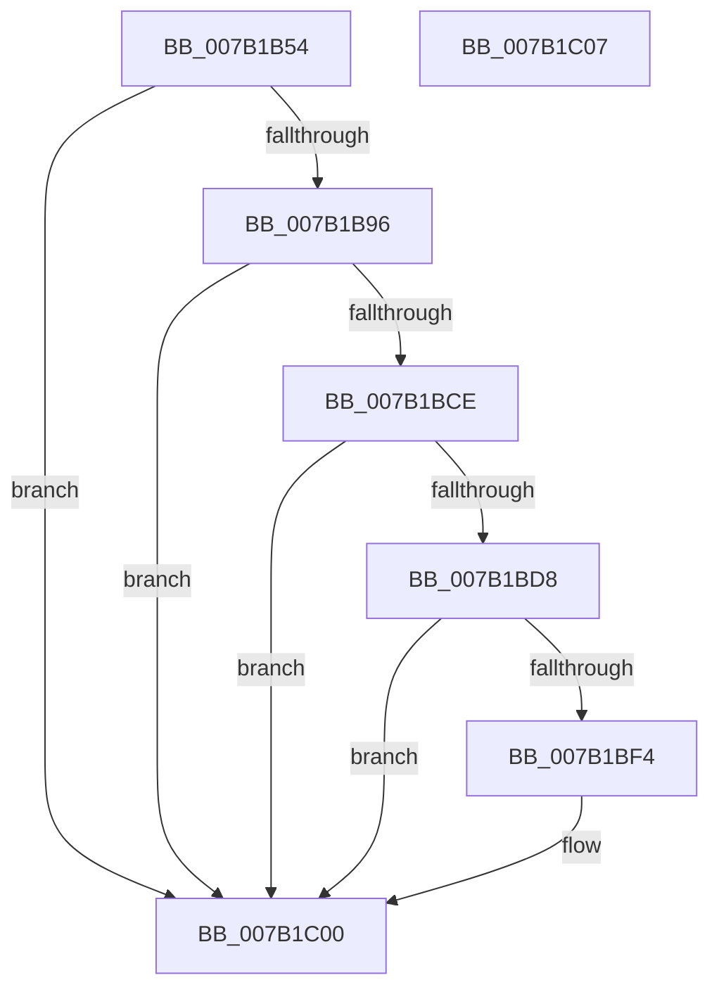

# WdipSemEnableSemProvider

- RVA: `0x007B1B54`–`0x007B1C08` (길이 `180` bytes)
- VA: `0x00000001407B1B54`
- 실행 섹션: `PAGE`
- PDB 이름 있음: `예`; PDB Function 태그: `아니요`
- unwind 정보 RVA: `0x0005D2F4`
- 디코드: `40`개 명령, `180/180` bytes 표시
- 미해석 바이트: `0` (있으면 어셈블리에 `.byte`로 보존)

> 이 문서는 커널 이미지의 기계어와 PDB 기호를 분석해 생성했습니다. 4번과 5번은 함수 원형과 자료형을 바이너리 사용 방식에서 추정한 C 해석이며 원본 소스 복구 결과는 아닙니다.

## 1. Dependencies

- 직접 호출 지점: **3**; 고유 호출 대상: **2**
- 직접 호출자로 확인된 함수: **1**
- RIP 상대 이미지 참조: **7**

### Outgoing calls
- `0x007B1B8B` → [WdipSemEnableDisableTrace](../A5/WdipSemEnableDisableTrace_function_00A5C7F8.md) (function, `0x00A5C7F8`)
- `0x007B1BC3` → [WdipSemEnableDisableTrace](../A5/WdipSemEnableDisableTrace_function_00A5C7F8.md) (function, `0x00A5C7F8`)
- `0x007B1BE9` → [EtwRegister](../92/EtwRegister_function_00920960.md) (function, `0x00920960`)

### Direct callers
- [WdipSemCleanStart](../7A/WdipSemCleanStart_function_007AF590.md) at `0x007AF5A1`

### Static image references
- `0x007B1B58` → RVA `0x00F02450` (`.data`; read)
- `0x007B1B5E` → RVA `0x00022198` (`.rdata`; read)
- `0x007B1B75` → RVA `0x00F02450` (`.data`; read/write)
- `0x007B1B96` → RVA `0x00F02454` (`.data`; read)
- `0x007B1BA3` → RVA `0x00F02454` (`.data`; read/write)
- `0x007B1BCE` → RVA `0x00F01DD0` (`.data`; read)
- `0x007B1BF9` → RVA `0x00F01DD0` (`.data`; write)

## 2. Other-region calls and transfers

- 다른 실행 섹션으로 향하는 call: **0**
- 별도 외부 분기/꼬리 이동을 확인하지 못했습니다.

## 3. Assembly (complete function range)

```asm
007B1B54  48 83 EC 38                     sub rsp, 0x38
007B1B58  8B 0D F2 08 75 00               mov ecx, dword ptr [rip + 0x7508f2]
007B1B5E  48 8D 15 33 06 87 FF            lea rdx, [rip - 0x78f9cd]
007B1B65  48 83 64 24 40 00               and qword ptr [rsp + 0x40], 0
007B1B6B  49 B9 00 00 00 00 02 00 00 00   movabs r9, 0x200000000
007B1B75  87 0D D5 08 75 00               xchg dword ptr [rip + 0x7508d5], ecx
007B1B7B  C7 44 24 28 01 00 00 00         mov dword ptr [rsp + 0x28], 1
007B1B83  45 33 C0                        xor r8d, r8d
007B1B86  83 64 24 20 00                  and dword ptr [rsp + 0x20], 0
007B1B8B  E8 68 AC 2A 00                  call 0x140a5c7f8
007B1B90  8B C8                           mov ecx, eax
007B1B92  85 C0                           test eax, eax
007B1B94  78 6A                           js 0x1407b1c00
007B1B96  8B 0D B8 08 75 00               mov ecx, dword ptr [rip + 0x7508b8]
007B1B9C  48 8D 15 F5 05 87 FF            lea rdx, [rip - 0x78fa0b]
007B1BA3  87 0D AB 08 75 00               xchg dword ptr [rip + 0x7508ab], ecx
007B1BA9  C7 44 24 28 01 00 00 00         mov dword ptr [rsp + 0x28], 1
007B1BB1  49 B9 00 00 00 00 01 00 00 00   movabs r9, 0x100000000
007B1BBB  83 64 24 20 00                  and dword ptr [rsp + 0x20], 0
007B1BC0  45 33 C0                        xor r8d, r8d
007B1BC3  E8 30 AC 2A 00                  call 0x140a5c7f8
007B1BC8  8B C8                           mov ecx, eax
007B1BCA  85 C0                           test eax, eax
007B1BCC  78 32                           js 0x1407b1c00
007B1BCE  48 83 3D FA 01 75 00 00         cmp qword ptr [rip + 0x7501fa], 0
007B1BD6  75 28                           jne 0x1407b1c00
007B1BD8  4C 8D 4C 24 40                  lea r9, [rsp + 0x40]
007B1BDD  45 33 C0                        xor r8d, r8d
007B1BE0  33 D2                           xor edx, edx
007B1BE2  48 8D 0D AF 05 87 FF            lea rcx, [rip - 0x78fa51]
007B1BE9  E8 72 ED 16 00                  call 0x140920960
007B1BEE  8B C8                           mov ecx, eax
007B1BF0  85 C0                           test eax, eax
007B1BF2  78 0C                           js 0x1407b1c00
007B1BF4  48 8B 44 24 40                  mov rax, qword ptr [rsp + 0x40]
007B1BF9  48 89 05 D0 01 75 00            mov qword ptr [rip + 0x7501d0], rax
007B1C00  8B C1                           mov eax, ecx
007B1C02  48 83 C4 38                     add rsp, 0x38
007B1C06  C3                              ret
007B1C07  CC                              int3
```

## 4. C-style interpretation (structured pseudocode)

```c
__int64 __fastcall WdipSemEnableSemProvider(__int64 a1, __int64 a2, int a3)
{
    __int64 result;
    __int64 v_rsp;
    unsigned int v_stack_m10;
    unsigned int v_stack_m18;
    unsigned __int64 v_stack_p8;

    v_rsp = (v_rsp) - (56);
    v_stack_m10 = 1;
    a3 = 0;
    result = WdipSemEnableDisableTrace((unsigned int)(*(unsigned int *)(v_rip + 7670002)), v_rip - 7928269, a3, a4);
    if (sign_flag) goto loc_007B1C00;
    v_stack_m10 = 1;
    a3 = 0;
    result = WdipSemEnableDisableTrace((unsigned int)(*(unsigned int *)(v_rip + 7669944)), v_rip - 7928331, a3, a4);
    if (sign_flag) goto loc_007B1C00;
    if ((*(unsigned __int64 *)(v_rip + 7668218)) != 0) goto loc_007B1C00;
    a3 = 0;
    a2 = 0;
    result = EtwRegister(v_rip - 7928401, a2, a3, v_stack_p8);
    if (!(sign_flag)) {
        result = v_stack_p8;
        *(unsigned __int64 *)(v_rip + 7668176) = result;
    }
    v_rsp = (v_rsp) + (56);
    return (unsigned int)((unsigned int)((unsigned int)((unsigned int)(result))));
}
```

## 5. (Beta) C Style

```c
int64_t WdipSemEnableSemProvider(int64_t Arg1, int64_t Arg2, int32_t Arg3)
{
    int64_t result;
    int64_t local_rsp;
    uint32_t v_stack_m10;
    uint32_t v_stack_m18;
    uint64_t v_stack_p8;

    local_rsp = (local_rsp) - (56);
    v_stack_m10 = 1;
    Arg3 = 0;
    result = WdipSemEnableDisableTrace((uint32_t)(*(uint32_t *)(v_rip + 0x7508F2)), v_rip - 7928269, Arg3, a4);
    if (sign_flag) goto loc_007B1C00;
    v_stack_m10 = 1;
    Arg3 = 0;
    result = WdipSemEnableDisableTrace((uint32_t)(*(uint32_t *)(v_rip + 0x7508B8)), v_rip - 7928331, Arg3, a4);
    if (sign_flag) goto loc_007B1C00;
    if ((*(uint64_t *)(v_rip + 0x7501FA)) != 0) goto loc_007B1C00;
    Arg3 = 0;
    Arg2 = 0;
    result = EtwRegister(v_rip - 7928401, Arg2, Arg3, v_stack_p8);
    if (!(sign_flag)) {
        result = v_stack_p8;
        *(uint64_t *)(v_rip + 0x7501D0) = result;
    }
    local_rsp = (local_rsp) + (56);
    return (uint32_t)((uint32_t)((uint32_t)((uint32_t)(result))));
}
```

## 6. Execution-region graph

[열기: 2D/3D 그래프와 함수 탐색 컨트롤 패널](../../../control-panel.html?section=page&rva=0x007B1B54&view=graph)

- 2D 그래프는 위에서 아래로 흐르고, 3D 그래프는 빈 공간을 드래그해 회전합니다. Shift+드래그는 이동, 휠은 확대·축소, 함수 노드 선택은 대상 보고서 이동입니다.

### Static fallback


