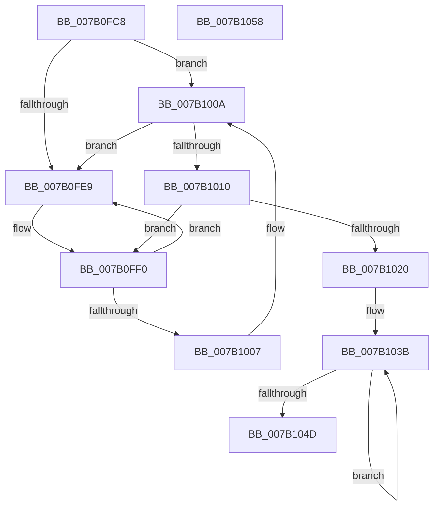

# WdipSemFreePool

- RVA: `0x007B0FC8`–`0x007B1059` (길이 `145` bytes)
- VA: `0x00000001407B0FC8`
- 실행 섹션: `PAGE`
- PDB 이름 있음: `예`; PDB Function 태그: `아니요`
- unwind 정보 RVA: `0x0005CAAC`
- 디코드: `37`개 명령, `145/145` bytes 표시
- 미해석 바이트: `0` (있으면 어셈블리에 `.byte`로 보존)

> 이 문서는 커널 이미지의 기계어와 PDB 기호를 분석해 생성했습니다. 4번과 5번은 함수 원형과 자료형을 바이너리 사용 방식에서 추정한 C 해석이며 원본 소스 복구 결과는 아닙니다.

## 1. Dependencies

- 직접 호출 지점: **2**; 고유 호출 대상: **2**
- 직접 호출자로 확인된 함수: **1**
- RIP 상대 이미지 참조: **5**

### Outgoing calls
- `0x007B0FF5` → [ExFreePoolWithTag](../../poolcode/B8/ExFreePoolWithTag_function_00B82870.md) (function, `0x00B82870`)
- `0x007B103E` → [InitializeSListHead](../../text/46/InitializeSListHead_function_00468A90.md) (function, `0x00468A90`)

### Direct callers
- [WdipSemShutdown](WdipSemShutdown_function_007B0954.md) at `0x007B09E4`

### Static image references
- `0x007B0FD2` → RVA `0x00E28C60` (`.data`; read)
- `0x007B1010` → RVA `0x00E28C60` (`.data`; write)
- `0x007B1020` → RVA `0x00E28C70` (`.data`; read/write)
- `0x007B1027` → RVA `0x00E28C90` (`.data`; read)
- `0x007B102E` → RVA `0x00E28C78` (`.data`; read/write)

## 2. Other-region calls and transfers

- 다른 실행 섹션으로 향하는 call: **2**
  - `0x007B0FF5` → [ExFreePoolWithTag](../../poolcode/B8/ExFreePoolWithTag_function_00B82870.md) (`PAGE` → `POOLCODE`)
  - `0x007B103E` → [InitializeSListHead](../../text/46/InitializeSListHead_function_00468A90.md) (`PAGE` → `.text`)
- 별도 외부 분기/꼬리 이동을 확인하지 못했습니다.

## 3. Assembly (complete function range)

```asm
007B0FC8  48 89 5C 24 08                  mov qword ptr [rsp + 8], rbx
007B0FCD  57                              push rdi
007B0FCE  48 83 EC 20                     sub rsp, 0x20
007B0FD2  48 8B 05 87 7C 67 00            mov rax, qword ptr [rip + 0x677c87]
007B0FD9  48 8D 1D 80 7C 67 00            lea rbx, [rip + 0x677c80]
007B0FE0  48 8B 08                        mov rcx, qword ptr [rax]
007B0FE3  48 39 58 08                     cmp qword ptr [rax + 8], rbx
007B0FE7  74 21                           je 0x1407b100a
007B0FE9  B9 03 00 00 00                  mov ecx, 3
007B0FEE  CD 29                           int 0x29
007B0FF0  33 D2                           xor edx, edx
007B0FF2  48 8B C8                        mov rcx, rax
007B0FF5  E8 76 18 3D 00                  call 0x140b82870
007B0FFA  48 8B 05 5F 7C 67 00            mov rax, qword ptr [rip + 0x677c5f]
007B1001  48 39 58 08                     cmp qword ptr [rax + 8], rbx
007B1005  75 E2                           jne 0x1407b0fe9
007B1007  48 8B 08                        mov rcx, qword ptr [rax]
007B100A  48 39 41 08                     cmp qword ptr [rcx + 8], rax
007B100E  75 D9                           jne 0x1407b0fe9
007B1010  48 89 0D 49 7C 67 00            mov qword ptr [rip + 0x677c49], rcx
007B1017  48 89 59 08                     mov qword ptr [rcx + 8], rbx
007B101B  48 3B C3                        cmp rax, rbx
007B101E  75 D0                           jne 0x1407b0ff0
007B1020  83 25 49 7C 67 00 00            and dword ptr [rip + 0x677c49], 0
007B1027  48 8D 1D 62 7C 67 00            lea rbx, [rip + 0x677c62]
007B102E  48 83 25 42 7C 67 00 00         and qword ptr [rip + 0x677c42], 0
007B1036  BF 06 00 00 00                  mov edi, 6
007B103B  48 8B CB                        mov rcx, rbx
007B103E  E8 4D 7A CB FF                  call 0x140468a90
007B1043  48 83 C3 10                     add rbx, 0x10
007B1047  48 83 EF 01                     sub rdi, 1
007B104B  75 EE                           jne 0x1407b103b
007B104D  48 8B 5C 24 30                  mov rbx, qword ptr [rsp + 0x30]
007B1052  48 83 C4 20                     add rsp, 0x20
007B1056  5F                              pop rdi
007B1057  C3                              ret
007B1058  CC                              int3
```

## 4. C-style interpretation (structured pseudocode)

```c
__int64 __fastcall WdipSemFreePool(__int64 a1, int a2)
{
    __int64 result;
    __int64 v_rbx;
    __int64 v_rdi;
    __int64 v_rsp;
    unsigned __int64 v_stack_p8;

    v_stack_p8 = v_rbx;
    v_rsp = (v_rsp) - (32);
    if ((*(unsigned __int64 *)(*(unsigned __int64 *)(v_rip + 6782087) + 8)) == (v_rip + 6782080)) goto loc_007B100A;
loc_007B0FE9:
loc_007B0FF0:
    a2 = 0;
    result = ExFreePoolWithTag(*(unsigned __int64 *)(v_rip + 6782087), a2, a3, a4);
    if ((*(unsigned __int64 *)(*(unsigned __int64 *)(v_rip + 6782047) + 8)) != (v_rip + 6782080)) goto loc_007B0FE9;
loc_007B100A:
    if ((*(unsigned __int64 *)(*(unsigned __int64 *)(*(unsigned __int64 *)(v_rip + 6782047)) + 8)) != (*(unsigned __int64 *)(v_rip + 6782047))) goto loc_007B0FE9;
    *(unsigned __int64 *)(v_rip + 6782025) = *(unsigned __int64 *)(*(unsigned __int64 *)(v_rip + 6782047));
    *(unsigned __int64 *)(*(unsigned __int64 *)(*(unsigned __int64 *)(v_rip + 6782047)) + 8) = v_rip + 6782080;
    if ((*(unsigned __int64 *)(v_rip + 6782047)) != (v_rip + 6782080)) goto loc_007B0FF0;
loc_007B103B:
    result = InitializeSListHead(v_rip + 6782050, a2, a3, a4);
    v_rbx = (v_rip + 6782050) + (16);
    v_rdi = (6) - (1);
    if (condition_is_not_equal) goto loc_007B103B;
    v_rsp = (v_rsp) + (32);
    return result;
}
```

## 5. (Beta) C Style

```c
int64_t WdipSemFreePool(int64_t Arg1, int32_t Arg2)
{
    int64_t result;
    int64_t local_rbx;
    int64_t local_rdi;
    int64_t local_rsp;
    uint64_t v_stack_p8;

    v_stack_p8 = local_rbx;
    local_rsp = (local_rsp) - (32);
    if ((*(uint64_t *)(*(uint64_t *)(v_rip + 0x677C87) + 0x8)) == (v_rip + 6782080)) goto loc_007B100A;
loc_007B0FE9:
loc_007B0FF0:
    Arg2 = 0;
    result = ExFreePoolWithTag(*(uint64_t *)(v_rip + 0x677C87), Arg2, a3, a4);
    if ((*(uint64_t *)(*(uint64_t *)(v_rip + 0x677C5F) + 0x8)) != (v_rip + 6782080)) goto loc_007B0FE9;
loc_007B100A:
    if ((*(uint64_t *)(*(uint64_t *)(*(uint64_t *)(v_rip + 0x677C5F)) + 0x8)) != (*(uint64_t *)(v_rip + 0x677C5F))) goto loc_007B0FE9;
    *(uint64_t *)(v_rip + 0x677C49) = *(uint64_t *)(*(uint64_t *)(v_rip + 0x677C5F));
    *(uint64_t *)(*(uint64_t *)(*(uint64_t *)(v_rip + 0x677C5F)) + 0x8) = v_rip + 6782080;
    if ((*(uint64_t *)(v_rip + 0x677C5F)) != (v_rip + 6782080)) goto loc_007B0FF0;
loc_007B103B:
    result = InitializeSListHead(v_rip + 6782050, Arg2, a3, a4);
    local_rbx = (v_rip + 6782050) + (16);
    local_rdi = (6) - (1);
    if (condition_is_not_equal) goto loc_007B103B;
    local_rsp = (local_rsp) + (32);
    return result;
}
```

## 6. Execution-region graph

[열기: 2D/3D 그래프와 함수 탐색 컨트롤 패널](../../../control-panel.html?section=page&rva=0x007B0FC8&view=graph)

- 2D 그래프는 위에서 아래로 흐르고, 3D 그래프는 빈 공간을 드래그해 회전합니다. Shift+드래그는 이동, 휠은 확대·축소, 함수 노드 선택은 대상 보고서 이동입니다.

### Static fallback


