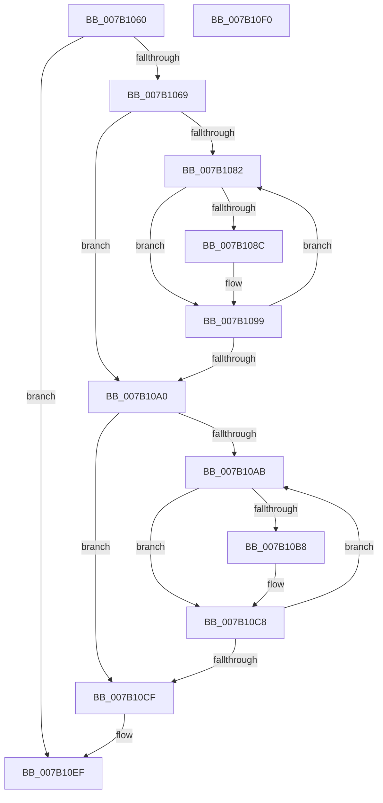

# WdipSemFreeScenario

- RVA: `0x007B1060`–`0x007B10F1` (길이 `145` bytes)
- VA: `0x00000001407B1060`
- 실행 섹션: `PAGE`
- PDB 이름 있음: `예`; PDB Function 태그: `아니요`
- unwind 정보 RVA: `0x00067A3C`
- 디코드: `42`개 명령, `145/145` bytes 표시
- 미해석 바이트: `0` (있으면 어셈블리에 `.byte`로 보존)

> 이 문서는 커널 이미지의 기계어와 PDB 기호를 분석해 생성했습니다. 4번과 5번은 함수 원형과 자료형을 바이너리 사용 방식에서 추정한 C 해석이며 원본 소스 복구 결과는 아닙니다.

## 1. Dependencies

- 직접 호출 지점: **3**; 고유 호출 대상: **1**
- 직접 호출자로 확인된 함수: **2**
- RIP 상대 이미지 참조: **0**

### Outgoing calls
- `0x007B108E` → [WdipSemFastFree](../70/WdipSemFastFree_function_0070303C.md) (function, `0x0070303C`)
- `0x007B10BA` → [WdipSemFastFree](../70/WdipSemFastFree_function_0070303C.md) (function, `0x0070303C`)
- `0x007B10DB` → [WdipSemFastFree](../70/WdipSemFastFree_function_0070303C.md) (function, `0x0070303C`)

### Direct callers
- [WdipSemAddScenarioToTable](../7A/WdipSemAddScenarioToTable_function_007AF4D0.md) at `0x007AF54E`
- [WdipSemLoadScenarioTable](WdipSemLoadScenarioTable_function_007B02D8.md) at `0x007B0605`
- [WdipSemLoadScenarioTable](WdipSemLoadScenarioTable_function_007B02D8.md) at `0x007B07E5`

### Static image references
- 디코드된 RIP-relative 메모리 참조가 없습니다.

## 2. Other-region calls and transfers

- 다른 실행 섹션으로 향하는 call: **0**
- 별도 외부 분기/꼬리 이동을 확인하지 못했습니다.

## 3. Assembly (complete function range)

```asm
007B1060  48 85 C9                        test rcx, rcx
007B1063  0F 84 86 00 00 00               je 0x1407b10ef
007B1069  48 89 5C 24 08                  mov qword ptr [rsp + 8], rbx
007B106E  48 89 74 24 10                  mov qword ptr [rsp + 0x10], rsi
007B1073  57                              push rdi
007B1074  48 83 EC 20                     sub rsp, 0x20
007B1078  33 FF                           xor edi, edi
007B107A  48 8B D9                        mov rbx, rcx
007B107D  39 79 30                        cmp dword ptr [rcx + 0x30], edi
007B1080  76 1E                           jbe 0x1407b10a0
007B1082  48 8B 54 FB 38                  mov rdx, qword ptr [rbx + rdi*8 + 0x38]
007B1087  48 85 D2                        test rdx, rdx
007B108A  74 0D                           je 0x1407b1099
007B108C  33 C9                           xor ecx, ecx
007B108E  E8 A9 1F F5 FF                  call 0x14070303c
007B1093  48 83 64 FB 38 00               and qword ptr [rbx + rdi*8 + 0x38], 0
007B1099  FF C7                           inc edi
007B109B  3B 7B 30                        cmp edi, dword ptr [rbx + 0x30]
007B109E  72 E2                           jb 0x1407b1082
007B10A0  83 63 30 00                     and dword ptr [rbx + 0x30], 0
007B10A4  33 FF                           xor edi, edi
007B10A6  39 7B 34                        cmp dword ptr [rbx + 0x34], edi
007B10A9  76 24                           jbe 0x1407b10cf
007B10AB  48 8B 94 FB 18 04 00 00         mov rdx, qword ptr [rbx + rdi*8 + 0x418]
007B10B3  48 85 D2                        test rdx, rdx
007B10B6  74 10                           je 0x1407b10c8
007B10B8  33 C9                           xor ecx, ecx
007B10BA  E8 7D 1F F5 FF                  call 0x14070303c
007B10BF  48 83 A4 FB 18 04 00 00 00      and qword ptr [rbx + rdi*8 + 0x418], 0
007B10C8  FF C7                           inc edi
007B10CA  3B 7B 34                        cmp edi, dword ptr [rbx + 0x34]
007B10CD  72 DC                           jb 0x1407b10ab
007B10CF  83 63 34 00                     and dword ptr [rbx + 0x34], 0
007B10D3  48 8B D3                        mov rdx, rbx
007B10D6  B9 01 00 00 00                  mov ecx, 1
007B10DB  E8 5C 1F F5 FF                  call 0x14070303c
007B10E0  48 8B 5C 24 30                  mov rbx, qword ptr [rsp + 0x30]
007B10E5  48 8B 74 24 38                  mov rsi, qword ptr [rsp + 0x38]
007B10EA  48 83 C4 20                     add rsp, 0x20
007B10EE  5F                              pop rdi
007B10EF  C3                              ret
007B10F0  CC                              int3
```

## 4. C-style interpretation (structured pseudocode)

```c
__int64 __fastcall WdipSemFreeScenario(__int64 a1)
{
    __int64 result;
    __int64 v_rdi;
    __int64 v_rsp;
    unsigned __int64 v_stack_p10;
    unsigned __int64 v_stack_p8;

    if (a1 == 0) goto loc_007B10EF;
    v_stack_p8 = v_rbx;
    v_stack_p10 = v_rsi;
    v_rsp = (v_rsp) - (32);
    v_rdi = 0;
    if ((*(unsigned int *)(a1 + 48)) <= 0) goto loc_007B10A0;
loc_007B1082:
    if (*(unsigned __int64 *)(a1 + v_rdi * 8 + 56) != 0) {
        a1 = 0;
        result = WdipSemFastFree(a1, *(unsigned __int64 *)(a1 + v_rdi * 8 + 56), a3, a4);
    }
    v_rdi = (unsigned int)((v_rdi) + 1);
    if (((unsigned int)(v_rdi)) < (*(unsigned int *)(a1 + 48))) goto loc_007B1082;
loc_007B10A0:
    v_rdi = 0;
    if ((*(unsigned int *)(a1 + 52)) <= 0) goto loc_007B10CF;
loc_007B10AB:
    if (*(unsigned __int64 *)(a1 + v_rdi * 8 + 1048) != 0) {
        a1 = 0;
        result = WdipSemFastFree(a1, *(unsigned __int64 *)(a1 + v_rdi * 8 + 1048), a3, a4);
    }
    v_rdi = (unsigned int)((v_rdi) + 1);
    if (((unsigned int)(v_rdi)) < (*(unsigned int *)(a1 + 52))) goto loc_007B10AB;
loc_007B10CF:
    result = WdipSemFastFree(1, 0, a3, a4);
    v_rsp = (v_rsp) + (32);
loc_007B10EF:
    return result;
}
```

## 5. (Beta) C Style

```c
int64_t WdipSemFreeScenario(int64_t Arg1)
{
    int64_t result;
    int64_t local_rdi;
    int64_t local_rsp;
    uint64_t v_stack_p10;
    uint64_t v_stack_p8;

    if (Arg1 == 0) goto loc_007B10EF;
    v_stack_p8 = local_rbx;
    v_stack_p10 = local_rsi;
    local_rsp = (local_rsp) - (32);
    local_rdi = 0;
    if ((*(uint32_t *)(Arg1 + 0x30)) <= 0) goto loc_007B10A0;
loc_007B1082:
    if (*(uint64_t *)(Arg1 + local_rdi * 8 + 0x38) != 0) {
        Arg1 = 0;
        result = WdipSemFastFree(Arg1, *(uint64_t *)(Arg1 + local_rdi * 8 + 0x38), a3, a4);
    }
    local_rdi = (uint32_t)((local_rdi) + 1);
    if (((uint32_t)(local_rdi)) < (*(uint32_t *)(Arg1 + 0x30))) goto loc_007B1082;
loc_007B10A0:
    local_rdi = 0;
    if ((*(uint32_t *)(Arg1 + 0x34)) <= 0) goto loc_007B10CF;
loc_007B10AB:
    if (*(uint64_t *)(Arg1 + local_rdi * 8 + 0x418) != 0) {
        Arg1 = 0;
        result = WdipSemFastFree(Arg1, *(uint64_t *)(Arg1 + local_rdi * 8 + 0x418), a3, a4);
    }
    local_rdi = (uint32_t)((local_rdi) + 1);
    if (((uint32_t)(local_rdi)) < (*(uint32_t *)(Arg1 + 0x34))) goto loc_007B10AB;
loc_007B10CF:
    result = WdipSemFastFree(1, 0, a3, a4);
    local_rsp = (local_rsp) + (32);
loc_007B10EF:
    return result;
}
```

## 6. Execution-region graph

[열기: 2D/3D 그래프와 함수 탐색 컨트롤 패널](../../../control-panel.html?section=page&rva=0x007B1060&view=graph)

- 2D 그래프는 위에서 아래로 흐르고, 3D 그래프는 빈 공간을 드래그해 회전합니다. Shift+드래그는 이동, 휠은 확대·축소, 함수 노드 선택은 대상 보고서 이동입니다.

### Static fallback


