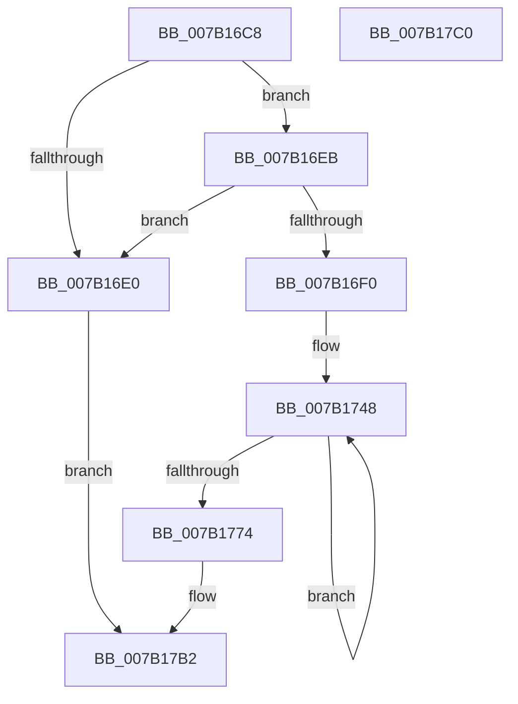

# WdipSemGetGuidKey

- RVA: `0x007B16C8`–`0x007B17C1` (길이 `249` bytes)
- VA: `0x00000001407B16C8`
- 실행 섹션: `PAGE`
- PDB 이름 있음: `예`; PDB Function 태그: `아니요`
- unwind 정보 RVA: `0x000D30C4`
- 디코드: `69`개 명령, `249/249` bytes 표시
- 미해석 바이트: `0` (있으면 어셈블리에 `.byte`로 보존)

> 이 문서는 커널 이미지의 기계어와 PDB 기호를 분석해 생성했습니다. 4번과 5번은 함수 원형과 자료형을 바이너리 사용 방식에서 추정한 C 해석이며 원본 소스 복구 결과는 아닙니다.

## 1. Dependencies

- 직접 호출 지점: **0**; 고유 호출 대상: **0**
- 직접 호출자로 확인된 함수: **2**
- RIP 상대 이미지 참조: **0**

### Outgoing calls
- 직접 디코드된 call 명령이 없습니다.

### Direct callers
- [WdipSemSqmLogTimeoutDataPoints](WdipSemSqmLogTimeoutDataPoints_function_007B1F1C.md) at `0x007B1F3A`
- [sub_00B3DAFC](../B3/Unknown_function_00B3DAFC.md) at `0x00B3DB07`

### Static image references
- 디코드된 RIP-relative 메모리 참조가 없습니다.

## 2. Other-region calls and transfers

- 다른 실행 섹션으로 향하는 call: **0**
- 별도 외부 분기/꼬리 이동을 확인하지 못했습니다.

## 3. Assembly (complete function range)

```asm
007B16C8  48 89 5C 24 08                  mov qword ptr [rsp + 8], rbx
007B16CD  48 89 74 24 10                  mov qword ptr [rsp + 0x10], rsi
007B16D2  45 33 C9                        xor r9d, r9d
007B16D5  4C 8B DA                        mov r11, rdx
007B16D8  4C 8B C1                        mov r8, rcx
007B16DB  48 85 C9                        test rcx, rcx
007B16DE  75 0B                           jne 0x1407b16eb
007B16E0  41 B9 0D 00 00 C0               mov r9d, 0xc000000d
007B16E6  E9 C7 00 00 00                  jmp 0x1407b17b2
007B16EB  4D 85 DB                        test r11, r11
007B16EE  74 F0                           je 0x1407b16e0
007B16F0  0F B7 51 06                     movzx edx, word ptr [rcx + 6]
007B16F4  BE 00 00 FF FF                  mov esi, 0xffff0000
007B16F9  0F B7 49 04                     movzx ecx, word ptr [rcx + 4]
007B16FD  41 BA 39 30 00 00               mov r10d, 0x3039
007B1703  69 C1 CD D6 78 17               imul eax, ecx, 0x1778d6cd
007B1709  BB 08 00 00 00                  mov ebx, 8
007B170E  44 2B D0                        sub r10d, eax
007B1711  69 C1 D3 15 19 13               imul eax, ecx, 0x131915d3
007B1717  41 C1 EA 10                     shr r10d, 0x10
007B171B  B9 39 30 00 00                  mov ecx, 0x3039
007B1720  FF C0                           inc eax
007B1722  23 C6                           and eax, esi
007B1724  44 0B D0                        or r10d, eax
007B1727  69 C2 CD D6 78 17               imul eax, edx, 0x1778d6cd
007B172D  2B C8                           sub ecx, eax
007B172F  69 C2 D3 15 19 13               imul eax, edx, 0x131915d3
007B1735  C1 E9 10                        shr ecx, 0x10
007B1738  FF C0                           inc eax
007B173A  23 C6                           and eax, esi
007B173C  0B C8                           or ecx, eax
007B173E  44 03 D1                        add r10d, ecx
007B1741  45 03 10                        add r10d, dword ptr [r8]
007B1744  49 83 C0 08                     add r8, 8
007B1748  41 0F B6 08                     movzx ecx, byte ptr [r8]
007B174C  BA 39 30 00 00                  mov edx, 0x3039
007B1751  69 C1 CD D6 78 17               imul eax, ecx, 0x1778d6cd
007B1757  49 FF C0                        inc r8
007B175A  2B D0                           sub edx, eax
007B175C  69 C1 D3 15 19 13               imul eax, ecx, 0x131915d3
007B1762  C1 EA 10                        shr edx, 0x10
007B1765  FF C0                           inc eax
007B1767  23 C6                           and eax, esi
007B1769  0B D0                           or edx, eax
007B176B  44 03 D2                        add r10d, edx
007B176E  48 83 EB 01                     sub rbx, 1
007B1772  75 D4                           jne 0x1407b1748
007B1774  45 69 C2 6D 4E C6 41            imul r8d, r10d, 0x41c64e6d
007B177B  41 69 C2 CD 0D 01 00            imul eax, r10d, 0x10dcd
007B1782  41 81 C0 39 30 00 00            add r8d, 0x3039
007B1789  FF C0                           inc eax
007B178B  41 C1 E8 10                     shr r8d, 0x10
007B178F  23 C6                           and eax, esi
007B1791  44 0B C0                        or r8d, eax
007B1794  8D 43 03                        lea eax, [rbx + 3]
007B1797  41 F7 E0                        mul r8d
007B179A  41 8B C8                        mov ecx, r8d
007B179D  2B CA                           sub ecx, edx
007B179F  D1 E9                           shr ecx, 1
007B17A1  03 CA                           add ecx, edx
007B17A3  C1 E9 1E                        shr ecx, 0x1e
007B17A6  69 C9 FF FF FF 7F               imul ecx, ecx, 0x7fffffff
007B17AC  44 2B C1                        sub r8d, ecx
007B17AF  45 89 03                        mov dword ptr [r11], r8d
007B17B2  48 8B 5C 24 08                  mov rbx, qword ptr [rsp + 8]
007B17B7  41 8B C1                        mov eax, r9d
007B17BA  48 8B 74 24 10                  mov rsi, qword ptr [rsp + 0x10]
007B17BF  C3                              ret
007B17C0  CC                              int3
```

## 4. C-style interpretation (structured pseudocode)

```c
__int64 __fastcall WdipSemGetGuidKey(__int64 a1, __int64 a2, __int64 a3, int a4)
{
    __int64 result;
    __int64 v_r10;
    __int64 v_rbx;
    unsigned __int64 v_stack_p10;
    unsigned __int64 v_stack_p8;

    v_stack_p8 = v_rbx;
    v_stack_p10 = v_rsi;
    a4 = 0;
    if (a1 != 0) goto loc_007B16EB;
loc_007B16E0:
    goto loc_007B17B2;
loc_007B16EB:
    if (a2 == 0) goto loc_007B16E0;
    result = (unsigned int)((result) * ((unsigned int)(*(unsigned __int16 *)(a1 + 4))));
    v_r10 = (unsigned int)(((unsigned int)(0x3039ULL)) - ((unsigned int)(result)));
    result = (unsigned int)((result) * ((unsigned int)(*(unsigned __int16 *)(a1 + 4))));
    v_r10 = (unsigned int)((v_r10) >> (16));
    result = (unsigned int)((result) + 1);
    result = (unsigned int)((result) & ((unsigned int)((unsigned int)(0xFFFF0000ULL))));
    v_r10 = (unsigned int)((v_r10) | ((unsigned int)(result)));
    result = (unsigned int)((result) * ((unsigned int)(*(unsigned __int16 *)(a1 + 6))));
    a1 = (unsigned int)(((unsigned int)(0x3039ULL)) - ((unsigned int)(result)));
    result = (unsigned int)((result) * ((unsigned int)(*(unsigned __int16 *)(a1 + 6))));
    a1 = (unsigned int)((a1) >> (16));
    result = (unsigned int)((result) + 1);
    result = (unsigned int)((result) & ((unsigned int)((unsigned int)(0xFFFF0000ULL))));
    a1 = (unsigned int)((a1) | ((unsigned int)(result)));
    v_r10 = (unsigned int)((v_r10) + ((unsigned int)(a1)));
    v_r10 = (unsigned int)((v_r10) + (*(unsigned int *)(a1)));
    a3 = (a1) + (8);
loc_007B1748:
    result = (unsigned int)((result) * ((unsigned int)(*(unsigned __int8 *)(a3))));
    a3 = (a3) + 1;
    a2 = (unsigned int)(((unsigned int)(0x3039ULL)) - ((unsigned int)(result)));
    result = (unsigned int)((result) * ((unsigned int)(*(unsigned __int8 *)(a3))));
    a2 = (unsigned int)((a2) >> (16));
    result = (unsigned int)((result) + 1);
    result = (unsigned int)((result) & ((unsigned int)((unsigned int)(0xFFFF0000ULL))));
    a2 = (unsigned int)((a2) | ((unsigned int)(result)));
    v_r10 = (unsigned int)((v_r10) + ((unsigned int)(a2)));
    v_rbx = (8) - (1);
    if (condition_is_not_equal) goto loc_007B1748;
    a3 = (unsigned int)((a3) * ((unsigned int)(v_r10)));
    result = (unsigned int)((result) * ((unsigned int)(v_r10)));
    a3 = (unsigned int)((a3) + (0x3039ULL));
    result = (unsigned int)((result) + 1);
    a3 = (unsigned int)((a3) >> (16));
    result = (unsigned int)((result) & ((unsigned int)((unsigned int)(0xFFFF0000ULL))));
    a3 = (unsigned int)((a3) | ((unsigned int)(result)));
    a1 = (unsigned int)(((unsigned int)((unsigned int)(a3))) - ((unsigned int)(a2)));
    a1 = (unsigned int)((a1) >> (1));
    a1 = (unsigned int)((a1) + ((unsigned int)(a2)));
    a1 = (unsigned int)((a1) >> (30));
    a1 = (unsigned int)((a1) * ((unsigned int)(a1)));
    a3 = (unsigned int)((a3) - ((unsigned int)(a1)));
    *(unsigned int *)(a2) = (unsigned int)(a3);
loc_007B17B2:
    return (unsigned int)((unsigned int)((unsigned int)(0xC000000DULL)));
}
```

## 5. (Beta) C Style

```c
int64_t WdipSemGetGuidKey(void *Arg1, int64_t Arg2, int64_t Arg3, int32_t Arg4)
{
    uint8_t *arg1 = (uint8_t *)Arg1;

    int64_t result;
    int64_t local_r10;
    int64_t local_rbx;
    uint64_t v_stack_p10;
    uint64_t v_stack_p8;

    v_stack_p8 = local_rbx;
    v_stack_p10 = local_rsi;
    Arg4 = 0;
    if (Arg1 != NULL) goto loc_007B16EB;
loc_007B16E0:
    goto loc_007B17B2;
loc_007B16EB:
    if (Arg2 == 0) goto loc_007B16E0;
    result = (uint32_t)((result) * ((uint32_t)(*(uint16_t *)(arg1 + 0x4))));
    local_r10 = (uint32_t)(((uint32_t)(0x3039ULL)) - ((uint32_t)(result)));
    result = (uint32_t)((result) * ((uint32_t)(*(uint16_t *)(arg1 + 0x4))));
    local_r10 = (uint32_t)((local_r10) >> (16));
    result = (uint32_t)((result) + 1);
    result = (uint32_t)((result) & ((uint32_t)((uint32_t)(0xFFFF0000ULL))));
    local_r10 = (uint32_t)((local_r10) | ((uint32_t)(result)));
    result = (uint32_t)((result) * ((uint32_t)(*(uint16_t *)(arg1 + 0x6))));
    Arg1 = (uint32_t)(((uint32_t)(0x3039ULL)) - ((uint32_t)(result)));
    result = (uint32_t)((result) * ((uint32_t)(*(uint16_t *)(arg1 + 0x6))));
    Arg1 = (uint32_t)((Arg1) >> (16));
    result = (uint32_t)((result) + 1);
    result = (uint32_t)((result) & ((uint32_t)((uint32_t)(0xFFFF0000ULL))));
    Arg1 = (uint32_t)((Arg1) | ((uint32_t)(result)));
    local_r10 = (uint32_t)((local_r10) + ((uint32_t)(Arg1)));
    local_r10 = (uint32_t)((local_r10) + (*(uint32_t *)(arg1)));
    Arg3 = (Arg1) + (8);
loc_007B1748:
    result = (uint32_t)((result) * ((uint32_t)(*(uint8_t *)(Arg3))));
    Arg3 = (Arg3) + 1;
    Arg2 = (uint32_t)(((uint32_t)(0x3039ULL)) - ((uint32_t)(result)));
    result = (uint32_t)((result) * ((uint32_t)(*(uint8_t *)(Arg3))));
    Arg2 = (uint32_t)((Arg2) >> (16));
    result = (uint32_t)((result) + 1);
    result = (uint32_t)((result) & ((uint32_t)((uint32_t)(0xFFFF0000ULL))));
    Arg2 = (uint32_t)((Arg2) | ((uint32_t)(result)));
    local_r10 = (uint32_t)((local_r10) + ((uint32_t)(Arg2)));
    local_rbx = (8) - (1);
    if (condition_is_not_equal) goto loc_007B1748;
    Arg3 = (uint32_t)((Arg3) * ((uint32_t)(local_r10)));
    result = (uint32_t)((result) * ((uint32_t)(local_r10)));
    Arg3 = (uint32_t)((Arg3) + (0x3039ULL));
    result = (uint32_t)((result) + 1);
    Arg3 = (uint32_t)((Arg3) >> (16));
    result = (uint32_t)((result) & ((uint32_t)((uint32_t)(0xFFFF0000ULL))));
    Arg3 = (uint32_t)((Arg3) | ((uint32_t)(result)));
    Arg1 = (uint32_t)(((uint32_t)((uint32_t)(Arg3))) - ((uint32_t)(Arg2)));
    Arg1 = (uint32_t)((Arg1) >> (1));
    Arg1 = (uint32_t)((Arg1) + ((uint32_t)(Arg2)));
    Arg1 = (uint32_t)((Arg1) >> (30));
    Arg1 = (uint32_t)((Arg1) * ((uint32_t)(Arg1)));
    Arg3 = (uint32_t)((Arg3) - ((uint32_t)(Arg1)));
    *(uint32_t *)(Arg2) = (uint32_t)(Arg3);
loc_007B17B2:
    return (uint32_t)((uint32_t)((uint32_t)(0xC000000DULL)));
}
```

### 관측된 메모리 오프셋

구조체 형식이 확인되지 않은 접근은 인자 기준의 오프셋으로만 기록했습니다.

| 기준 인자 | 오프셋 표현 | 폭 (bit) | 접근 |
|---|---:|---:|---|
| `Arg1` | `+ 0x0` | `32` | `R` |

## 6. Execution-region graph

[열기: 2D/3D 그래프와 함수 탐색 컨트롤 패널](../../../control-panel.html?section=page&rva=0x007B16C8&view=graph)

- 2D 그래프는 위에서 아래로 흐르고, 3D 그래프는 빈 공간을 드래그해 회전합니다. Shift+드래그는 이동, 휠은 확대·축소, 함수 노드 선택은 대상 보고서 이동입니다.

### Static fallback


