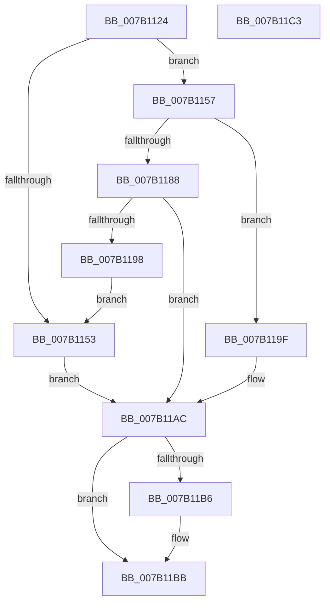

# WdipSemLoadGroupPolicy

- RVA: `0x007B1124`–`0x007B11C4` (길이 `160` bytes)
- VA: `0x00000001407B1124`
- 실행 섹션: `PAGE`
- PDB 이름 있음: `예`; PDB Function 태그: `아니요`
- unwind 정보 RVA: `0x000AA39C`
- 디코드: `46`개 명령, `160/160` bytes 표시
- 미해석 바이트: `0` (있으면 어셈블리에 `.byte`로 보존)

> 이 문서는 커널 이미지의 기계어와 PDB 기호를 분석해 생성했습니다. 4번과 5번은 함수 원형과 자료형을 바이너리 사용 방식에서 추정한 C 해석이며 원본 소스 복구 결과는 아닙니다.

## 1. Dependencies

- 직접 호출 지점: **5**; 고유 호출 대상: **5**
- 직접 호출자로 확인된 함수: **1**
- RIP 상대 이미지 참조: **2**

### Outgoing calls
- `0x007B114A` → [WdipSemOpenRegistryKey](WdipSemOpenRegistryKey_function_007B17C8.md) (function, `0x007B17C8`)
- `0x007B117D` → [WdipSemQueryValueFromRegistry](WdipSemQueryValueFromRegistry_function_007B185C.md) (function, `0x007B185C`)
- `0x007B118D` → [WdipSemLoadLocalGroupPolicy](WdipSemLoadLocalGroupPolicy_function_007B11CC.md) (function, `0x007B11CC`)
- `0x007B1198` → [WdipSemCleanupGroupPolicy](WdipSemCleanupGroupPolicy_function_007B10F8.md) (function, `0x007B10F8`)
- `0x007B11B6` → [ZwClose](../../text/6A/ZwClose_function_006AD2B0.md) (function, `0x006AD2B0`)

### Direct callers
- [WdipSemCleanStart](../7A/WdipSemCleanStart_function_007AF590.md) at `0x007AF5B7`

### Static image references
- `0x007B1139` → RVA `0x00B06DA0` (` ?? ::NNGAKEGL::`string'`; read)
- `0x007B1166` → RVA `0x00B06B80` (` ?? ::NNGAKEGL::`string'`; read)

## 2. Other-region calls and transfers

- 다른 실행 섹션으로 향하는 call: **1**
  - `0x007B11B6` → [ZwClose](../../text/6A/ZwClose_function_006AD2B0.md) (`PAGE` → `.text`)
- 별도 외부 분기/꼬리 이동을 확인하지 못했습니다.

## 3. Assembly (complete function range)

```asm
007B1124  48 8B C4                        mov rax, rsp
007B1127  53                              push rbx
007B1128  48 83 EC 30                     sub rsp, 0x30
007B112C  48 83 60 18 00                  and qword ptr [rax + 0x18], 0
007B1131  4C 8D 40 18                     lea r8, [rax + 0x18]
007B1135  83 60 08 00                     and dword ptr [rax + 8], 0
007B1139  48 8D 0D 60 5C 35 00            lea rcx, [rip + 0x355c60]
007B1140  BB 04 00 00 00                  mov ebx, 4
007B1145  33 D2                           xor edx, edx
007B1147  89 58 10                        mov dword ptr [rax + 0x10], ebx
007B114A  E8 79 06 00 00                  call 0x1407b17c8
007B114F  85 C0                           test eax, eax
007B1151  79 04                           jns 0x1407b1157
007B1153  33 DB                           xor ebx, ebx
007B1155  EB 55                           jmp 0x1407b11ac
007B1157  48 8B 4C 24 50                  mov rcx, qword ptr [rsp + 0x50]
007B115C  48 8D 44 24 48                  lea rax, [rsp + 0x48]
007B1161  48 89 44 24 28                  mov qword ptr [rsp + 0x28], rax
007B1166  48 8D 15 13 5A 35 00            lea rdx, [rip + 0x355a13]
007B116D  48 8D 44 24 40                  lea rax, [rsp + 0x40]
007B1172  44 8B CB                        mov r9d, ebx
007B1175  44 8B C3                        mov r8d, ebx
007B1178  48 89 44 24 20                  mov qword ptr [rsp + 0x20], rax
007B117D  E8 DA 06 00 00                  call 0x1407b185c
007B1182  8B D8                           mov ebx, eax
007B1184  85 C0                           test eax, eax
007B1186  79 17                           jns 0x1407b119f
007B1188  48 8B 4C 24 50                  mov rcx, qword ptr [rsp + 0x50]
007B118D  E8 3A 00 00 00                  call 0x1407b11cc
007B1192  8B D8                           mov ebx, eax
007B1194  85 C0                           test eax, eax
007B1196  79 14                           jns 0x1407b11ac
007B1198  E8 5B FF FF FF                  call 0x1407b10f8
007B119D  EB B4                           jmp 0x1407b1153
007B119F  83 7C 24 40 00                  cmp dword ptr [rsp + 0x40], 0
007B11A4  B8 01 00 00 C0                  mov eax, 0xc0000001
007B11A9  0F 44 D8                        cmove ebx, eax
007B11AC  48 8B 4C 24 50                  mov rcx, qword ptr [rsp + 0x50]
007B11B1  48 85 C9                        test rcx, rcx
007B11B4  74 05                           je 0x1407b11bb
007B11B6  E8 F5 C0 EF FF                  call 0x1406ad2b0
007B11BB  8B C3                           mov eax, ebx
007B11BD  48 83 C4 30                     add rsp, 0x30
007B11C1  5B                              pop rbx
007B11C2  C3                              ret
007B11C3  CC                              int3
```

## 4. C-style interpretation (structured pseudocode)

```c
__int64 __fastcall WdipSemLoadGroupPolicy(__int64 a1, int a2)
{
    __int64 result;
    __int64 v_rbx;
    __int64 v_rsp;
    unsigned __int64 v_stack_m10;
    unsigned __int64 v_stack_m18;
    unsigned __int64 v_stack_p10;
    unsigned __int64 v_stack_p18;
    unsigned __int64 v_stack_p8;

    v_rsp = (v_rsp) - (48);
    a2 = 0;
    *(unsigned int *)(v_rsp + 16) = 4;
    result = WdipSemOpenRegistryKey(v_rip + 3497056, a2, v_rsp + 24, a4);
    if (!sign_flag) goto loc_007B1157;
loc_007B1153:
    v_rbx = 0;
    goto loc_007B11AC;
loc_007B1157:
    v_stack_m10 = v_stack_p10;
    v_stack_m18 = v_stack_p8;
    result = WdipSemQueryValueFromRegistry(v_stack_p18, v_rip + 3496467, 0, 0);
    if (!sign_flag) goto loc_007B119F;
    result = WdipSemLoadLocalGroupPolicy(v_stack_p18, v_rip + 3496467, 0, 0);
    if (!sign_flag) goto loc_007B11AC;
    result = WdipSemCleanupGroupPolicy(v_stack_p18, v_rip + 3496467, 0, 0);
    goto loc_007B1153;
loc_007B119F:
    v_rbx = (unsigned int)((unsigned int)(result));
    if (v_stack_p8 == 0) { v_rbx = (unsigned int)((unsigned int)(0xC0000001ULL)); }
loc_007B11AC:
    result = (unsigned int)(0xC0000001ULL);
    if (v_stack_p18 != 0) {
        result = ZwClose(v_stack_p18, v_rip + 3496467, 0, 0);
    }
    v_rsp = (v_rsp) + (48);
    return (unsigned int)((unsigned int)(v_rbx));
}
```

## 5. (Beta) C Style

```c
int64_t WdipSemLoadGroupPolicy(int64_t Arg1, int32_t Arg2)
{
    int64_t result;
    int64_t local_rbx;
    int64_t local_rsp;
    uint64_t v_stack_m10;
    uint64_t v_stack_m18;
    uint64_t v_stack_p10;
    uint64_t v_stack_p18;
    uint64_t v_stack_p8;

    local_rsp = (local_rsp) - (48);
    Arg2 = 0;
    *(uint32_t *)(local_rsp + 0x10) = 4;
    result = WdipSemOpenRegistryKey(v_rip + 3497056, Arg2, local_rsp + 24, a4);
    if (!sign_flag) goto loc_007B1157;
loc_007B1153:
    local_rbx = 0;
    goto loc_007B11AC;
loc_007B1157:
    v_stack_m10 = v_stack_p10;
    v_stack_m18 = v_stack_p8;
    result = WdipSemQueryValueFromRegistry(v_stack_p18, v_rip + 3496467, 0, 0);
    if (!sign_flag) goto loc_007B119F;
    result = WdipSemLoadLocalGroupPolicy(v_stack_p18, v_rip + 3496467, 0, 0);
    if (!sign_flag) goto loc_007B11AC;
    result = WdipSemCleanupGroupPolicy(v_stack_p18, v_rip + 3496467, 0, 0);
    goto loc_007B1153;
loc_007B119F:
    local_rbx = (uint32_t)((uint32_t)(result));
    if (v_stack_p8 == 0) { local_rbx = (uint32_t)((uint32_t)(0xC0000001ULL)); }
loc_007B11AC:
    result = (uint32_t)(0xC0000001ULL);
    if (v_stack_p18 != 0) {
        result = ZwClose(v_stack_p18, v_rip + 3496467, 0, 0);
    }
    local_rsp = (local_rsp) + (48);
    return (uint32_t)((uint32_t)(local_rbx));
}
```

## 6. Execution-region graph

[열기: 2D/3D 그래프와 함수 탐색 컨트롤 패널](../../../control-panel.html?section=page&rva=0x007B1124&view=graph)

- 2D 그래프는 위에서 아래로 흐르고, 3D 그래프는 빈 공간을 드래그해 회전합니다. Shift+드래그는 이동, 휠은 확대·축소, 함수 노드 선택은 대상 보고서 이동입니다.

### Static fallback


