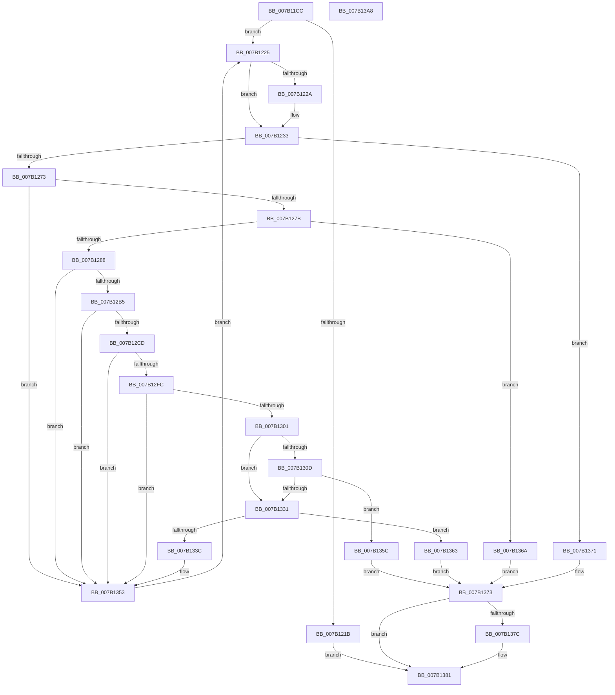

# WdipSemLoadLocalGroupPolicy

- RVA: `0x007B11CC`–`0x007B13A9` (길이 `477` bytes)
- VA: `0x00000001407B11CC`
- 실행 섹션: `PAGE`
- PDB 이름 있음: `예`; PDB Function 태그: `아니요`
- unwind 정보 RVA: `0x000CCA50`
- 디코드: `123`개 명령, `477/477` bytes 표시
- 미해석 바이트: `0` (있으면 어셈블리에 `.byte`로 보존)

> 이 문서는 커널 이미지의 기계어와 PDB 기호를 분석해 생성했습니다. 4번과 5번은 함수 원형과 자료형을 바이너리 사용 방식에서 추정한 C 해석이며 원본 소스 복구 결과는 아닙니다.

## 1. Dependencies

- 직접 호출 지점: **10**; 고유 호출 대상: **9**
- 직접 호출자로 확인된 함수: **1**
- RIP 상대 이미지 참조: **4**

### Outgoing calls
- `0x007B122A` → [ZwClose](../../text/6A/ZwClose_function_006AD2B0.md) (function, `0x006AD2B0`)
- `0x007B123F` → [memset](../../text/6C/memset_function_006C6C40.md) (function, `0x006C6C40`)
- `0x007B1261` → [ZwEnumerateKey](../../text/6A/ZwEnumerateKey_function_006AD710.md) (function, `0x006AD710`)
- `0x007B129B` → [RtlInitUnicodeString](../../text/42/RtlInitUnicodeString_function_0042A780.md) (function, `0x0042A780`)
- `0x007B12A8` → [RtlGUIDFromString](../8F/RtlGUIDFromString_function_008F1EF0.md) (function, `0x008F1EF0`)
- `0x007B12C0` → [WdipSemOpenRegistryKey](WdipSemOpenRegistryKey_function_007B17C8.md) (function, `0x007B17C8`)
- `0x007B12F3` → [WdipSemQueryValueFromRegistry](WdipSemQueryValueFromRegistry_function_007B185C.md) (function, `0x007B185C`)
- `0x007B131D` → [ExAllocatePool2](../../poolcode/B8/ExAllocatePool2_function_00B820F0.md) (function, `0x00B820F0`)
- `0x007B137C` → [ZwClose](../../text/6A/ZwClose_function_006AD2B0.md) (function, `0x006AD2B0`)
- `0x007B138A` → [_security_check_cookie](../../text/6A/_security_check_cookie_function_006AC640.md) (function, `0x006AC640`)

### Direct callers
- [WdipSemLoadGroupPolicy](WdipSemLoadGroupPolicy_function_007B1124.md) at `0x007B118D`

### Static image references
- `0x007B11E7` → RVA `0x00E0A740` (`.data`; read)
- `0x007B12DA` → RVA `0x00B06B80` (` ?? ::NNGAKEGL::`string'`; read)
- `0x007B1301` → RVA `0x00F01E10` (`.data`; read)
- `0x007B1322` → RVA `0x00F01E10` (`.data`; write)

## 2. Other-region calls and transfers

- 다른 실행 섹션으로 향하는 call: **7**
  - `0x007B122A` → [ZwClose](../../text/6A/ZwClose_function_006AD2B0.md) (`PAGE` → `.text`)
  - `0x007B123F` → [memset](../../text/6C/memset_function_006C6C40.md) (`PAGE` → `.text`)
  - `0x007B1261` → [ZwEnumerateKey](../../text/6A/ZwEnumerateKey_function_006AD710.md) (`PAGE` → `.text`)
  - `0x007B129B` → [RtlInitUnicodeString](../../text/42/RtlInitUnicodeString_function_0042A780.md) (`PAGE` → `.text`)
  - `0x007B131D` → [ExAllocatePool2](../../poolcode/B8/ExAllocatePool2_function_00B820F0.md) (`PAGE` → `POOLCODE`)
  - `0x007B137C` → [ZwClose](../../text/6A/ZwClose_function_006AD2B0.md) (`PAGE` → `.text`)
  - `0x007B138A` → [_security_check_cookie](../../text/6A/_security_check_cookie_function_006AC640.md) (`PAGE` → `.text`)
- 별도 외부 분기/꼬리 이동을 확인하지 못했습니다.

## 3. Assembly (complete function range)

```asm
007B11CC  48 8B C4                        mov rax, rsp
007B11CF  48 89 58 10                     mov qword ptr [rax + 0x10], rbx
007B11D3  48 89 70 18                     mov qword ptr [rax + 0x18], rsi
007B11D7  48 89 78 20                     mov qword ptr [rax + 0x20], rdi
007B11DB  55                              push rbp
007B11DC  48 8D 68 A1                     lea rbp, [rax - 0x5f]
007B11E0  48 81 EC 00 01 00 00            sub rsp, 0x100
007B11E7  48 8B 05 52 95 65 00            mov rax, qword ptr [rip + 0x659552]
007B11EE  48 33 C4                        xor rax, rsp
007B11F1  48 89 45 4F                     mov qword ptr [rbp + 0x4f], rax
007B11F5  33 F6                           xor esi, esi
007B11F7  48 8B D9                        mov rbx, rcx
007B11FA  89 75 8F                        mov dword ptr [rbp - 0x71], esi
007B11FD  8B CE                           mov ecx, esi
007B11FF  48 89 4D 87                     mov qword ptr [rbp - 0x79], rcx
007B1203  0F 57 C0                        xorps xmm0, xmm0
007B1206  89 75 93                        mov dword ptr [rbp - 0x6d], esi
007B1209  0F 57 C9                        xorps xmm1, xmm1
007B120C  8B FE                           mov edi, esi
007B120E  0F 11 45 97                     movups xmmword ptr [rbp - 0x69], xmm0
007B1212  0F 11 4D A7                     movups xmmword ptr [rbp - 0x59], xmm1
007B1216  48 85 DB                        test rbx, rbx
007B1219  75 0A                           jne 0x1407b1225
007B121B  BB 0D 00 00 C0                  mov ebx, 0xc000000d
007B1220  E9 5C 01 00 00                  jmp 0x1407b1381
007B1225  48 85 C9                        test rcx, rcx
007B1228  74 09                           je 0x1407b1233
007B122A  E8 81 C0 EF FF                  call 0x1406ad2b0
007B122F  48 89 75 87                     mov qword ptr [rbp - 0x79], rsi
007B1233  33 D2                           xor edx, edx
007B1235  48 8D 4D B7                     lea rcx, [rbp - 0x49]
007B1239  41 B8 98 00 00 00               mov r8d, 0x98
007B123F  E8 FC 59 F1 FF                  call 0x1406c6c40
007B1244  48 8D 45 8F                     lea rax, [rbp - 0x71]
007B1248  45 33 C0                        xor r8d, r8d
007B124B  48 89 44 24 28                  mov qword ptr [rsp + 0x28], rax
007B1250  4C 8D 4D B7                     lea r9, [rbp - 0x49]
007B1254  8B D7                           mov edx, edi
007B1256  C7 44 24 20 96 00 00 00         mov dword ptr [rsp + 0x20], 0x96
007B125E  48 8B CB                        mov rcx, rbx
007B1261  E8 AA C4 EF FF                  call 0x1406ad710
007B1266  FF C7                           inc edi
007B1268  3D 1A 00 00 80                  cmp eax, 0x8000001a
007B126D  0F 84 FE 00 00 00               je 0x1407b1371
007B1273  85 C0                           test eax, eax
007B1275  0F 88 D8 00 00 00               js 0x1407b1353
007B127B  81 7D C3 80 00 00 00            cmp dword ptr [rbp - 0x3d], 0x80
007B1282  0F 83 E2 00 00 00               jae 0x1407b136a
007B1288  8B 45 C3                        mov eax, dword ptr [rbp - 0x3d]
007B128B  48 8D 55 C7                     lea rdx, [rbp - 0x39]
007B128F  48 D1 E8                        shr rax, 1
007B1292  48 8D 4D 97                     lea rcx, [rbp - 0x69]
007B1296  66 89 74 45 C7                  mov word ptr [rbp + rax*2 - 0x39], si
007B129B  E8 E0 94 C7 FF                  call 0x14042a780
007B12A0  48 8D 55 A7                     lea rdx, [rbp - 0x59]
007B12A4  48 8D 4D 97                     lea rcx, [rbp - 0x69]
007B12A8  E8 43 0C 14 00                  call 0x1408f1ef0
007B12AD  85 C0                           test eax, eax
007B12AF  0F 88 9E 00 00 00               js 0x1407b1353
007B12B5  4C 8D 45 87                     lea r8, [rbp - 0x79]
007B12B9  48 8B D3                        mov rdx, rbx
007B12BC  48 8D 4D C7                     lea rcx, [rbp - 0x39]
007B12C0  E8 03 05 00 00                  call 0x1407b17c8
007B12C5  85 C0                           test eax, eax
007B12C7  0F 88 86 00 00 00               js 0x1407b1353
007B12CD  48 8B 4D 87                     mov rcx, qword ptr [rbp - 0x79]
007B12D1  48 8D 45 8F                     lea rax, [rbp - 0x71]
007B12D5  48 89 44 24 28                  mov qword ptr [rsp + 0x28], rax
007B12DA  48 8D 15 9F 58 35 00            lea rdx, [rip + 0x35589f]
007B12E1  41 B9 04 00 00 00               mov r9d, 4
007B12E7  48 8D 45 93                     lea rax, [rbp - 0x6d]
007B12EB  45 8B C1                        mov r8d, r9d
007B12EE  48 89 44 24 20                  mov qword ptr [rsp + 0x20], rax
007B12F3  E8 64 05 00 00                  call 0x1407b185c
007B12F8  85 C0                           test eax, eax
007B12FA  78 57                           js 0x1407b1353
007B12FC  39 75 93                        cmp dword ptr [rbp - 0x6d], esi
007B12FF  75 52                           jne 0x1407b1353
007B1301  48 8B 0D 08 0B 75 00            mov rcx, qword ptr [rip + 0x750b08]
007B1308  48 85 C9                        test rcx, rcx
007B130B  75 24                           jne 0x1407b1331
007B130D  BA 04 04 00 00                  mov edx, 0x404
007B1312  B9 00 01 00 00                  mov ecx, 0x100
007B1317  41 B8 57 44 49 73               mov r8d, 0x73494457
007B131D  E8 CE 0D 3D 00                  call 0x140b820f0
007B1322  48 89 05 E7 0A 75 00            mov qword ptr [rip + 0x750ae7], rax
007B1329  48 8B C8                        mov rcx, rax
007B132C  48 85 C0                        test rax, rax
007B132F  74 2B                           je 0x1407b135c
007B1331  8B 91 00 04 00 00               mov edx, dword ptr [rcx + 0x400]
007B1337  83 FA 40                        cmp edx, 0x40
007B133A  73 27                           jae 0x1407b1363
007B133C  8D 42 01                        lea eax, [rdx + 1]
007B133F  89 81 00 04 00 00               mov dword ptr [rcx + 0x400], eax
007B1345  8B C2                           mov eax, edx
007B1347  0F 10 45 A7                     movups xmm0, xmmword ptr [rbp - 0x59]
007B134B  48 03 C0                        add rax, rax
007B134E  F3 0F 7F 04 C1                  movdqu xmmword ptr [rcx + rax*8], xmm0
007B1353  48 8B 4D 87                     mov rcx, qword ptr [rbp - 0x79]
007B1357  E9 C9 FE FF FF                  jmp 0x1407b1225
007B135C  BB 9A 00 00 C0                  mov ebx, 0xc000009a
007B1361  EB 10                           jmp 0x1407b1373
007B1363  BB 01 00 00 C0                  mov ebx, 0xc0000001
007B1368  EB 09                           jmp 0x1407b1373
007B136A  BB 05 00 00 80                  mov ebx, 0x80000005
007B136F  EB 02                           jmp 0x1407b1373
007B1371  8B DE                           mov ebx, esi
007B1373  48 8B 4D 87                     mov rcx, qword ptr [rbp - 0x79]
007B1377  48 85 C9                        test rcx, rcx
007B137A  74 05                           je 0x1407b1381
007B137C  E8 2F BF EF FF                  call 0x1406ad2b0
007B1381  8B C3                           mov eax, ebx
007B1383  48 8B 4D 4F                     mov rcx, qword ptr [rbp + 0x4f]
007B1387  48 33 CC                        xor rcx, rsp
007B138A  E8 B1 B2 EF FF                  call 0x1406ac640
007B138F  4C 8D 9C 24 00 01 00 00         lea r11, [rsp + 0x100]
007B1397  49 8B 5B 18                     mov rbx, qword ptr [r11 + 0x18]
007B139B  49 8B 73 20                     mov rsi, qword ptr [r11 + 0x20]
007B139F  49 8B 7B 28                     mov rdi, qword ptr [r11 + 0x28]
007B13A3  49 8B E3                        mov rsp, r11
007B13A6  5D                              pop rbp
007B13A7  C3                              ret
007B13A8  CC                              int3
```

## 4. C-style interpretation (structured pseudocode)

```c
__int64 __fastcall WdipSemLoadLocalGroupPolicy(__int64 a1, int a2)
{
    __int64 result;
    __int64 v_rdi;
    __int64 v_rsi;
    __int64 v_rsp;
    unsigned __int64 v_stack_m8;
    unsigned __int64 v_stack_mE0;
    unsigned int v_stack_mE8;

    *(unsigned __int64 *)(v_rsp + 16) = v_rbx;
    *(unsigned __int64 *)(v_rsp + 24) = v_rsi;
    *(unsigned __int64 *)(v_rsp + 32) = v_rdi;
    v_rsp = (v_rsp) - (256);
    result = (*(unsigned __int64 *)(v_rip + 6657362)) ^ (v_rsp);
    *(unsigned __int64 *)(v_rsp - 95 + 79) = result;
    v_rsi = 0;
    *(unsigned int *)(v_rsp - 95 - 113) = 0;
    *(unsigned __int64 *)(v_rsp - 95 - 121) = 0;
    *(unsigned int *)(v_rsp - 95 - 109) = 0;
    *(unsigned __int64 *)(v_rsp - 95 - 105) = v_xmm0;
    *(unsigned __int64 *)(v_rsp - 95 - 89) = v_xmm1;
    if (a1 != 0) goto loc_007B1225;
    goto loc_007B1381;
loc_007B1225:
    if (0 != 0) {
        result = ZwClose(0, a2, a3, a4);
        *(unsigned __int64 *)(v_rsp - 95 - 121) = 0;
    }
    a2 = 0;
    result = memset(v_rsp - 95 - 73, a2, 152, a4);
    a3 = 0;
    v_stack_mE0 = v_rsp - 95 - 113;
    v_stack_mE8 = 150;
    result = ZwEnumerateKey((unsigned int)(0xC000000DULL), 0, a3, v_rsp - 95 - 73);
    v_rdi = (unsigned int)((0) + 1);
    if (((unsigned int)(result)) == 0x8000001AULL) goto loc_007B1371;
    if (sign_flag) goto loc_007B1353;
    if ((*(unsigned int *)(v_rsp - 95 - 61)) >= 128) goto loc_007B136A;
    result = ((unsigned int)(*(unsigned int *)(v_rsp - 95 - 61))) >> (1);
    *(unsigned __int16 *)(v_rsp - 95 + result * 2 - 57) = 0;
    result = RtlInitUnicodeString(v_rsp - 95 - 105, v_rsp - 95 - 57, a3, v_rsp - 95 - 73);
    result = RtlGUIDFromString(v_rsp - 95 - 105, v_rsp - 95 - 89, a3, v_rsp - 95 - 73);
    if (sign_flag) goto loc_007B1353;
    result = WdipSemOpenRegistryKey(v_rsp - 95 - 57, (unsigned int)(0xC000000DULL), v_rsp - 95 - 121, v_rsp - 95 - 73);
    if (sign_flag) goto loc_007B1353;
    v_stack_mE0 = v_rsp - 95 - 113;
    v_stack_mE8 = v_rsp - 95 - 109;
    result = WdipSemQueryValueFromRegistry(*(unsigned __int64 *)(v_rsp - 95 - 121), v_rip + 3496095, 4, 4);
    if (sign_flag) goto loc_007B1353;
    if ((*(unsigned int *)(v_rsp - 95 - 109)) != 0) goto loc_007B1353;
    if (*(unsigned __int64 *)(v_rip + 7670536) != 0) goto loc_007B1331;
    result = ExAllocatePool2(256, (unsigned int)(0x404ULL), (unsigned int)(0x73494457ULL), 4);
    *(unsigned __int64 *)(v_rip + 7670503) = result;
    if (result == 0) goto loc_007B135C;
loc_007B1331:
    if (((unsigned int)((unsigned int)(*(unsigned int *)(result + 1024)))) >= 64) goto loc_007B1363;
    *(unsigned int *)(result + 1024) = (unsigned int)((unsigned int)(*(unsigned int *)(result + 1024)) + 1);
    result = ((unsigned int)((unsigned int)((unsigned int)(*(unsigned int *)(result + 1024))))) + ((unsigned int)((unsigned int)((unsigned int)(*(unsigned int *)(result + 1024)))));
    *(unsigned __int64 *)(result + result * 8) = v_xmm0;
loc_007B1353:
    goto loc_007B1225;
loc_007B135C:
    goto loc_007B1373;
loc_007B1363:
    goto loc_007B1373;
loc_007B136A:
    goto loc_007B1373;
loc_007B1371:
loc_007B1373:
    if (*(unsigned __int64 *)(v_rsp - 95 - 121) != 0) {
        result = ZwClose(*(unsigned __int64 *)(v_rsp - 95 - 121), (unsigned int)(*(unsigned int *)(result + 1024)), (unsigned int)(0x73494457ULL), 4);
    }
    a1 = (*(unsigned __int64 *)(v_rsp - 95 + 79)) ^ (v_rsp);
    result = _security_check_cookie(a1, (unsigned int)(*(unsigned int *)(result + 1024)), (unsigned int)(0x73494457ULL), 4);
    return result;
}
```

## 5. (Beta) C Style

```c
int64_t WdipSemLoadLocalGroupPolicy(int64_t Arg1, int32_t Arg2)
{
    int64_t result;
    int64_t local_rdi;
    int64_t local_rsi;
    int64_t local_rsp;
    uint64_t v_stack_m8;
    uint64_t v_stack_mE0;
    uint32_t v_stack_mE8;

    *(uint64_t *)(local_rsp + 0x10) = local_rbx;
    *(uint64_t *)(local_rsp + 0x18) = local_rsi;
    *(uint64_t *)(local_rsp + 0x20) = local_rdi;
    local_rsp = (local_rsp) - (256);
    result = (*(uint64_t *)(v_rip + 0x659552)) ^ (local_rsp);
    *(uint64_t *)(local_rsp - 0x5F + 0x4F) = result;
    local_rsi = 0;
    *(uint32_t *)(local_rsp - 0x5F - 0x71) = 0;
    *(uint64_t *)(local_rsp - 0x5F - 0x79) = 0;
    *(uint32_t *)(local_rsp - 0x5F - 0x6D) = 0;
    *(uint64_t *)(local_rsp - 0x5F - 0x69) = v_xmm0;
    *(uint64_t *)(local_rsp - 0x5F - 0x59) = v_xmm1;
    if (Arg1 != 0) goto loc_007B1225;
    goto loc_007B1381;
loc_007B1225:
    if (0 != 0) {
        result = ZwClose(0, Arg2, a3, a4);
        *(uint64_t *)(local_rsp - 0x5F - 0x79) = 0;
    }
    Arg2 = 0;
    result = memset(local_rsp - 95 - 73, Arg2, 152, a4);
    a3 = 0;
    v_stack_mE0 = local_rsp - 95 - 113;
    v_stack_mE8 = 150;
    result = ZwEnumerateKey((uint32_t)(0xC000000DULL), 0, a3, local_rsp - 95 - 73);
    local_rdi = (uint32_t)((0) + 1);
    if (((uint32_t)(result)) == 0x8000001AULL) goto loc_007B1371;
    if (sign_flag) goto loc_007B1353;
    if ((*(uint32_t *)(local_rsp - 0x5F - 0x3D)) >= 128) goto loc_007B136A;
    result = ((uint32_t)(*(uint32_t *)(local_rsp - 0x5F - 0x3D))) >> (1);
    *(uint16_t *)(local_rsp - 0x5F + result * 2 - 0x39) = 0;
    result = RtlInitUnicodeString(local_rsp - 95 - 105, local_rsp - 95 - 57, a3, local_rsp - 95 - 73);
    result = RtlGUIDFromString(local_rsp - 95 - 105, local_rsp - 95 - 89, a3, local_rsp - 95 - 73);
    if (sign_flag) goto loc_007B1353;
    result = WdipSemOpenRegistryKey(local_rsp - 95 - 57, (uint32_t)(0xC000000DULL), local_rsp - 95 - 121, local_rsp - 95 - 73);
    if (sign_flag) goto loc_007B1353;
    v_stack_mE0 = local_rsp - 95 - 113;
    v_stack_mE8 = local_rsp - 95 - 109;
    result = WdipSemQueryValueFromRegistry(*(uint64_t *)(local_rsp - 0x5F - 0x79), v_rip + 3496095, 4, 4);
    if (sign_flag) goto loc_007B1353;
    if ((*(uint32_t *)(local_rsp - 0x5F - 0x6D)) != 0) goto loc_007B1353;
    if (*(uint64_t *)(v_rip + 0x750B08) != 0) goto loc_007B1331;
    result = ExAllocatePool2(256, (uint32_t)(0x404ULL), (uint32_t)(0x73494457ULL), 4);
    *(uint64_t *)(v_rip + 0x750AE7) = result;
    if (result == 0) goto loc_007B135C;
loc_007B1331:
    if (((uint32_t)((uint32_t)(*(uint32_t *)(result + 0x400)))) >= 64) goto loc_007B1363;
    *(uint32_t *)(result + 0x400) = (uint32_t)((uint32_t)(*(uint32_t *)(result + 0x400)) + 1);
    result = ((uint32_t)((uint32_t)((uint32_t)(*(uint32_t *)(result + 0x400))))) + ((uint32_t)((uint32_t)((uint32_t)(*(uint32_t *)(result + 0x400)))));
    *(uint64_t *)(result + result * 8) = v_xmm0;
loc_007B1353:
    goto loc_007B1225;
loc_007B135C:
    goto loc_007B1373;
loc_007B1363:
    goto loc_007B1373;
loc_007B136A:
    goto loc_007B1373;
loc_007B1371:
loc_007B1373:
    if (*(uint64_t *)(local_rsp - 0x5F - 0x79) != 0) {
        result = ZwClose(*(uint64_t *)(local_rsp - 0x5F - 0x79), (uint32_t)(*(uint32_t *)(result + 0x400)), (uint32_t)(0x73494457ULL), 4);
    }
    Arg1 = (*(uint64_t *)(local_rsp - 0x5F + 0x4F)) ^ (local_rsp);
    result = _security_check_cookie(Arg1, (uint32_t)(*(uint32_t *)(result + 0x400)), (uint32_t)(0x73494457ULL), 4);
    return result;
}
```

## 6. Execution-region graph

[열기: 2D/3D 그래프와 함수 탐색 컨트롤 패널](../../../control-panel.html?section=page&rva=0x007B11CC&view=graph)

- 2D 그래프는 위에서 아래로 흐르고, 3D 그래프는 빈 공간을 드래그해 회전합니다. Shift+드래그는 이동, 휠은 확대·축소, 함수 노드 선택은 대상 보고서 이동입니다.

### Static fallback


