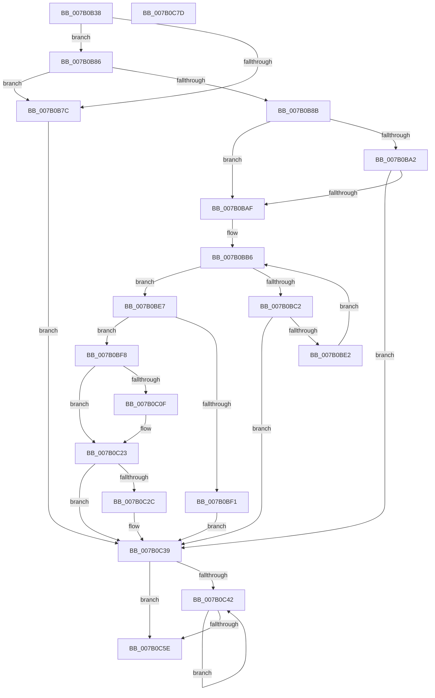

# WdipSemLogInflightLimitExceededInformation

- RVA: `0x007B0B38`–`0x007B0C7E` (길이 `326` bytes)
- VA: `0x00000001407B0B38`
- 실행 섹션: `PAGE`
- PDB 이름 있음: `예`; PDB Function 태그: `아니요`
- unwind 정보 RVA: `0x000D3064`
- 디코드: `85`개 명령, `326/326` bytes 표시
- 미해석 바이트: `0` (있으면 어셈블리에 `.byte`로 보존)

> 이 문서는 커널 이미지의 기계어와 PDB 기호를 분석해 생성했습니다. 4번과 5번은 함수 원형과 자료형을 바이너리 사용 방식에서 추정한 C 해석이며 원본 소스 복구 결과는 아닙니다.

## 1. Dependencies

- 직접 호출 지점: **9**; 고유 호출 대상: **7**
- 직접 호출자로 확인된 함수: **1**
- RIP 상대 이미지 참조: **3**

### Outgoing calls
- `0x007B0B72` → [memset](../../text/6C/memset_function_006C6C40.md) (function, `0x006C6C40`)
- `0x007B0B99` → [EtwEventEnabled](../../text/39/EtwEventEnabled_function_00392450.md) (function, `0x00392450`)
- `0x007B0BA2` → [WdipSemSqmEnabled](../70/WdipSemSqmEnabled_function_0070276C.md) (function, `0x0070276C`)
- `0x007B0BD7` → [WdipSemUpdateInflightScenarioTable](WdipSemUpdateInflightScenarioTable_function_007B0EB4.md) (function, `0x007B0EB4`)
- `0x007B0C06` → [EtwEventEnabled](../../text/39/EtwEventEnabled_function_00392450.md) (function, `0x00392450`)
- `0x007B0C1E` → [WdipSemWriteInflightLimitExceededEvent](WdipSemWriteInflightLimitExceededEvent_function_007B1434.md) (function, `0x007B1434`)
- `0x007B0C23` → [WdipSemSqmEnabled](../70/WdipSemSqmEnabled_function_0070276C.md) (function, `0x0070276C`)
- `0x007B0C34` → [WdipSemUpdateFrequentScenarioTable](WdipSemUpdateFrequentScenarioTable_function_007B0D7C.md) (function, `0x007B0D7C`)
- `0x007B0C4E` → [WdipSemFastFree](../70/WdipSemFastFree_function_0070303C.md) (function, `0x0070303C`)

### Direct callers
- [WdipSemReserveInstanceTableEntry](../A5/WdipSemReserveInstanceTableEntry_function_00A5DA08.md) at `0x00A5DB1B`

### Static image references
- `0x007B0B8B` → RVA `0x00F01DD0` (`.data`; read)
- `0x007B0B92` → RVA `0x00021790` (`.rdata`; read)
- `0x007B0BAF` → RVA `0x00F01DE0` (`.data`; read)

## 2. Other-region calls and transfers

- 다른 실행 섹션으로 향하는 call: **3**
  - `0x007B0B72` → [memset](../../text/6C/memset_function_006C6C40.md) (`PAGE` → `.text`)
  - `0x007B0B99` → [EtwEventEnabled](../../text/39/EtwEventEnabled_function_00392450.md) (`PAGE` → `.text`)
  - `0x007B0C06` → [EtwEventEnabled](../../text/39/EtwEventEnabled_function_00392450.md) (`PAGE` → `.text`)
- 별도 외부 분기/꼬리 이동을 확인하지 못했습니다.

## 3. Assembly (complete function range)

```asm
007B0B38  48 8B C4                        mov rax, rsp
007B0B3B  48 89 58 10                     mov qword ptr [rax + 0x10], rbx
007B0B3F  48 89 68 18                     mov qword ptr [rax + 0x18], rbp
007B0B43  48 89 70 20                     mov qword ptr [rax + 0x20], rsi
007B0B47  57                              push rdi
007B0B48  41 56                           push r14
007B0B4A  41 57                           push r15
007B0B4C  48 81 EC 10 04 00 00            sub rsp, 0x410
007B0B53  49 8B E8                        mov rbp, r8
007B0B56  44 0F B7 FA                     movzx r15d, dx
007B0B5A  4C 8B F1                        mov r14, rcx
007B0B5D  33 DB                           xor ebx, ebx
007B0B5F  33 D2                           xor edx, edx
007B0B61  48 89 58 08                     mov qword ptr [rax + 8], rbx
007B0B65  41 B8 F0 03 00 00               mov r8d, 0x3f0
007B0B6B  48 8D 4C 24 20                  lea rcx, [rsp + 0x20]
007B0B70  8B FB                           mov edi, ebx
007B0B72  E8 C9 60 F1 FF                  call 0x1406c6c40
007B0B77  4D 85 F6                        test r14, r14
007B0B7A  75 0A                           jne 0x1407b0b86
007B0B7C  BF 0D 00 00 C0                  mov edi, 0xc000000d
007B0B81  E9 B3 00 00 00                  jmp 0x1407b0c39
007B0B86  48 85 ED                        test rbp, rbp
007B0B89  74 F1                           je 0x1407b0b7c
007B0B8B  48 8B 0D 3E 12 75 00            mov rcx, qword ptr [rip + 0x75123e]
007B0B92  48 8D 15 F7 0B 87 FF            lea rdx, [rip - 0x78f409]
007B0B99  E8 B2 18 BE FF                  call 0x140392450
007B0B9E  84 C0                           test al, al
007B0BA0  75 0D                           jne 0x1407b0baf
007B0BA2  E8 C5 1B F5 FF                  call 0x14070276c
007B0BA7  84 C0                           test al, al
007B0BA9  0F 84 8A 00 00 00               je 0x1407b0c39
007B0BAF  48 8B 35 2A 12 75 00            mov rsi, qword ptr [rip + 0x75122a]
007B0BB6  48 8D 05 23 12 75 00            lea rax, [rip + 0x751223]
007B0BBD  48 3B C6                        cmp rax, rsi
007B0BC0  74 25                           je 0x1407b0be7
007B0BC2  48 8B 4E 20                     mov rcx, qword ptr [rsi + 0x20]
007B0BC6  4C 8D 8C 24 30 04 00 00         lea r9, [rsp + 0x430]
007B0BCE  4C 8D 44 24 20                  lea r8, [rsp + 0x20]
007B0BD3  0F B7 51 10                     movzx edx, word ptr [rcx + 0x10]
007B0BD7  E8 D8 02 00 00                  call 0x1407b0eb4
007B0BDC  8B F8                           mov edi, eax
007B0BDE  85 C0                           test eax, eax
007B0BE0  78 57                           js 0x1407b0c39
007B0BE2  48 8B 36                        mov rsi, qword ptr [rsi]
007B0BE5  EB CF                           jmp 0x1407b0bb6
007B0BE7  48 39 9C 24 30 04 00 00         cmp qword ptr [rsp + 0x430], rbx
007B0BEF  75 07                           jne 0x1407b0bf8
007B0BF1  BF 01 00 00 C0                  mov edi, 0xc0000001
007B0BF6  EB 41                           jmp 0x1407b0c39
007B0BF8  48 8B 0D D1 11 75 00            mov rcx, qword ptr [rip + 0x7511d1]
007B0BFF  48 8D 15 8A 0B 87 FF            lea rdx, [rip - 0x78f476]
007B0C06  E8 45 18 BE FF                  call 0x140392450
007B0C0B  84 C0                           test al, al
007B0C0D  74 14                           je 0x1407b0c23
007B0C0F  4C 8D 4C 24 20                  lea r9, [rsp + 0x20]
007B0C14  4C 8B C5                        mov r8, rbp
007B0C17  41 0F B7 D7                     movzx edx, r15w
007B0C1B  49 8B CE                        mov rcx, r14
007B0C1E  E8 11 08 00 00                  call 0x1407b1434
007B0C23  E8 44 1B F5 FF                  call 0x14070276c
007B0C28  84 C0                           test al, al
007B0C2A  74 0D                           je 0x1407b0c39
007B0C2C  48 8B 8C 24 30 04 00 00         mov rcx, qword ptr [rsp + 0x430]
007B0C34  E8 43 01 00 00                  call 0x1407b0d7c
007B0C39  39 9C 24 08 04 00 00            cmp dword ptr [rsp + 0x408], ebx
007B0C40  76 1C                           jbe 0x1407b0c5e
007B0C42  8B D3                           mov edx, ebx
007B0C44  B9 05 00 00 00                  mov ecx, 5
007B0C49  48 8B 54 D4 20                  mov rdx, qword ptr [rsp + rdx*8 + 0x20]
007B0C4E  E8 E9 23 F5 FF                  call 0x14070303c
007B0C53  FF C3                           inc ebx
007B0C55  3B 9C 24 08 04 00 00            cmp ebx, dword ptr [rsp + 0x408]
007B0C5C  72 E4                           jb 0x1407b0c42
007B0C5E  4C 8D 9C 24 10 04 00 00         lea r11, [rsp + 0x410]
007B0C66  8B C7                           mov eax, edi
007B0C68  49 8B 5B 28                     mov rbx, qword ptr [r11 + 0x28]
007B0C6C  49 8B 6B 30                     mov rbp, qword ptr [r11 + 0x30]
007B0C70  49 8B 73 38                     mov rsi, qword ptr [r11 + 0x38]
007B0C74  49 8B E3                        mov rsp, r11
007B0C77  41 5F                           pop r15
007B0C79  41 5E                           pop r14
007B0C7B  5F                              pop rdi
007B0C7C  C3                              ret
007B0C7D  CC                              int3
```

## 4. C-style interpretation (structured pseudocode)

```c
__int64 __fastcall WdipSemLogInflightLimitExceededInformation(__int64 a1, int a2, __int64 a3)
{
    __int64 result;
    __int64 v_rbx;
    __int64 v_rsp;
    unsigned __int64 v_stack_m18;
    unsigned int v_stack_m20;
    unsigned __int64 v_stack_m408;
    unsigned __int64 v_stack_p8;

    *(unsigned __int64 *)(v_rsp + 16) = v_rbx;
    *(unsigned __int64 *)(v_rsp + 24) = v_rbp;
    *(unsigned __int64 *)(v_rsp + 32) = v_rsi;
    v_rsp = (v_rsp) - (0x410ULL);
    v_rbx = 0;
    a2 = 0;
    *(unsigned __int64 *)(v_rsp + 8) = 0;
    result = memset(v_stack_m408, a2, (unsigned int)(0x3F0ULL), a4);
    if (a1 != 0) goto loc_007B0B86;
loc_007B0B7C:
    goto loc_007B0C39;
loc_007B0B86:
    if (a3 == 0) goto loc_007B0B7C;
    result = EtwEventEnabled(*(unsigned __int64 *)(v_rip + 7672382), v_rip - 7926793, (unsigned int)(0x3F0ULL), a4);
    if ((unsigned __int8)(result) != 0) goto loc_007B0BAF;
    result = WdipSemSqmEnabled(*(unsigned __int64 *)(v_rip + 7672382), v_rip - 7926793, (unsigned int)(0x3F0ULL), a4);
    if ((unsigned __int8)(result) == 0) goto loc_007B0C39;
loc_007B0BAF:
loc_007B0BB6:
    if ((v_rip + 7672355) == (*(unsigned __int64 *)(v_rip + 7672362))) goto loc_007B0BE7;
    result = WdipSemUpdateInflightScenarioTable(*(unsigned __int64 *)(*(unsigned __int64 *)(v_rip + 7672362) + 32), *(unsigned __int16 *)(*(unsigned __int64 *)(*(unsigned __int64 *)(v_rip + 7672362) + 32) + 16), v_stack_m408, v_stack_p8);
    if (sign_flag) goto loc_007B0C39;
    goto loc_007B0BB6;
loc_007B0BE7:
    if (v_stack_p8 != 0) goto loc_007B0BF8;
    goto loc_007B0C39;
loc_007B0BF8:
    result = EtwEventEnabled(*(unsigned __int64 *)(v_rip + 7672273), v_rip - 7926902, v_stack_m408, v_stack_p8);
    if ((unsigned __int8)(result) != 0) {
        a4 = v_stack_m408;
        a3 = a3;
        a2 = (unsigned __int16)((unsigned __int16)(a2));
        a1 = a1;
        result = WdipSemWriteInflightLimitExceededEvent(a1, a2, a3, a4);
    }
    result = WdipSemSqmEnabled(a1, a2, a3, a4);
    if ((unsigned __int8)(result) != 0) {
        a1 = v_stack_p8;
        result = WdipSemUpdateFrequentScenarioTable(a1, a2, a3, a4);
    }
    if (v_stack_m20 <= 0) goto loc_007B0C5E;
loc_007B0C42:
    result = WdipSemFastFree(5, *(unsigned __int64 *)(v_rsp + 0 * 8 + 32), a3, a4);
    v_rbx = (unsigned int)((v_rbx) + 1);
    if (((unsigned int)(v_rbx)) < v_stack_m20) goto loc_007B0C42;
loc_007B0C5E:
    return (unsigned int)((unsigned int)((unsigned int)(0xC0000001ULL)));
}
```

## 5. (Beta) C Style

```c
int64_t WdipSemLogInflightLimitExceededInformation(int64_t Arg1, int32_t Arg2, int64_t Arg3)
{
    int64_t result;
    int64_t local_rbx;
    int64_t local_rsp;
    uint64_t v_stack_m18;
    uint32_t v_stack_m20;
    uint64_t v_stack_m408;
    uint64_t v_stack_p8;

    *(uint64_t *)(local_rsp + 0x10) = local_rbx;
    *(uint64_t *)(local_rsp + 0x18) = local_rbp;
    *(uint64_t *)(local_rsp + 0x20) = local_rsi;
    local_rsp = (local_rsp) - (0x410ULL);
    local_rbx = 0;
    Arg2 = 0;
    *(uint64_t *)(local_rsp + 0x8) = 0;
    result = memset(v_stack_m408, Arg2, (uint32_t)(0x3F0ULL), a4);
    if (Arg1 != 0) goto loc_007B0B86;
loc_007B0B7C:
    goto loc_007B0C39;
loc_007B0B86:
    if (Arg3 == 0) goto loc_007B0B7C;
    result = EtwEventEnabled(*(uint64_t *)(v_rip + 0x75123E), v_rip - 7926793, (uint32_t)(0x3F0ULL), a4);
    if ((uint8_t)(result) != 0) goto loc_007B0BAF;
    result = WdipSemSqmEnabled(*(uint64_t *)(v_rip + 0x75123E), v_rip - 7926793, (uint32_t)(0x3F0ULL), a4);
    if ((uint8_t)(result) == 0) goto loc_007B0C39;
loc_007B0BAF:
loc_007B0BB6:
    if ((v_rip + 7672355) == (*(uint64_t *)(v_rip + 0x75122A))) goto loc_007B0BE7;
    result = WdipSemUpdateInflightScenarioTable(*(uint64_t *)(*(uint64_t *)(v_rip + 0x75122A) + 0x20), *(uint16_t *)(*(uint64_t *)(*(uint64_t *)(v_rip + 0x75122A) + 0x20) + 0x10), v_stack_m408, v_stack_p8);
    if (sign_flag) goto loc_007B0C39;
    goto loc_007B0BB6;
loc_007B0BE7:
    if (v_stack_p8 != 0) goto loc_007B0BF8;
    goto loc_007B0C39;
loc_007B0BF8:
    result = EtwEventEnabled(*(uint64_t *)(v_rip + 0x7511D1), v_rip - 7926902, v_stack_m408, v_stack_p8);
    if ((uint8_t)(result) != 0) {
        a4 = v_stack_m408;
        Arg3 = Arg3;
        Arg2 = (uint16_t)((uint16_t)(Arg2));
        Arg1 = Arg1;
        result = WdipSemWriteInflightLimitExceededEvent(Arg1, Arg2, Arg3, a4);
    }
    result = WdipSemSqmEnabled(Arg1, Arg2, Arg3, a4);
    if ((uint8_t)(result) != 0) {
        Arg1 = v_stack_p8;
        result = WdipSemUpdateFrequentScenarioTable(Arg1, Arg2, Arg3, a4);
    }
    if (v_stack_m20 <= 0) goto loc_007B0C5E;
loc_007B0C42:
    result = WdipSemFastFree(5, *(uint64_t *)(local_rsp + 0x0 * 8 + 0x20), Arg3, a4);
    local_rbx = (uint32_t)((local_rbx) + 1);
    if (((uint32_t)(local_rbx)) < v_stack_m20) goto loc_007B0C42;
loc_007B0C5E:
    return (uint32_t)((uint32_t)((uint32_t)(0xC0000001ULL)));
}
```

## 6. Execution-region graph

[열기: 2D/3D 그래프와 함수 탐색 컨트롤 패널](../../../control-panel.html?section=page&rva=0x007B0B38&view=graph)

- 2D 그래프는 위에서 아래로 흐르고, 3D 그래프는 빈 공간을 드래그해 회전합니다. Shift+드래그는 이동, 휠은 확대·축소, 함수 노드 선택은 대상 보고서 이동입니다.

### Static fallback


