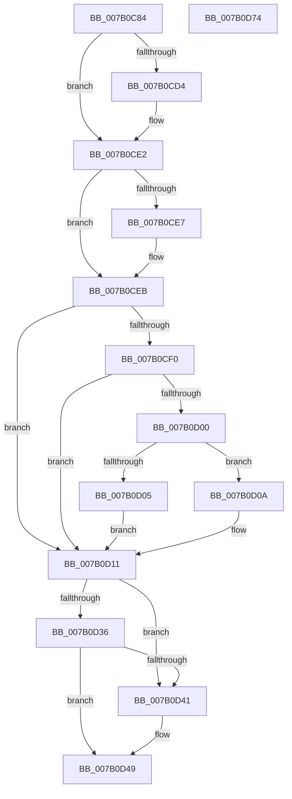

# WdipSemMarkInstanceForDeletion

- RVA: `0x007B0C84`–`0x007B0D75` (길이 `241` bytes)
- VA: `0x00000001407B0C84`
- 실행 섹션: `PAGE`
- PDB 이름 있음: `예`; PDB Function 태그: `아니요`
- unwind 정보 RVA: `0x0005E6B4`
- 디코드: `65`개 명령, `241/241` bytes 표시
- 미해석 바이트: `0` (있으면 어셈블리에 `.byte`로 보존)

> 이 문서는 커널 이미지의 기계어와 PDB 기호를 분석해 생성했습니다. 4번과 5번은 함수 원형과 자료형을 바이너리 사용 방식에서 추정한 C 해석이며 원본 소스 복구 결과는 아닙니다.

## 1. Dependencies

- 직접 호출 지점: **6**; 고유 호출 대상: **6**
- 직접 호출자로 확인된 함수: **1**
- RIP 상대 이미지 참조: **1**

### Outgoing calls
- `0x007B0CC4` → [KeAbPreAcquire](../../text/21/KeAbPreAcquire_function_00210230.md) (function, `0x00210230`)
- `0x007B0CDD` → [ExfAcquirePushLockExclusiveEx](../../text/20/ExfAcquirePushLockExclusiveEx_function_0020FC90.md) (function, `0x0020FC90`)
- `0x007B0CF3` → [WdipSemQueryEnabledInstanceTable](../A5/WdipSemQueryEnabledInstanceTable_function_00A5DB48.md) (function, `0x00A5DB48`)
- `0x007B0D44` → [ExfReleasePushLock](../../text/26/ExfReleasePushLock_function_002638D0.md) (function, `0x002638D0`)
- `0x007B0D4C` → [KeAbPostRelease](../../text/2E/KeAbPostRelease_function_002E1600.md) (function, `0x002E1600`)
- `0x007B0D51` → [KeLeaveCriticalRegion](../../text/25/KeLeaveCriticalRegion_function_0025D8B0.md) (function, `0x0025D8B0`)

### Direct callers
- [sub_00B3DB56](../B3/Unknown_function_00B3DB56.md) at `0x00B3DB60`

### Static image references
- `0x007B0CA6` → RVA `0x00F01DF8` (`.data`; read)

## 2. Other-region calls and transfers

- 다른 실행 섹션으로 향하는 call: **5**
  - `0x007B0CC4` → [KeAbPreAcquire](../../text/21/KeAbPreAcquire_function_00210230.md) (`PAGE` → `.text`)
  - `0x007B0CDD` → [ExfAcquirePushLockExclusiveEx](../../text/20/ExfAcquirePushLockExclusiveEx_function_0020FC90.md) (`PAGE` → `.text`)
  - `0x007B0D44` → [ExfReleasePushLock](../../text/26/ExfReleasePushLock_function_002638D0.md) (`PAGE` → `.text`)
  - `0x007B0D4C` → [KeAbPostRelease](../../text/2E/KeAbPostRelease_function_002E1600.md) (`PAGE` → `.text`)
  - `0x007B0D51` → [KeLeaveCriticalRegion](../../text/25/KeLeaveCriticalRegion_function_0025D8B0.md) (`PAGE` → `.text`)
- 별도 외부 분기/꼬리 이동을 확인하지 못했습니다.

## 3. Assembly (complete function range)

```asm
007B0C84  48 8B C4                        mov rax, rsp
007B0C87  48 89 58 08                     mov qword ptr [rax + 8], rbx
007B0C8B  48 89 68 10                     mov qword ptr [rax + 0x10], rbp
007B0C8F  48 89 70 18                     mov qword ptr [rax + 0x18], rsi
007B0C93  48 89 78 20                     mov qword ptr [rax + 0x20], rdi
007B0C97  41 56                           push r14
007B0C99  48 83 EC 20                     sub rsp, 0x20
007B0C9D  65 48 8B 04 25 88 01 00 00      mov rax, qword ptr gs:[0x188]
007B0CA6  4C 8D 35 4B 11 75 00            lea r14, [rip + 0x75114b]
007B0CAD  48 8B F1                        mov rsi, rcx
007B0CB0  33 ED                           xor ebp, ebp
007B0CB2  45 33 C0                        xor r8d, r8d
007B0CB5  33 D2                           xor edx, edx
007B0CB7  49 8B CE                        mov rcx, r14
007B0CBA  8B DD                           mov ebx, ebp
007B0CBC  66 FF 88 E4 01 00 00            dec word ptr [rax + 0x1e4]
007B0CC3  90                              nop
007B0CC4  E8 67 F5 A5 FF                  call 0x140210230
007B0CC9  F0 49 0F BA 2E 00               lock bts qword ptr [r14], 0
007B0CCF  48 8B F8                        mov rdi, rax
007B0CD2  73 0E                           jae 0x1407b0ce2
007B0CD4  4D 8B C6                        mov r8, r14
007B0CD7  48 8B D0                        mov rdx, rax
007B0CDA  49 8B CE                        mov rcx, r14
007B0CDD  E8 AE EF A5 FF                  call 0x14020fc90
007B0CE2  48 85 FF                        test rdi, rdi
007B0CE5  74 04                           je 0x1407b0ceb
007B0CE7  C6 47 0A 01                     mov byte ptr [rdi + 0xa], 1
007B0CEB  48 85 F6                        test rsi, rsi
007B0CEE  74 21                           je 0x1407b0d11
007B0CF0  48 8B CE                        mov rcx, rsi
007B0CF3  E8 50 CE 2A 00                  call 0x140a5db48
007B0CF8  48 8B D8                        mov rbx, rax
007B0CFB  48 85 C0                        test rax, rax
007B0CFE  74 11                           je 0x1407b0d11
007B0D00  39 68 2C                        cmp dword ptr [rax + 0x2c], ebp
007B0D03  74 05                           je 0x1407b0d0a
007B0D05  48 8B DD                        mov rbx, rbp
007B0D08  EB 07                           jmp 0x1407b0d11
007B0D0A  C7 40 2C 01 00 00 00            mov dword ptr [rax + 0x2c], 1
007B0D11  0F 0D 0D E0 10 75 00            prefetchw byte ptr [rip + 0x7510e0]
007B0D18  48 8B 05 D9 10 75 00            mov rax, qword ptr [rip + 0x7510d9]
007B0D1F  48 8B C8                        mov rcx, rax
007B0D22  48 83 E1 F0                     and rcx, 0xfffffffffffffff0
007B0D26  48 83 F9 10                     cmp rcx, 0x10
007B0D2A  48 8D 50 F0                     lea rdx, [rax - 0x10]
007B0D2E  48 0F 46 D5                     cmovbe rdx, rbp
007B0D32  A8 02                           test al, 2
007B0D34  75 0B                           jne 0x1407b0d41
007B0D36  F0 48 0F B1 15 B9 10 75 00      lock cmpxchg qword ptr [rip + 0x7510b9], rdx
007B0D3F  74 08                           je 0x1407b0d49
007B0D41  49 8B CE                        mov rcx, r14
007B0D44  E8 87 2B AB FF                  call 0x1402638d0
007B0D49  49 8B CE                        mov rcx, r14
007B0D4C  E8 AF 08 B3 FF                  call 0x1402e1600
007B0D51  E8 5A CB AA FF                  call 0x14025d8b0
007B0D56  48 8B 6C 24 38                  mov rbp, qword ptr [rsp + 0x38]
007B0D5B  48 8B C3                        mov rax, rbx
007B0D5E  48 8B 5C 24 30                  mov rbx, qword ptr [rsp + 0x30]
007B0D63  48 8B 74 24 40                  mov rsi, qword ptr [rsp + 0x40]
007B0D68  48 8B 7C 24 48                  mov rdi, qword ptr [rsp + 0x48]
007B0D6D  48 83 C4 20                     add rsp, 0x20
007B0D71  41 5E                           pop r14
007B0D73  C3                              ret
007B0D74  CC                              int3
```

## 4. C-style interpretation (structured pseudocode)

```c
__int64 __fastcall WdipSemMarkInstanceForDeletion(__int64 a1, int a2, int a3)
{
    __int64 result;
    __int64 v_rbp;
    __int64 v_rsp;
    unsigned __int64 v_stack_p10;
    unsigned __int64 v_stack_p18;
    unsigned __int64 v_stack_p20;
    unsigned __int64 v_stack_p8;

    *(unsigned __int64 *)(v_rsp + 8) = v_rbx;
    *(unsigned __int64 *)(v_rsp + 16) = v_rbp;
    *(unsigned __int64 *)(v_rsp + 24) = v_rsi;
    *(unsigned __int64 *)(v_rsp + 32) = v_rdi;
    v_rsp = (v_rsp) - (32);
    v_rbp = 0;
    a3 = 0;
    a2 = 0;
    result = KeAbPreAcquire(v_rip + 7672139, a2, a3, a4);
    if (!(condition_is_above_or_equal)) {
        a3 = v_rip + 7672139;
        a2 = result;
        a1 = v_rip + 7672139;
        result = ExfAcquirePushLockExclusiveEx(a1, a2, a3, a4);
    }
    if (result != 0) {
        *(unsigned __int8 *)(result + 10) = 1;
    }
    if (a1 == 0) goto loc_007B0D11;
    result = WdipSemQueryEnabledInstanceTable(a1, a2, a3, a4);
    if (result == 0) goto loc_007B0D11;
    if ((*(unsigned int *)(result + 44)) == 0) goto loc_007B0D0A;
    goto loc_007B0D11;
loc_007B0D0A:
    *(unsigned int *)(result + 44) = 1;
loc_007B0D11:
    a1 = (*(unsigned __int64 *)(v_rip + 7672025)) & (-16);
    a2 = *(unsigned __int64 *)(v_rip + 7672025) - 16;
    if (a1 <= 16) { a2 = 0; }
    if ((((unsigned __int8)(*(unsigned __int64 *)(v_rip + 7672025))) & (2)) != 0) goto loc_007B0D41;
    result = *(unsigned __int64 *)(v_rip + 7672025);
    if ((((unsigned __int8)(*(unsigned __int64 *)(v_rip + 7672025))) & (2)) != 0) {
        a1 = v_rip + 7672139;
        result = ExfReleasePushLock(a1, a2, a3, a4);
    }
    result = KeAbPostRelease(v_rip + 7672139, a2, a3, a4);
    result = KeLeaveCriticalRegion(v_rip + 7672139, a2, a3, a4);
    v_rsp = (v_rsp) + (32);
    return 0;
}
```

## 5. (Beta) C Style

```c
int64_t WdipSemMarkInstanceForDeletion(int64_t Arg1, int32_t Arg2, int32_t Arg3)
{
    int64_t result;
    int64_t local_rbp;
    int64_t local_rsp;
    uint64_t v_stack_p10;
    uint64_t v_stack_p18;
    uint64_t v_stack_p20;
    uint64_t v_stack_p8;

    *(uint64_t *)(local_rsp + 0x8) = local_rbx;
    *(uint64_t *)(local_rsp + 0x10) = local_rbp;
    *(uint64_t *)(local_rsp + 0x18) = local_rsi;
    *(uint64_t *)(local_rsp + 0x20) = local_rdi;
    local_rsp = (local_rsp) - (32);
    local_rbp = 0;
    Arg3 = 0;
    Arg2 = 0;
    result = KeAbPreAcquire(v_rip + 7672139, Arg2, Arg3, a4);
    if (!(condition_is_above_or_equal)) {
        Arg3 = v_rip + 7672139;
        Arg2 = result;
        Arg1 = v_rip + 7672139;
        result = ExfAcquirePushLockExclusiveEx(Arg1, Arg2, Arg3, a4);
    }
    if (result != 0) {
        *(uint8_t *)(result + 0xA) = 1;
    }
    if (Arg1 == 0) goto loc_007B0D11;
    result = WdipSemQueryEnabledInstanceTable(Arg1, Arg2, Arg3, a4);
    if (result == 0) goto loc_007B0D11;
    if ((*(uint32_t *)(result + 0x2C)) == 0) goto loc_007B0D0A;
    goto loc_007B0D11;
loc_007B0D0A:
    *(uint32_t *)(result + 0x2C) = 1;
loc_007B0D11:
    Arg1 = (*(uint64_t *)(v_rip + 0x7510D9)) & (-16);
    Arg2 = *(uint64_t *)(v_rip + 0x7510D9) - 16;
    if (Arg1 <= 16) { Arg2 = 0; }
    if ((((uint8_t)(*(uint64_t *)(v_rip + 0x7510D9))) & (2)) != 0) goto loc_007B0D41;
    result = *(uint64_t *)(v_rip + 0x7510D9);
    if ((((uint8_t)(*(uint64_t *)(v_rip + 0x7510D9))) & (2)) != 0) {
        Arg1 = v_rip + 7672139;
        result = ExfReleasePushLock(Arg1, Arg2, Arg3, a4);
    }
    result = KeAbPostRelease(v_rip + 7672139, Arg2, Arg3, a4);
    result = KeLeaveCriticalRegion(v_rip + 7672139, Arg2, Arg3, a4);
    local_rsp = (local_rsp) + (32);
    return 0;
}
```

## 6. Execution-region graph

[열기: 2D/3D 그래프와 함수 탐색 컨트롤 패널](../../../control-panel.html?section=page&rva=0x007B0C84&view=graph)

- 2D 그래프는 위에서 아래로 흐르고, 3D 그래프는 빈 공간을 드래그해 회전합니다. Shift+드래그는 이동, 휠은 확대·축소, 함수 노드 선택은 대상 보고서 이동입니다.

### Static fallback


