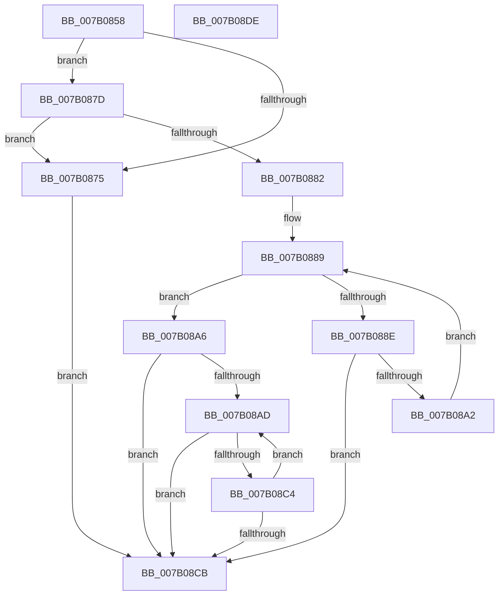

# WdipSemMergeScenarios

- RVA: `0x007B0858`–`0x007B08DF` (길이 `135` bytes)
- VA: `0x00000001407B0858`
- 실행 섹션: `PAGE`
- PDB 이름 있음: `예`; PDB Function 태그: `아니요`
- unwind 정보 RVA: `0x00060BC4`
- 디코드: `44`개 명령, `135/135` bytes 표시
- 미해석 바이트: `0` (있으면 어셈블리에 `.byte`로 보존)

> 이 문서는 커널 이미지의 기계어와 PDB 기호를 분석해 생성했습니다. 4번과 5번은 함수 원형과 자료형을 바이너리 사용 방식에서 추정한 C 해석이며 원본 소스 복구 결과는 아닙니다.

## 1. Dependencies

- 직접 호출 지점: **3**; 고유 호출 대상: **3**
- 직접 호출자로 확인된 함수: **1**
- RIP 상대 이미지 참조: **0**

### Outgoing calls
- `0x007B0882` → [WdipSemMergeEvents](WdipSemMergeEvents_function_007B0824.md) (function, `0x007B0824`)
- `0x007B0896` → [WdipSemAddContextEventToScenario](../7A/WdipSemAddContextEventToScenario_function_007AF338.md) (function, `0x007AF338`)
- `0x007B08B8` → [WdipSemAddEndEventToScenario](../7A/WdipSemAddEndEventToScenario_function_007AF3FC.md) (function, `0x007AF3FC`)

### Direct callers
- [WdipSemAddScenarioToTable](../7A/WdipSemAddScenarioToTable_function_007AF4D0.md) at `0x007AF53C`

### Static image references
- 디코드된 RIP-relative 메모리 참조가 없습니다.

## 2. Other-region calls and transfers

- 다른 실행 섹션으로 향하는 call: **0**
- 별도 외부 분기/꼬리 이동을 확인하지 못했습니다.

## 3. Assembly (complete function range)

```asm
007B0858  48 89 5C 24 08                  mov qword ptr [rsp + 8], rbx
007B085D  48 89 74 24 10                  mov qword ptr [rsp + 0x10], rsi
007B0862  57                              push rdi
007B0863  48 83 EC 20                     sub rsp, 0x20
007B0867  45 33 C9                        xor r9d, r9d
007B086A  48 8B DA                        mov rbx, rdx
007B086D  48 8B F1                        mov rsi, rcx
007B0870  48 85 C9                        test rcx, rcx
007B0873  75 08                           jne 0x1407b087d
007B0875  41 B9 0D 00 00 C0               mov r9d, 0xc000000d
007B087B  EB 4E                           jmp 0x1407b08cb
007B087D  48 85 DB                        test rbx, rbx
007B0880  74 F3                           je 0x1407b0875
007B0882  E8 9D FF FF FF                  call 0x1407b0824
007B0887  33 FF                           xor edi, edi
007B0889  3B 7B 30                        cmp edi, dword ptr [rbx + 0x30]
007B088C  73 18                           jae 0x1407b08a6
007B088E  48 8B 54 FB 38                  mov rdx, qword ptr [rbx + rdi*8 + 0x38]
007B0893  48 8B CE                        mov rcx, rsi
007B0896  E8 9D EA FF FF                  call 0x1407af338
007B089B  44 8B C8                        mov r9d, eax
007B089E  85 C0                           test eax, eax
007B08A0  78 29                           js 0x1407b08cb
007B08A2  FF C7                           inc edi
007B08A4  EB E3                           jmp 0x1407b0889
007B08A6  33 FF                           xor edi, edi
007B08A8  39 7B 34                        cmp dword ptr [rbx + 0x34], edi
007B08AB  76 1E                           jbe 0x1407b08cb
007B08AD  48 8B 94 FB 18 04 00 00         mov rdx, qword ptr [rbx + rdi*8 + 0x418]
007B08B5  48 8B CE                        mov rcx, rsi
007B08B8  E8 3F EB FF FF                  call 0x1407af3fc
007B08BD  44 8B C8                        mov r9d, eax
007B08C0  85 C0                           test eax, eax
007B08C2  78 07                           js 0x1407b08cb
007B08C4  FF C7                           inc edi
007B08C6  3B 7B 34                        cmp edi, dword ptr [rbx + 0x34]
007B08C9  72 E2                           jb 0x1407b08ad
007B08CB  48 8B 5C 24 30                  mov rbx, qword ptr [rsp + 0x30]
007B08D0  41 8B C1                        mov eax, r9d
007B08D3  48 8B 74 24 38                  mov rsi, qword ptr [rsp + 0x38]
007B08D8  48 83 C4 20                     add rsp, 0x20
007B08DC  5F                              pop rdi
007B08DD  C3                              ret
007B08DE  CC                              int3
```

## 4. C-style interpretation (structured pseudocode)

```c
__int64 __fastcall WdipSemMergeScenarios(__int64 a1, __int64 a2, __int64 a3, int a4)
{
    __int64 result;
    __int64 v_rdi;
    __int64 v_rsp;
    unsigned __int64 v_stack_p10;
    unsigned __int64 v_stack_p8;

    v_stack_p8 = v_rbx;
    v_stack_p10 = v_rsi;
    v_rsp = (v_rsp) - (32);
    a4 = 0;
    if (a1 != 0) goto loc_007B087D;
loc_007B0875:
    goto loc_007B08CB;
loc_007B087D:
    if (a2 == 0) goto loc_007B0875;
    result = WdipSemMergeEvents(a1, a2, a3, (unsigned int)(0xC000000DULL));
    v_rdi = 0;
loc_007B0889:
    if (0 >= (*(unsigned int *)(a2 + 48))) goto loc_007B08A6;
    result = WdipSemAddContextEventToScenario(a1, *(unsigned __int64 *)(a2 + v_rdi * 8 + 56), a3, (unsigned int)(0xC000000DULL));
    if (sign_flag) goto loc_007B08CB;
    v_rdi = (unsigned int)((v_rdi) + 1);
    goto loc_007B0889;
loc_007B08A6:
    v_rdi = 0;
    if ((*(unsigned int *)(a2 + 52)) <= 0) goto loc_007B08CB;
loc_007B08AD:
    result = WdipSemAddEndEventToScenario(a1, *(unsigned __int64 *)(a2 + v_rdi * 8 + 1048), a3, (unsigned int)((unsigned int)(result)));
    if (sign_flag) goto loc_007B08CB;
    v_rdi = (unsigned int)((v_rdi) + 1);
    if (((unsigned int)(v_rdi)) < (*(unsigned int *)(a2 + 52))) goto loc_007B08AD;
loc_007B08CB:
    v_rsp = (v_rsp) + (32);
    return (unsigned int)((unsigned int)((unsigned int)((unsigned int)(result))));
}
```

## 5. (Beta) C Style

```c
int64_t WdipSemMergeScenarios(int64_t Arg1, int64_t Arg2, int64_t Arg3, int32_t Arg4)
{
    int64_t result;
    int64_t local_rdi;
    int64_t local_rsp;
    uint64_t v_stack_p10;
    uint64_t v_stack_p8;

    v_stack_p8 = local_rbx;
    v_stack_p10 = local_rsi;
    local_rsp = (local_rsp) - (32);
    Arg4 = 0;
    if (Arg1 != 0) goto loc_007B087D;
loc_007B0875:
    goto loc_007B08CB;
loc_007B087D:
    if (Arg2 == 0) goto loc_007B0875;
    result = WdipSemMergeEvents(Arg1, Arg2, Arg3, (uint32_t)(0xC000000DULL));
    local_rdi = 0;
loc_007B0889:
    if (0 >= (*(uint32_t *)(Arg2 + 0x30))) goto loc_007B08A6;
    result = WdipSemAddContextEventToScenario(Arg1, *(uint64_t *)(Arg2 + local_rdi * 8 + 0x38), Arg3, (uint32_t)(0xC000000DULL));
    if (sign_flag) goto loc_007B08CB;
    local_rdi = (uint32_t)((local_rdi) + 1);
    goto loc_007B0889;
loc_007B08A6:
    local_rdi = 0;
    if ((*(uint32_t *)(Arg2 + 0x34)) <= 0) goto loc_007B08CB;
loc_007B08AD:
    result = WdipSemAddEndEventToScenario(Arg1, *(uint64_t *)(Arg2 + local_rdi * 8 + 0x418), Arg3, (uint32_t)((uint32_t)(result)));
    if (sign_flag) goto loc_007B08CB;
    local_rdi = (uint32_t)((local_rdi) + 1);
    if (((uint32_t)(local_rdi)) < (*(uint32_t *)(Arg2 + 0x34))) goto loc_007B08AD;
loc_007B08CB:
    local_rsp = (local_rsp) + (32);
    return (uint32_t)((uint32_t)((uint32_t)((uint32_t)(result))));
}
```

## 6. Execution-region graph

[열기: 2D/3D 그래프와 함수 탐색 컨트롤 패널](../../../control-panel.html?section=page&rva=0x007B0858&view=graph)

- 2D 그래프는 위에서 아래로 흐르고, 3D 그래프는 빈 공간을 드래그해 회전합니다. Shift+드래그는 이동, 휠은 확대·축소, 함수 노드 선택은 대상 보고서 이동입니다.

### Static fallback


