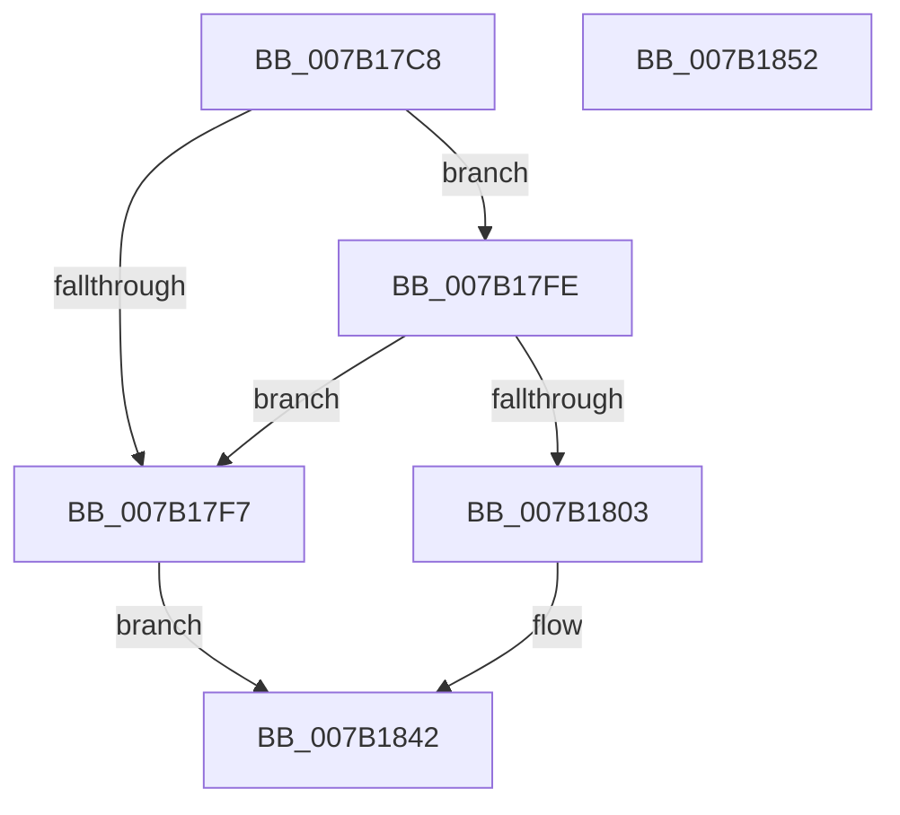

# WdipSemOpenRegistryKey

- RVA: `0x007B17C8`–`0x007B1853` (길이 `139` bytes)
- VA: `0x00000001407B17C8`
- 실행 섹션: `PAGE`
- PDB 이름 있음: `예`; PDB Function 태그: `아니요`
- unwind 정보 RVA: `0x000BE5B4`
- 디코드: `39`개 명령, `139/139` bytes 표시
- 미해석 바이트: `0` (있으면 어셈블리에 `.byte`로 보존)

> 이 문서는 커널 이미지의 기계어와 PDB 기호를 분석해 생성했습니다. 4번과 5번은 함수 원형과 자료형을 바이너리 사용 방식에서 추정한 C 해석이며 원본 소스 복구 결과는 아닙니다.

## 1. Dependencies

- 직접 호출 지점: **2**; 고유 호출 대상: **2**
- 직접 호출자로 확인된 함수: **7**
- RIP 상대 이미지 참조: **0**

### Outgoing calls
- `0x007B180A` → [RtlInitUnicodeString](../../text/42/RtlInitUnicodeString_function_0042A780.md) (function, `0x0042A780`)
- `0x007B183D` → [ZwOpenKey](../../text/6A/ZwOpenKey_function_006AD310.md) (function, `0x006AD310`)

### Direct callers
- [WdipSemLoadConfigInfo](../7A/WdipSemLoadConfigInfo_function_007AF700.md) at `0x007AF729`
- [WdipSemLoadNextContextProvider](../7A/WdipSemLoadNextContextProvider_function_007AF820.md) at `0x007AF93C`
- [WdipSemLoadNextEndEvent](../7A/WdipSemLoadNextEndEvent_function_007AFAD0.md) at `0x007AFCB8`
- [WdipSemLoadNextScenario](../7A/WdipSemLoadNextScenario_function_007AFDE0.md) at `0x007B003F`
- [WdipSemLoadNextScenario](../7A/WdipSemLoadNextScenario_function_007AFDE0.md) at `0x007B0164`
- [WdipSemLoadNextScenario](../7A/WdipSemLoadNextScenario_function_007AFDE0.md) at `0x007B0230`
- [WdipSemLoadScenarioTable](WdipSemLoadScenarioTable_function_007B02D8.md) at `0x007B0367`
- [WdipSemLoadScenarioTable](WdipSemLoadScenarioTable_function_007B02D8.md) at `0x007B04AD`
- [WdipSemLoadScenarioTable](WdipSemLoadScenarioTable_function_007B02D8.md) at `0x007B04D6`
- [WdipSemLoadScenarioTable](WdipSemLoadScenarioTable_function_007B02D8.md) at `0x007B05ED`
- [WdipSemLoadGroupPolicy](WdipSemLoadGroupPolicy_function_007B1124.md) at `0x007B114A`
- [WdipSemLoadLocalGroupPolicy](WdipSemLoadLocalGroupPolicy_function_007B11CC.md) at `0x007B12C0`

### Static image references
- 디코드된 RIP-relative 메모리 참조가 없습니다.

## 2. Other-region calls and transfers

- 다른 실행 섹션으로 향하는 call: **2**
  - `0x007B180A` → [RtlInitUnicodeString](../../text/42/RtlInitUnicodeString_function_0042A780.md) (`PAGE` → `.text`)
  - `0x007B183D` → [ZwOpenKey](../../text/6A/ZwOpenKey_function_006AD310.md) (`PAGE` → `.text`)
- 별도 외부 분기/꼬리 이동을 확인하지 못했습니다.

## 3. Assembly (complete function range)

```asm
007B17C8  48 89 5C 24 08                  mov qword ptr [rsp + 8], rbx
007B17CD  48 89 7C 24 10                  mov qword ptr [rsp + 0x10], rdi
007B17D2  55                              push rbp
007B17D3  48 8B EC                        mov rbp, rsp
007B17D6  48 83 EC 60                     sub rsp, 0x60
007B17DA  33 C0                           xor eax, eax
007B17DC  0F 57 C0                        xorps xmm0, xmm0
007B17DF  21 45 EC                        and dword ptr [rbp - 0x14], eax
007B17E2  49 8B D8                        mov rbx, r8
007B17E5  89 45 D4                        mov dword ptr [rbp - 0x2c], eax
007B17E8  48 8B FA                        mov rdi, rdx
007B17EB  21 45 D4                        and dword ptr [rbp - 0x2c], eax
007B17EE  0F 11 45 C0                     movups xmmword ptr [rbp - 0x40], xmm0
007B17F2  48 85 C9                        test rcx, rcx
007B17F5  75 07                           jne 0x1407b17fe
007B17F7  B8 0D 00 00 C0                  mov eax, 0xc000000d
007B17FC  EB 44                           jmp 0x1407b1842
007B17FE  48 85 DB                        test rbx, rbx
007B1801  74 F4                           je 0x1407b17f7
007B1803  48 8B D1                        mov rdx, rcx
007B1806  48 8D 4D C0                     lea rcx, [rbp - 0x40]
007B180A  E8 71 8F C7 FF                  call 0x14042a780
007B180F  48 8D 45 C0                     lea rax, [rbp - 0x40]
007B1813  C7 45 D0 30 00 00 00            mov dword ptr [rbp - 0x30], 0x30
007B181A  0F 57 C0                        xorps xmm0, xmm0
007B181D  48 89 45 E0                     mov qword ptr [rbp - 0x20], rax
007B1821  4C 8D 45 D0                     lea r8, [rbp - 0x30]
007B1825  48 89 7D D8                     mov qword ptr [rbp - 0x28], rdi
007B1829  BA 3F 00 0F 00                  mov edx, 0xf003f
007B182E  C7 45 E8 40 02 00 00            mov dword ptr [rbp - 0x18], 0x240
007B1835  48 8B CB                        mov rcx, rbx
007B1838  F3 0F 7F 45 F0                  movdqu xmmword ptr [rbp - 0x10], xmm0
007B183D  E8 CE BA EF FF                  call 0x1406ad310
007B1842  48 8B 5C 24 70                  mov rbx, qword ptr [rsp + 0x70]
007B1847  48 8B 7C 24 78                  mov rdi, qword ptr [rsp + 0x78]
007B184C  48 83 C4 60                     add rsp, 0x60
007B1850  5D                              pop rbp
007B1851  C3                              ret
007B1852  CC                              int3
```

## 4. C-style interpretation (structured pseudocode)

```c
__int64 __fastcall WdipSemOpenRegistryKey(__int64 a1, __int64 a2, __int64 a3)
{
    __int64 result;
    __int64 v_rsp;
    unsigned __int64 v_stack_m18;
    unsigned int v_stack_m1C;
    unsigned int v_stack_m20;
    unsigned __int64 v_stack_m28;
    unsigned __int64 v_stack_m30;
    unsigned int v_stack_m34;
    unsigned int v_stack_m38;
    unsigned __int64 v_stack_m48;
    unsigned __int64 v_stack_p10;
    unsigned __int64 v_stack_p8;

    v_stack_p8 = v_rbx;
    v_stack_p10 = v_rdi;
    v_rsp = (v_rsp) - (96);
    result = 0;
    v_stack_m34 = 0;
    v_stack_m48 = v_xmm0;
    if (a1 != 0) goto loc_007B17FE;
loc_007B17F7:
    goto loc_007B1842;
loc_007B17FE:
    if (a3 == 0) goto loc_007B17F7;
    result = RtlInitUnicodeString(v_stack_m48, a1, a3, a4);
    v_stack_m38 = 48;
    v_stack_m28 = v_stack_m48;
    v_stack_m30 = a2;
    v_stack_m20 = 576;
    v_stack_m18 = v_xmm0;
    result = ZwOpenKey(a3, (unsigned int)(0xF003FULL), v_stack_m38, a4);
loc_007B1842:
    v_rsp = (v_rsp) + (96);
    return result;
}
```

## 5. (Beta) C Style

```c
int64_t WdipSemOpenRegistryKey(int64_t Arg1, int64_t Arg2, int64_t Arg3)
{
    int64_t result;
    int64_t local_rsp;
    uint64_t v_stack_m18;
    uint32_t v_stack_m1C;
    uint32_t v_stack_m20;
    uint64_t v_stack_m28;
    uint64_t v_stack_m30;
    uint32_t v_stack_m34;
    uint32_t v_stack_m38;
    uint64_t v_stack_m48;
    uint64_t v_stack_p10;
    uint64_t v_stack_p8;

    v_stack_p8 = local_rbx;
    v_stack_p10 = local_rdi;
    local_rsp = (local_rsp) - (96);
    result = 0;
    v_stack_m34 = 0;
    v_stack_m48 = v_xmm0;
    if (Arg1 != 0) goto loc_007B17FE;
loc_007B17F7:
    goto loc_007B1842;
loc_007B17FE:
    if (Arg3 == 0) goto loc_007B17F7;
    result = RtlInitUnicodeString(v_stack_m48, Arg1, Arg3, a4);
    v_stack_m38 = 48;
    v_stack_m28 = v_stack_m48;
    v_stack_m30 = Arg2;
    v_stack_m20 = 576;
    v_stack_m18 = v_xmm0;
    result = ZwOpenKey(Arg3, (uint32_t)(0xF003FULL), v_stack_m38, a4);
loc_007B1842:
    local_rsp = (local_rsp) + (96);
    return result;
}
```

## 6. Execution-region graph

[열기: 2D/3D 그래프와 함수 탐색 컨트롤 패널](../../../control-panel.html?section=page&rva=0x007B17C8&view=graph)

- 2D 그래프는 위에서 아래로 흐르고, 3D 그래프는 빈 공간을 드래그해 회전합니다. Shift+드래그는 이동, 휠은 확대·축소, 함수 노드 선택은 대상 보고서 이동입니다.

### Static fallback


