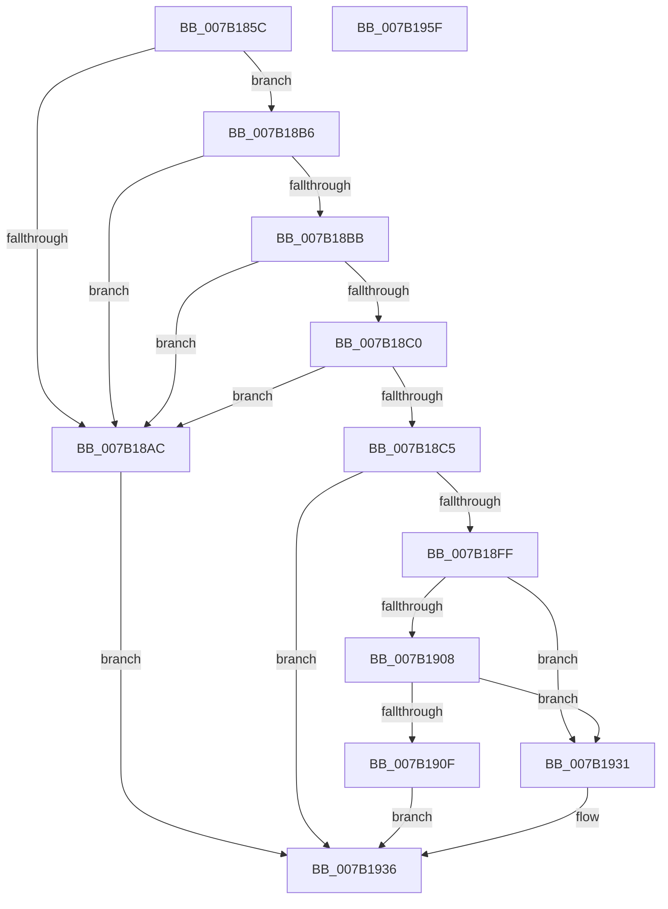

# WdipSemQueryValueFromRegistry

- RVA: `0x007B185C`–`0x007B1960` (길이 `260` bytes)
- VA: `0x00000001407B185C`
- 실행 섹션: `PAGE`
- PDB 이름 있음: `예`; PDB Function 태그: `아니요`
- unwind 정보 RVA: `0x000D30D4`
- 디코드: `70`개 명령, `260/260` bytes 표시
- 미해석 바이트: `0` (있으면 어셈블리에 `.byte`로 보존)

> 이 문서는 커널 이미지의 기계어와 PDB 기호를 분석해 생성했습니다. 4번과 5번은 함수 원형과 자료형을 바이너리 사용 방식에서 추정한 C 해석이며 원본 소스 복구 결과는 아닙니다.

## 1. Dependencies

- 직접 호출 지점: **5**; 고유 호출 대상: **5**
- 직접 호출자로 확인된 함수: **7**
- RIP 상대 이미지 참조: **1**

### Outgoing calls
- `0x007B18CA` → [RtlInitUnicodeString](../../text/42/RtlInitUnicodeString_function_0042A780.md) (function, `0x0042A780`)
- `0x007B18F4` → [ZwQueryValueKey](../../text/6A/ZwQueryValueKey_function_006AD3B0.md) (function, `0x006AD3B0`)
- `0x007B1917` → [memset](../../text/6C/memset_function_006C6C40.md) (function, `0x006C6C40`)
- `0x007B1927` → [memcpy](../../text/6C/memcpy_function_006C6840.md) (function, `0x006C6840`)
- `0x007B1943` → [_security_check_cookie](../../text/6A/_security_check_cookie_function_006AC640.md) (function, `0x006AC640`)

### Direct callers
- [WdipSemLoadConfigInfo](../7A/WdipSemLoadConfigInfo_function_007AF700.md) at `0x007AF760`
- [WdipSemLoadConfigInfo](../7A/WdipSemLoadConfigInfo_function_007AF700.md) at `0x007AF79C`
- [WdipSemLoadNextContextProvider](../7A/WdipSemLoadNextContextProvider_function_007AF820.md) at `0x007AF977`
- [WdipSemLoadNextContextProvider](../7A/WdipSemLoadNextContextProvider_function_007AF820.md) at `0x007AF9D3`
- [WdipSemLoadNextContextProvider](../7A/WdipSemLoadNextContextProvider_function_007AF820.md) at `0x007AFA2A`
- [WdipSemLoadNextContextProvider](../7A/WdipSemLoadNextContextProvider_function_007AF820.md) at `0x007AFA73`
- [WdipSemLoadNextEndEvent](../7A/WdipSemLoadNextEndEvent_function_007AFAD0.md) at `0x007AFCF0`
- [WdipSemLoadNextEndEvent](../7A/WdipSemLoadNextEndEvent_function_007AFAD0.md) at `0x007AFD4C`
- [WdipSemLoadNextEndEvent](../7A/WdipSemLoadNextEndEvent_function_007AFAD0.md) at `0x007AFDA6`
- [WdipSemLoadNextScenario](../7A/WdipSemLoadNextScenario_function_007AFDE0.md) at `0x007B0079`
- [WdipSemLoadNextScenario](../7A/WdipSemLoadNextScenario_function_007AFDE0.md) at `0x007B00D7`
- [WdipSemLoadNextScenario](../7A/WdipSemLoadNextScenario_function_007AFDE0.md) at `0x007B0132`
- [WdipSemLoadScenarioTable](WdipSemLoadScenarioTable_function_007B02D8.md) at `0x007B050C`
- [WdipSemLoadScenarioTable](WdipSemLoadScenarioTable_function_007B02D8.md) at `0x007B0548`
- [WdipSemLoadScenarioTable](WdipSemLoadScenarioTable_function_007B02D8.md) at `0x007B05C8`
- [WdipSemLoadGroupPolicy](WdipSemLoadGroupPolicy_function_007B1124.md) at `0x007B117D`
- [WdipSemLoadLocalGroupPolicy](WdipSemLoadLocalGroupPolicy_function_007B11CC.md) at `0x007B12F3`

### Static image references
- `0x007B186F` → RVA `0x00E0A740` (`.data`; read)

## 2. Other-region calls and transfers

- 다른 실행 섹션으로 향하는 call: **5**
  - `0x007B18CA` → [RtlInitUnicodeString](../../text/42/RtlInitUnicodeString_function_0042A780.md) (`PAGE` → `.text`)
  - `0x007B18F4` → [ZwQueryValueKey](../../text/6A/ZwQueryValueKey_function_006AD3B0.md) (`PAGE` → `.text`)
  - `0x007B1917` → [memset](../../text/6C/memset_function_006C6C40.md) (`PAGE` → `.text`)
  - `0x007B1927` → [memcpy](../../text/6C/memcpy_function_006C6840.md) (`PAGE` → `.text`)
  - `0x007B1943` → [_security_check_cookie](../../text/6A/_security_check_cookie_function_006AC640.md) (`PAGE` → `.text`)
- 별도 외부 분기/꼬리 이동을 확인하지 못했습니다.

## 3. Assembly (complete function range)

```asm
007B185C  48 89 5C 24 18                  mov qword ptr [rsp + 0x18], rbx
007B1861  55                              push rbp
007B1862  56                              push rsi
007B1863  57                              push rdi
007B1864  41 56                           push r14
007B1866  41 57                           push r15
007B1868  48 81 EC E0 00 00 00            sub rsp, 0xe0
007B186F  48 8B 05 CA 8E 65 00            mov rax, qword ptr [rip + 0x658eca]
007B1876  48 33 C4                        xor rax, rsp
007B1879  48 89 84 24 D8 00 00 00         mov qword ptr [rsp + 0xd8], rax
007B1881  83 64 24 30 00                  and dword ptr [rsp + 0x30], 0
007B1886  0F 57 C0                        xorps xmm0, xmm0
007B1889  48 8B B4 24 30 01 00 00         mov rsi, qword ptr [rsp + 0x130]
007B1891  45 8B F8                        mov r15d, r8d
007B1894  4C 8B B4 24 38 01 00 00         mov r14, qword ptr [rsp + 0x138]
007B189C  48 8B D9                        mov rbx, rcx
007B189F  41 8B E9                        mov ebp, r9d
007B18A2  0F 11 44 24 38                  movups xmmword ptr [rsp + 0x38], xmm0
007B18A7  48 85 C9                        test rcx, rcx
007B18AA  75 0A                           jne 0x1407b18b6
007B18AC  BB 0D 00 00 C0                  mov ebx, 0xc000000d
007B18B1  E9 80 00 00 00                  jmp 0x1407b1936
007B18B6  48 85 D2                        test rdx, rdx
007B18B9  74 F1                           je 0x1407b18ac
007B18BB  48 85 F6                        test rsi, rsi
007B18BE  74 EC                           je 0x1407b18ac
007B18C0  4D 85 F6                        test r14, r14
007B18C3  74 E7                           je 0x1407b18ac
007B18C5  48 8D 4C 24 38                  lea rcx, [rsp + 0x38]
007B18CA  E8 B1 8E C7 FF                  call 0x14042a780
007B18CF  48 8D 44 24 30                  lea rax, [rsp + 0x30]
007B18D4  41 B8 02 00 00 00               mov r8d, 2
007B18DA  48 89 44 24 28                  mov qword ptr [rsp + 0x28], rax
007B18DF  4C 8D 4C 24 48                  lea r9, [rsp + 0x48]
007B18E4  48 8D 54 24 38                  lea rdx, [rsp + 0x38]
007B18E9  C7 44 24 20 90 00 00 00         mov dword ptr [rsp + 0x20], 0x90
007B18F1  48 8B CB                        mov rcx, rbx
007B18F4  E8 B7 BA EF FF                  call 0x1406ad3b0
007B18F9  8B D8                           mov ebx, eax
007B18FB  85 C0                           test eax, eax
007B18FD  78 37                           js 0x1407b1936
007B18FF  48 8B 7C 24 50                  mov rdi, qword ptr [rsp + 0x50]
007B1904  3B FD                           cmp edi, ebp
007B1906  77 29                           ja 0x1407b1931
007B1908  44 39 7C 24 4C                  cmp dword ptr [rsp + 0x4c], r15d
007B190D  75 22                           jne 0x1407b1931
007B190F  4C 8B C5                        mov r8, rbp
007B1912  33 D2                           xor edx, edx
007B1914  48 8B CE                        mov rcx, rsi
007B1917  E8 24 53 F1 FF                  call 0x1406c6c40
007B191C  44 8B C7                        mov r8d, edi
007B191F  48 8D 54 24 54                  lea rdx, [rsp + 0x54]
007B1924  48 8B CE                        mov rcx, rsi
007B1927  E8 14 4F F1 FF                  call 0x1406c6840
007B192C  41 89 3E                        mov dword ptr [r14], edi
007B192F  EB 05                           jmp 0x1407b1936
007B1931  BB 01 00 00 C0                  mov ebx, 0xc0000001
007B1936  8B C3                           mov eax, ebx
007B1938  48 8B 8C 24 D8 00 00 00         mov rcx, qword ptr [rsp + 0xd8]
007B1940  48 33 CC                        xor rcx, rsp
007B1943  E8 F8 AC EF FF                  call 0x1406ac640
007B1948  48 8B 9C 24 20 01 00 00         mov rbx, qword ptr [rsp + 0x120]
007B1950  48 81 C4 E0 00 00 00            add rsp, 0xe0
007B1957  41 5F                           pop r15
007B1959  41 5E                           pop r14
007B195B  5F                              pop rdi
007B195C  5E                              pop rsi
007B195D  5D                              pop rbp
007B195E  C3                              ret
007B195F  CC                              int3
```

## 4. C-style interpretation (structured pseudocode)

```c
__int64 __fastcall WdipSemQueryValueFromRegistry(__int64 a1, __int64 a2, int a3, int a4, __int64 a5, __int64 a6)
{
    __int64 result;
    __int64 v_rsp;
    unsigned __int64 v_stack_m30;
    unsigned __int64 v_stack_mB4;
    unsigned __int64 v_stack_mB8;
    unsigned int v_stack_mBC;
    unsigned __int64 v_stack_mC0;
    unsigned __int64 v_stack_mD0;
    unsigned int v_stack_mD8;
    unsigned __int64 v_stack_mE0;
    unsigned int v_stack_mE8;
    unsigned __int64 v_stack_p18;

    v_stack_p18 = v_rbx;
    v_rsp = (v_rsp) - (224);
    result = (*(unsigned __int64 *)(v_rip + 6655690)) ^ (v_rsp);
    v_stack_m30 = result;
    v_stack_mD0 = v_xmm0;
    if (a1 != 0) goto loc_007B18B6;
loc_007B18AC:
    goto loc_007B1936;
loc_007B18B6:
    if (a2 == 0) goto loc_007B18AC;
    if (a5 == 0) goto loc_007B18AC;
    if (a6 == 0) goto loc_007B18AC;
    result = RtlInitUnicodeString(v_stack_mD0, a2, a3, a4);
    v_stack_mE0 = v_stack_mD8;
    v_stack_mE8 = 144;
    result = ZwQueryValueKey((unsigned int)(0xC000000DULL), v_stack_mD0, 2, v_stack_mC0);
    if (sign_flag) goto loc_007B1936;
    if (((unsigned int)(v_stack_mB8)) > ((unsigned int)((unsigned int)(a4)))) goto loc_007B1931;
    if (v_stack_mBC != ((unsigned int)((unsigned int)(a3)))) goto loc_007B1931;
    a2 = 0;
    result = memset(a5, a2, (unsigned int)(a4), v_stack_mC0);
    result = memcpy(a5, v_stack_mB4, (unsigned int)((unsigned int)(v_stack_mB8)), v_stack_mC0);
    *(unsigned int *)(a6) = (unsigned int)(v_stack_mB8);
    goto loc_007B1936;
loc_007B1931:
loc_007B1936:
    a1 = (v_stack_m30) ^ (v_rsp);
    result = _security_check_cookie(a1, v_stack_mB4, (unsigned int)((unsigned int)(v_stack_mB8)), v_stack_mC0);
    v_rsp = (v_rsp) + (224);
    return result;
}
```

## 5. (Beta) C Style

```c
int64_t WdipSemQueryValueFromRegistry(int64_t Arg1, int64_t Arg2, int32_t Arg3, int32_t Arg4, int64_t Arg5, int64_t Arg6)
{
    int64_t result;
    int64_t local_rsp;
    uint64_t v_stack_m30;
    uint64_t v_stack_mB4;
    uint64_t v_stack_mB8;
    uint32_t v_stack_mBC;
    uint64_t v_stack_mC0;
    uint64_t v_stack_mD0;
    uint32_t v_stack_mD8;
    uint64_t v_stack_mE0;
    uint32_t v_stack_mE8;
    uint64_t v_stack_p18;

    v_stack_p18 = local_rbx;
    local_rsp = (local_rsp) - (224);
    result = (*(uint64_t *)(v_rip + 0x658ECA)) ^ (local_rsp);
    v_stack_m30 = result;
    v_stack_mD0 = v_xmm0;
    if (Arg1 != 0) goto loc_007B18B6;
loc_007B18AC:
    goto loc_007B1936;
loc_007B18B6:
    if (Arg2 == 0) goto loc_007B18AC;
    if (Arg5 == 0) goto loc_007B18AC;
    if (Arg6 == 0) goto loc_007B18AC;
    result = RtlInitUnicodeString(v_stack_mD0, Arg2, Arg3, Arg4);
    v_stack_mE0 = v_stack_mD8;
    v_stack_mE8 = 144;
    result = ZwQueryValueKey((uint32_t)(0xC000000DULL), v_stack_mD0, 2, v_stack_mC0);
    if (sign_flag) goto loc_007B1936;
    if (((uint32_t)(v_stack_mB8)) > ((uint32_t)((uint32_t)(Arg4)))) goto loc_007B1931;
    if (v_stack_mBC != ((uint32_t)((uint32_t)(Arg3)))) goto loc_007B1931;
    Arg2 = 0;
    result = memset(Arg5, Arg2, (uint32_t)(Arg4), v_stack_mC0);
    result = memcpy(Arg5, v_stack_mB4, (uint32_t)((uint32_t)(v_stack_mB8)), v_stack_mC0);
    *(uint32_t *)(Arg6) = (uint32_t)(v_stack_mB8);
    goto loc_007B1936;
loc_007B1931:
loc_007B1936:
    Arg1 = (v_stack_m30) ^ (local_rsp);
    result = _security_check_cookie(Arg1, v_stack_mB4, (uint32_t)((uint32_t)(v_stack_mB8)), v_stack_mC0);
    local_rsp = (local_rsp) + (224);
    return result;
}
```

## 6. Execution-region graph

[열기: 2D/3D 그래프와 함수 탐색 컨트롤 패널](../../../control-panel.html?section=page&rva=0x007B185C&view=graph)

- 2D 그래프는 위에서 아래로 흐르고, 3D 그래프는 빈 공간을 드래그해 회전합니다. Shift+드래그는 이동, 휠은 확대·축소, 함수 노드 선택은 대상 보고서 이동입니다.

### Static fallback


