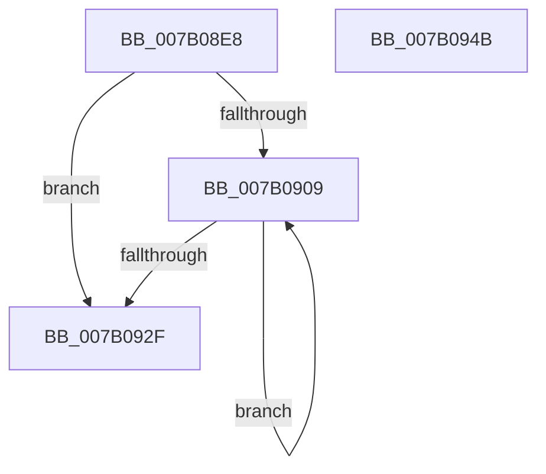

# WdipSemRollBackProviderTable

- RVA: `0x007B08E8`–`0x007B094C` (길이 `100` bytes)
- VA: `0x00000001407B08E8`
- 실행 섹션: `PAGE`
- PDB 이름 있음: `예`; PDB Function 태그: `아니요`
- unwind 정보 RVA: `0x0006F978`
- 디코드: `26`개 명령, `100/100` bytes 표시
- 미해석 바이트: `0` (있으면 어셈블리에 `.byte`로 보존)

> 이 문서는 커널 이미지의 기계어와 PDB 기호를 분석해 생성했습니다. 4번과 5번은 함수 원형과 자료형을 바이너리 사용 방식에서 추정한 C 해석이며 원본 소스 복구 결과는 아닙니다.

## 1. Dependencies

- 직접 호출 지점: **1**; 고유 호출 대상: **1**
- 직접 호출자로 확인된 함수: **1**
- RIP 상대 이미지 참조: **3**

### Outgoing calls
- `0x007B091B` → [WdipSemFastFree](../70/WdipSemFastFree_function_0070303C.md) (function, `0x0070303C`)

### Direct callers
- [WdipSemLoadScenarioTable](WdipSemLoadScenarioTable_function_007B02D8.md) at `0x007B06F7`

### Static image references
- `0x007B08FD` → RVA `0x00F01DC0` (`.data`; read)
- `0x007B090B` → RVA `0x00EFFDC0` (`.data`; read)
- `0x007B0939` → RVA `0x00F01DC0` (`.data`; write)

## 2. Other-region calls and transfers

- 다른 실행 섹션으로 향하는 call: **0**
- 별도 외부 분기/꼬리 이동을 확인하지 못했습니다.

## 3. Assembly (complete function range)

```asm
007B08E8  48 89 5C 24 08                  mov qword ptr [rsp + 8], rbx
007B08ED  48 89 74 24 10                  mov qword ptr [rsp + 0x10], rsi
007B08F2  48 89 7C 24 18                  mov qword ptr [rsp + 0x18], rdi
007B08F7  41 56                           push r14
007B08F9  48 83 EC 20                     sub rsp, 0x20
007B08FD  3B 0D BD 14 75 00               cmp ecx, dword ptr [rip + 0x7514bd]
007B0903  8B F9                           mov edi, ecx
007B0905  8B F1                           mov esi, ecx
007B0907  73 26                           jae 0x1407b092f
007B0909  8B DE                           mov ebx, esi
007B090B  4C 8D 35 AE F4 74 00            lea r14, [rip + 0x74f4ae]
007B0912  B9 02 00 00 00                  mov ecx, 2
007B0917  49 8B 14 DE                     mov rdx, qword ptr [r14 + rbx*8]
007B091B  E8 1C 27 F5 FF                  call 0x14070303c
007B0920  49 83 24 DE 00                  and qword ptr [r14 + rbx*8], 0
007B0925  FF C6                           inc esi
007B0927  3B 35 93 14 75 00               cmp esi, dword ptr [rip + 0x751493]
007B092D  72 DA                           jb 0x1407b0909
007B092F  48 8B 5C 24 30                  mov rbx, qword ptr [rsp + 0x30]
007B0934  48 8B 74 24 38                  mov rsi, qword ptr [rsp + 0x38]
007B0939  89 3D 81 14 75 00               mov dword ptr [rip + 0x751481], edi
007B093F  48 8B 7C 24 40                  mov rdi, qword ptr [rsp + 0x40]
007B0944  48 83 C4 20                     add rsp, 0x20
007B0948  41 5E                           pop r14
007B094A  C3                              ret
007B094B  CC                              int3
```

## 4. C-style interpretation (structured pseudocode)

```c
__int64 __fastcall WdipSemRollBackProviderTable(int a1)
{
    __int64 result;
    __int64 v_rsi;
    __int64 v_rsp;
    unsigned __int64 v_stack_p10;
    unsigned __int64 v_stack_p18;
    unsigned __int64 v_stack_p8;

    v_stack_p8 = v_rbx;
    v_stack_p10 = v_rsi;
    v_stack_p18 = v_rdi;
    v_rsp = (v_rsp) - (32);
    if (a1 >= (*(unsigned int *)(v_rip + 7673021))) goto loc_007B092F;
loc_007B0909:
    result = WdipSemFastFree(2, *(unsigned __int64 *)(v_rip + 7664814 + (unsigned int)((unsigned int)((unsigned int)(a1))) * 8), a3, a4);
    v_rsi = (unsigned int)(((unsigned int)(a1)) + 1);
    if (((unsigned int)(v_rsi)) < (*(unsigned int *)(v_rip + 7672979))) goto loc_007B0909;
loc_007B092F:
    *(unsigned int *)(v_rip + 7672961) = (unsigned int)((unsigned int)(a1));
    v_rsp = (v_rsp) + (32);
    return result;
}
```

## 5. (Beta) C Style

```c
int64_t WdipSemRollBackProviderTable(int32_t Arg1)
{
    int64_t result;
    int64_t local_rsi;
    int64_t local_rsp;
    uint64_t v_stack_p10;
    uint64_t v_stack_p18;
    uint64_t v_stack_p8;

    v_stack_p8 = local_rbx;
    v_stack_p10 = local_rsi;
    v_stack_p18 = local_rdi;
    local_rsp = (local_rsp) - (32);
    if (Arg1 >= (*(uint32_t *)(v_rip + 0x7514BD))) goto loc_007B092F;
loc_007B0909:
    result = WdipSemFastFree(2, *(uint64_t *)(v_rip + 0x74F4AE + (uint32_t)((uint32_t)((uint32_t)(Arg1))) * 8), a3, a4);
    local_rsi = (uint32_t)(((uint32_t)(Arg1)) + 1);
    if (((uint32_t)(local_rsi)) < (*(uint32_t *)(v_rip + 0x751493))) goto loc_007B0909;
loc_007B092F:
    *(uint32_t *)(v_rip + 0x751481) = (uint32_t)((uint32_t)(Arg1));
    local_rsp = (local_rsp) + (32);
    return result;
}
```

## 6. Execution-region graph

[열기: 2D/3D 그래프와 함수 탐색 컨트롤 패널](../../../control-panel.html?section=page&rva=0x007B08E8&view=graph)

- 2D 그래프는 위에서 아래로 흐르고, 3D 그래프는 빈 공간을 드래그해 회전합니다. Shift+드래그는 이동, 휠은 확대·축소, 함수 노드 선택은 대상 보고서 이동입니다.

### Static fallback


