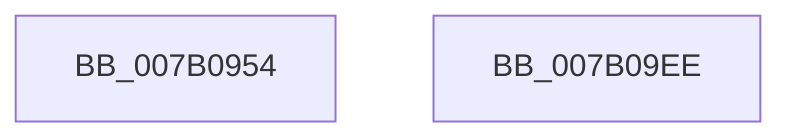

# WdipSemShutdown

- RVA: `0x007B0954`–`0x007B09EF` (길이 `155` bytes)
- VA: `0x00000001407B0954`
- 실행 섹션: `PAGE`
- PDB 이름 있음: `예`; PDB Function 태그: `아니요`
- unwind 정보 RVA: `0x0005C788`
- 디코드: `27`개 명령, `155/155` bytes 표시
- 미해석 바이트: `0` (있으면 어셈블리에 `.byte`로 보존)

> 이 문서는 커널 이미지의 기계어와 PDB 기호를 분석해 생성했습니다. 4번과 5번은 함수 원형과 자료형을 바이너리 사용 방식에서 추정한 C 해석이며 원본 소스 복구 결과는 아닙니다.

## 1. Dependencies

- 직접 호출 지점: **5**; 고유 호출 대상: **4**
- 직접 호출자로 확인된 함수: **4**
- RIP 상대 이미지 참조: **14**

### Outgoing calls
- `0x007B0978` → [WdipSemDisableAllProviders](WdipSemDisableAllProviders_function_007B1968.md) (function, `0x007B1968`)
- `0x007B099A` → [memset](../../text/6C/memset_function_006C6C40.md) (function, `0x006C6C40`)
- `0x007B09AE` → [memset](../../text/6C/memset_function_006C6C40.md) (function, `0x006C6C40`)
- `0x007B09DF` → [WdipSemClearFrequentScenarioTable](../../text/64/WdipSemClearFrequentScenarioTable_function_0064E340.md) (function, `0x0064E340`)
- `0x007B09E4` → [WdipSemFreePool](WdipSemFreePool_function_007B0FC8.md) (function, `0x007B0FC8`)

### Direct callers
- [WdipSemUpdate](../7A/WdipSemUpdate_function_007AED28.md) at `0x007AED97`
- [WdipSemCleanStart](../7A/WdipSemCleanStart_function_007AF590.md) at `0x007AF5E6`
- [sub_00B3DB56](../B3/Unknown_function_00B3DB56.md) at `0x00B3DBE1`
- [sub_00B3DC32](../B3/Unknown_function_00B3DC32.md) at `0x00B3DC8C`

### Static image references
- `0x007B0958` → RVA `0x00F01E10` (`.data`; read/write)
- `0x007B0960` → RVA `0x00F01E18` (`.data`; write)
- `0x007B0967` → RVA `0x00F02028` (`.data`; write)
- `0x007B096E` → RVA `0x00F01E04` (`.data`; write)
- `0x007B097D` → RVA `0x00F02450` (`.data`; read/write)
- `0x007B0984` → RVA `0x00F01E20` (`.data`; read)
- `0x007B098B` → RVA `0x00F02454` (`.data`; read/write)
- `0x007B09A1` → RVA `0x00EFFDC0` (`.data`; read)
- `0x007B09B3` → RVA `0x00F01DC8` (`.data`; read/write)
- `0x007B09BB` → RVA `0x00F01DE0` (`.data`; read)
- `0x007B09C2` → RVA `0x00F01DF0` (`.data`; read/write)
- `0x007B09C9` → RVA `0x00F01DF8` (`.data`; read/write)
- `0x007B09D1` → RVA `0x00F01DE8` (`.data`; write)
- `0x007B09D8` → RVA `0x00F01DE0` (`.data`; write)

## 2. Other-region calls and transfers

- 다른 실행 섹션으로 향하는 call: **3**
  - `0x007B099A` → [memset](../../text/6C/memset_function_006C6C40.md) (`PAGE` → `.text`)
  - `0x007B09AE` → [memset](../../text/6C/memset_function_006C6C40.md) (`PAGE` → `.text`)
  - `0x007B09DF` → [WdipSemClearFrequentScenarioTable](../../text/64/WdipSemClearFrequentScenarioTable_function_0064E340.md) (`PAGE` → `.text`)
- 별도 외부 분기/꼬리 이동을 확인하지 못했습니다.

## 3. Assembly (complete function range)

```asm
007B0954  48 83 EC 28                     sub rsp, 0x28
007B0958  48 83 25 B0 14 75 00 00         and qword ptr [rip + 0x7514b0], 0
007B0960  C6 05 B1 14 75 00 00            mov byte ptr [rip + 0x7514b1], 0
007B0967  C6 05 BA 16 75 00 00            mov byte ptr [rip + 0x7516ba], 0
007B096E  C7 05 8C 14 75 00 58 02 00 00   mov dword ptr [rip + 0x75148c], 0x258
007B0978  E8 EB 0F 00 00                  call 0x1407b1968
007B097D  83 25 CC 1A 75 00 00            and dword ptr [rip + 0x751acc], 0
007B0984  48 8D 0D 95 14 75 00            lea rcx, [rip + 0x751495]
007B098B  83 25 C2 1A 75 00 00            and dword ptr [rip + 0x751ac2], 0
007B0992  33 D2                           xor edx, edx
007B0994  41 B8 08 02 00 00               mov r8d, 0x208
007B099A  E8 A1 62 F1 FF                  call 0x1406c6c40
007B099F  33 D2                           xor edx, edx
007B09A1  48 8D 0D 18 F4 74 00            lea rcx, [rip + 0x74f418]
007B09A8  41 B8 08 20 00 00               mov r8d, 0x2008
007B09AE  E8 8D 62 F1 FF                  call 0x1406c6c40
007B09B3  48 83 25 0D 14 75 00 00         and qword ptr [rip + 0x75140d], 0
007B09BB  48 8D 05 1E 14 75 00            lea rax, [rip + 0x75141e]
007B09C2  83 25 27 14 75 00 00            and dword ptr [rip + 0x751427], 0
007B09C9  48 83 25 27 14 75 00 00         and qword ptr [rip + 0x751427], 0
007B09D1  48 89 05 10 14 75 00            mov qword ptr [rip + 0x751410], rax
007B09D8  48 89 05 01 14 75 00            mov qword ptr [rip + 0x751401], rax
007B09DF  E8 5C D9 E9 FF                  call 0x14064e340
007B09E4  E8 DF 05 00 00                  call 0x1407b0fc8
007B09E9  48 83 C4 28                     add rsp, 0x28
007B09ED  C3                              ret
007B09EE  CC                              int3
```

## 4. C-style interpretation (structured pseudocode)

```c
__int64 __fastcall WdipSemShutdown(__int64 a1, int a2)
{
    __int64 result;
    __int64 v_rsp;

    v_rsp = (v_rsp) - (40);
    *(unsigned __int8 *)(v_rip + 7673009) = 0;
    *(unsigned __int8 *)(v_rip + 7673530) = 0;
    *(unsigned int *)(v_rip + 7672972) = 600;
    result = WdipSemDisableAllProviders(a1, a2, a3, a4);
    a2 = 0;
    result = memset(v_rip + 7672981, a2, 520, a4);
    a2 = 0;
    result = memset(v_rip + 7664664, a2, (unsigned int)(0x2008ULL), a4);
    *(unsigned __int64 *)(v_rip + 7672848) = v_rip + 7672862;
    *(unsigned __int64 *)(v_rip + 7672833) = v_rip + 7672862;
    result = WdipSemClearFrequentScenarioTable(v_rip + 7664664, a2, (unsigned int)(0x2008ULL), a4);
    result = WdipSemFreePool(v_rip + 7664664, a2, (unsigned int)(0x2008ULL), a4);
    v_rsp = (v_rsp) + (40);
    return result;
}
```

## 5. (Beta) C Style

```c
int64_t WdipSemShutdown(int64_t Arg1, int32_t Arg2)
{
    int64_t result;
    int64_t local_rsp;

    local_rsp = (local_rsp) - (40);
    *(uint8_t *)(v_rip + 0x7514B1) = 0;
    *(uint8_t *)(v_rip + 0x7516BA) = 0;
    *(uint32_t *)(v_rip + 0x75148C) = 600;
    result = WdipSemDisableAllProviders(Arg1, Arg2, a3, a4);
    Arg2 = 0;
    result = memset(v_rip + 7672981, Arg2, 520, a4);
    Arg2 = 0;
    result = memset(v_rip + 7664664, Arg2, (uint32_t)(0x2008ULL), a4);
    *(uint64_t *)(v_rip + 0x751410) = v_rip + 7672862;
    *(uint64_t *)(v_rip + 0x751401) = v_rip + 7672862;
    result = WdipSemClearFrequentScenarioTable(v_rip + 7664664, Arg2, (uint32_t)(0x2008ULL), a4);
    result = WdipSemFreePool(v_rip + 7664664, Arg2, (uint32_t)(0x2008ULL), a4);
    local_rsp = (local_rsp) + (40);
    return result;
}
```

## 6. Execution-region graph

[열기: 2D/3D 그래프와 함수 탐색 컨트롤 패널](../../../control-panel.html?section=page&rva=0x007B0954&view=graph)

- 2D 그래프는 위에서 아래로 흐르고, 3D 그래프는 빈 공간을 드래그해 회전합니다. Shift+드래그는 이동, 휠은 확대·축소, 함수 노드 선택은 대상 보고서 이동입니다.

### Static fallback


