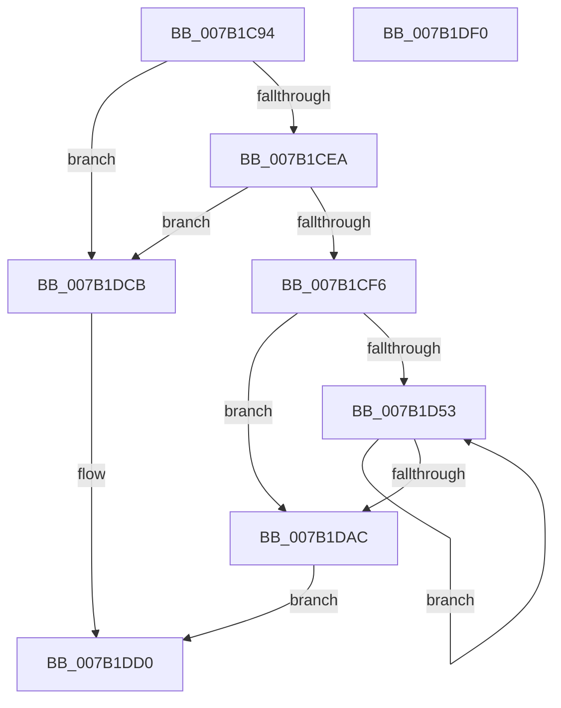

# WdipSemSqmAddToStream

- RVA: `0x007B1C94`–`0x007B1DF1` (길이 `349` bytes)
- VA: `0x00000001407B1C94`
- 실행 섹션: `PAGE`
- PDB 이름 있음: `예`; PDB Function 태그: `아니요`
- unwind 정보 RVA: `0x000D30F8`
- 디코드: `78`개 명령, `349/349` bytes 표시
- 미해석 바이트: `0` (있으면 어셈블리에 `.byte`로 보존)

> 이 문서는 커널 이미지의 기계어와 PDB 기호를 분석해 생성했습니다. 4번과 5번은 함수 원형과 자료형을 바이너리 사용 방식에서 추정한 C 해석이며 원본 소스 복구 결과는 아닙니다.

## 1. Dependencies

- 직접 호출 지점: **2**; 고유 호출 대상: **2**
- 직접 호출자로 확인된 함수: **2**
- RIP 상대 이미지 참조: **3**

### Outgoing calls
- `0x007B1DC4` → [WdipSemWriteEvent](../A9/WdipSemWriteEvent_function_00A9B6D4.md) (function, `0x00A9B6D4`)
- `0x007B1DDA` → [_security_check_cookie](../../text/6A/_security_check_cookie_function_006AC640.md) (function, `0x006AC640`)

### Direct callers
- [WdipSemSqmLogTimeoutDataPoints](WdipSemSqmLogTimeoutDataPoints_function_007B1F1C.md) at `0x007B1F5E`
- [sub_00B3DAFC](../B3/Unknown_function_00B3DAFC.md) at `0x00B3DB3A`

### Static image references
- `0x007B1CAD` → RVA `0x00E0A740` (`.data`; read)
- `0x007B1CFB` → RVA `0x00038348` (`.rdata`; read)
- `0x007B1DBD` → RVA `0x00022128` (`.rdata`; read)

## 2. Other-region calls and transfers

- 다른 실행 섹션으로 향하는 call: **1**
  - `0x007B1DDA` → [_security_check_cookie](../../text/6A/_security_check_cookie_function_006AC640.md) (`PAGE` → `.text`)
- 별도 외부 분기/꼬리 이동을 확인하지 못했습니다.

## 3. Assembly (complete function range)

```asm
007B1C94  48 89 7C 24 18                  mov qword ptr [rsp + 0x18], rdi
007B1C99  89 4C 24 08                     mov dword ptr [rsp + 8], ecx
007B1C9D  55                              push rbp
007B1C9E  48 8D AC 24 B0 FE FF FF         lea rbp, [rsp - 0x150]
007B1CA6  48 81 EC 50 02 00 00            sub rsp, 0x250
007B1CAD  48 8B 05 8C 8A 65 00            mov rax, qword ptr [rip + 0x658a8c]
007B1CB4  48 33 C4                        xor rax, rsp
007B1CB7  48 89 85 40 01 00 00            mov qword ptr [rbp + 0x140], rax
007B1CBE  89 54 24 38                     mov dword ptr [rsp + 0x38], edx
007B1CC2  44 8B CA                        mov r9d, edx
007B1CC5  C7 44 24 40 01 00 00 00         mov dword ptr [rsp + 0x40], 1
007B1CCD  44 8D 1C 52                     lea r11d, [rdx + rdx*2]
007B1CD1  C7 44 24 44 30 00 00 00         mov dword ptr [rsp + 0x44], 0x30
007B1CD9  C7 44 24 30 0B 00 00 00         mov dword ptr [rsp + 0x30], 0xb
007B1CE1  4D 85 C0                        test r8, r8
007B1CE4  0F 84 E1 00 00 00               je 0x1407b1dcb
007B1CEA  8D 42 FF                        lea eax, [rdx - 1]
007B1CED  83 F8 08                        cmp eax, 8
007B1CF0  0F 87 D5 00 00 00               ja 0x1407b1dcb
007B1CF6  83 64 24 5C 00                  and dword ptr [rsp + 0x5c], 0
007B1CFB  48 8D 05 46 66 88 FF            lea rax, [rip - 0x7799ba]
007B1D02  83 64 24 6C 00                  and dword ptr [rsp + 0x6c], 0
007B1D07  BF 04 00 00 00                  mov edi, 4
007B1D0C  83 64 24 7C 00                  and dword ptr [rsp + 0x7c], 0
007B1D11  45 33 D2                        xor r10d, r10d
007B1D14  83 65 8C 00                     and dword ptr [rbp - 0x74], 0
007B1D18  48 89 44 24 50                  mov qword ptr [rsp + 0x50], rax
007B1D1D  48 8D 85 60 01 00 00            lea rax, [rbp + 0x160]
007B1D24  48 89 44 24 60                  mov qword ptr [rsp + 0x60], rax
007B1D29  48 8D 44 24 30                  lea rax, [rsp + 0x30]
007B1D2E  48 89 44 24 70                  mov qword ptr [rsp + 0x70], rax
007B1D33  48 8D 44 24 38                  lea rax, [rsp + 0x38]
007B1D38  48 89 45 80                     mov qword ptr [rbp - 0x80], rax
007B1D3C  C7 44 24 58 10 00 00 00         mov dword ptr [rsp + 0x58], 0x10
007B1D44  89 7C 24 68                     mov dword ptr [rsp + 0x68], edi
007B1D48  89 7C 24 78                     mov dword ptr [rsp + 0x78], edi
007B1D4C  89 7D 88                        mov dword ptr [rbp - 0x78], edi
007B1D4F  85 D2                           test edx, edx
007B1D51  74 59                           je 0x1407b1dac
007B1D53  43 8D 14 52                     lea edx, [r10 + r10*2]
007B1D57  48 8D 44 24 40                  lea rax, [rsp + 0x40]
007B1D5C  8D 4A 04                        lea ecx, [rdx + 4]
007B1D5F  48 03 C9                        add rcx, rcx
007B1D62  83 64 CC 5C 00                  and dword ptr [rsp + rcx*8 + 0x5c], 0
007B1D67  48 89 44 CC 50                  mov qword ptr [rsp + rcx*8 + 0x50], rax
007B1D6C  41 8D 42 02                     lea eax, [r10 + 2]
007B1D70  89 7C CC 58                     mov dword ptr [rsp + rcx*8 + 0x58], edi
007B1D74  8D 04 40                        lea eax, [rax + rax*2]
007B1D77  48 03 C0                        add rax, rax
007B1D7A  8D 4A 05                        lea ecx, [rdx + 5]
007B1D7D  48 03 C9                        add rcx, rcx
007B1D80  41 FF C2                        inc r10d
007B1D83  83 64 CC 5C 00                  and dword ptr [rsp + rcx*8 + 0x5c], 0
007B1D88  4C 89 44 CC 50                  mov qword ptr [rsp + rcx*8 + 0x50], r8
007B1D8D  4C 03 C7                        add r8, rdi
007B1D90  89 7C CC 58                     mov dword ptr [rsp + rcx*8 + 0x58], edi
007B1D94  48 8D 4C 24 44                  lea rcx, [rsp + 0x44]
007B1D99  83 64 C4 5C 00                  and dword ptr [rsp + rax*8 + 0x5c], 0
007B1D9E  48 89 4C C4 50                  mov qword ptr [rsp + rax*8 + 0x50], rcx
007B1DA3  89 7C C4 58                     mov dword ptr [rsp + rax*8 + 0x58], edi
007B1DA7  45 3B D1                        cmp r10d, r9d
007B1DAA  72 A7                           jb 0x1407b1d53
007B1DAC  48 8D 44 24 50                  lea rax, [rsp + 0x50]
007B1DB1  45 33 C0                        xor r8d, r8d
007B1DB4  45 8D 4B 04                     lea r9d, [r11 + 4]
007B1DB8  48 89 44 24 20                  mov qword ptr [rsp + 0x20], rax
007B1DBD  48 8D 15 64 03 87 FF            lea rdx, [rip - 0x78fc9c]
007B1DC4  E8 0B 99 2E 00                  call 0x140a9b6d4
007B1DC9  EB 05                           jmp 0x1407b1dd0
007B1DCB  B8 0D 00 00 C0                  mov eax, 0xc000000d
007B1DD0  48 8B 8D 40 01 00 00            mov rcx, qword ptr [rbp + 0x140]
007B1DD7  48 33 CC                        xor rcx, rsp
007B1DDA  E8 61 A8 EF FF                  call 0x1406ac640
007B1DDF  48 8B BC 24 70 02 00 00         mov rdi, qword ptr [rsp + 0x270]
007B1DE7  48 81 C4 50 02 00 00            add rsp, 0x250
007B1DEE  5D                              pop rbp
007B1DEF  C3                              ret
007B1DF0  CC                              int3
```

## 4. C-style interpretation (structured pseudocode)

```c
__int64 __fastcall WdipSemSqmAddToStream(int a1, __int64 a2, __int64 a3)
{
    __int64 result;
    __int64 v_r10;
    __int64 v_rsp;
    unsigned __int64 v_stack_m158;
    unsigned __int64 v_stack_m18;
    unsigned int v_stack_m1CC;
    unsigned int v_stack_m1D0;
    unsigned __int64 v_stack_m1D8;
    unsigned int v_stack_m1DC;
    unsigned int v_stack_m1E0;
    unsigned __int64 v_stack_m1E8;
    unsigned int v_stack_m1EC;
    unsigned int v_stack_m1F0;
    unsigned __int64 v_stack_m1F8;
    unsigned int v_stack_m1FC;
    unsigned int v_stack_m200;
    unsigned __int64 v_stack_m208;
    unsigned int v_stack_m214;
    unsigned int v_stack_m218;
    unsigned int v_stack_m220;
    unsigned int v_stack_m228;
    unsigned __int64 v_stack_m238;
    unsigned __int64 v_stack_p18;
    unsigned int v_stack_p8;

    v_stack_p18 = v_rdi;
    v_stack_p8 = a1;
    v_rsp = (v_rsp) - (592);
    result = (*(unsigned __int64 *)(v_rip + 6654604)) ^ (v_rsp);
    v_stack_m18 = result;
    v_stack_m220 = (unsigned int)(a2);
    v_stack_m218 = 1;
    v_stack_m214 = 48;
    v_stack_m228 = 11;
    if (a3 == 0) goto loc_007B1DCB;
    if (((unsigned int)(a2 - 1)) > 8) goto loc_007B1DCB;
    v_r10 = 0;
    v_stack_m208 = v_rip - 7838138;
    v_stack_m1F8 = v_stack_p8;
    v_stack_m1E8 = v_stack_m228;
    v_stack_m1D8 = v_stack_m220;
    v_stack_m200 = 16;
    v_stack_m1F0 = 4;
    v_stack_m1E0 = 4;
    v_stack_m1D0 = 4;
    if ((unsigned int)(a2) == 0) goto loc_007B1DAC;
loc_007B1D53:
    a1 = (v_r10 + v_r10 * 2 + 4) + (v_r10 + v_r10 * 2 + 4);
    *(unsigned __int64 *)(v_rsp + a1 * 8 + 80) = v_stack_m218;
    *(unsigned int *)(v_rsp + a1 * 8 + 88) = 4;
    result = (v_r10 + 2 + v_r10 + 2 * 2) + (v_r10 + 2 + v_r10 + 2 * 2);
    a1 = (v_r10 + v_r10 * 2 + 5) + (v_r10 + v_r10 * 2 + 5);
    v_r10 = (unsigned int)((v_r10) + 1);
    *(unsigned __int64 *)(v_rsp + a1 * 8 + 80) = a3;
    a3 = (a3) + (4);
    *(unsigned int *)(v_rsp + a1 * 8 + 88) = 4;
    *(unsigned __int64 *)(v_rsp + result * 8 + 80) = v_stack_m214;
    *(unsigned int *)(v_rsp + result * 8 + 88) = 4;
    if (((unsigned int)(v_r10)) < ((unsigned int)((unsigned int)((unsigned int)(a2))))) goto loc_007B1D53;
loc_007B1DAC:
    a3 = 0;
    v_stack_m238 = v_stack_m208;
    result = WdipSemWriteEvent(v_stack_m214, v_rip - 7928988, a3, a2 + a2 * 2 + 4);
    goto loc_007B1DD0;
loc_007B1DCB:
loc_007B1DD0:
    a1 = (v_stack_m18) ^ (v_rsp);
    result = _security_check_cookie(a1, v_rip - 7928988, a3, a2 + a2 * 2 + 4);
    v_rsp = (v_rsp) + (592);
    return result;
}
```

## 5. (Beta) C Style

```c
int64_t WdipSemSqmAddToStream(int32_t Arg1, void *Arg2, int64_t Arg3)
{
    uint8_t *arg2 = (uint8_t *)Arg2;

    int64_t result;
    int64_t local_r10;
    int64_t local_rsp;
    uint64_t v_stack_m158;
    uint64_t v_stack_m18;
    uint32_t v_stack_m1CC;
    uint32_t v_stack_m1D0;
    uint64_t v_stack_m1D8;
    uint32_t v_stack_m1DC;
    uint32_t v_stack_m1E0;
    uint64_t v_stack_m1E8;
    uint32_t v_stack_m1EC;
    uint32_t v_stack_m1F0;
    uint64_t v_stack_m1F8;
    uint32_t v_stack_m1FC;
    uint32_t v_stack_m200;
    uint64_t v_stack_m208;
    uint32_t v_stack_m214;
    uint32_t v_stack_m218;
    uint32_t v_stack_m220;
    uint32_t v_stack_m228;
    uint64_t v_stack_m238;
    uint64_t v_stack_p18;
    uint32_t v_stack_p8;

    v_stack_p18 = local_rdi;
    v_stack_p8 = Arg1;
    local_rsp = (local_rsp) - (592);
    result = (*(uint64_t *)(v_rip + 0x658A8C)) ^ (local_rsp);
    v_stack_m18 = result;
    v_stack_m220 = (uint32_t)(Arg2);
    v_stack_m218 = 1;
    v_stack_m214 = 48;
    v_stack_m228 = 11;
    if (Arg3 == 0) goto loc_007B1DCB;
    if (((uint32_t)(Arg2 - 1)) > 8) goto loc_007B1DCB;
    local_r10 = 0;
    v_stack_m208 = v_rip - 7838138;
    v_stack_m1F8 = v_stack_p8;
    v_stack_m1E8 = v_stack_m228;
    v_stack_m1D8 = v_stack_m220;
    v_stack_m200 = 16;
    v_stack_m1F0 = 4;
    v_stack_m1E0 = 4;
    v_stack_m1D0 = 4;
    if ((uint32_t)(Arg2) == 0) goto loc_007B1DAC;
loc_007B1D53:
    Arg1 = (local_r10 + local_r10 * 2 + 4) + (local_r10 + local_r10 * 2 + 4);
    *(uint64_t *)(local_rsp + Arg1 * 8 + 0x50) = v_stack_m218;
    *(uint32_t *)(local_rsp + Arg1 * 8 + 0x58) = 4;
    result = (local_r10 + 2 + local_r10 + 2 * 2) + (local_r10 + 2 + local_r10 + 2 * 2);
    Arg1 = (local_r10 + local_r10 * 2 + 5) + (local_r10 + local_r10 * 2 + 5);
    local_r10 = (uint32_t)((local_r10) + 1);
    *(uint64_t *)(local_rsp + Arg1 * 8 + 0x50) = Arg3;
    Arg3 = (Arg3) + (4);
    *(uint32_t *)(local_rsp + Arg1 * 8 + 0x58) = 4;
    *(uint64_t *)(local_rsp + result * 8 + 0x50) = v_stack_m214;
    *(uint32_t *)(local_rsp + result * 8 + 0x58) = 4;
    if (((uint32_t)(local_r10)) < ((uint32_t)((uint32_t)((uint32_t)(Arg2))))) goto loc_007B1D53;
loc_007B1DAC:
    Arg3 = 0;
    v_stack_m238 = v_stack_m208;
    result = WdipSemWriteEvent(v_stack_m214, v_rip - 7928988, Arg3, Arg2 + Arg2 * 2 + 4);
    goto loc_007B1DD0;
loc_007B1DCB:
loc_007B1DD0:
    Arg1 = (v_stack_m18) ^ (local_rsp);
    result = _security_check_cookie(Arg1, v_rip - 7928988, Arg3, Arg2 + Arg2 * 2 + 4);
    local_rsp = (local_rsp) + (592);
    return result;
}
```

### 관측된 메모리 오프셋

구조체 형식이 확인되지 않은 접근은 인자 기준의 오프셋으로만 기록했습니다.

| 기준 인자 | 오프셋 표현 | 폭 (bit) | 접근 |
|---|---:|---:|---|
| `Arg2` | `- 0x1` | `32` | `R` |
| `Arg2` | `+ 0x0 + rdx*2` | `32` | `R` |
| `Arg2` | `+ 0x4` | `32` | `R` |

## 6. Execution-region graph

[열기: 2D/3D 그래프와 함수 탐색 컨트롤 패널](../../../control-panel.html?section=page&rva=0x007B1C94&view=graph)

- 2D 그래프는 위에서 아래로 흐르고, 3D 그래프는 빈 공간을 드래그해 회전합니다. Shift+드래그는 이동, 휠은 확대·축소, 함수 노드 선택은 대상 보고서 이동입니다.

### Static fallback


