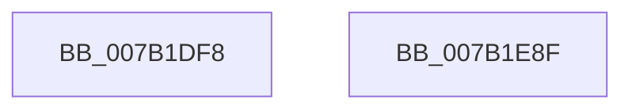

# WdipSemSqmIncrementDword

- RVA: `0x007B1DF8`–`0x007B1E90` (길이 `152` bytes)
- VA: `0x00000001407B1DF8`
- 실행 섹션: `PAGE`
- PDB 이름 있음: `예`; PDB Function 태그: `아니요`
- unwind 정보 RVA: `0x000D3114`
- 디코드: `34`개 명령, `152/152` bytes 표시
- 미해석 바이트: `0` (있으면 어셈블리에 `.byte`로 보존)

> 이 문서는 커널 이미지의 기계어와 PDB 기호를 분석해 생성했습니다. 4번과 5번은 함수 원형과 자료형을 바이너리 사용 방식에서 추정한 C 해석이며 원본 소스 복구 결과는 아닙니다.

## 1. Dependencies

- 직접 호출 지점: **2**; 고유 호출 대상: **2**
- 직접 호출자로 확인된 함수: **1**
- RIP 상대 이미지 참조: **3**

### Outgoing calls
- `0x007B1E75` → [WdipSemWriteEvent](../A9/WdipSemWriteEvent_function_00A9B6D4.md) (function, `0x00A9B6D4`)
- `0x007B1E81` → [_security_check_cookie](../../text/6A/_security_check_cookie_function_006AC640.md) (function, `0x006AC640`)

### Direct callers
- [WdipSemSqmLogInflightLimitExceededDataPoints](../A5/WdipSemSqmLogInflightLimitExceededDataPoints_function_00A5BA80.md) at `0x00A5BB7A`

### Static image references
- `0x007B1E09` → RVA `0x00E0A740` (`.data`; read)
- `0x007B1E24` → RVA `0x00038348` (`.rdata`; read)
- `0x007B1E69` → RVA `0x0001ED98` (`.rdata`; read)

## 2. Other-region calls and transfers

- 다른 실행 섹션으로 향하는 call: **1**
  - `0x007B1E81` → [_security_check_cookie](../../text/6A/_security_check_cookie_function_006AC640.md) (`PAGE` → `.text`)
- 별도 외부 분기/꼬리 이동을 확인하지 못했습니다.

## 3. Assembly (complete function range)

```asm
007B1DF8  89 54 24 10                     mov dword ptr [rsp + 0x10], edx
007B1DFC  55                              push rbp
007B1DFD  48 8D 6C 24 A9                  lea rbp, [rsp - 0x57]
007B1E02  48 81 EC 90 00 00 00            sub rsp, 0x90
007B1E09  48 8B 05 30 89 65 00            mov rax, qword ptr [rip + 0x658930]
007B1E10  48 33 C4                        xor rax, rsp
007B1E13  48 89 45 47                     mov qword ptr [rbp + 0x47], rax
007B1E17  41 B9 04 00 00 00               mov r9d, 4
007B1E1D  C7 45 F7 C2 01 00 00            mov dword ptr [rbp - 9], 0x1c2
007B1E24  48 8D 05 1D 65 88 FF            lea rax, [rip - 0x779ae3]
007B1E2B  C7 45 FF 06 00 00 00            mov dword ptr [rbp - 1], 6
007B1E32  48 89 45 07                     mov qword ptr [rbp + 7], rax
007B1E36  48 8D 45 F7                     lea rax, [rbp - 9]
007B1E3A  48 89 45 17                     mov qword ptr [rbp + 0x17], rax
007B1E3E  48 8D 45 FF                     lea rax, [rbp - 1]
007B1E42  48 89 45 27                     mov qword ptr [rbp + 0x27], rax
007B1E46  48 8D 45 6F                     lea rax, [rbp + 0x6f]
007B1E4A  48 89 45 37                     mov qword ptr [rbp + 0x37], rax
007B1E4E  48 C7 45 0F 10 00 00 00         mov qword ptr [rbp + 0xf], 0x10
007B1E56  4C 89 4D 1F                     mov qword ptr [rbp + 0x1f], r9
007B1E5A  4C 89 4D 2F                     mov qword ptr [rbp + 0x2f], r9
007B1E5E  4C 89 4D 3F                     mov qword ptr [rbp + 0x3f], r9
007B1E62  48 8D 45 07                     lea rax, [rbp + 7]
007B1E66  45 33 C0                        xor r8d, r8d
007B1E69  48 8D 15 28 CF 86 FF            lea rdx, [rip - 0x7930d8]
007B1E70  48 89 44 24 20                  mov qword ptr [rsp + 0x20], rax
007B1E75  E8 5A 98 2E 00                  call 0x140a9b6d4
007B1E7A  48 8B 4D 47                     mov rcx, qword ptr [rbp + 0x47]
007B1E7E  48 33 CC                        xor rcx, rsp
007B1E81  E8 BA A7 EF FF                  call 0x1406ac640
007B1E86  48 81 C4 90 00 00 00            add rsp, 0x90
007B1E8D  5D                              pop rbp
007B1E8E  C3                              ret
007B1E8F  CC                              int3
```

## 4. C-style interpretation (structured pseudocode)

```c
__int64 __fastcall WdipSemSqmIncrementDword(__int64 a1, int a2, int a3)
{
    __int64 result;
    __int64 v_rsp;
    unsigned __int64 v_stack_m18;
    unsigned __int64 v_stack_m20;
    unsigned __int64 v_stack_m28;
    unsigned __int64 v_stack_m30;
    unsigned __int64 v_stack_m38;
    unsigned __int64 v_stack_m40;
    unsigned __int64 v_stack_m48;
    unsigned __int64 v_stack_m50;
    unsigned __int64 v_stack_m58;
    unsigned __int64 v_stack_m5F;
    unsigned int v_stack_m60;
    unsigned int v_stack_m68;
    unsigned __int64 v_stack_m78;
    unsigned int v_stack_p10;

    v_stack_p10 = a2;
    v_rsp = (v_rsp) - (144);
    result = (*(unsigned __int64 *)(v_rip + 6654256)) ^ (v_rsp);
    v_stack_m18 = result;
    v_stack_m68 = 450;
    v_stack_m60 = 6;
    v_stack_m58 = v_rip - 7838435;
    v_stack_m48 = v_stack_m68;
    v_stack_m38 = v_stack_m60;
    v_stack_m28 = v_stack_p10;
    v_stack_m50 = 16;
    v_stack_m40 = 4;
    v_stack_m30 = 4;
    v_stack_m20 = 4;
    a3 = 0;
    v_stack_m78 = v_stack_m58;
    result = WdipSemWriteEvent(a1, v_rip - 7942360, a3, 4);
    a1 = (v_stack_m18) ^ (v_rsp);
    result = _security_check_cookie(a1, v_rip - 7942360, a3, 4);
    v_rsp = (v_rsp) + (144);
    return result;
}
```

## 5. (Beta) C Style

```c
int64_t WdipSemSqmIncrementDword(int64_t Arg1, int32_t Arg2, int32_t Arg3)
{
    int64_t result;
    int64_t local_rsp;
    uint64_t v_stack_m18;
    uint64_t v_stack_m20;
    uint64_t v_stack_m28;
    uint64_t v_stack_m30;
    uint64_t v_stack_m38;
    uint64_t v_stack_m40;
    uint64_t v_stack_m48;
    uint64_t v_stack_m50;
    uint64_t v_stack_m58;
    uint64_t v_stack_m5F;
    uint32_t v_stack_m60;
    uint32_t v_stack_m68;
    uint64_t v_stack_m78;
    uint32_t v_stack_p10;

    v_stack_p10 = Arg2;
    local_rsp = (local_rsp) - (144);
    result = (*(uint64_t *)(v_rip + 0x658930)) ^ (local_rsp);
    v_stack_m18 = result;
    v_stack_m68 = 450;
    v_stack_m60 = 6;
    v_stack_m58 = v_rip - 7838435;
    v_stack_m48 = v_stack_m68;
    v_stack_m38 = v_stack_m60;
    v_stack_m28 = v_stack_p10;
    v_stack_m50 = 16;
    v_stack_m40 = 4;
    v_stack_m30 = 4;
    v_stack_m20 = 4;
    Arg3 = 0;
    v_stack_m78 = v_stack_m58;
    result = WdipSemWriteEvent(Arg1, v_rip - 7942360, Arg3, 4);
    Arg1 = (v_stack_m18) ^ (local_rsp);
    result = _security_check_cookie(Arg1, v_rip - 7942360, Arg3, 4);
    local_rsp = (local_rsp) + (144);
    return result;
}
```

## 6. Execution-region graph

[열기: 2D/3D 그래프와 함수 탐색 컨트롤 패널](../../../control-panel.html?section=page&rva=0x007B1DF8&view=graph)

- 2D 그래프는 위에서 아래로 흐르고, 3D 그래프는 빈 공간을 드래그해 회전합니다. Shift+드래그는 이동, 휠은 확대·축소, 함수 노드 선택은 대상 보고서 이동입니다.

### Static fallback


