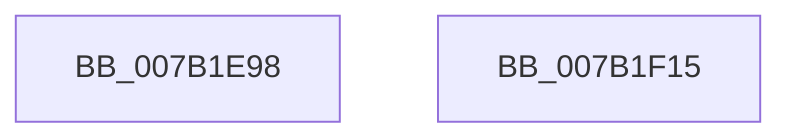

# WdipSemSqmInit

- RVA: `0x007B1E98`–`0x007B1F16` (길이 `126` bytes)
- VA: `0x00000001407B1E98`
- 실행 섹션: `PAGE`
- PDB 이름 있음: `예`; PDB Function 태그: `아니요`
- unwind 정보 RVA: `0x00080A9C`
- 디코드: `26`개 명령, `126/126` bytes 표시
- 미해석 바이트: `0` (있으면 어셈블리에 `.byte`로 보존)

> 이 문서는 커널 이미지의 기계어와 PDB 기호를 분석해 생성했습니다. 4번과 5번은 함수 원형과 자료형을 바이너리 사용 방식에서 추정한 C 해석이며 원본 소스 복구 결과는 아닙니다.

## 1. Dependencies

- 직접 호출 지점: **3**; 고유 호출 대상: **3**
- 직접 호출자로 확인된 함수: **1**
- RIP 상대 이미지 참조: **3**

### Outgoing calls
- `0x007B1ED6` → [RtlLengthSid](../../text/45/RtlLengthSid_function_0045D270.md) (function, `0x0045D270`)
- `0x007B1EFE` → [WdipSemWriteEvent](../A9/WdipSemWriteEvent_function_00A9B6D4.md) (function, `0x00A9B6D4`)
- `0x007B1F0B` → [_security_check_cookie](../../text/6A/_security_check_cookie_function_006AC640.md) (function, `0x006AC640`)

### Direct callers
- [WdipSemStartTimeoutCheck](WdipSemStartTimeoutCheck_function_007B13B0.md) at `0x007B13C4`

### Static image references
- `0x007B1E9C` → RVA `0x00E0A740` (`.data`; read)
- `0x007B1EAB` → RVA `0x00E67D58` (`.data`; read)
- `0x007B1EF7` → RVA `0x00022030` (`.rdata`; read)

## 2. Other-region calls and transfers

- 다른 실행 섹션으로 향하는 call: **2**
  - `0x007B1ED6` → [RtlLengthSid](../../text/45/RtlLengthSid_function_0045D270.md) (`PAGE` → `.text`)
  - `0x007B1F0B` → [_security_check_cookie](../../text/6A/_security_check_cookie_function_006AC640.md) (`PAGE` → `.text`)
- 별도 외부 분기/꼬리 이동을 확인하지 못했습니다.

## 3. Assembly (complete function range)

```asm
007B1E98  48 83 EC 68                     sub rsp, 0x68
007B1E9C  48 8B 05 9D 88 65 00            mov rax, qword ptr [rip + 0x65889d]
007B1EA3  48 33 C4                        xor rax, rsp
007B1EA6  48 89 44 24 58                  mov qword ptr [rsp + 0x58], rax
007B1EAB  48 8B 0D A6 5E 6B 00            mov rcx, qword ptr [rip + 0x6b5ea6]
007B1EB2  48 8D 44 24 30                  lea rax, [rsp + 0x30]
007B1EB7  83 64 24 44 00                  and dword ptr [rsp + 0x44], 0
007B1EBC  48 89 44 24 38                  mov qword ptr [rsp + 0x38], rax
007B1EC1  48 89 4C 24 48                  mov qword ptr [rsp + 0x48], rcx
007B1EC6  C7 44 24 30 01 00 00 00         mov dword ptr [rsp + 0x30], 1
007B1ECE  C7 44 24 40 04 00 00 00         mov dword ptr [rsp + 0x40], 4
007B1ED6  E8 95 B3 CA FF                  call 0x14045d270
007B1EDB  83 64 24 54 00                  and dword ptr [rsp + 0x54], 0
007B1EE0  89 44 24 50                     mov dword ptr [rsp + 0x50], eax
007B1EE4  48 8D 44 24 38                  lea rax, [rsp + 0x38]
007B1EE9  41 B9 02 00 00 00               mov r9d, 2
007B1EEF  45 33 C0                        xor r8d, r8d
007B1EF2  48 89 44 24 20                  mov qword ptr [rsp + 0x20], rax
007B1EF7  48 8D 15 32 01 87 FF            lea rdx, [rip - 0x78fece]
007B1EFE  E8 D1 97 2E 00                  call 0x140a9b6d4
007B1F03  48 8B 4C 24 58                  mov rcx, qword ptr [rsp + 0x58]
007B1F08  48 33 CC                        xor rcx, rsp
007B1F0B  E8 30 A7 EF FF                  call 0x1406ac640
007B1F10  48 83 C4 68                     add rsp, 0x68
007B1F14  C3                              ret
007B1F15  CC                              int3
```

## 4. C-style interpretation (structured pseudocode)

```c
__int64 __fastcall WdipSemSqmInit(__int64 a1, __int64 a2, int a3)
{
    __int64 result;
    __int64 v_rsp;
    unsigned __int64 v_stack_m10;
    unsigned int v_stack_m14;
    unsigned int v_stack_m18;
    unsigned __int64 v_stack_m20;
    unsigned int v_stack_m24;
    unsigned int v_stack_m28;
    unsigned __int64 v_stack_m30;
    unsigned __int64 v_stack_m38;
    unsigned __int64 v_stack_m48;

    v_rsp = (v_rsp) - (104);
    result = (*(unsigned __int64 *)(v_rip + 6654109)) ^ (v_rsp);
    v_stack_m10 = result;
    v_stack_m30 = v_stack_m38;
    v_stack_m20 = *(unsigned __int64 *)(v_rip + 7036582);
    v_stack_m38 = 1;
    v_stack_m28 = 4;
    result = RtlLengthSid(*(unsigned __int64 *)(v_rip + 7036582), a2, a3, a4);
    v_stack_m18 = (unsigned int)(result);
    a3 = 0;
    v_stack_m48 = v_stack_m30;
    result = WdipSemWriteEvent(*(unsigned __int64 *)(v_rip + 7036582), v_rip - 7929550, a3, 2);
    a1 = (v_stack_m10) ^ (v_rsp);
    result = _security_check_cookie(a1, v_rip - 7929550, a3, 2);
    v_rsp = (v_rsp) + (104);
    return result;
}
```

## 5. (Beta) C Style

```c
int64_t WdipSemSqmInit(int64_t Arg1, int64_t Arg2, int32_t Arg3)
{
    int64_t result;
    int64_t local_rsp;
    uint64_t v_stack_m10;
    uint32_t v_stack_m14;
    uint32_t v_stack_m18;
    uint64_t v_stack_m20;
    uint32_t v_stack_m24;
    uint32_t v_stack_m28;
    uint64_t v_stack_m30;
    uint64_t v_stack_m38;
    uint64_t v_stack_m48;

    local_rsp = (local_rsp) - (104);
    result = (*(uint64_t *)(v_rip + 0x65889D)) ^ (local_rsp);
    v_stack_m10 = result;
    v_stack_m30 = v_stack_m38;
    v_stack_m20 = *(uint64_t *)(v_rip + 0x6B5EA6);
    v_stack_m38 = 1;
    v_stack_m28 = 4;
    result = RtlLengthSid(*(uint64_t *)(v_rip + 0x6B5EA6), Arg2, Arg3, a4);
    v_stack_m18 = (uint32_t)(result);
    Arg3 = 0;
    v_stack_m48 = v_stack_m30;
    result = WdipSemWriteEvent(*(uint64_t *)(v_rip + 0x6B5EA6), v_rip - 7929550, Arg3, 2);
    Arg1 = (v_stack_m10) ^ (local_rsp);
    result = _security_check_cookie(Arg1, v_rip - 7929550, Arg3, 2);
    local_rsp = (local_rsp) + (104);
    return result;
}
```

## 6. Execution-region graph

[열기: 2D/3D 그래프와 함수 탐색 컨트롤 패널](../../../control-panel.html?section=page&rva=0x007B1E98&view=graph)

- 2D 그래프는 위에서 아래로 흐르고, 3D 그래프는 빈 공간을 드래그해 회전합니다. Shift+드래그는 이동, 휠은 확대·축소, 함수 노드 선택은 대상 보고서 이동입니다.

### Static fallback


