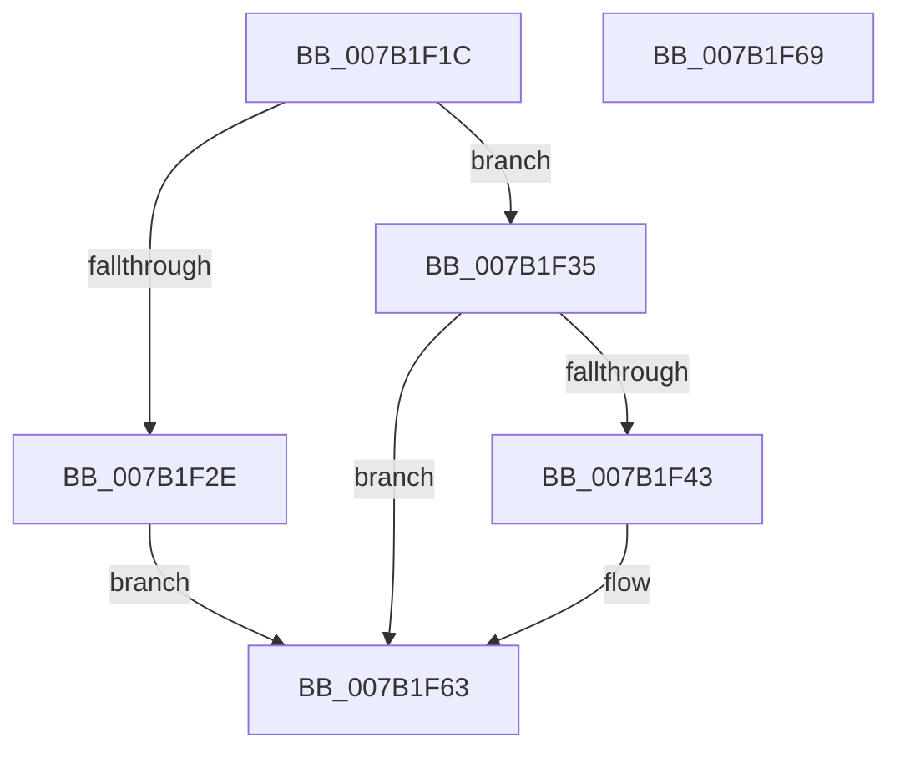

# WdipSemSqmLogTimeoutDataPoints

- RVA: `0x007B1F1C`–`0x007B1F6A` (길이 `78` bytes)
- VA: `0x00000001407B1F1C`
- 실행 섹션: `PAGE`
- PDB 이름 있음: `예`; PDB Function 태그: `아니요`
- unwind 정보 RVA: `0x0005CF00`
- 디코드: `23`개 명령, `78/78` bytes 표시
- 미해석 바이트: `0` (있으면 어셈블리에 `.byte`로 보존)

> 이 문서는 커널 이미지의 기계어와 PDB 기호를 분석해 생성했습니다. 4번과 5번은 함수 원형과 자료형을 바이너리 사용 방식에서 추정한 C 해석이며 원본 소스 복구 결과는 아닙니다.

## 1. Dependencies

- 직접 호출 지점: **2**; 고유 호출 대상: **2**
- 직접 호출자로 확인된 함수: **1**
- RIP 상대 이미지 참조: **0**

### Outgoing calls
- `0x007B1F3A` → [WdipSemGetGuidKey](WdipSemGetGuidKey_function_007B16C8.md) (function, `0x007B16C8`)
- `0x007B1F5E` → [WdipSemSqmAddToStream](WdipSemSqmAddToStream_function_007B1C94.md) (function, `0x007B1C94`)

### Direct callers
- [WdipSemLogTimeoutInformation](../A5/WdipSemLogTimeoutInformation_function_00A5C02C.md) at `0x00A5C0AF`

### Static image references
- 디코드된 RIP-relative 메모리 참조가 없습니다.

## 2. Other-region calls and transfers

- 다른 실행 섹션으로 향하는 call: **0**
- 별도 외부 분기/꼬리 이동을 확인하지 못했습니다.

## 3. Assembly (complete function range)

```asm
007B1F1C  40 53                           push rbx
007B1F1E  48 83 EC 20                     sub rsp, 0x20
007B1F22  83 64 24 30 00                  and dword ptr [rsp + 0x30], 0
007B1F27  8B DA                           mov ebx, edx
007B1F29  48 85 C9                        test rcx, rcx
007B1F2C  75 07                           jne 0x1407b1f35
007B1F2E  B8 0D 00 00 C0                  mov eax, 0xc000000d
007B1F33  EB 2E                           jmp 0x1407b1f63
007B1F35  48 8D 54 24 30                  lea rdx, [rsp + 0x30]
007B1F3A  E8 89 F7 FF FF                  call 0x1407b16c8
007B1F3F  85 C0                           test eax, eax
007B1F41  78 20                           js 0x1407b1f63
007B1F43  8B 44 24 30                     mov eax, dword ptr [rsp + 0x30]
007B1F47  4C 8D 44 24 30                  lea r8, [rsp + 0x30]
007B1F4C  BA 02 00 00 00                  mov edx, 2
007B1F51  89 44 24 30                     mov dword ptr [rsp + 0x30], eax
007B1F55  B9 1E 04 00 00                  mov ecx, 0x41e
007B1F5A  89 5C 24 34                     mov dword ptr [rsp + 0x34], ebx
007B1F5E  E8 31 FD FF FF                  call 0x1407b1c94
007B1F63  48 83 C4 20                     add rsp, 0x20
007B1F67  5B                              pop rbx
007B1F68  C3                              ret
007B1F69  CC                              int3
```

## 4. C-style interpretation (structured pseudocode)

```c
__int64 __fastcall WdipSemSqmLogTimeoutDataPoints(__int64 a1, int a2)
{
    __int64 result;
    __int64 v_rsp;
    unsigned int v_stack_p8;
    unsigned int v_stack_pC;

    v_rsp = (v_rsp) - (32);
    if (a1 != 0) goto loc_007B1F35;
    goto loc_007B1F63;
loc_007B1F35:
    result = WdipSemGetGuidKey(a1, v_stack_p8, a3, a4);
    if (!(sign_flag)) {
        result = v_stack_p8;
        a3 = v_stack_p8;
        a2 = 2;
        v_stack_p8 = (unsigned int)(result);
        a1 = 0x41EULL;
        v_stack_pC = (unsigned int)((unsigned int)(a2));
        result = WdipSemSqmAddToStream(a1, a2, a3, a4);
    }
    v_rsp = (v_rsp) + (32);
    return result;
}
```

## 5. (Beta) C Style

```c
int64_t WdipSemSqmLogTimeoutDataPoints(int64_t Arg1, int32_t Arg2)
{
    int64_t result;
    int64_t local_rsp;
    uint32_t v_stack_p8;
    uint32_t v_stack_pC;

    local_rsp = (local_rsp) - (32);
    if (Arg1 != 0) goto loc_007B1F35;
    goto loc_007B1F63;
loc_007B1F35:
    result = WdipSemGetGuidKey(Arg1, v_stack_p8, a3, a4);
    if (!(sign_flag)) {
        result = v_stack_p8;
        a3 = v_stack_p8;
        Arg2 = 2;
        v_stack_p8 = (uint32_t)(result);
        Arg1 = 0x41EULL;
        v_stack_pC = (uint32_t)((uint32_t)(Arg2));
        result = WdipSemSqmAddToStream(Arg1, Arg2, a3, a4);
    }
    local_rsp = (local_rsp) + (32);
    return result;
}
```

## 6. Execution-region graph

[열기: 2D/3D 그래프와 함수 탐색 컨트롤 패널](../../../control-panel.html?section=page&rva=0x007B1F1C&view=graph)

- 2D 그래프는 위에서 아래로 흐르고, 3D 그래프는 빈 공간을 드래그해 회전합니다. Shift+드래그는 이동, 휠은 확대·축소, 함수 노드 선택은 대상 보고서 이동입니다.

### Static fallback


