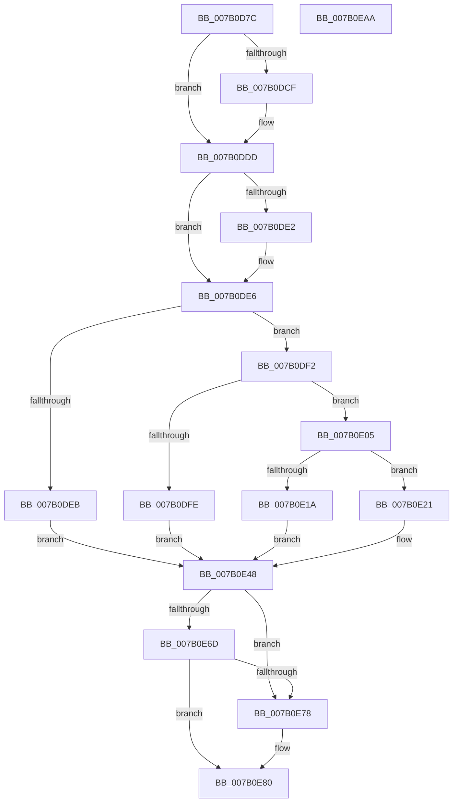

# WdipSemUpdateFrequentScenarioTable

- RVA: `0x007B0D7C`–`0x007B0EAB` (길이 `303` bytes)
- VA: `0x00000001407B0D7C`
- 실행 섹션: `PAGE`
- PDB 이름 있음: `예`; PDB Function 태그: `아니요`
- unwind 정보 RVA: `0x0005E6B4`
- 디코드: `77`개 명령, `303/303` bytes 표시
- 미해석 바이트: `0` (있으면 어셈블리에 `.byte`로 보존)

> 이 문서는 커널 이미지의 기계어와 PDB 기호를 분석해 생성했습니다. 4번과 5번은 함수 원형과 자료형을 바이너리 사용 방식에서 추정한 C 해석이며 원본 소스 복구 결과는 아닙니다.

## 1. Dependencies

- 직접 호출 지점: **6**; 고유 호출 대상: **6**
- 직접 호출자로 확인된 함수: **1**
- RIP 상대 이미지 참조: **4**

### Outgoing calls
- `0x007B0DBE` → [KeAbPreAcquire](../../text/21/KeAbPreAcquire_function_00210230.md) (function, `0x00210230`)
- `0x007B0DD8` → [ExfAcquirePushLockExclusiveEx](../../text/20/ExfAcquirePushLockExclusiveEx_function_0020FC90.md) (function, `0x0020FC90`)
- `0x007B0E0D` → [WdipSemFastAllocate](../A5/WdipSemFastAllocate_function_00A5DC04.md) (function, `0x00A5DC04`)
- `0x007B0E7B` → [ExfReleasePushLock](../../text/26/ExfReleasePushLock_function_002638D0.md) (function, `0x002638D0`)
- `0x007B0E83` → [KeAbPostRelease](../../text/2E/KeAbPostRelease_function_002E1600.md) (function, `0x002E1600`)
- `0x007B0E88` → [KeLeaveCriticalRegion](../../text/25/KeLeaveCriticalRegion_function_0025D8B0.md) (function, `0x0025D8B0`)

### Direct callers
- [WdipSemLogInflightLimitExceededInformation](WdipSemLogInflightLimitExceededInformation_function_007B0B38.md) at `0x007B0C34`

### Static image references
- `0x007B0D9E` → RVA `0x00F02448` (`.data`; read)
- `0x007B0DF2` → RVA `0x00F02440` (`.data`; read)
- `0x007B0E24` → RVA `0x00F02040` (`.data`; read)
- `0x007B0E42` → RVA `0x00F02440` (`.data`; read/write)

## 2. Other-region calls and transfers

- 다른 실행 섹션으로 향하는 call: **5**
  - `0x007B0DBE` → [KeAbPreAcquire](../../text/21/KeAbPreAcquire_function_00210230.md) (`PAGE` → `.text`)
  - `0x007B0DD8` → [ExfAcquirePushLockExclusiveEx](../../text/20/ExfAcquirePushLockExclusiveEx_function_0020FC90.md) (`PAGE` → `.text`)
  - `0x007B0E7B` → [ExfReleasePushLock](../../text/26/ExfReleasePushLock_function_002638D0.md) (`PAGE` → `.text`)
  - `0x007B0E83` → [KeAbPostRelease](../../text/2E/KeAbPostRelease_function_002E1600.md) (`PAGE` → `.text`)
  - `0x007B0E88` → [KeLeaveCriticalRegion](../../text/25/KeLeaveCriticalRegion_function_0025D8B0.md) (`PAGE` → `.text`)
- 별도 외부 분기/꼬리 이동을 확인하지 못했습니다.

## 3. Assembly (complete function range)

```asm
007B0D7C  48 8B C4                        mov rax, rsp
007B0D7F  48 89 58 08                     mov qword ptr [rax + 8], rbx
007B0D83  48 89 68 10                     mov qword ptr [rax + 0x10], rbp
007B0D87  48 89 70 18                     mov qword ptr [rax + 0x18], rsi
007B0D8B  48 89 78 20                     mov qword ptr [rax + 0x20], rdi
007B0D8F  41 56                           push r14
007B0D91  48 83 EC 20                     sub rsp, 0x20
007B0D95  65 48 8B 04 25 88 01 00 00      mov rax, qword ptr gs:[0x188]
007B0D9E  48 8D 2D A3 16 75 00            lea rbp, [rip + 0x7516a3]
007B0DA5  48 8B F1                        mov rsi, rcx
007B0DA8  45 33 F6                        xor r14d, r14d
007B0DAB  45 33 C0                        xor r8d, r8d
007B0DAE  33 D2                           xor edx, edx
007B0DB0  48 8B CD                        mov rcx, rbp
007B0DB3  41 8B DE                        mov ebx, r14d
007B0DB6  66 FF 88 E4 01 00 00            dec word ptr [rax + 0x1e4]
007B0DBD  90                              nop
007B0DBE  E8 6D F4 A5 FF                  call 0x140210230
007B0DC3  F0 48 0F BA 6D 00 00            lock bts qword ptr [rbp], 0
007B0DCA  48 8B F8                        mov rdi, rax
007B0DCD  73 0E                           jae 0x1407b0ddd
007B0DCF  4C 8B C5                        mov r8, rbp
007B0DD2  48 8B D0                        mov rdx, rax
007B0DD5  48 8B CD                        mov rcx, rbp
007B0DD8  E8 B3 EE A5 FF                  call 0x14020fc90
007B0DDD  48 85 FF                        test rdi, rdi
007B0DE0  74 04                           je 0x1407b0de6
007B0DE2  C6 47 0A 01                     mov byte ptr [rdi + 0xa], 1
007B0DE6  48 85 F6                        test rsi, rsi
007B0DE9  75 07                           jne 0x1407b0df2
007B0DEB  BB 0D 00 00 C0                  mov ebx, 0xc000000d
007B0DF0  EB 56                           jmp 0x1407b0e48
007B0DF2  81 3D 44 16 75 00 80 00 00 00   cmp dword ptr [rip + 0x751644], 0x80
007B0DFC  72 07                           jb 0x1407b0e05
007B0DFE  BB 01 00 00 C0                  mov ebx, 0xc0000001
007B0E03  EB 43                           jmp 0x1407b0e48
007B0E05  BA 18 00 00 00                  mov edx, 0x18
007B0E0A  8D 4A ED                        lea ecx, [rdx - 0x13]
007B0E0D  E8 F2 CD 2A 00                  call 0x140a5dc04
007B0E12  48 8B C8                        mov rcx, rax
007B0E15  48 85 C0                        test rax, rax
007B0E18  75 07                           jne 0x1407b0e21
007B0E1A  BB 9A 00 00 C0                  mov ebx, 0xc000009a
007B0E1F  EB 27                           jmp 0x1407b0e48
007B0E21  0F 10 06                        movups xmm0, xmmword ptr [rsi]
007B0E24  48 8D 15 15 12 75 00            lea rdx, [rip + 0x751215]
007B0E2B  0F 11 00                        movups xmmword ptr [rax], xmm0
007B0E2E  F2 0F 10 4E 10                  movsd xmm1, qword ptr [rsi + 0x10]
007B0E33  F2 0F 11 48 10                  movsd qword ptr [rax + 0x10], xmm1
007B0E38  8B 05 02 16 75 00               mov eax, dword ptr [rip + 0x751602]
007B0E3E  48 89 0C C2                     mov qword ptr [rdx + rax*8], rcx
007B0E42  FF 05 F8 15 75 00               inc dword ptr [rip + 0x7515f8]
007B0E48  0F 0D 0D F9 15 75 00            prefetchw byte ptr [rip + 0x7515f9]
007B0E4F  48 8B 05 F2 15 75 00            mov rax, qword ptr [rip + 0x7515f2]
007B0E56  48 8B C8                        mov rcx, rax
007B0E59  48 83 E1 F0                     and rcx, 0xfffffffffffffff0
007B0E5D  48 83 F9 10                     cmp rcx, 0x10
007B0E61  48 8D 50 F0                     lea rdx, [rax - 0x10]
007B0E65  49 0F 46 D6                     cmovbe rdx, r14
007B0E69  A8 02                           test al, 2
007B0E6B  75 0B                           jne 0x1407b0e78
007B0E6D  F0 48 0F B1 15 D2 15 75 00      lock cmpxchg qword ptr [rip + 0x7515d2], rdx
007B0E76  74 08                           je 0x1407b0e80
007B0E78  48 8B CD                        mov rcx, rbp
007B0E7B  E8 50 2A AB FF                  call 0x1402638d0
007B0E80  48 8B CD                        mov rcx, rbp
007B0E83  E8 78 07 B3 FF                  call 0x1402e1600
007B0E88  E8 23 CA AA FF                  call 0x14025d8b0
007B0E8D  48 8B 6C 24 38                  mov rbp, qword ptr [rsp + 0x38]
007B0E92  8B C3                           mov eax, ebx
007B0E94  48 8B 5C 24 30                  mov rbx, qword ptr [rsp + 0x30]
007B0E99  48 8B 74 24 40                  mov rsi, qword ptr [rsp + 0x40]
007B0E9E  48 8B 7C 24 48                  mov rdi, qword ptr [rsp + 0x48]
007B0EA3  48 83 C4 20                     add rsp, 0x20
007B0EA7  41 5E                           pop r14
007B0EA9  C3                              ret
007B0EAA  CC                              int3
```

## 4. C-style interpretation (structured pseudocode)

```c
__int64 __fastcall WdipSemUpdateFrequentScenarioTable(__int64 a1, int a2, int a3)
{
    __int64 result;
    __int64 v_r14;
    __int64 v_rsp;
    unsigned __int64 v_stack_p10;
    unsigned __int64 v_stack_p18;
    unsigned __int64 v_stack_p20;
    unsigned __int64 v_stack_p8;

    *(unsigned __int64 *)(v_rsp + 8) = v_rbx;
    *(unsigned __int64 *)(v_rsp + 16) = v_rbp;
    *(unsigned __int64 *)(v_rsp + 24) = v_rsi;
    *(unsigned __int64 *)(v_rsp + 32) = v_rdi;
    v_rsp = (v_rsp) - (32);
    v_r14 = 0;
    a3 = 0;
    a2 = 0;
    result = KeAbPreAcquire(v_rip + 7673507, a2, a3, a4);
    if (!(condition_is_above_or_equal)) {
        a3 = v_rip + 7673507;
        a2 = result;
        a1 = v_rip + 7673507;
        result = ExfAcquirePushLockExclusiveEx(a1, a2, a3, a4);
    }
    if (result != 0) {
        *(unsigned __int8 *)(result + 10) = 1;
    }
    if (a1 != 0) goto loc_007B0DF2;
    goto loc_007B0E48;
loc_007B0DF2:
    if ((*(unsigned int *)(v_rip + 7673412)) < 128) goto loc_007B0E05;
    goto loc_007B0E48;
loc_007B0E05:
    result = WdipSemFastAllocate(24 - 19, 24, a3, a4);
    if (result != 0) goto loc_007B0E21;
    goto loc_007B0E48;
loc_007B0E21:
    *(unsigned __int64 *)(result) = v_xmm0;
    *(unsigned __int64 *)(result + 16) = v_xmm1;
    *(unsigned __int64 *)(v_rip + 7672341 + (unsigned int)(*(unsigned int *)(v_rip + 7673346)) * 8) = result;
loc_007B0E48:
    a1 = (*(unsigned __int64 *)(v_rip + 7673330)) & (-16);
    a2 = *(unsigned __int64 *)(v_rip + 7673330) - 16;
    if (a1 <= 16) { a2 = 0; }
    if ((((unsigned __int8)(*(unsigned __int64 *)(v_rip + 7673330))) & (2)) != 0) goto loc_007B0E78;
    result = *(unsigned __int64 *)(v_rip + 7673330);
    if ((((unsigned __int8)(*(unsigned __int64 *)(v_rip + 7673330))) & (2)) != 0) {
        a1 = v_rip + 7673507;
        result = ExfReleasePushLock(a1, a2, a3, a4);
    }
    result = KeAbPostRelease(v_rip + 7673507, a2, a3, a4);
    result = KeLeaveCriticalRegion(v_rip + 7673507, a2, a3, a4);
    v_rsp = (v_rsp) + (32);
    return (unsigned int)((unsigned int)((unsigned int)(0xC000009AULL)));
}
```

## 5. (Beta) C Style

```c
int64_t WdipSemUpdateFrequentScenarioTable(int64_t Arg1, int32_t Arg2, int32_t Arg3)
{
    int64_t result;
    int64_t local_r14;
    int64_t local_rsp;
    uint64_t v_stack_p10;
    uint64_t v_stack_p18;
    uint64_t v_stack_p20;
    uint64_t v_stack_p8;

    *(uint64_t *)(local_rsp + 0x8) = local_rbx;
    *(uint64_t *)(local_rsp + 0x10) = local_rbp;
    *(uint64_t *)(local_rsp + 0x18) = local_rsi;
    *(uint64_t *)(local_rsp + 0x20) = local_rdi;
    local_rsp = (local_rsp) - (32);
    local_r14 = 0;
    Arg3 = 0;
    Arg2 = 0;
    result = KeAbPreAcquire(v_rip + 7673507, Arg2, Arg3, a4);
    if (!(condition_is_above_or_equal)) {
        Arg3 = v_rip + 7673507;
        Arg2 = result;
        Arg1 = v_rip + 7673507;
        result = ExfAcquirePushLockExclusiveEx(Arg1, Arg2, Arg3, a4);
    }
    if (result != 0) {
        *(uint8_t *)(result + 0xA) = 1;
    }
    if (Arg1 != 0) goto loc_007B0DF2;
    goto loc_007B0E48;
loc_007B0DF2:
    if ((*(uint32_t *)(v_rip + 0x751644)) < 128) goto loc_007B0E05;
    goto loc_007B0E48;
loc_007B0E05:
    result = WdipSemFastAllocate(24 - 19, 24, Arg3, a4);
    if (result != 0) goto loc_007B0E21;
    goto loc_007B0E48;
loc_007B0E21:
    *(uint64_t *)(result) = v_xmm0;
    *(uint64_t *)(result + 0x10) = v_xmm1;
    *(uint64_t *)(v_rip + 0x751215 + (uint32_t)(*(uint32_t *)(v_rip + 0x751602)) * 8) = result;
loc_007B0E48:
    Arg1 = (*(uint64_t *)(v_rip + 0x7515F2)) & (-16);
    Arg2 = *(uint64_t *)(v_rip + 0x7515F2) - 16;
    if (Arg1 <= 16) { Arg2 = 0; }
    if ((((uint8_t)(*(uint64_t *)(v_rip + 0x7515F2))) & (2)) != 0) goto loc_007B0E78;
    result = *(uint64_t *)(v_rip + 0x7515F2);
    if ((((uint8_t)(*(uint64_t *)(v_rip + 0x7515F2))) & (2)) != 0) {
        Arg1 = v_rip + 7673507;
        result = ExfReleasePushLock(Arg1, Arg2, Arg3, a4);
    }
    result = KeAbPostRelease(v_rip + 7673507, Arg2, Arg3, a4);
    result = KeLeaveCriticalRegion(v_rip + 7673507, Arg2, Arg3, a4);
    local_rsp = (local_rsp) + (32);
    return (uint32_t)((uint32_t)((uint32_t)(0xC000009AULL)));
}
```

## 6. Execution-region graph

[열기: 2D/3D 그래프와 함수 탐색 컨트롤 패널](../../../control-panel.html?section=page&rva=0x007B0D7C&view=graph)

- 2D 그래프는 위에서 아래로 흐르고, 3D 그래프는 빈 공간을 드래그해 회전합니다. Shift+드래그는 이동, 휠은 확대·축소, 함수 노드 선택은 대상 보고서 이동입니다.

### Static fallback


