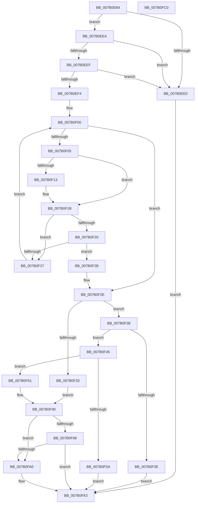

# WdipSemUpdateInflightScenarioTable

- RVA: `0x007B0EB4`–`0x007B0FC1` (길이 `269` bytes)
- VA: `0x00000001407B0EB4`
- 실행 섹션: `PAGE`
- PDB 이름 있음: `예`; PDB Function 태그: `아니요`
- unwind 정보 RVA: `0x0005E6B4`
- 디코드: `82`개 명령, `269/269` bytes 표시
- 미해석 바이트: `0` (있으면 어셈블리에 `.byte`로 보존)

> 이 문서는 커널 이미지의 기계어와 PDB 기호를 분석해 생성했습니다. 4번과 5번은 함수 원형과 자료형을 바이너리 사용 방식에서 추정한 C 해석이며 원본 소스 복구 결과는 아닙니다.

## 1. Dependencies

- 직접 호출 지점: **1**; 고유 호출 대상: **1**
- 직접 호출자로 확인된 함수: **1**
- RIP 상대 이미지 참조: **0**

### Outgoing calls
- `0x007B0F4D` → [WdipSemFastAllocate](../A5/WdipSemFastAllocate_function_00A5DC04.md) (function, `0x00A5DC04`)

### Direct callers
- [WdipSemLogInflightLimitExceededInformation](WdipSemLogInflightLimitExceededInformation_function_007B0B38.md) at `0x007B0BD7`

### Static image references
- 디코드된 RIP-relative 메모리 참조가 없습니다.

## 2. Other-region calls and transfers

- 다른 실행 섹션으로 향하는 call: **0**
- 별도 외부 분기/꼬리 이동을 확인하지 못했습니다.

## 3. Assembly (complete function range)

```asm
007B0EB4  48 8B C4                        mov rax, rsp
007B0EB7  48 89 58 08                     mov qword ptr [rax + 8], rbx
007B0EBB  48 89 68 10                     mov qword ptr [rax + 0x10], rbp
007B0EBF  48 89 70 18                     mov qword ptr [rax + 0x18], rsi
007B0EC3  48 89 78 20                     mov qword ptr [rax + 0x20], rdi
007B0EC7  41 56                           push r14
007B0EC9  48 83 EC 20                     sub rsp, 0x20
007B0ECD  33 DB                           xor ebx, ebx
007B0ECF  49 8B F1                        mov rsi, r9
007B0ED2  49 8B F8                        mov rdi, r8
007B0ED5  0F B7 EA                        movzx ebp, dx
007B0ED8  4C 8B F1                        mov r14, rcx
007B0EDB  48 85 C9                        test rcx, rcx
007B0EDE  75 0A                           jne 0x1407b0eea
007B0EE0  BB 0D 00 00 C0                  mov ebx, 0xc000000d
007B0EE5  E9 B9 00 00 00                  jmp 0x1407b0fa3
007B0EEA  48 85 FF                        test rdi, rdi
007B0EED  74 F1                           je 0x1407b0ee0
007B0EEF  48 85 F6                        test rsi, rsi
007B0EF2  74 EC                           je 0x1407b0ee0
007B0EF4  45 8B 90 E8 03 00 00            mov r10d, dword ptr [r8 + 0x3e8]
007B0EFB  48 8B D3                        mov rdx, rbx
007B0EFE  8B CB                           mov ecx, ebx
007B0F00  41 3B CA                        cmp ecx, r10d
007B0F03  73 29                           jae 0x1407b0f2e
007B0F05  4D 8B 06                        mov r8, qword ptr [r14]
007B0F08  8B C1                           mov eax, ecx
007B0F0A  4C 8B 0C C7                     mov r9, qword ptr [rdi + rax*8]
007B0F0E  4D 2B 01                        sub r8, qword ptr [r9]
007B0F11  75 08                           jne 0x1407b0f1b
007B0F13  4D 8B 46 08                     mov r8, qword ptr [r14 + 8]
007B0F17  4D 2B 41 08                     sub r8, qword ptr [r9 + 8]
007B0F1B  4D 85 C0                        test r8, r8
007B0F1E  75 07                           jne 0x1407b0f27
007B0F20  66 41 3B 69 10                  cmp bp, word ptr [r9 + 0x10]
007B0F25  74 04                           je 0x1407b0f2b
007B0F27  FF C1                           inc ecx
007B0F29  EB D5                           jmp 0x1407b0f00
007B0F2B  49 8B D1                        mov rdx, r9
007B0F2E  48 85 D2                        test rdx, rdx
007B0F31  74 05                           je 0x1407b0f38
007B0F33  FF 42 14                        inc dword ptr [rdx + 0x14]
007B0F36  EB 58                           jmp 0x1407b0f90
007B0F38  41 83 FA 7D                     cmp r10d, 0x7d
007B0F3C  72 07                           jb 0x1407b0f45
007B0F3E  BB 01 00 00 C0                  mov ebx, 0xc0000001
007B0F43  EB 5E                           jmp 0x1407b0fa3
007B0F45  BA 18 00 00 00                  mov edx, 0x18
007B0F4A  8D 4A ED                        lea ecx, [rdx - 0x13]
007B0F4D  E8 B2 CC 2A 00                  call 0x140a5dc04
007B0F52  48 8B D0                        mov rdx, rax
007B0F55  48 85 C0                        test rax, rax
007B0F58  75 07                           jne 0x1407b0f61
007B0F5A  BB 9A 00 00 C0                  mov ebx, 0xc000009a
007B0F5F  EB 42                           jmp 0x1407b0fa3
007B0F61  33 C0                           xor eax, eax
007B0F63  0F 57 C0                        xorps xmm0, xmm0
007B0F66  0F 11 02                        movups xmmword ptr [rdx], xmm0
007B0F69  48 89 42 10                     mov qword ptr [rdx + 0x10], rax
007B0F6D  41 0F 10 06                     movups xmm0, xmmword ptr [r14]
007B0F71  66 89 6A 10                     mov word ptr [rdx + 0x10], bp
007B0F75  C7 42 14 01 00 00 00            mov dword ptr [rdx + 0x14], 1
007B0F7C  F3 0F 7F 02                     movdqu xmmword ptr [rdx], xmm0
007B0F80  8B 87 E8 03 00 00               mov eax, dword ptr [rdi + 0x3e8]
007B0F86  48 89 14 C7                     mov qword ptr [rdi + rax*8], rdx
007B0F8A  FF 87 E8 03 00 00               inc dword ptr [rdi + 0x3e8]
007B0F90  48 8B 0E                        mov rcx, qword ptr [rsi]
007B0F93  48 85 C9                        test rcx, rcx
007B0F96  74 08                           je 0x1407b0fa0
007B0F98  8B 49 14                        mov ecx, dword ptr [rcx + 0x14]
007B0F9B  39 4A 14                        cmp dword ptr [rdx + 0x14], ecx
007B0F9E  76 03                           jbe 0x1407b0fa3
007B0FA0  48 89 16                        mov qword ptr [rsi], rdx
007B0FA3  48 8B 6C 24 38                  mov rbp, qword ptr [rsp + 0x38]
007B0FA8  8B C3                           mov eax, ebx
007B0FAA  48 8B 5C 24 30                  mov rbx, qword ptr [rsp + 0x30]
007B0FAF  48 8B 74 24 40                  mov rsi, qword ptr [rsp + 0x40]
007B0FB4  48 8B 7C 24 48                  mov rdi, qword ptr [rsp + 0x48]
007B0FB9  48 83 C4 20                     add rsp, 0x20
007B0FBD  41 5E                           pop r14
007B0FBF  C3                              ret
007B0FC0  CC                              int3
```

## 4. C-style interpretation (structured pseudocode)

```c
__int64 __fastcall WdipSemUpdateInflightScenarioTable(__int64 a1, unsigned __int16 a2, __int64 a3, __int64 a4)
{
    __int64 result;
    __int64 v_rbx;
    __int64 v_rsp;
    unsigned __int64 v_stack_p10;
    unsigned __int64 v_stack_p18;
    unsigned __int64 v_stack_p20;
    unsigned __int64 v_stack_p8;

    *(unsigned __int64 *)(v_rsp + 8) = v_rbx;
    *(unsigned __int64 *)(v_rsp + 16) = v_rbp;
    *(unsigned __int64 *)(v_rsp + 24) = v_rsi;
    *(unsigned __int64 *)(v_rsp + 32) = v_rdi;
    v_rsp = (v_rsp) - (32);
    v_rbx = 0;
    if (a1 != 0) goto loc_007B0EEA;
loc_007B0EE0:
    goto loc_007B0FA3;
loc_007B0EEA:
    if (a3 == 0) goto loc_007B0EE0;
    if (a4 == 0) goto loc_007B0EE0;
loc_007B0F00:
    if (((unsigned int)((unsigned int)((unsigned int)((unsigned int)(0xC000000DULL))))) >= ((unsigned int)((unsigned int)(*(unsigned int *)(a3 + 1000))))) goto loc_007B0F2E;
    a3 = (*(unsigned __int64 *)(a1)) - (*(unsigned __int64 *)(*(unsigned __int64 *)(a3 + (unsigned int)((unsigned int)((unsigned int)((unsigned int)((unsigned int)(0xC000000DULL))))) * 8)));
    if (!(condition_is_not_equal)) {
        a3 = *(unsigned __int64 *)(a1 + 8);
        a3 = (a3) - (*(unsigned __int64 *)(*(unsigned __int64 *)(a3 + (unsigned int)((unsigned int)((unsigned int)((unsigned int)((unsigned int)(0xC000000DULL))))) * 8) + 8));
    }
    if (a3 != 0) goto loc_007B0F27;
    if (a2 == (*(unsigned __int16 *)(*(unsigned __int64 *)(a3 + (unsigned int)((unsigned int)((unsigned int)((unsigned int)((unsigned int)(0xC000000DULL))))) * 8) + 16))) goto loc_007B0F2B;
loc_007B0F27:
    a1 = (unsigned int)(((unsigned int)((unsigned int)((unsigned int)(0xC000000DULL)))) + 1);
    goto loc_007B0F00;
loc_007B0F2B:
loc_007B0F2E:
    if (*(unsigned __int64 *)(a3 + (unsigned int)((unsigned int)((unsigned int)((unsigned int)((unsigned int)(0xC000000DULL))))) * 8) == 0) goto loc_007B0F38;
    goto loc_007B0F90;
loc_007B0F38:
    if (((unsigned int)((unsigned int)(*(unsigned int *)(a3 + 1000)))) < 125) goto loc_007B0F45;
    goto loc_007B0FA3;
loc_007B0F45:
    result = WdipSemFastAllocate(24 - 19, 24, a3, *(unsigned __int64 *)(a3 + (unsigned int)((unsigned int)((unsigned int)((unsigned int)((unsigned int)(0xC000000DULL))))) * 8));
    if (result != 0) goto loc_007B0F61;
    goto loc_007B0FA3;
loc_007B0F61:
    result = 0;
    *(unsigned __int64 *)(result) = v_xmm0;
    *(unsigned __int64 *)(result + 16) = 0;
    *(unsigned __int16 *)(result + 16) = a2;
    *(unsigned int *)(result + 20) = 1;
    *(unsigned __int64 *)(result) = v_xmm0;
    *(unsigned __int64 *)(a3 + (unsigned int)(*(unsigned int *)(a3 + 1000)) * 8) = 0;
loc_007B0F90:
    if (*(unsigned __int64 *)(a4) == 0) goto loc_007B0FA0;
    if ((*(unsigned int *)(result + 20)) >= = ((unsigned int)((unsigned int)(*(unsigned int *)(*(unsigned __int64 *)(a4) + 20))))) {
        *(unsigned __int64 *)(a4) = 0;
    }
    v_rsp = (v_rsp) + (32);
    return (unsigned int)((unsigned int)((unsigned int)(0xC000009AULL)));
}
```

## 5. (Beta) C Style

```c
int64_t WdipSemUpdateInflightScenarioTable(void *Arg1, uint16_t Arg2, void *Arg3, int64_t Arg4)
{
    uint8_t *arg1 = (uint8_t *)Arg1;
    uint8_t *arg3 = (uint8_t *)Arg3;

    int64_t result;
    int64_t local_rbx;
    int64_t local_rsp;
    uint64_t v_stack_p10;
    uint64_t v_stack_p18;
    uint64_t v_stack_p20;
    uint64_t v_stack_p8;

    *(uint64_t *)(local_rsp + 0x8) = local_rbx;
    *(uint64_t *)(local_rsp + 0x10) = local_rbp;
    *(uint64_t *)(local_rsp + 0x18) = local_rsi;
    *(uint64_t *)(local_rsp + 0x20) = local_rdi;
    local_rsp = (local_rsp) - (32);
    local_rbx = 0;
    if (Arg1 != NULL) goto loc_007B0EEA;
loc_007B0EE0:
    goto loc_007B0FA3;
loc_007B0EEA:
    if (Arg3 == NULL) goto loc_007B0EE0;
    if (Arg4 == 0) goto loc_007B0EE0;
loc_007B0F00:
    if (((uint32_t)((uint32_t)((uint32_t)((uint32_t)(0xC000000DULL))))) >= ((uint32_t)((uint32_t)(*(uint32_t *)(arg3 + 0x3E8))))) goto loc_007B0F2E;
    Arg3 = (*(uint64_t *)(arg1)) - (*(uint64_t *)(*(uint64_t *)(arg3 + (uint32_t)((uint32_t)((uint32_t)((uint32_t)((uint32_t)(0xC000000DULL))))) * 8)));
    if (!(condition_is_not_equal)) {
        Arg3 = *(uint64_t *)(arg1 + 0x8);
        Arg3 = (Arg3) - (*(uint64_t *)(*(uint64_t *)(arg3 + (uint32_t)((uint32_t)((uint32_t)((uint32_t)((uint32_t)(0xC000000DULL))))) * 8) + 0x8));
    }
    if (Arg3 != NULL) goto loc_007B0F27;
    if (Arg2 == (*(uint16_t *)(*(uint64_t *)(arg3 + (uint32_t)((uint32_t)((uint32_t)((uint32_t)((uint32_t)(0xC000000DULL))))) * 8) + 0x10))) goto loc_007B0F2B;
loc_007B0F27:
    Arg1 = (uint32_t)(((uint32_t)((uint32_t)((uint32_t)(0xC000000DULL)))) + 1);
    goto loc_007B0F00;
loc_007B0F2B:
loc_007B0F2E:
    if (*(uint64_t *)(arg3 + (uint32_t)((uint32_t)((uint32_t)((uint32_t)((uint32_t)(0xC000000DULL))))) * 8) == 0) goto loc_007B0F38;
    goto loc_007B0F90;
loc_007B0F38:
    if (((uint32_t)((uint32_t)(*(uint32_t *)(arg3 + 0x3E8)))) < 125) goto loc_007B0F45;
    goto loc_007B0FA3;
loc_007B0F45:
    result = WdipSemFastAllocate(24 - 19, 24, Arg3, *(uint64_t *)(arg3 + (uint32_t)((uint32_t)((uint32_t)((uint32_t)((uint32_t)(0xC000000DULL))))) * 8));
    if (result != 0) goto loc_007B0F61;
    goto loc_007B0FA3;
loc_007B0F61:
    result = 0;
    *(uint64_t *)(result) = v_xmm0;
    *(uint64_t *)(result + 0x10) = 0;
    *(uint16_t *)(result + 0x10) = Arg2;
    *(uint32_t *)(result + 0x14) = 1;
    *(uint64_t *)(result) = v_xmm0;
    *(uint64_t *)(arg3 + (uint32_t)(*(uint32_t *)(arg3 + 0x3E8)) * 8) = 0;
loc_007B0F90:
    if (*(uint64_t *)(Arg4) == 0) goto loc_007B0FA0;
    if ((*(uint32_t *)(result + 0x14)) >= = ((uint32_t)((uint32_t)(*(uint32_t *)(*(uint64_t *)(Arg4) + 0x14))))) {
        *(uint64_t *)(Arg4) = 0;
    }
    local_rsp = (local_rsp) + (32);
    return (uint32_t)((uint32_t)((uint32_t)(0xC000009AULL)));
}
```

### 관측된 메모리 오프셋

구조체 형식이 확인되지 않은 접근은 인자 기준의 오프셋으로만 기록했습니다.

| 기준 인자 | 오프셋 표현 | 폭 (bit) | 접근 |
|---|---:|---:|---|
| `Arg1` | `+ 0x0` | `64` | `R` |
| `Arg1` | `+ 0x0` | `128` | `R` |
| `Arg1` | `+ 0x8` | `64` | `R` |
| `Arg3` | `+ 0x3E8` | `32` | `R` |

## 6. Execution-region graph

[열기: 2D/3D 그래프와 함수 탐색 컨트롤 패널](../../../control-panel.html?section=page&rva=0x007B0EB4&view=graph)

- 2D 그래프는 위에서 아래로 흐르고, 3D 그래프는 빈 공간을 드래그해 회전합니다. Shift+드래그는 이동, 휠은 확대·축소, 함수 노드 선택은 대상 보고서 이동입니다.

### Static fallback


