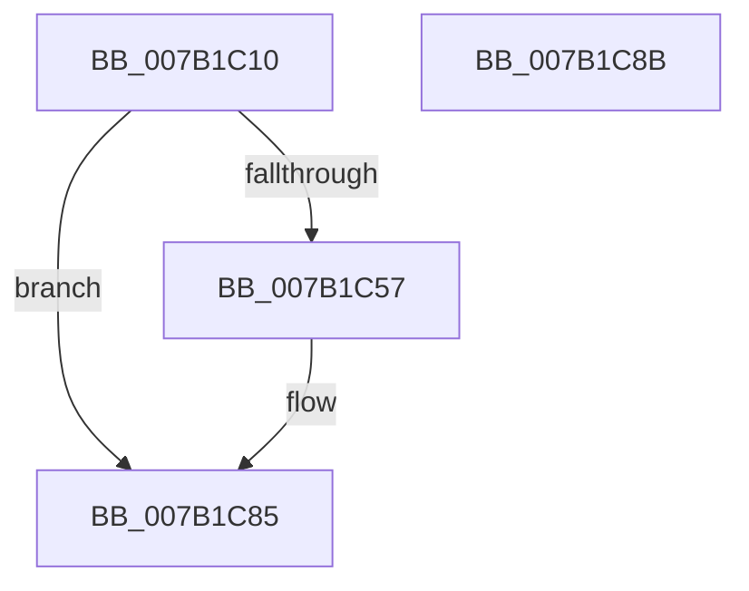

# WdipSemUpdateProviderEntryForEvent

- RVA: `0x007B1C10`–`0x007B1C8C` (길이 `124` bytes)
- VA: `0x00000001407B1C10`
- 실행 섹션: `PAGE`
- PDB 이름 있음: `예`; PDB Function 태그: `아니요`
- unwind 정보 RVA: `0x00071750`
- 디코드: `34`개 명령, `124/124` bytes 표시
- 미해석 바이트: `0` (있으면 어셈블리에 `.byte`로 보존)

> 이 문서는 커널 이미지의 기계어와 PDB 기호를 분석해 생성했습니다. 4번과 5번은 함수 원형과 자료형을 바이너리 사용 방식에서 추정한 C 해석이며 원본 소스 복구 결과는 아닙니다.

## 1. Dependencies

- 직접 호출 지점: **0**; 고유 호출 대상: **0**
- 직접 호출자로 확인된 함수: **1**
- RIP 상대 이미지 참조: **0**

### Outgoing calls
- 직접 디코드된 call 명령이 없습니다.

### Direct callers
- [WdipSemLoadScenarioTable](WdipSemLoadScenarioTable_function_007B02D8.md) at `0x007B0711`
- [WdipSemLoadScenarioTable](WdipSemLoadScenarioTable_function_007B02D8.md) at `0x007B072A`

### Static image references
- 디코드된 RIP-relative 메모리 참조가 없습니다.

## 2. Other-region calls and transfers

- 다른 실행 섹션으로 향하는 call: **0**
- 별도 외부 분기/꼬리 이동을 확인하지 못했습니다.

## 3. Assembly (complete function range)

```asm
007B1C10  48 89 5C 24 08                  mov qword ptr [rsp + 8], rbx
007B1C15  4C 8B 59 28                     mov r11, qword ptr [rcx + 0x28]
007B1C19  44 8A D2                        mov r10b, dl
007B1C1C  44 0F B6 41 12                  movzx r8d, byte ptr [rcx + 0x12]
007B1C21  48 8B D9                        mov rbx, rcx
007B1C24  8B 41 24                        mov eax, dword ptr [rcx + 0x24]
007B1C27  41 0F B6 53 10                  movzx edx, byte ptr [r11 + 0x10]
007B1C2C  4D 8B 4B 18                     mov r9, qword ptr [r11 + 0x18]
007B1C30  4C 0B 49 18                     or r9, qword ptr [rcx + 0x18]
007B1C34  41 09 43 20                     or dword ptr [r11 + 0x20], eax
007B1C38  41 8B C0                        mov eax, r8d
007B1C3B  41 FF 43 28                     inc dword ptr [r11 + 0x28]
007B1C3F  44 3A C2                        cmp r8b, dl
007B1C42  4D 89 4B 18                     mov qword ptr [r11 + 0x18], r9
007B1C46  0F 46 C2                        cmovbe eax, edx
007B1C49  41 80 4B 24 01                  or byte ptr [r11 + 0x24], 1
007B1C4E  41 88 43 10                     mov byte ptr [r11 + 0x10], al
007B1C52  45 84 D2                        test r10b, r10b
007B1C55  74 2E                           je 0x1407b1c85
007B1C57  0F B6 51 12                     movzx edx, byte ptr [rcx + 0x12]
007B1C5B  48 8B 43 18                     mov rax, qword ptr [rbx + 0x18]
007B1C5F  45 0F B6 43 30                  movzx r8d, byte ptr [r11 + 0x30]
007B1C64  41 8B 4B 40                     mov ecx, dword ptr [r11 + 0x40]
007B1C68  0B 4B 24                        or ecx, dword ptr [rbx + 0x24]
007B1C6B  49 09 43 38                     or qword ptr [r11 + 0x38], rax
007B1C6F  8B C2                           mov eax, edx
007B1C71  41 3A D0                        cmp dl, r8b
007B1C74  41 89 4B 40                     mov dword ptr [r11 + 0x40], ecx
007B1C78  41 0F 46 C0                     cmovbe eax, r8d
007B1C7C  41 80 4B 44 01                  or byte ptr [r11 + 0x44], 1
007B1C81  41 88 43 30                     mov byte ptr [r11 + 0x30], al
007B1C85  48 8B 5C 24 08                  mov rbx, qword ptr [rsp + 8]
007B1C8A  C3                              ret
007B1C8B  CC                              int3
```

## 4. C-style interpretation (structured pseudocode)

```c
__int64 __fastcall WdipSemUpdateProviderEntryForEvent(__int64 a1, unsigned __int8 a2)
{
    __int64 result;
    unsigned __int64 v_stack_p8;

    v_stack_p8 = v_rbx;
    a4 = (*(unsigned __int64 *)(*(unsigned __int64 *)(a1 + 40) + 24)) | (*(unsigned __int64 *)(a1 + 24));
    *(unsigned __int64 *)(*(unsigned __int64 *)(a1 + 40) + 24) = a4;
    result = (unsigned int)((unsigned int)(*(unsigned __int8 *)(a1 + 18)));
    if (((unsigned __int8)(*(unsigned __int8 *)(a1 + 18))) <= ((unsigned __int8)(*(unsigned __int8 *)(*(unsigned __int64 *)(a1 + 40) + 16)))) { result = (unsigned int)(*(unsigned __int8 *)(*(unsigned __int64 *)(a1 + 40) + 16)); }
    *(unsigned __int8 *)(*(unsigned __int64 *)(a1 + 40) + 16) = (unsigned __int8)(result);
    if (a2 != 0) {
        a2 = *(unsigned __int8 *)(a1 + 18);
        result = *(unsigned __int64 *)(a1 + 24);
        a3 = *(unsigned __int8 *)(*(unsigned __int64 *)(a1 + 40) + 48);
        a1 = *(unsigned int *)(*(unsigned __int64 *)(a1 + 40) + 64);
        a1 = (unsigned int)((a1) | (*(unsigned int *)(a1 + 36)));
        result = a2;
        *(unsigned int *)(*(unsigned __int64 *)(a1 + 40) + 64) = (unsigned int)(a1);
        if (a2 <= ((unsigned __int8)(a3))) { result = (unsigned int)(a3); }
        *(unsigned __int8 *)(*(unsigned __int64 *)(a1 + 40) + 48) = (unsigned __int8)(result);
    }
    return result;
}
```

## 5. (Beta) C Style

```c
int64_t WdipSemUpdateProviderEntryForEvent(void *Arg1, uint8_t Arg2)
{
    uint8_t *arg1 = (uint8_t *)Arg1;

    int64_t result;
    uint64_t v_stack_p8;

    v_stack_p8 = local_rbx;
    a4 = (*(uint64_t *)(*(uint64_t *)(arg1 + 0x28) + 0x18)) | (*(uint64_t *)(arg1 + 0x18));
    *(uint64_t *)(*(uint64_t *)(arg1 + 0x28) + 0x18) = a4;
    result = (uint32_t)((uint32_t)(*(uint8_t *)(arg1 + 0x12)));
    if (((uint8_t)(*(uint8_t *)(arg1 + 0x12))) <= ((uint8_t)(*(uint8_t *)(*(uint64_t *)(arg1 + 0x28) + 0x10)))) { result = (uint32_t)(*(uint8_t *)(*(uint64_t *)(arg1 + 0x28) + 0x10)); }
    *(uint8_t *)(*(uint64_t *)(arg1 + 0x28) + 0x10) = (uint8_t)(result);
    if (Arg2 != 0) {
        Arg2 = *(uint8_t *)(arg1 + 0x12);
        result = *(uint64_t *)(arg1 + 0x18);
        a3 = *(uint8_t *)(*(uint64_t *)(arg1 + 0x28) + 0x30);
        Arg1 = *(uint32_t *)(*(uint64_t *)(arg1 + 0x28) + 0x40);
        Arg1 = (uint32_t)((Arg1) | (*(uint32_t *)(arg1 + 0x24)));
        result = Arg2;
        *(uint32_t *)(*(uint64_t *)(arg1 + 0x28) + 0x40) = (uint32_t)(Arg1);
        if (Arg2 <= ((uint8_t)(a3))) { result = (uint32_t)(a3); }
        *(uint8_t *)(*(uint64_t *)(arg1 + 0x28) + 0x30) = (uint8_t)(result);
    }
    return result;
}
```

### 관측된 메모리 오프셋

구조체 형식이 확인되지 않은 접근은 인자 기준의 오프셋으로만 기록했습니다.

| 기준 인자 | 오프셋 표현 | 폭 (bit) | 접근 |
|---|---:|---:|---|
| `Arg1` | `+ 0x12` | `8` | `R` |
| `Arg1` | `+ 0x18` | `64` | `R` |
| `Arg1` | `+ 0x24` | `32` | `R` |
| `Arg1` | `+ 0x28` | `64` | `R` |

## 6. Execution-region graph

[열기: 2D/3D 그래프와 함수 탐색 컨트롤 패널](../../../control-panel.html?section=page&rva=0x007B1C10&view=graph)

- 2D 그래프는 위에서 아래로 흐르고, 3D 그래프는 빈 공간을 드래그해 회전합니다. Shift+드래그는 이동, 휠은 확대·축소, 함수 노드 선택은 대상 보고서 이동입니다.

### Static fallback


