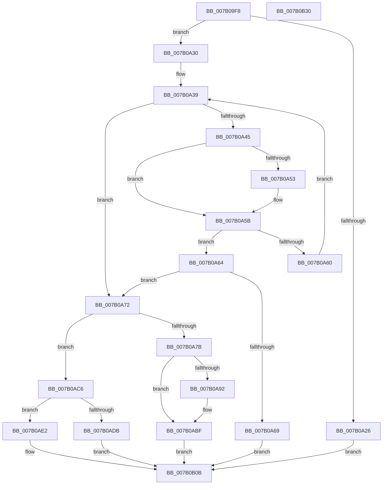

# WdipSemUpdateProviderTableWithEvent

- RVA: `0x007B09F8`–`0x007B0B31` (길이 `313` bytes)
- VA: `0x00000001407B09F8`
- 실행 섹션: `PAGE`
- PDB 이름 있음: `예`; PDB Function 태그: `아니요`
- unwind 정보 RVA: `0x000D2FAC`
- 디코드: `80`개 명령, `313/313` bytes 표시
- 미해석 바이트: `0` (있으면 어셈블리에 `.byte`로 보존)

> 이 문서는 커널 이미지의 기계어와 PDB 기호를 분석해 생성했습니다. 4번과 5번은 함수 원형과 자료형을 바이너리 사용 방식에서 추정한 C 해석이며 원본 소스 복구 결과는 아닙니다.

## 1. Dependencies

- 직접 호출 지점: **5**; 고유 호출 대상: **5**
- 직접 호출자로 확인된 함수: **1**
- RIP 상대 이미지 참조: **6**

### Outgoing calls
- `0x007B0A89` → [EtwEventEnabled](../../text/39/EtwEventEnabled_function_00392450.md) (function, `0x00392450`)
- `0x007B0ABA` → [WdipSemWriteEvent](../A9/WdipSemWriteEvent_function_00A9B6D4.md) (function, `0x00A9B6D4`)
- `0x007B0ACE` → [WdipSemFastAllocate](../A5/WdipSemFastAllocate_function_00A5DC04.md) (function, `0x00A5DC04`)
- `0x007B0AEB` → [memset](../../text/6C/memset_function_006C6C40.md) (function, `0x006C6C40`)
- `0x007B0B15` → [_security_check_cookie](../../text/6A/_security_check_cookie_function_006AC640.md) (function, `0x006AC640`)

### Direct callers
- [WdipSemLoadScenarioTable](WdipSemLoadScenarioTable_function_007B02D8.md) at `0x007B06A0`
- [WdipSemLoadScenarioTable](WdipSemLoadScenarioTable_function_007B02D8.md) at `0x007B06B5`
- [WdipSemLoadScenarioTable](WdipSemLoadScenarioTable_function_007B02D8.md) at `0x007B06D3`

### Static image references
- `0x007B0A0D` → RVA `0x00E0A740` (`.data`; read)
- `0x007B0A32` → RVA `0x00EFFDC0` (`.data`; read)
- `0x007B0A39` → RVA `0x00F01DC0` (`.data`; read)
- `0x007B0A7B` → RVA `0x00F01DD0` (`.data`; read)
- `0x007B0A82` → RVA `0x00020D90` (`.rdata`; read)
- `0x007B0B01` → RVA `0x00F01DC0` (`.data`; read/write)

## 2. Other-region calls and transfers

- 다른 실행 섹션으로 향하는 call: **3**
  - `0x007B0A89` → [EtwEventEnabled](../../text/39/EtwEventEnabled_function_00392450.md) (`PAGE` → `.text`)
  - `0x007B0AEB` → [memset](../../text/6C/memset_function_006C6C40.md) (`PAGE` → `.text`)
  - `0x007B0B15` → [_security_check_cookie](../../text/6A/_security_check_cookie_function_006AC640.md) (`PAGE` → `.text`)
- 별도 외부 분기/꼬리 이동을 확인하지 못했습니다.

## 3. Assembly (complete function range)

```asm
007B09F8  48 89 5C 24 10                  mov qword ptr [rsp + 0x10], rbx
007B09FD  48 89 74 24 18                  mov qword ptr [rsp + 0x18], rsi
007B0A02  48 89 7C 24 20                  mov qword ptr [rsp + 0x20], rdi
007B0A07  41 56                           push r14
007B0A09  48 83 EC 50                     sub rsp, 0x50
007B0A0D  48 8B 05 2C 9D 65 00            mov rax, qword ptr [rip + 0x659d2c]
007B0A14  48 33 C4                        xor rax, rsp
007B0A17  48 89 44 24 40                  mov qword ptr [rsp + 0x40], rax
007B0A1C  33 DB                           xor ebx, ebx
007B0A1E  48 8B F9                        mov rdi, rcx
007B0A21  48 85 C9                        test rcx, rcx
007B0A24  75 0A                           jne 0x1407b0a30
007B0A26  BB 0D 00 00 C0                  mov ebx, 0xc000000d
007B0A2B  E9 DB 00 00 00                  jmp 0x1407b0b0b
007B0A30  8B CB                           mov ecx, ebx
007B0A32  4C 8D 35 87 F3 74 00            lea r14, [rip + 0x74f387]
007B0A39  44 8B 0D 80 13 75 00            mov r9d, dword ptr [rip + 0x751380]
007B0A40  41 3B C9                        cmp ecx, r9d
007B0A43  73 2D                           jae 0x1407b0a72
007B0A45  48 8B 17                        mov rdx, qword ptr [rdi]
007B0A48  8B C1                           mov eax, ecx
007B0A4A  4D 8B 04 C6                     mov r8, qword ptr [r14 + rax*8]
007B0A4E  49 2B 10                        sub rdx, qword ptr [r8]
007B0A51  75 08                           jne 0x1407b0a5b
007B0A53  48 8B 57 08                     mov rdx, qword ptr [rdi + 8]
007B0A57  49 2B 50 08                     sub rdx, qword ptr [r8 + 8]
007B0A5B  48 85 D2                        test rdx, rdx
007B0A5E  74 04                           je 0x1407b0a64
007B0A60  FF C1                           inc ecx
007B0A62  EB D5                           jmp 0x1407b0a39
007B0A64  4D 85 C0                        test r8, r8
007B0A67  74 09                           je 0x1407b0a72
007B0A69  4C 89 47 28                     mov qword ptr [rdi + 0x28], r8
007B0A6D  E9 99 00 00 00                  jmp 0x1407b0b0b
007B0A72  41 81 F9 00 04 00 00            cmp r9d, 0x400
007B0A79  72 4B                           jb 0x1407b0ac6
007B0A7B  48 8B 0D 4E 13 75 00            mov rcx, qword ptr [rip + 0x75134e]
007B0A82  48 8D 15 07 03 87 FF            lea rdx, [rip - 0x78fcf9]
007B0A89  E8 C2 19 BE FF                  call 0x140392450
007B0A8E  84 C0                           test al, al
007B0A90  74 2D                           je 0x1407b0abf
007B0A92  48 8D 44 24 30                  lea rax, [rsp + 0x30]
007B0A97  48 89 7C 24 30                  mov qword ptr [rsp + 0x30], rdi
007B0A9C  41 B9 01 00 00 00               mov r9d, 1
007B0AA2  48 89 44 24 20                  mov qword ptr [rsp + 0x20], rax
007B0AA7  45 33 C0                        xor r8d, r8d
007B0AAA  48 C7 44 24 38 10 00 00 00      mov qword ptr [rsp + 0x38], 0x10
007B0AB3  48 8D 15 D6 02 87 FF            lea rdx, [rip - 0x78fd2a]
007B0ABA  E8 15 AC 2E 00                  call 0x140a9b6d4
007B0ABF  BB 01 00 00 C0                  mov ebx, 0xc0000001
007B0AC4  EB 45                           jmp 0x1407b0b0b
007B0AC6  BA 50 00 00 00                  mov edx, 0x50
007B0ACB  8D 4A B2                        lea ecx, [rdx - 0x4e]
007B0ACE  E8 31 D1 2A 00                  call 0x140a5dc04
007B0AD3  48 8B F0                        mov rsi, rax
007B0AD6  48 85 C0                        test rax, rax
007B0AD9  75 07                           jne 0x1407b0ae2
007B0ADB  BB 9A 00 00 C0                  mov ebx, 0xc000009a
007B0AE0  EB 29                           jmp 0x1407b0b0b
007B0AE2  33 D2                           xor edx, edx
007B0AE4  48 8B CE                        mov rcx, rsi
007B0AE7  44 8D 42 50                     lea r8d, [rdx + 0x50]
007B0AEB  E8 50 61 F1 FF                  call 0x1406c6c40
007B0AF0  0F 10 07                        movups xmm0, xmmword ptr [rdi]
007B0AF3  F3 0F 7F 06                     movdqu xmmword ptr [rsi], xmm0
007B0AF7  8B 0D C3 12 75 00               mov ecx, dword ptr [rip + 0x7512c3]
007B0AFD  49 89 34 CE                     mov qword ptr [r14 + rcx*8], rsi
007B0B01  FF 05 B9 12 75 00               inc dword ptr [rip + 0x7512b9]
007B0B07  48 89 77 28                     mov qword ptr [rdi + 0x28], rsi
007B0B0B  8B C3                           mov eax, ebx
007B0B0D  48 8B 4C 24 40                  mov rcx, qword ptr [rsp + 0x40]
007B0B12  48 33 CC                        xor rcx, rsp
007B0B15  E8 26 BB EF FF                  call 0x1406ac640
007B0B1A  48 8B 5C 24 68                  mov rbx, qword ptr [rsp + 0x68]
007B0B1F  48 8B 74 24 70                  mov rsi, qword ptr [rsp + 0x70]
007B0B24  48 8B 7C 24 78                  mov rdi, qword ptr [rsp + 0x78]
007B0B29  48 83 C4 50                     add rsp, 0x50
007B0B2D  41 5E                           pop r14
007B0B2F  C3                              ret
007B0B30  CC                              int3
```

## 4. C-style interpretation (structured pseudocode)

```c
__int64 __fastcall WdipSemUpdateProviderTableWithEvent(__int64 a1)
{
    __int64 result;
    __int64 v_rbx;
    __int64 v_rsp;
    unsigned __int64 v_stack_m18;
    unsigned __int64 v_stack_m20;
    unsigned __int64 v_stack_m28;
    unsigned __int64 v_stack_m38;
    unsigned __int64 v_stack_p10;
    unsigned __int64 v_stack_p18;
    unsigned __int64 v_stack_p20;

    v_stack_p10 = v_rbx;
    v_stack_p18 = v_rsi;
    v_stack_p20 = v_rdi;
    v_rsp = (v_rsp) - (80);
    result = (*(unsigned __int64 *)(v_rip + 6659372)) ^ (v_rsp);
    v_stack_m18 = result;
    v_rbx = 0;
    if (a1 != 0) goto loc_007B0A30;
    goto loc_007B0B0B;
loc_007B0A30:
loc_007B0A39:
    if (((unsigned int)((unsigned int)((unsigned int)((unsigned int)(0xC000000DULL))))) >= ((unsigned int)((unsigned int)(*(unsigned int *)(v_rip + 7672704))))) goto loc_007B0A72;
    a2 = (*(unsigned __int64 *)(a1)) - (*(unsigned __int64 *)(*(unsigned __int64 *)(v_rip + 7664519 + (unsigned int)((unsigned int)((unsigned int)((unsigned int)((unsigned int)(0xC000000DULL))))) * 8)));
    if (!(condition_is_not_equal)) {
        a2 = *(unsigned __int64 *)(a1 + 8);
        a2 = (a2) - (*(unsigned __int64 *)(*(unsigned __int64 *)(v_rip + 7664519 + (unsigned int)((unsigned int)((unsigned int)((unsigned int)((unsigned int)(0xC000000DULL))))) * 8) + 8));
    }
    if (a2 == 0) goto loc_007B0A64;
    a1 = (unsigned int)(((unsigned int)((unsigned int)((unsigned int)(0xC000000DULL)))) + 1);
    goto loc_007B0A39;
loc_007B0A64:
    if (*(unsigned __int64 *)(v_rip + 7664519 + (unsigned int)((unsigned int)((unsigned int)((unsigned int)((unsigned int)(0xC000000DULL))))) * 8) == 0) goto loc_007B0A72;
    *(unsigned __int64 *)(a1 + 40) = *(unsigned __int64 *)(v_rip + 7664519 + (unsigned int)((unsigned int)((unsigned int)((unsigned int)((unsigned int)(0xC000000DULL))))) * 8);
    goto loc_007B0B0B;
loc_007B0A72:
    if (((unsigned int)((unsigned int)(*(unsigned int *)(v_rip + 7672704)))) < 0x400ULL) goto loc_007B0AC6;
    result = EtwEventEnabled(*(unsigned __int64 *)(v_rip + 7672654), v_rip - 7929081, *(unsigned __int64 *)(v_rip + 7664519 + (unsigned int)((unsigned int)((unsigned int)((unsigned int)((unsigned int)(0xC000000DULL))))) * 8), (unsigned int)(*(unsigned int *)(v_rip + 7672704)));
    if ((unsigned __int8)(result) != 0) {
        result = v_stack_m28;
        v_stack_m28 = a1;
        a4 = 1;
        v_stack_m38 = result;
        a3 = 0;
        v_stack_m20 = 16;
        a2 = v_rip - 7929130;
        result = WdipSemWriteEvent(*(unsigned __int64 *)(v_rip + 7672654), a2, a3, a4);
    }
    goto loc_007B0B0B;
loc_007B0AC6:
    result = WdipSemFastAllocate(80 - 78, 80, a3, a4);
    if (result != 0) goto loc_007B0AE2;
    goto loc_007B0B0B;
loc_007B0AE2:
    a2 = 0;
    result = memset(result, a2, a2 + 80, a4);
    *(unsigned __int64 *)(result) = v_xmm0;
    *(unsigned __int64 *)(v_rip + 7664519 + (unsigned int)(*(unsigned int *)(v_rip + 7672515)) * 8) = result;
    *(unsigned __int64 *)(a1 + 40) = result;
loc_007B0B0B:
    a1 = (v_stack_m18) ^ (v_rsp);
    result = _security_check_cookie(a1, a2, a2 + 80, a4);
    v_rsp = (v_rsp) + (80);
    return result;
}
```

## 5. (Beta) C Style

```c
int64_t WdipSemUpdateProviderTableWithEvent(void *Arg1)
{
    uint8_t *arg1 = (uint8_t *)Arg1;

    int64_t result;
    int64_t local_rbx;
    int64_t local_rsp;
    uint64_t v_stack_m18;
    uint64_t v_stack_m20;
    uint64_t v_stack_m28;
    uint64_t v_stack_m38;
    uint64_t v_stack_p10;
    uint64_t v_stack_p18;
    uint64_t v_stack_p20;

    v_stack_p10 = local_rbx;
    v_stack_p18 = local_rsi;
    v_stack_p20 = local_rdi;
    local_rsp = (local_rsp) - (80);
    result = (*(uint64_t *)(v_rip + 0x659D2C)) ^ (local_rsp);
    v_stack_m18 = result;
    local_rbx = 0;
    if (Arg1 != NULL) goto loc_007B0A30;
    goto loc_007B0B0B;
loc_007B0A30:
loc_007B0A39:
    if (((uint32_t)((uint32_t)((uint32_t)((uint32_t)(0xC000000DULL))))) >= ((uint32_t)((uint32_t)(*(uint32_t *)(v_rip + 0x751380))))) goto loc_007B0A72;
    a2 = (*(uint64_t *)(arg1)) - (*(uint64_t *)(*(uint64_t *)(v_rip + 0x74F387 + (uint32_t)((uint32_t)((uint32_t)((uint32_t)((uint32_t)(0xC000000DULL))))) * 8)));
    if (!(condition_is_not_equal)) {
        a2 = *(uint64_t *)(arg1 + 0x8);
        a2 = (a2) - (*(uint64_t *)(*(uint64_t *)(v_rip + 0x74F387 + (uint32_t)((uint32_t)((uint32_t)((uint32_t)((uint32_t)(0xC000000DULL))))) * 8) + 0x8));
    }
    if (a2 == 0) goto loc_007B0A64;
    Arg1 = (uint32_t)(((uint32_t)((uint32_t)((uint32_t)(0xC000000DULL)))) + 1);
    goto loc_007B0A39;
loc_007B0A64:
    if (*(uint64_t *)(v_rip + 0x74F387 + (uint32_t)((uint32_t)((uint32_t)((uint32_t)((uint32_t)(0xC000000DULL))))) * 8) == 0) goto loc_007B0A72;
    *(uint64_t *)(arg1 + 0x28) = *(uint64_t *)(v_rip + 0x74F387 + (uint32_t)((uint32_t)((uint32_t)((uint32_t)((uint32_t)(0xC000000DULL))))) * 8);
    goto loc_007B0B0B;
loc_007B0A72:
    if (((uint32_t)((uint32_t)(*(uint32_t *)(v_rip + 0x751380)))) < 0x400ULL) goto loc_007B0AC6;
    result = EtwEventEnabled(*(uint64_t *)(v_rip + 0x75134E), v_rip - 7929081, *(uint64_t *)(v_rip + 0x74F387 + (uint32_t)((uint32_t)((uint32_t)((uint32_t)((uint32_t)(0xC000000DULL))))) * 8), (uint32_t)(*(uint32_t *)(v_rip + 0x751380)));
    if ((uint8_t)(result) != 0) {
        result = v_stack_m28;
        v_stack_m28 = Arg1;
        a4 = 1;
        v_stack_m38 = result;
        a3 = 0;
        v_stack_m20 = 16;
        a2 = v_rip - 7929130;
        result = WdipSemWriteEvent(*(uint64_t *)(v_rip + 0x75134E), a2, a3, a4);
    }
    goto loc_007B0B0B;
loc_007B0AC6:
    result = WdipSemFastAllocate(80 - 78, 80, a3, a4);
    if (result != 0) goto loc_007B0AE2;
    goto loc_007B0B0B;
loc_007B0AE2:
    a2 = 0;
    result = memset(result, a2, a2 + 80, a4);
    *(uint64_t *)(result) = v_xmm0;
    *(uint64_t *)(v_rip + 0x74F387 + (uint32_t)(*(uint32_t *)(v_rip + 0x7512C3)) * 8) = result;
    *(uint64_t *)(arg1 + 0x28) = result;
loc_007B0B0B:
    Arg1 = (v_stack_m18) ^ (local_rsp);
    result = _security_check_cookie(Arg1, a2, a2 + 80, a4);
    local_rsp = (local_rsp) + (80);
    return result;
}
```

### 관측된 메모리 오프셋

구조체 형식이 확인되지 않은 접근은 인자 기준의 오프셋으로만 기록했습니다.

| 기준 인자 | 오프셋 표현 | 폭 (bit) | 접근 |
|---|---:|---:|---|
| `Arg1` | `+ 0x0` | `64` | `R` |
| `Arg1` | `+ 0x0` | `128` | `R` |
| `Arg1` | `+ 0x8` | `64` | `R` |
| `Arg1` | `+ 0x28` | `64` | `W` |

## 6. Execution-region graph

[열기: 2D/3D 그래프와 함수 탐색 컨트롤 패널](../../../control-panel.html?section=page&rva=0x007B09F8&view=graph)

- 2D 그래프는 위에서 아래로 흐르고, 3D 그래프는 빈 공간을 드래그해 회전합니다. Shift+드래그는 이동, 휠은 확대·축소, 함수 노드 선택은 대상 보고서 이동입니다.

### Static fallback


