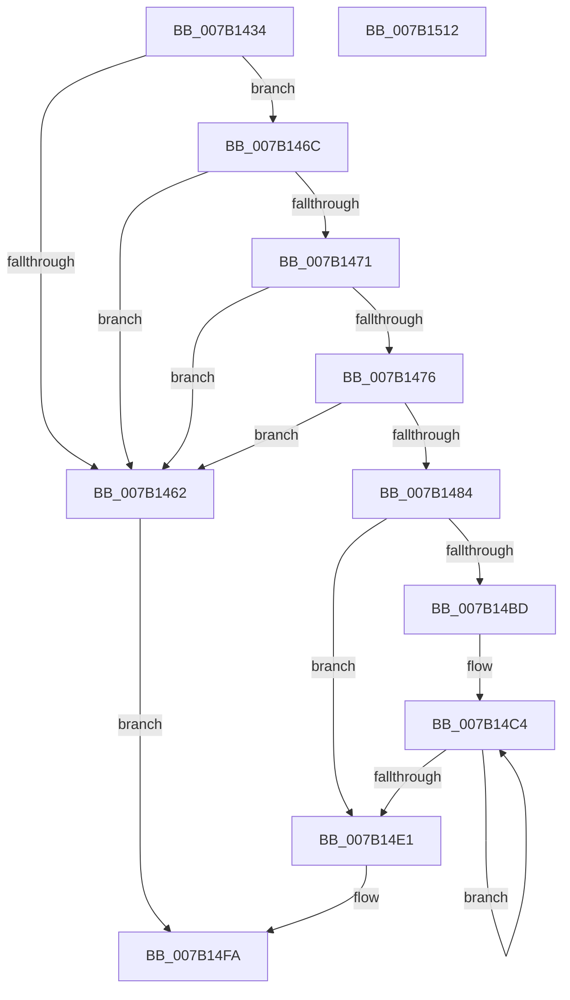

# WdipSemWriteInflightLimitExceededEvent

- RVA: `0x007B1434`–`0x007B1513` (길이 `223` bytes)
- VA: `0x00000001407B1434`
- 실행 섹션: `PAGE`
- PDB 이름 있음: `예`; PDB Function 태그: `아니요`
- unwind 정보 RVA: `0x000D3098`
- 디코드: `51`개 명령, `223/223` bytes 표시
- 미해석 바이트: `0` (있으면 어셈블리에 `.byte`로 보존)

> 이 문서는 커널 이미지의 기계어와 PDB 기호를 분석해 생성했습니다. 4번과 5번은 함수 원형과 자료형을 바이너리 사용 방식에서 추정한 C 해석이며 원본 소스 복구 결과는 아닙니다.

## 1. Dependencies

- 직접 호출 지점: **2**; 고유 호출 대상: **2**
- 직접 호출자로 확인된 함수: **1**
- RIP 상대 이미지 참조: **2**

### Outgoing calls
- `0x007B14F5` → [WdipSemWriteEvent](../A9/WdipSemWriteEvent_function_00A9B6D4.md) (function, `0x00A9B6D4`)
- `0x007B1504` → [_security_check_cookie](../../text/6A/_security_check_cookie_function_006AC640.md) (function, `0x006AC640`)

### Direct callers
- [WdipSemLogInflightLimitExceededInformation](WdipSemLogInflightLimitExceededInformation_function_007B0B38.md) at `0x007B0C1E`

### Static image references
- `0x007B1449` → RVA `0x00E0A740` (`.data`; read)
- `0x007B14E9` → RVA `0x00021790` (`.rdata`; read)

## 2. Other-region calls and transfers

- 다른 실행 섹션으로 향하는 call: **1**
  - `0x007B1504` → [_security_check_cookie](../../text/6A/_security_check_cookie_function_006AC640.md) (`PAGE` → `.text`)
- 별도 외부 분기/꼬리 이동을 확인하지 못했습니다.

## 3. Assembly (complete function range)

```asm
007B1434  66 89 54 24 10                  mov word ptr [rsp + 0x10], dx
007B1439  55                              push rbp
007B143A  48 8D AC 24 C0 F8 FF FF         lea rbp, [rsp - 0x740]
007B1442  48 81 EC 40 08 00 00            sub rsp, 0x840
007B1449  48 8B 05 F0 92 65 00            mov rax, qword ptr [rip + 0x6592f0]
007B1450  48 33 C4                        xor rax, rsp
007B1453  48 89 85 30 07 00 00            mov qword ptr [rbp + 0x730], rax
007B145A  48 8B D1                        mov rdx, rcx
007B145D  48 85 C9                        test rcx, rcx
007B1460  75 0A                           jne 0x1407b146c
007B1462  B8 0D 00 00 C0                  mov eax, 0xc000000d
007B1467  E9 8E 00 00 00                  jmp 0x1407b14fa
007B146C  4D 85 C0                        test r8, r8
007B146F  74 F1                           je 0x1407b1462
007B1471  4D 85 C9                        test r9, r9
007B1474  74 EC                           je 0x1407b1462
007B1476  49 8D 89 E8 03 00 00            lea rcx, [r9 + 0x3e8]
007B147D  8B 01                           mov eax, dword ptr [rcx]
007B147F  83 F8 7D                        cmp eax, 0x7d
007B1482  77 DE                           ja 0x1407b1462
007B1484  48 89 54 24 30                  mov qword ptr [rsp + 0x30], rdx
007B1489  48 8D 95 58 07 00 00            lea rdx, [rbp + 0x758]
007B1490  48 89 54 24 40                  mov qword ptr [rsp + 0x40], rdx
007B1495  44 8D 50 03                     lea r10d, [rax + 3]
007B1499  48 C7 44 24 38 10 00 00 00      mov qword ptr [rsp + 0x38], 0x10
007B14A2  48 C7 44 24 48 02 00 00 00      mov qword ptr [rsp + 0x48], 2
007B14AB  48 89 4C 24 50                  mov qword ptr [rsp + 0x50], rcx
007B14B0  48 C7 44 24 58 04 00 00 00      mov qword ptr [rsp + 0x58], 4
007B14B9  85 C0                           test eax, eax
007B14BB  74 24                           je 0x1407b14e1
007B14BD  48 8D 4C 24 6C                  lea rcx, [rsp + 0x6c]
007B14C2  8B D0                           mov edx, eax
007B14C4  49 8B 01                        mov rax, qword ptr [r9]
007B14C7  4D 8D 49 08                     lea r9, [r9 + 8]
007B14CB  48 89 41 F4                     mov qword ptr [rcx - 0xc], rax
007B14CF  48 C7 41 FC 18 00 00 00         mov qword ptr [rcx - 4], 0x18
007B14D7  48 8D 49 10                     lea rcx, [rcx + 0x10]
007B14DB  48 83 EA 01                     sub rdx, 1
007B14DF  75 E3                           jne 0x1407b14c4
007B14E1  48 8D 44 24 30                  lea rax, [rsp + 0x30]
007B14E6  45 8B CA                        mov r9d, r10d
007B14E9  48 8D 15 A0 02 87 FF            lea rdx, [rip - 0x78fd60]
007B14F0  48 89 44 24 20                  mov qword ptr [rsp + 0x20], rax
007B14F5  E8 DA A1 2E 00                  call 0x140a9b6d4
007B14FA  48 8B 8D 30 07 00 00            mov rcx, qword ptr [rbp + 0x730]
007B1501  48 33 CC                        xor rcx, rsp
007B1504  E8 37 B1 EF FF                  call 0x1406ac640
007B1509  48 81 C4 40 08 00 00            add rsp, 0x840
007B1510  5D                              pop rbp
007B1511  C3                              ret
007B1512  CC                              int3
```

## 4. C-style interpretation (structured pseudocode)

```c
__int64 __fastcall WdipSemWriteInflightLimitExceededEvent(__int64 a1, unsigned __int16 a2, __int64 a3, __int64 a4)
{
    __int64 result;
    __int64 v_rsp;
    unsigned __int64 v_stack_m18;
    unsigned __int64 v_stack_m748;
    unsigned __int64 v_stack_m7DC;
    unsigned __int64 v_stack_m7F0;
    unsigned __int64 v_stack_m7F8;
    unsigned __int64 v_stack_m800;
    unsigned __int64 v_stack_m808;
    unsigned __int64 v_stack_m810;
    unsigned __int64 v_stack_m818;
    unsigned __int64 v_stack_m828;
    unsigned __int16 v_stack_p10;

    v_stack_p10 = a2;
    v_rsp = (v_rsp) - (0x840ULL);
    result = (*(unsigned __int64 *)(v_rip + 6656752)) ^ (v_rsp);
    v_stack_m18 = result;
    if (a1 != 0) goto loc_007B146C;
loc_007B1462:
    goto loc_007B14FA;
loc_007B146C:
    if (a3 == 0) goto loc_007B1462;
    if (a4 == 0) goto loc_007B1462;
    if (((unsigned int)((unsigned int)(*(unsigned int *)(a4 + 1000)))) > 125) goto loc_007B1462;
    v_stack_m818 = a1;
    v_stack_m808 = v_stack_p10;
    v_stack_m810 = 16;
    v_stack_m800 = 2;
    v_stack_m7F8 = a4 + 1000;
    v_stack_m7F0 = 4;
    if ((unsigned int)((unsigned int)(*(unsigned int *)(a4 + 1000))) == 0) goto loc_007B14E1;
loc_007B14C4:
    *(unsigned __int64 *)(v_stack_m7DC - 12) = *(unsigned __int64 *)(a4);
    *(unsigned __int64 *)(v_stack_m7DC - 4) = 24;
    a2 = ((unsigned int)((unsigned int)((unsigned int)(*(unsigned int *)(a4 + 1000))))) - (1);
    if (condition_is_not_equal) goto loc_007B14C4;
loc_007B14E1:
    v_stack_m828 = v_stack_m818;
    result = WdipSemWriteEvent(v_stack_m7DC + 16, v_rip - 7929184, a3, (unsigned int)((unsigned int)((unsigned int)(*(unsigned int *)(a4 + 1000)) + 3)));
loc_007B14FA:
    a1 = (v_stack_m18) ^ (v_rsp);
    result = _security_check_cookie(a1, v_rip - 7929184, a3, (unsigned int)((unsigned int)((unsigned int)(*(unsigned int *)(a4 + 1000)) + 3)));
    v_rsp = (v_rsp) + (0x840ULL);
    return result;
}
```

## 5. (Beta) C Style

```c
int64_t WdipSemWriteInflightLimitExceededEvent(int64_t Arg1, uint16_t Arg2, int64_t Arg3, int64_t Arg4)
{
    int64_t result;
    int64_t local_rsp;
    uint64_t v_stack_m18;
    uint64_t v_stack_m748;
    uint64_t v_stack_m7DC;
    uint64_t v_stack_m7F0;
    uint64_t v_stack_m7F8;
    uint64_t v_stack_m800;
    uint64_t v_stack_m808;
    uint64_t v_stack_m810;
    uint64_t v_stack_m818;
    uint64_t v_stack_m828;
    uint16_t v_stack_p10;

    v_stack_p10 = Arg2;
    local_rsp = (local_rsp) - (0x840ULL);
    result = (*(uint64_t *)(v_rip + 0x6592F0)) ^ (local_rsp);
    v_stack_m18 = result;
    if (Arg1 != 0) goto loc_007B146C;
loc_007B1462:
    goto loc_007B14FA;
loc_007B146C:
    if (Arg3 == 0) goto loc_007B1462;
    if (Arg4 == 0) goto loc_007B1462;
    if (((uint32_t)((uint32_t)(*(uint32_t *)(Arg4 + 0x3E8)))) > 125) goto loc_007B1462;
    v_stack_m818 = Arg1;
    v_stack_m808 = v_stack_p10;
    v_stack_m810 = 16;
    v_stack_m800 = 2;
    v_stack_m7F8 = Arg4 + 1000;
    v_stack_m7F0 = 4;
    if ((uint32_t)((uint32_t)(*(uint32_t *)(Arg4 + 0x3E8))) == 0) goto loc_007B14E1;
loc_007B14C4:
    *(uint64_t *)(v_stack_m7DC - 0xC) = *(uint64_t *)(Arg4);
    *(uint64_t *)(v_stack_m7DC - 0x4) = 24;
    Arg2 = ((uint32_t)((uint32_t)((uint32_t)(*(uint32_t *)(Arg4 + 0x3E8))))) - (1);
    if (condition_is_not_equal) goto loc_007B14C4;
loc_007B14E1:
    v_stack_m828 = v_stack_m818;
    result = WdipSemWriteEvent(v_stack_m7DC + 16, v_rip - 7929184, Arg3, (uint32_t)((uint32_t)((uint32_t)(*(uint32_t *)(Arg4 + 0x3E8)) + 3)));
loc_007B14FA:
    Arg1 = (v_stack_m18) ^ (local_rsp);
    result = _security_check_cookie(Arg1, v_rip - 7929184, Arg3, (uint32_t)((uint32_t)((uint32_t)(*(uint32_t *)(Arg4 + 0x3E8)) + 3)));
    local_rsp = (local_rsp) + (0x840ULL);
    return result;
}
```

## 6. Execution-region graph

[열기: 2D/3D 그래프와 함수 탐색 컨트롤 패널](../../../control-panel.html?section=page&rva=0x007B1434&view=graph)

- 2D 그래프는 위에서 아래로 흐르고, 3D 그래프는 빈 공간을 드래그해 회전합니다. Shift+드래그는 이동, 휠은 확대·축소, 함수 노드 선택은 대상 보고서 이동입니다.

### Static fallback


