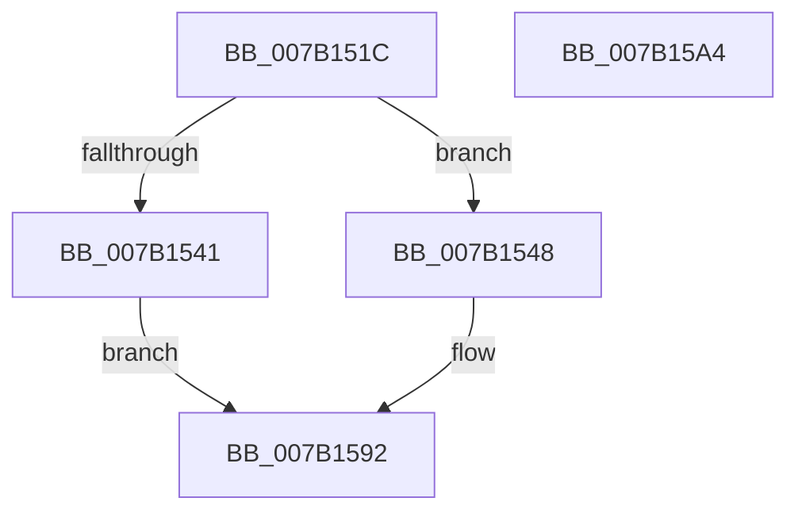

# WdipSemWriteMisconfigEvent

- RVA: `0x007B151C`–`0x007B15A5` (길이 `137` bytes)
- VA: `0x00000001407B151C`
- 실행 섹션: `PAGE`
- PDB 이름 있음: `예`; PDB Function 태그: `아니요`
- unwind 정보 RVA: `0x000D30B0`
- 디코드: `33`개 명령, `137/137` bytes 표시
- 미해석 바이트: `0` (있으면 어셈블리에 `.byte`로 보존)

> 이 문서는 커널 이미지의 기계어와 PDB 기호를 분석해 생성했습니다. 4번과 5번은 함수 원형과 자료형을 바이너리 사용 방식에서 추정한 C 해석이며 원본 소스 복구 결과는 아닙니다.

## 1. Dependencies

- 직접 호출 지점: **2**; 고유 호출 대상: **2**
- 직접 호출자로 확인된 함수: **1**
- RIP 상대 이미지 참조: **2**

### Outgoing calls
- `0x007B158D` → [WdipSemWriteEvent](../A9/WdipSemWriteEvent_function_00A9B6D4.md) (function, `0x00A9B6D4`)
- `0x007B1599` → [_security_check_cookie](../../text/6A/_security_check_cookie_function_006AC640.md) (function, `0x006AC640`)

### Direct callers
- [WdipSemLoadScenarioTable](WdipSemLoadScenarioTable_function_007B02D8.md) at `0x007B0680`

### Static image references
- `0x007B152E` → RVA `0x00E0A740` (`.data`; read)
- `0x007B1554` → RVA `0x000224F0` (`.rdata`; read)

## 2. Other-region calls and transfers

- 다른 실행 섹션으로 향하는 call: **1**
  - `0x007B1599` → [_security_check_cookie](../../text/6A/_security_check_cookie_function_006AC640.md) (`PAGE` → `.text`)
- 별도 외부 분기/꼬리 이동을 확인하지 못했습니다.

## 3. Assembly (complete function range)

```asm
007B151C  44 89 44 24 18                  mov dword ptr [rsp + 0x18], r8d
007B1521  66 89 54 24 10                  mov word ptr [rsp + 0x10], dx
007B1526  55                              push rbp
007B1527  48 8B EC                        mov rbp, rsp
007B152A  48 83 EC 70                     sub rsp, 0x70
007B152E  48 8B 05 0B 92 65 00            mov rax, qword ptr [rip + 0x65920b]
007B1535  48 33 C4                        xor rax, rsp
007B1538  48 89 45 F0                     mov qword ptr [rbp - 0x10], rax
007B153C  48 85 C9                        test rcx, rcx
007B153F  75 07                           jne 0x1407b1548
007B1541  B8 0D 00 00 C0                  mov eax, 0xc000000d
007B1546  EB 4A                           jmp 0x1407b1592
007B1548  48 8D 45 18                     lea rax, [rbp + 0x18]
007B154C  48 89 4D C0                     mov qword ptr [rbp - 0x40], rcx
007B1550  48 89 45 D0                     mov qword ptr [rbp - 0x30], rax
007B1554  48 8D 15 95 0F 87 FF            lea rdx, [rip - 0x78f06b]
007B155B  48 8D 45 20                     lea rax, [rbp + 0x20]
007B155F  48 C7 45 C8 10 00 00 00         mov qword ptr [rbp - 0x38], 0x10
007B1567  48 89 45 E0                     mov qword ptr [rbp - 0x20], rax
007B156B  41 B9 03 00 00 00               mov r9d, 3
007B1571  48 8D 45 C0                     lea rax, [rbp - 0x40]
007B1575  48 C7 45 D8 02 00 00 00         mov qword ptr [rbp - 0x28], 2
007B157D  45 33 C0                        xor r8d, r8d
007B1580  48 89 44 24 20                  mov qword ptr [rsp + 0x20], rax
007B1585  48 C7 45 E8 04 00 00 00         mov qword ptr [rbp - 0x18], 4
007B158D  E8 42 A1 2E 00                  call 0x140a9b6d4
007B1592  48 8B 4D F0                     mov rcx, qword ptr [rbp - 0x10]
007B1596  48 33 CC                        xor rcx, rsp
007B1599  E8 A2 B0 EF FF                  call 0x1406ac640
007B159E  48 83 C4 70                     add rsp, 0x70
007B15A2  5D                              pop rbp
007B15A3  C3                              ret
007B15A4  CC                              int3
```

## 4. C-style interpretation (structured pseudocode)

```c
__int64 __fastcall WdipSemWriteMisconfigEvent(__int64 a1, unsigned __int16 a2, int a3)
{
    __int64 result;
    __int64 v_rsp;
    unsigned __int64 v_stack_m18;
    unsigned __int64 v_stack_m20;
    unsigned __int64 v_stack_m28;
    unsigned __int64 v_stack_m30;
    unsigned __int64 v_stack_m38;
    unsigned __int64 v_stack_m40;
    unsigned __int64 v_stack_m48;
    unsigned __int64 v_stack_m58;
    unsigned __int16 v_stack_p10;
    unsigned int v_stack_p18;

    v_stack_p18 = a3;
    v_stack_p10 = a2;
    v_rsp = (v_rsp) - (112);
    result = (*(unsigned __int64 *)(v_rip + 6656523)) ^ (v_rsp);
    v_stack_m18 = result;
    if (a1 != 0) goto loc_007B1548;
    goto loc_007B1592;
loc_007B1548:
    v_stack_m48 = a1;
    v_stack_m38 = v_stack_p10;
    v_stack_m40 = 16;
    v_stack_m28 = v_stack_p18;
    v_stack_m30 = 2;
    a3 = 0;
    v_stack_m58 = v_stack_m48;
    v_stack_m20 = 4;
    result = WdipSemWriteEvent(a1, v_rip - 7925867, a3, 3);
loc_007B1592:
    a1 = (v_stack_m18) ^ (v_rsp);
    result = _security_check_cookie(a1, v_rip - 7925867, a3, 3);
    v_rsp = (v_rsp) + (112);
    return result;
}
```

## 5. (Beta) C Style

```c
int64_t WdipSemWriteMisconfigEvent(int64_t Arg1, uint16_t Arg2, int32_t Arg3)
{
    int64_t result;
    int64_t local_rsp;
    uint64_t v_stack_m18;
    uint64_t v_stack_m20;
    uint64_t v_stack_m28;
    uint64_t v_stack_m30;
    uint64_t v_stack_m38;
    uint64_t v_stack_m40;
    uint64_t v_stack_m48;
    uint64_t v_stack_m58;
    uint16_t v_stack_p10;
    uint32_t v_stack_p18;

    v_stack_p18 = Arg3;
    v_stack_p10 = Arg2;
    local_rsp = (local_rsp) - (112);
    result = (*(uint64_t *)(v_rip + 0x65920B)) ^ (local_rsp);
    v_stack_m18 = result;
    if (Arg1 != 0) goto loc_007B1548;
    goto loc_007B1592;
loc_007B1548:
    v_stack_m48 = Arg1;
    v_stack_m38 = v_stack_p10;
    v_stack_m40 = 16;
    v_stack_m28 = v_stack_p18;
    v_stack_m30 = 2;
    Arg3 = 0;
    v_stack_m58 = v_stack_m48;
    v_stack_m20 = 4;
    result = WdipSemWriteEvent(Arg1, v_rip - 7925867, Arg3, 3);
loc_007B1592:
    Arg1 = (v_stack_m18) ^ (local_rsp);
    result = _security_check_cookie(Arg1, v_rip - 7925867, Arg3, 3);
    local_rsp = (local_rsp) + (112);
    return result;
}
```

## 6. Execution-region graph

[열기: 2D/3D 그래프와 함수 탐색 컨트롤 패널](../../../control-panel.html?section=page&rva=0x007B151C&view=graph)

- 2D 그래프는 위에서 아래로 흐르고, 3D 그래프는 빈 공간을 드래그해 회전합니다. Shift+드래그는 이동, 휠은 확대·축소, 함수 노드 선택은 대상 보고서 이동입니다.

### Static fallback


