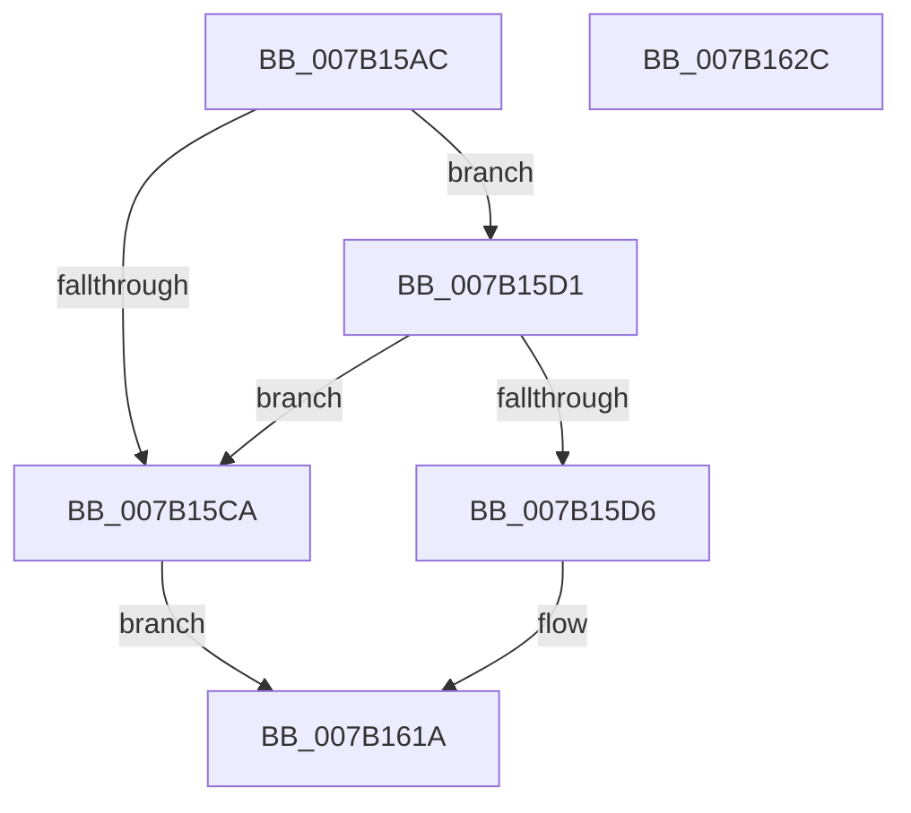

# WdipSemWriteScenarioLimitExceededEvent

- RVA: `0x007B15AC`–`0x007B162D` (길이 `129` bytes)
- VA: `0x00000001407B15AC`
- 실행 섹션: `PAGE`
- PDB 이름 있음: `예`; PDB Function 태그: `아니요`
- unwind 정보 RVA: `0x000BB6F0`
- 디코드: `30`개 명령, `129/129` bytes 표시
- 미해석 바이트: `0` (있으면 어셈블리에 `.byte`로 보존)

> 이 문서는 커널 이미지의 기계어와 PDB 기호를 분석해 생성했습니다. 4번과 5번은 함수 원형과 자료형을 바이너리 사용 방식에서 추정한 C 해석이며 원본 소스 복구 결과는 아닙니다.

## 1. Dependencies

- 직접 호출 지점: **2**; 고유 호출 대상: **2**
- 직접 호출자로 확인된 함수: **2**
- RIP 상대 이미지 참조: **1**

### Outgoing calls
- `0x007B1615` → [WdipSemWriteEvent](../A9/WdipSemWriteEvent_function_00A9B6D4.md) (function, `0x00A9B6D4`)
- `0x007B1622` → [_security_check_cookie](../../text/6A/_security_check_cookie_function_006AC640.md) (function, `0x006AC640`)

### Direct callers
- [WdipSemLoadNextScenario](../7A/WdipSemLoadNextScenario_function_007AFDE0.md) at `0x007B0202`
- [WdipSemLoadScenarioTable](WdipSemLoadScenarioTable_function_007B02D8.md) at `0x007B0773`

### Static image references
- `0x007B15B6` → RVA `0x00E0A740` (`.data`; read)

## 2. Other-region calls and transfers

- 다른 실행 섹션으로 향하는 call: **1**
  - `0x007B1622` → [_security_check_cookie](../../text/6A/_security_check_cookie_function_006AC640.md) (`PAGE` → `.text`)
- 별도 외부 분기/꼬리 이동을 확인하지 못했습니다.

## 3. Assembly (complete function range)

```asm
007B15AC  66 44 89 44 24 18               mov word ptr [rsp + 0x18], r8w
007B15B2  48 83 EC 68                     sub rsp, 0x68
007B15B6  48 8B 05 83 91 65 00            mov rax, qword ptr [rip + 0x659183]
007B15BD  48 33 C4                        xor rax, rsp
007B15C0  48 89 44 24 50                  mov qword ptr [rsp + 0x50], rax
007B15C5  48 85 C9                        test rcx, rcx
007B15C8  75 07                           jne 0x1407b15d1
007B15CA  B8 0D 00 00 C0                  mov eax, 0xc000000d
007B15CF  EB 49                           jmp 0x1407b161a
007B15D1  48 85 D2                        test rdx, rdx
007B15D4  74 F4                           je 0x1407b15ca
007B15D6  83 64 24 3C 00                  and dword ptr [rsp + 0x3c], 0
007B15DB  48 8D 84 24 80 00 00 00         lea rax, [rsp + 0x80]
007B15E3  83 64 24 4C 00                  and dword ptr [rsp + 0x4c], 0
007B15E8  41 B9 02 00 00 00               mov r9d, 2
007B15EE  48 89 44 24 40                  mov qword ptr [rsp + 0x40], rax
007B15F3  45 33 C0                        xor r8d, r8d
007B15F6  48 8D 44 24 30                  lea rax, [rsp + 0x30]
007B15FB  48 89 54 24 30                  mov qword ptr [rsp + 0x30], rdx
007B1600  48 8B D1                        mov rdx, rcx
007B1603  48 89 44 24 20                  mov qword ptr [rsp + 0x20], rax
007B1608  C7 44 24 38 10 00 00 00         mov dword ptr [rsp + 0x38], 0x10
007B1610  44 89 4C 24 48                  mov dword ptr [rsp + 0x48], r9d
007B1615  E8 BA A0 2E 00                  call 0x140a9b6d4
007B161A  48 8B 4C 24 50                  mov rcx, qword ptr [rsp + 0x50]
007B161F  48 33 CC                        xor rcx, rsp
007B1622  E8 19 B0 EF FF                  call 0x1406ac640
007B1627  48 83 C4 68                     add rsp, 0x68
007B162B  C3                              ret
007B162C  CC                              int3
```

## 4. C-style interpretation (structured pseudocode)

```c
__int64 __fastcall WdipSemWriteScenarioLimitExceededEvent(__int64 a1, __int64 a2, int a3)
{
    __int64 result;
    __int64 v_rsp;
    unsigned __int64 v_stack_m18;
    unsigned int v_stack_m1C;
    unsigned int v_stack_m20;
    unsigned __int64 v_stack_m28;
    unsigned int v_stack_m2C;
    unsigned int v_stack_m30;
    unsigned __int64 v_stack_m38;
    unsigned __int64 v_stack_m48;
    unsigned __int16 v_stack_p18;

    v_stack_p18 = (unsigned __int16)(a3);
    v_rsp = (v_rsp) - (104);
    result = (*(unsigned __int64 *)(v_rip + 6656387)) ^ (v_rsp);
    v_stack_m18 = result;
    if (a1 != 0) goto loc_007B15D1;
loc_007B15CA:
    goto loc_007B161A;
loc_007B15D1:
    if (a2 == 0) goto loc_007B15CA;
    v_stack_m28 = v_stack_p18;
    a3 = 0;
    v_stack_m38 = a2;
    v_stack_m48 = v_stack_m38;
    v_stack_m30 = 16;
    v_stack_m20 = 2;
    result = WdipSemWriteEvent(a1, a1, a3, 2);
loc_007B161A:
    a1 = (v_stack_m18) ^ (v_rsp);
    result = _security_check_cookie(a1, a1, a3, 2);
    v_rsp = (v_rsp) + (104);
    return result;
}
```

## 5. (Beta) C Style

```c
int64_t WdipSemWriteScenarioLimitExceededEvent(int64_t Arg1, int64_t Arg2, int32_t Arg3)
{
    int64_t result;
    int64_t local_rsp;
    uint64_t v_stack_m18;
    uint32_t v_stack_m1C;
    uint32_t v_stack_m20;
    uint64_t v_stack_m28;
    uint32_t v_stack_m2C;
    uint32_t v_stack_m30;
    uint64_t v_stack_m38;
    uint64_t v_stack_m48;
    uint16_t v_stack_p18;

    v_stack_p18 = (uint16_t)(Arg3);
    local_rsp = (local_rsp) - (104);
    result = (*(uint64_t *)(v_rip + 0x659183)) ^ (local_rsp);
    v_stack_m18 = result;
    if (Arg1 != 0) goto loc_007B15D1;
loc_007B15CA:
    goto loc_007B161A;
loc_007B15D1:
    if (Arg2 == 0) goto loc_007B15CA;
    v_stack_m28 = v_stack_p18;
    Arg3 = 0;
    v_stack_m38 = Arg2;
    v_stack_m48 = v_stack_m38;
    v_stack_m30 = 16;
    v_stack_m20 = 2;
    result = WdipSemWriteEvent(Arg1, Arg1, Arg3, 2);
loc_007B161A:
    Arg1 = (v_stack_m18) ^ (local_rsp);
    result = _security_check_cookie(Arg1, Arg1, Arg3, 2);
    local_rsp = (local_rsp) + (104);
    return result;
}
```

## 6. Execution-region graph

[열기: 2D/3D 그래프와 함수 탐색 컨트롤 패널](../../../control-panel.html?section=page&rva=0x007B15AC&view=graph)

- 2D 그래프는 위에서 아래로 흐르고, 3D 그래프는 빈 공간을 드래그해 회전합니다. Shift+드래그는 이동, 휠은 확대·축소, 함수 노드 선택은 대상 보고서 이동입니다.

### Static fallback


