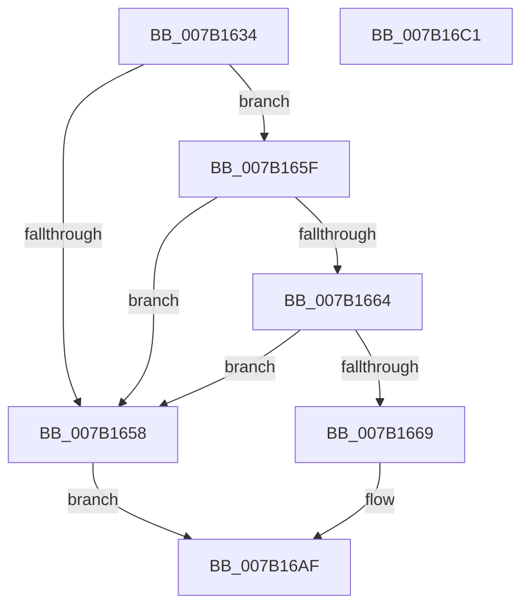

# WdipSemWriteSemFailureEvent

- RVA: `0x007B1634`–`0x007B16C2` (길이 `142` bytes)
- VA: `0x00000001407B1634`
- 실행 섹션: `PAGE`
- PDB 이름 있음: `예`; PDB Function 태그: `아니요`
- unwind 정보 RVA: `0x000D3084`
- 디코드: `37`개 명령, `142/142` bytes 표시
- 미해석 바이트: `0` (있으면 어셈블리에 `.byte`로 보존)

> 이 문서는 커널 이미지의 기계어와 PDB 기호를 분석해 생성했습니다. 4번과 5번은 함수 원형과 자료형을 바이너리 사용 방식에서 추정한 C 해석이며 원본 소스 복구 결과는 아닙니다.

## 1. Dependencies

- 직접 호출 지점: **2**; 고유 호출 대상: **2**
- 직접 호출자로 확인된 함수: **2**
- RIP 상대 이미지 참조: **1**

### Outgoing calls
- `0x007B16AA` → [WdipSemWriteEvent](../A9/WdipSemWriteEvent_function_00A9B6D4.md) (function, `0x00A9B6D4`)
- `0x007B16B6` → [_security_check_cookie](../../text/6A/_security_check_cookie_function_006AC640.md) (function, `0x006AC640`)

### Direct callers
- [sub_00B3DB56](../B3/Unknown_function_00B3DB56.md) at `0x00B3DBB3`
- [sub_00B3DC32](../B3/Unknown_function_00B3DC32.md) at `0x00B3DC5E`

### Static image references
- `0x007B1642` → RVA `0x00E0A740` (`.data`; read)

## 2. Other-region calls and transfers

- 다른 실행 섹션으로 향하는 call: **1**
  - `0x007B16B6` → [_security_check_cookie](../../text/6A/_security_check_cookie_function_006AC640.md) (`PAGE` → `.text`)
- 별도 외부 분기/꼬리 이동을 확인하지 못했습니다.

## 3. Assembly (complete function range)

```asm
007B1634  66 44 89 44 24 18               mov word ptr [rsp + 0x18], r8w
007B163A  55                              push rbp
007B163B  48 8B EC                        mov rbp, rsp
007B163E  48 83 EC 70                     sub rsp, 0x70
007B1642  48 8B 05 F7 90 65 00            mov rax, qword ptr [rip + 0x6590f7]
007B1649  48 33 C4                        xor rax, rsp
007B164C  48 89 45 F0                     mov qword ptr [rbp - 0x10], rax
007B1650  49 8B C1                        mov rax, r9
007B1653  48 85 C9                        test rcx, rcx
007B1656  75 07                           jne 0x1407b165f
007B1658  B8 0D 00 00 C0                  mov eax, 0xc000000d
007B165D  EB 50                           jmp 0x1407b16af
007B165F  48 85 D2                        test rdx, rdx
007B1662  74 F4                           je 0x1407b1658
007B1664  48 85 C0                        test rax, rax
007B1667  74 EF                           je 0x1407b1658
007B1669  48 89 55 C0                     mov qword ptr [rbp - 0x40], rdx
007B166D  41 B9 03 00 00 00               mov r9d, 3
007B1673  48 8D 55 20                     lea rdx, [rbp + 0x20]
007B1677  48 C7 45 C8 10 00 00 00         mov qword ptr [rbp - 0x38], 0x10
007B167F  48 89 55 D0                     mov qword ptr [rbp - 0x30], rdx
007B1683  4C 8B C0                        mov r8, rax
007B1686  48 8D 55 30                     lea rdx, [rbp + 0x30]
007B168A  48 C7 45 D8 02 00 00 00         mov qword ptr [rbp - 0x28], 2
007B1692  48 89 55 E0                     mov qword ptr [rbp - 0x20], rdx
007B1696  48 8D 55 C0                     lea rdx, [rbp - 0x40]
007B169A  48 89 54 24 20                  mov qword ptr [rsp + 0x20], rdx
007B169F  48 8B D1                        mov rdx, rcx
007B16A2  48 C7 45 E8 04 00 00 00         mov qword ptr [rbp - 0x18], 4
007B16AA  E8 25 A0 2E 00                  call 0x140a9b6d4
007B16AF  48 8B 4D F0                     mov rcx, qword ptr [rbp - 0x10]
007B16B3  48 33 CC                        xor rcx, rsp
007B16B6  E8 85 AF EF FF                  call 0x1406ac640
007B16BB  48 83 C4 70                     add rsp, 0x70
007B16BF  5D                              pop rbp
007B16C0  C3                              ret
007B16C1  CC                              int3
```

## 4. C-style interpretation (structured pseudocode)

```c
__int64 __fastcall WdipSemWriteSemFailureEvent(__int64 a1, __int64 a2, unsigned __int16 a3, __int64 a4, __int64 a5)
{
    __int64 result;
    __int64 v_rsp;
    unsigned __int64 v_stack_m18;
    unsigned __int64 v_stack_m20;
    unsigned __int64 v_stack_m28;
    unsigned __int64 v_stack_m30;
    unsigned __int64 v_stack_m38;
    unsigned __int64 v_stack_m40;
    unsigned __int64 v_stack_m48;
    unsigned __int64 v_stack_m58;
    unsigned __int16 v_stack_p18;

    v_stack_p18 = a3;
    v_rsp = (v_rsp) - (112);
    result = (*(unsigned __int64 *)(v_rip + 6656247)) ^ (v_rsp);
    v_stack_m18 = result;
    if (a1 != 0) goto loc_007B165F;
loc_007B1658:
    goto loc_007B16AF;
loc_007B165F:
    if (a2 == 0) goto loc_007B1658;
    if ((unsigned int)(0xC000000DULL) == 0) goto loc_007B1658;
    v_stack_m48 = a2;
    v_stack_m40 = 16;
    v_stack_m38 = v_stack_p18;
    v_stack_m30 = 2;
    v_stack_m28 = a5;
    v_stack_m58 = v_stack_m48;
    v_stack_m20 = 4;
    result = WdipSemWriteEvent(a1, a1, (unsigned int)(0xC000000DULL), 3);
loc_007B16AF:
    a1 = (v_stack_m18) ^ (v_rsp);
    result = _security_check_cookie(a1, a1, (unsigned int)(0xC000000DULL), 3);
    v_rsp = (v_rsp) + (112);
    return result;
}
```

## 5. (Beta) C Style

```c
int64_t WdipSemWriteSemFailureEvent(int64_t Arg1, int64_t Arg2, uint16_t Arg3, int64_t Arg4, int64_t Arg5)
{
    int64_t result;
    int64_t local_rsp;
    uint64_t v_stack_m18;
    uint64_t v_stack_m20;
    uint64_t v_stack_m28;
    uint64_t v_stack_m30;
    uint64_t v_stack_m38;
    uint64_t v_stack_m40;
    uint64_t v_stack_m48;
    uint64_t v_stack_m58;
    uint16_t v_stack_p18;

    v_stack_p18 = Arg3;
    local_rsp = (local_rsp) - (112);
    result = (*(uint64_t *)(v_rip + 0x6590F7)) ^ (local_rsp);
    v_stack_m18 = result;
    if (Arg1 != 0) goto loc_007B165F;
loc_007B1658:
    goto loc_007B16AF;
loc_007B165F:
    if (Arg2 == 0) goto loc_007B1658;
    if ((uint32_t)(0xC000000DULL) == 0) goto loc_007B1658;
    v_stack_m48 = Arg2;
    v_stack_m40 = 16;
    v_stack_m38 = v_stack_p18;
    v_stack_m30 = 2;
    v_stack_m28 = Arg5;
    v_stack_m58 = v_stack_m48;
    v_stack_m20 = 4;
    result = WdipSemWriteEvent(Arg1, Arg1, (uint32_t)(0xC000000DULL), 3);
loc_007B16AF:
    Arg1 = (v_stack_m18) ^ (local_rsp);
    result = _security_check_cookie(Arg1, Arg1, (uint32_t)(0xC000000DULL), 3);
    local_rsp = (local_rsp) + (112);
    return result;
}
```

## 6. Execution-region graph

[열기: 2D/3D 그래프와 함수 탐색 컨트롤 패널](../../../control-panel.html?section=page&rva=0x007B1634&view=graph)

- 2D 그래프는 위에서 아래로 흐르고, 3D 그래프는 빈 공간을 드래그해 회전합니다. Shift+드래그는 이동, 휠은 확대·축소, 함수 노드 선택은 대상 보고서 이동입니다.

### Static fallback


