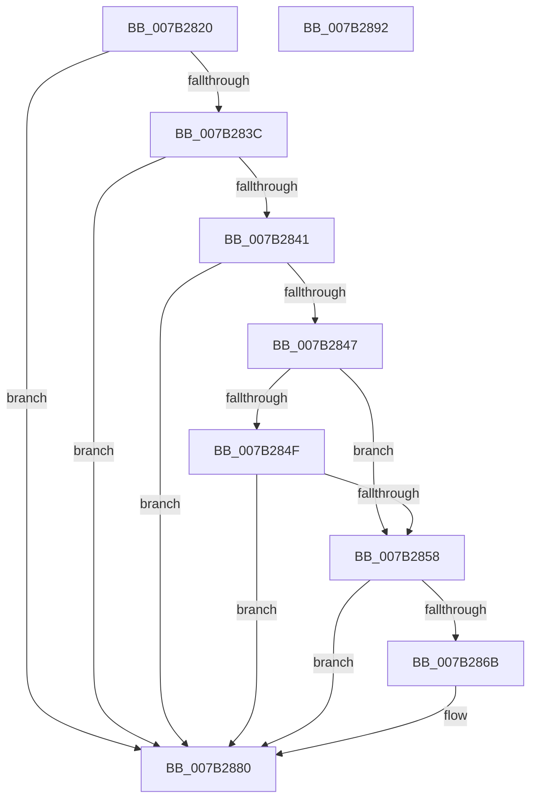

# WmiMatchSMBiosSysInfo

- RVA: `0x007B2820`–`0x007B2893` (길이 `115` bytes)
- VA: `0x00000001407B2820`
- 실행 섹션: `PAGE`
- PDB 이름 있음: `예`; PDB Function 태그: `아니요`
- unwind 정보 RVA: `0x00060BC4`
- 디코드: `35`개 명령, `115/115` bytes 표시
- 미해석 바이트: `0` (있으면 어셈블리에 `.byte`로 보존)

> 이 문서는 커널 이미지의 기계어와 PDB 기호를 분석해 생성했습니다. 4번과 5번은 함수 원형과 자료형을 바이너리 사용 방식에서 추정한 C 해석이며 원본 소스 복구 결과는 아닙니다.

## 1. Dependencies

- 직접 호출 지점: **3**; 고유 호출 대상: **2**
- 직접 호출자로 확인된 함수: **0**
- RIP 상대 이미지 참조: **3**

### Outgoing calls
- `0x007B284F` → [WmipReadSMBiosSysInfo](../../text/64/WmipReadSMBiosSysInfo_function_0064E36C.md) (function, `0x0064E36C`)
- `0x007B2862` → [WmipCheckSMBiosSysInfoString](WmipCheckSMBiosSysInfoString_function_007B289C.md) (function, `0x007B289C`)
- `0x007B2876` → [WmipCheckSMBiosSysInfoString](WmipCheckSMBiosSysInfoString_function_007B289C.md) (function, `0x007B289C`)

### Direct callers
- 이 함수 시작 RVA로 연결되는 직접 call은 확인되지 않았습니다. 간접 호출은 완전히 역산할 수 없습니다.

### Static image references
- `0x007B2847` → RVA `0x00EFFBE8` (`.data`; read)
- `0x007B285B` → RVA `0x00EFFBC0` (`.data`; read)
- `0x007B286F` → RVA `0x00EFFBD0` (`.data`; read)

## 2. Other-region calls and transfers

- 다른 실행 섹션으로 향하는 call: **1**
  - `0x007B284F` → [WmipReadSMBiosSysInfo](../../text/64/WmipReadSMBiosSysInfo_function_0064E36C.md) (`PAGE` → `.text`)
- 별도 외부 분기/꼬리 이동을 확인하지 못했습니다.

## 3. Assembly (complete function range)

```asm
007B2820  48 89 5C 24 08                  mov qword ptr [rsp + 8], rbx
007B2825  48 89 74 24 10                  mov qword ptr [rsp + 0x10], rsi
007B282A  57                              push rdi
007B282B  48 83 EC 20                     sub rsp, 0x20
007B282F  33 DB                           xor ebx, ebx
007B2831  49 8B F8                        mov rdi, r8
007B2834  8D 73 02                        lea esi, [rbx + 2]
007B2837  44 3B CE                        cmp r9d, esi
007B283A  75 44                           jne 0x1407b2880
007B283C  49 39 18                        cmp qword ptr [r8], rbx
007B283F  74 3F                           je 0x1407b2880
007B2841  49 39 58 08                     cmp qword ptr [r8 + 8], rbx
007B2845  74 39                           je 0x1407b2880
007B2847  38 1D 9B D3 74 00               cmp byte ptr [rip + 0x74d39b], bl
007B284D  75 09                           jne 0x1407b2858
007B284F  E8 18 BB E9 FF                  call 0x14064e36c
007B2854  85 C0                           test eax, eax
007B2856  78 28                           js 0x1407b2880
007B2858  48 8B 0F                        mov rcx, qword ptr [rdi]
007B285B  48 8D 15 5E D3 74 00            lea rdx, [rip + 0x74d35e]
007B2862  E8 35 00 00 00                  call 0x1407b289c
007B2867  84 C0                           test al, al
007B2869  74 15                           je 0x1407b2880
007B286B  48 8B 4F 08                     mov rcx, qword ptr [rdi + 8]
007B286F  48 8D 15 5A D3 74 00            lea rdx, [rip + 0x74d35a]
007B2876  E8 21 00 00 00                  call 0x1407b289c
007B287B  84 C0                           test al, al
007B287D  0F 45 DE                        cmovne ebx, esi
007B2880  48 8B 74 24 38                  mov rsi, qword ptr [rsp + 0x38]
007B2885  8B C3                           mov eax, ebx
007B2887  48 8B 5C 24 30                  mov rbx, qword ptr [rsp + 0x30]
007B288C  48 83 C4 20                     add rsp, 0x20
007B2890  5F                              pop rdi
007B2891  C3                              ret
007B2892  CC                              int3
```

## 4. C-style interpretation (structured pseudocode)

```c
__int64 __fastcall WmiMatchSMBiosSysInfo(__int64 a1, __int64 a2, __int64 a3, int a4)
{
    __int64 result;
    __int64 v_rbx;
    __int64 v_rsp;
    unsigned __int64 v_stack_p10;
    unsigned __int64 v_stack_p8;

    v_stack_p8 = v_rbx;
    v_stack_p10 = v_rsi;
    v_rsp = (v_rsp) - (32);
    v_rbx = 0;
    if (a4 != ((unsigned int)(v_rbx + 2))) goto loc_007B2880;
    if ((*(unsigned __int64 *)(a3)) == 0) goto loc_007B2880;
    if ((*(unsigned __int64 *)(a3 + 8)) == 0) goto loc_007B2880;
    if ((*(unsigned __int8 *)(v_rip + 7656347)) != 0) goto loc_007B2858;
    result = WmipReadSMBiosSysInfo(a1, a2, a3, a4);
    if (sign_flag) goto loc_007B2880;
loc_007B2858:
    result = WmipCheckSMBiosSysInfoString(*(unsigned __int64 *)(a3), v_rip + 7656286, a3, a4);
    if ((unsigned __int8)(result) != 0) {
        a1 = *(unsigned __int64 *)(a3 + 8);
        a2 = v_rip + 7656282;
        result = WmipCheckSMBiosSysInfoString(a1, a2, a3, a4);
        if ((unsigned __int8)(result) != 0) { v_rbx = (unsigned int)(v_rbx + 2); }
    }
    v_rsp = (v_rsp) + (32);
    return (unsigned int)((unsigned int)(v_rbx));
}
```

## 5. (Beta) C Style

```c
int64_t WmiMatchSMBiosSysInfo(int64_t Arg1, int64_t Arg2, void *Arg3, int32_t Arg4)
{
    uint8_t *arg3 = (uint8_t *)Arg3;

    int64_t result;
    int64_t local_rbx;
    int64_t local_rsp;
    uint64_t v_stack_p10;
    uint64_t v_stack_p8;

    v_stack_p8 = local_rbx;
    v_stack_p10 = local_rsi;
    local_rsp = (local_rsp) - (32);
    local_rbx = 0;
    if (Arg4 != ((uint32_t)(local_rbx + 2))) goto loc_007B2880;
    if ((*(uint64_t *)(arg3)) == 0) goto loc_007B2880;
    if ((*(uint64_t *)(arg3 + 0x8)) == 0) goto loc_007B2880;
    if ((*(uint8_t *)(v_rip + 0x74D39B)) != 0) goto loc_007B2858;
    result = WmipReadSMBiosSysInfo(Arg1, Arg2, Arg3, Arg4);
    if (sign_flag) goto loc_007B2880;
loc_007B2858:
    result = WmipCheckSMBiosSysInfoString(*(uint64_t *)(arg3), v_rip + 7656286, Arg3, Arg4);
    if ((uint8_t)(result) != 0) {
        Arg1 = *(uint64_t *)(arg3 + 0x8);
        Arg2 = v_rip + 7656282;
        result = WmipCheckSMBiosSysInfoString(Arg1, Arg2, Arg3, Arg4);
        if ((uint8_t)(result) != 0) { local_rbx = (uint32_t)(local_rbx + 2); }
    }
    local_rsp = (local_rsp) + (32);
    return (uint32_t)((uint32_t)(local_rbx));
}
```

### 관측된 메모리 오프셋

구조체 형식이 확인되지 않은 접근은 인자 기준의 오프셋으로만 기록했습니다.

| 기준 인자 | 오프셋 표현 | 폭 (bit) | 접근 |
|---|---:|---:|---|
| `Arg3` | `+ 0x0` | `64` | `R` |
| `Arg3` | `+ 0x8` | `64` | `R` |

## 6. Execution-region graph

[열기: 2D/3D 그래프와 함수 탐색 컨트롤 패널](../../../control-panel.html?section=page&rva=0x007B2820&view=graph)

- 2D 그래프는 위에서 아래로 흐르고, 3D 그래프는 빈 공간을 드래그해 회전합니다. Shift+드래그는 이동, 휠은 확대·축소, 함수 노드 선택은 대상 보고서 이동입니다.

### Static fallback


