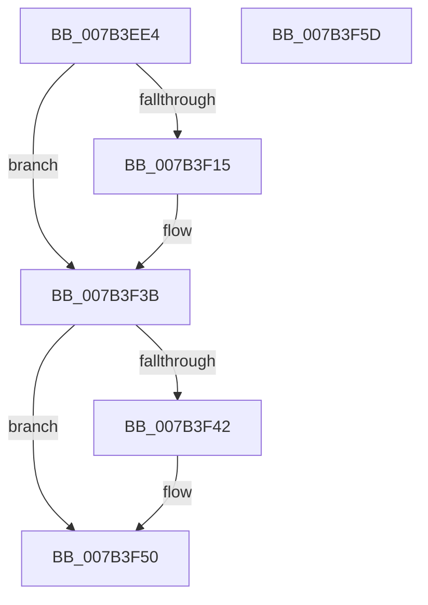

# WmiSetNetworkNotify

- RVA: `0x007B3EE4`–`0x007B3F5E` (길이 `122` bytes)
- VA: `0x00000001407B3EE4`
- 실행 섹션: `PAGE`
- PDB 이름 있음: `예`; PDB Function 태그: `아니요`
- unwind 정보 RVA: `0x000AC048`
- 디코드: `36`개 명령, `122/122` bytes 표시
- 미해석 바이트: `0` (있으면 어셈블리에 `.byte`로 보존)

> 이 문서는 커널 이미지의 기계어와 PDB 기호를 분석해 생성했습니다. 4번과 5번은 함수 원형과 자료형을 바이너리 사용 방식에서 추정한 C 해석이며 원본 소스 복구 결과는 아닙니다.

## 1. Dependencies

- 직접 호출 지점: **3**; 고유 호출 대상: **3**
- 직접 호출자로 확인된 함수: **2**
- RIP 상대 이미지 참조: **0**

### Outgoing calls
- `0x007B3F0A` → [WmipBuildTraceDeviceList](../../text/49/WmipBuildTraceDeviceList_function_00494050.md) (function, `0x00494050`)
- `0x007B3F2F` → [WmipSendWmiIrpToTraceDeviceList](../9E/WmipSendWmiIrpToTraceDeviceList_function_009E2988.md) (function, `0x009E2988`)
- `0x007B3F4B` → [WmipFreeTraceDeviceList](../9E/WmipFreeTraceDeviceList_function_009E4780.md) (function, `0x009E4780`)

### Direct callers
- [EtwpDisableKernelTrace](../A4/EtwpDisableKernelTrace_function_00A4F7D8.md) at `0x00A4FAA6`
- [EtwpEnableKernelTrace](../A4/EtwpEnableKernelTrace_function_00A4FBCC.md) at `0x00A50163`

### Static image references
- 디코드된 RIP-relative 메모리 참조가 없습니다.

## 2. Other-region calls and transfers

- 다른 실행 섹션으로 향하는 call: **1**
  - `0x007B3F0A` → [WmipBuildTraceDeviceList](../../text/49/WmipBuildTraceDeviceList_function_00494050.md) (`PAGE` → `.text`)
- 별도 외부 분기/꼬리 이동을 확인하지 못했습니다.

## 3. Assembly (complete function range)

```asm
007B3EE4  48 8B C4                        mov rax, rsp
007B3EE7  48 89 58 20                     mov qword ptr [rax + 0x20], rbx
007B3EEB  48 89 48 08                     mov qword ptr [rax + 8], rcx
007B3EEF  56                              push rsi
007B3EF0  48 83 EC 30                     sub rsp, 0x30
007B3EF4  33 F6                           xor esi, esi
007B3EF6  4C 8D 40 10                     lea r8, [rax + 0x10]
007B3EFA  48 8D 50 18                     lea rdx, [rax + 0x18]
007B3EFE  48 89 70 18                     mov qword ptr [rax + 0x18], rsi
007B3F02  B9 00 00 20 00                  mov ecx, 0x200000
007B3F07  89 70 10                        mov dword ptr [rax + 0x10], esi
007B3F0A  E8 41 01 CE FF                  call 0x140494050
007B3F0F  8B D8                           mov ebx, eax
007B3F11  85 C0                           test eax, eax
007B3F13  78 26                           js 0x1407b3f3b
007B3F15  8B 54 24 48                     mov edx, dword ptr [rsp + 0x48]
007B3F19  48 8D 44 24 40                  lea rax, [rsp + 0x40]
007B3F1E  48 8B 4C 24 50                  mov rcx, qword ptr [rsp + 0x50]
007B3F23  44 8D 4E 08                     lea r9d, [rsi + 8]
007B3F27  41 B0 0A                        mov r8b, 0xa
007B3F2A  48 89 44 24 20                  mov qword ptr [rsp + 0x20], rax
007B3F2F  E8 54 EA 22 00                  call 0x1409e2988
007B3F34  85 C0                           test eax, eax
007B3F36  8B D8                           mov ebx, eax
007B3F38  0F 49 DE                        cmovns ebx, esi
007B3F3B  48 39 74 24 50                  cmp qword ptr [rsp + 0x50], rsi
007B3F40  74 0E                           je 0x1407b3f50
007B3F42  8B 54 24 48                     mov edx, dword ptr [rsp + 0x48]
007B3F46  48 8B 4C 24 50                  mov rcx, qword ptr [rsp + 0x50]
007B3F4B  E8 30 08 23 00                  call 0x1409e4780
007B3F50  8B C3                           mov eax, ebx
007B3F52  48 8B 5C 24 58                  mov rbx, qword ptr [rsp + 0x58]
007B3F57  48 83 C4 30                     add rsp, 0x30
007B3F5B  5E                              pop rsi
007B3F5C  C3                              ret
007B3F5D  CC                              int3
```

## 4. C-style interpretation (structured pseudocode)

```c
__int64 __fastcall WmiSetNetworkNotify(__int64 a1)
{
    __int64 result;
    __int64 v_rbx;
    __int64 v_rsi;
    __int64 v_rsp;
    unsigned __int64 v_stack_m18;
    unsigned int v_stack_p10;
    unsigned __int64 v_stack_p18;
    unsigned __int64 v_stack_p20;
    unsigned __int64 v_stack_p8;

    *(unsigned __int64 *)(v_rsp + 32) = v_rbx;
    *(unsigned __int64 *)(v_rsp + 8) = a1;
    v_rsp = (v_rsp) - (48);
    v_rsi = 0;
    *(unsigned __int64 *)(v_rsp + 24) = 0;
    *(unsigned int *)(v_rsp + 16) = 0;
    result = WmipBuildTraceDeviceList((unsigned int)(0x200000ULL), v_rsp + 24, v_rsp + 16, a4);
    v_rbx = (unsigned int)((unsigned int)(result));
    if (!(sign_flag)) {
        a2 = v_stack_p10;
        result = v_stack_p8;
        a1 = v_stack_p18;
        a4 = v_rsi + 8;
        a3 = 10;
        v_stack_m18 = result;
        result = WmipSendWmiIrpToTraceDeviceList(a1, a2, a3, a4);
        v_rbx = (unsigned int)(result);
        if (!sign_flag) { v_rbx = 0; }
    }
    if (v_stack_p18 != 0) {
        a2 = v_stack_p10;
        a1 = v_stack_p18;
        result = WmipFreeTraceDeviceList(a1, a2, a3, a4);
    }
    v_rsp = (v_rsp) + (48);
    return (unsigned int)((unsigned int)(v_rbx));
}
```

## 5. (Beta) C Style

```c
int64_t WmiSetNetworkNotify(int64_t Arg1)
{
    int64_t result;
    int64_t local_rbx;
    int64_t local_rsi;
    int64_t local_rsp;
    uint64_t v_stack_m18;
    uint32_t v_stack_p10;
    uint64_t v_stack_p18;
    uint64_t v_stack_p20;
    uint64_t v_stack_p8;

    *(uint64_t *)(local_rsp + 0x20) = local_rbx;
    *(uint64_t *)(local_rsp + 0x8) = Arg1;
    local_rsp = (local_rsp) - (48);
    local_rsi = 0;
    *(uint64_t *)(local_rsp + 0x18) = 0;
    *(uint32_t *)(local_rsp + 0x10) = 0;
    result = WmipBuildTraceDeviceList((uint32_t)(0x200000ULL), local_rsp + 24, local_rsp + 16, a4);
    local_rbx = (uint32_t)((uint32_t)(result));
    if (!(sign_flag)) {
        a2 = v_stack_p10;
        result = v_stack_p8;
        Arg1 = v_stack_p18;
        a4 = local_rsi + 8;
        a3 = 10;
        v_stack_m18 = result;
        result = WmipSendWmiIrpToTraceDeviceList(Arg1, a2, a3, a4);
        local_rbx = (uint32_t)(result);
        if (!sign_flag) { local_rbx = 0; }
    }
    if (v_stack_p18 != 0) {
        a2 = v_stack_p10;
        Arg1 = v_stack_p18;
        result = WmipFreeTraceDeviceList(Arg1, a2, a3, a4);
    }
    local_rsp = (local_rsp) + (48);
    return (uint32_t)((uint32_t)(local_rbx));
}
```

## 6. Execution-region graph

[열기: 2D/3D 그래프와 함수 탐색 컨트롤 패널](../../../control-panel.html?section=page&rva=0x007B3EE4&view=graph)

- 2D 그래프는 위에서 아래로 흐르고, 3D 그래프는 빈 공간을 드래그해 회전합니다. Shift+드래그는 이동, 휠은 확대·축소, 함수 노드 선택은 대상 보고서 이동입니다.

### Static fallback


