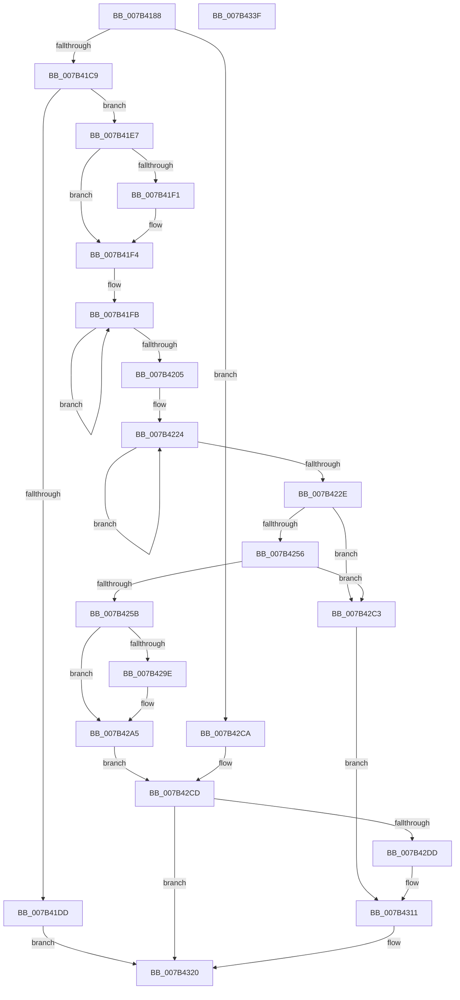

# WmipAddMofResource

- RVA: `0x007B4188`–`0x007B4340` (길이 `440` bytes)
- VA: `0x00000001407B4188`
- 실행 섹션: `PAGE`
- PDB 이름 있음: `예`; PDB Function 태그: `아니요`
- unwind 정보 RVA: `0x0008C20C`
- 디코드: `118`개 명령, `440/440` bytes 표시
- 미해석 바이트: `0` (있으면 어셈블리에 `.byte`로 보존)

> 이 문서는 커널 이미지의 기계어와 PDB 기호를 분석해 생성했습니다. 4번과 5번은 함수 원형과 자료형을 바이너리 사용 방식에서 추정한 C 해석이며 원본 소스 복구 결과는 아닙니다.

## 1. Dependencies

- 직접 호출 지점: **12**; 고유 호출 대상: **8**
- 직접 호출자로 확인된 함수: **2**
- RIP 상대 이미지 참조: **3**

### Outgoing calls
- `0x007B41B6` → [WmipFindMRByNames](../AB/WmipFindMRByNames_function_00AB0054.md) (function, `0x00AB0054`)
- `0x007B41D0` → [WmipAllocEntry](../9D/WmipAllocEntry_function_009DDF70.md) (function, `0x009DDF70`)
- `0x007B421B` → [ExAllocatePool2](../../poolcode/B8/ExAllocatePool2_function_00B820F0.md) (function, `0x00B820F0`)
- `0x007B4244` → [ExAllocatePool2](../../poolcode/B8/ExAllocatePool2_function_00B820F0.md) (function, `0x00B820F0`)
- `0x007B4261` → [RtlStringCbCopyW](../../text/43/RtlStringCbCopyW_function_0043B910.md) (function, `0x0043B910`)
- `0x007B4270` → [RtlStringCbCopyW](../../text/43/RtlStringCbCopyW_function_0043B910.md) (function, `0x0043B910`)
- `0x007B4289` → [KeWaitForSingleObject](../../text/20/KeWaitForSingleObject_function_0020E6B0.md) (function, `0x0020E6B0`)
- `0x007B42BC` → [KeReleaseMutex](../../text/39/KeReleaseMutex_function_00396810.md) (function, `0x00396810`)
- `0x007B42F1` → [KeWaitForSingleObject](../../text/20/KeWaitForSingleObject_function_0020E6B0.md) (function, `0x0020E6B0`)
- `0x007B42FC` → [WmipInsertMofResource](WmipInsertMofResource_function_007B44FC.md) (function, `0x007B44FC`)
- `0x007B430C` → [KeReleaseMutex](../../text/39/KeReleaseMutex_function_00396810.md) (function, `0x00396810`)
- `0x007B431B` → [WmipUnreferenceEntry](../9E/WmipUnreferenceEntry_function_009E0CC8.md) (function, `0x009E0CC8`)

### Direct callers
- [WmipAddDataSource](../9D/WmipAddDataSource_function_009DDC30.md) at `0x009DDF16`
- [WmipInitializeDataStructs](../../init/C4/WmipInitializeDataStructs_function_00C4D6BC.md) at `0x00C4D80B`

### Static image references
- `0x007B41C9` → RVA `0x00E03668` (`.data`; read)
- `0x007B4280` → RVA `0x00EFFA60` (`.data`; read)
- `0x007B428E` → RVA `0x00EFFAE0` (`.data`; read)

## 2. Other-region calls and transfers

- 다른 실행 섹션으로 향하는 call: **8**
  - `0x007B421B` → [ExAllocatePool2](../../poolcode/B8/ExAllocatePool2_function_00B820F0.md) (`PAGE` → `POOLCODE`)
  - `0x007B4244` → [ExAllocatePool2](../../poolcode/B8/ExAllocatePool2_function_00B820F0.md) (`PAGE` → `POOLCODE`)
  - `0x007B4261` → [RtlStringCbCopyW](../../text/43/RtlStringCbCopyW_function_0043B910.md) (`PAGE` → `.text`)
  - `0x007B4270` → [RtlStringCbCopyW](../../text/43/RtlStringCbCopyW_function_0043B910.md) (`PAGE` → `.text`)
  - `0x007B4289` → [KeWaitForSingleObject](../../text/20/KeWaitForSingleObject_function_0020E6B0.md) (`PAGE` → `.text`)
  - `0x007B42BC` → [KeReleaseMutex](../../text/39/KeReleaseMutex_function_00396810.md) (`PAGE` → `.text`)
  - `0x007B42F1` → [KeWaitForSingleObject](../../text/20/KeWaitForSingleObject_function_0020E6B0.md) (`PAGE` → `.text`)
  - `0x007B430C` → [KeReleaseMutex](../../text/39/KeReleaseMutex_function_00396810.md) (`PAGE` → `.text`)
- 별도 외부 분기/꼬리 이동을 확인하지 못했습니다.

## 3. Assembly (complete function range)

```asm
007B4188  48 89 5C 24 08                  mov qword ptr [rsp + 8], rbx
007B418D  48 89 6C 24 10                  mov qword ptr [rsp + 0x10], rbp
007B4192  48 89 74 24 18                  mov qword ptr [rsp + 0x18], rsi
007B4197  57                              push rdi
007B4198  41 54                           push r12
007B419A  41 55                           push r13
007B419C  41 56                           push r14
007B419E  41 57                           push r15
007B41A0  48 83 EC 30                     sub rsp, 0x30
007B41A4  4C 8B F2                        mov r14, rdx
007B41A7  4C 8B E1                        mov r12, rcx
007B41AA  49 8B CE                        mov rcx, r14
007B41AD  49 8B D1                        mov rdx, r9
007B41B0  4D 8B F9                        mov r15, r9
007B41B3  41 8A F0                        mov sil, r8b
007B41B6  E8 99 BE 2F 00                  call 0x140ab0054
007B41BB  33 DB                           xor ebx, ebx
007B41BD  48 8B F8                        mov rdi, rax
007B41C0  48 85 C0                        test rax, rax
007B41C3  0F 85 01 01 00 00               jne 0x1407b42ca
007B41C9  48 8D 0D 98 F4 64 00            lea rcx, [rip + 0x64f498]
007B41D0  E8 9B 9D 22 00                  call 0x1409ddf70
007B41D5  48 8B F8                        mov rdi, rax
007B41D8  48 85 C0                        test rax, rax
007B41DB  75 0A                           jne 0x1407b41e7
007B41DD  BB 9A 00 00 C0                  mov ebx, 0xc000009a
007B41E2  E9 39 01 00 00                  jmp 0x1407b4320
007B41E7  BD 01 00 00 00                  mov ebp, 1
007B41EC  40 84 F6                        test sil, sil
007B41EF  74 03                           je 0x1407b41f4
007B41F1  09 68 10                        or dword ptr [rax + 0x10], ebp
007B41F4  48 83 CE FF                     or rsi, 0xffffffffffffffff
007B41F8  48 8B C6                        mov rax, rsi
007B41FB  48 FF C0                        inc rax
007B41FE  66 41 39 1C 46                  cmp word ptr [r14 + rax*2], bx
007B4203  75 F6                           jne 0x1407b41fb
007B4205  4C 8D 2C 45 02 00 00 00         lea r13, [rax*2 + 2]
007B420D  41 B8 57 6D 69 70               mov r8d, 0x70696d57
007B4213  49 8B D5                        mov rdx, r13
007B4216  B9 00 01 00 00                  mov ecx, 0x100
007B421B  E8 D0 DE 3C 00                  call 0x140b820f0
007B4220  48 89 47 28                     mov qword ptr [rdi + 0x28], rax
007B4224  48 FF C6                        inc rsi
007B4227  66 41 39 1C 77                  cmp word ptr [r15 + rsi*2], bx
007B422C  75 F6                           jne 0x1407b4224
007B422E  48 8D 34 75 02 00 00 00         lea rsi, [rsi*2 + 2]
007B4236  41 B8 57 6D 69 70               mov r8d, 0x70696d57
007B423C  48 8B D6                        mov rdx, rsi
007B423F  B9 00 01 00 00                  mov ecx, 0x100
007B4244  E8 A7 DE 3C 00                  call 0x140b820f0
007B4249  48 8B 4F 28                     mov rcx, qword ptr [rdi + 0x28]
007B424D  48 89 47 30                     mov qword ptr [rdi + 0x30], rax
007B4251  48 85 C9                        test rcx, rcx
007B4254  74 6D                           je 0x1407b42c3
007B4256  48 85 C0                        test rax, rax
007B4259  74 68                           je 0x1407b42c3
007B425B  4D 8B C6                        mov r8, r14
007B425E  49 8B D5                        mov rdx, r13
007B4261  E8 AA 76 C8 FF                  call 0x14043b910
007B4266  48 8B 4F 30                     mov rcx, qword ptr [rdi + 0x30]
007B426A  4D 8B C7                        mov r8, r15
007B426D  48 8B D6                        mov rdx, rsi
007B4270  E8 9B 76 C8 FF                  call 0x14043b910
007B4275  45 33 C9                        xor r9d, r9d
007B4278  48 89 5C 24 20                  mov qword ptr [rsp + 0x20], rbx
007B427D  45 33 C0                        xor r8d, r8d
007B4280  48 8D 0D D9 B7 74 00            lea rcx, [rip + 0x74b7d9]
007B4287  33 D2                           xor edx, edx
007B4289  E8 22 A4 A5 FF                  call 0x14020e6b0
007B428E  48 8B 05 4B B8 74 00            mov rax, qword ptr [rip + 0x74b84b]
007B4295  48 8B 48 08                     mov rcx, qword ptr [rax + 8]
007B4299  48 39 01                        cmp qword ptr [rcx], rax
007B429C  74 07                           je 0x1407b42a5
007B429E  B9 03 00 00 00                  mov ecx, 3
007B42A3  CD 29                           int 0x29
007B42A5  48 89 4F 08                     mov qword ptr [rdi + 8], rcx
007B42A9  33 D2                           xor edx, edx
007B42AB  48 89 07                        mov qword ptr [rdi], rax
007B42AE  48 89 39                        mov qword ptr [rcx], rdi
007B42B1  48 8D 0D A8 B7 74 00            lea rcx, [rip + 0x74b7a8]
007B42B8  48 89 78 08                     mov qword ptr [rax + 8], rdi
007B42BC  E8 4F 25 BE FF                  call 0x140396810
007B42C1  EB 0A                           jmp 0x1407b42cd
007B42C3  BB 9A 00 00 C0                  mov ebx, 0xc000009a
007B42C8  EB 47                           jmp 0x1407b4311
007B42CA  40 8A EB                        mov bpl, bl
007B42CD  48 8B 84 24 80 00 00 00         mov rax, qword ptr [rsp + 0x80]
007B42D5  40 88 28                        mov byte ptr [rax], bpl
007B42D8  4D 85 E4                        test r12, r12
007B42DB  74 43                           je 0x1407b4320
007B42DD  45 33 C9                        xor r9d, r9d
007B42E0  48 89 5C 24 20                  mov qword ptr [rsp + 0x20], rbx
007B42E5  45 33 C0                        xor r8d, r8d
007B42E8  48 8D 0D 71 B7 74 00            lea rcx, [rip + 0x74b771]
007B42EF  33 D2                           xor edx, edx
007B42F1  E8 BA A3 A5 FF                  call 0x14020e6b0
007B42F6  48 8B D7                        mov rdx, rdi
007B42F9  49 8B CC                        mov rcx, r12
007B42FC  E8 FB 01 00 00                  call 0x1407b44fc
007B4301  33 D2                           xor edx, edx
007B4303  48 8D 0D 56 B7 74 00            lea rcx, [rip + 0x74b756]
007B430A  8B D8                           mov ebx, eax
007B430C  E8 FF 24 BE FF                  call 0x140396810
007B4311  48 8B D7                        mov rdx, rdi
007B4314  48 8D 0D 4D F3 64 00            lea rcx, [rip + 0x64f34d]
007B431B  E8 A8 C9 22 00                  call 0x1409e0cc8
007B4320  48 8B 6C 24 68                  mov rbp, qword ptr [rsp + 0x68]
007B4325  8B C3                           mov eax, ebx
007B4327  48 8B 5C 24 60                  mov rbx, qword ptr [rsp + 0x60]
007B432C  48 8B 74 24 70                  mov rsi, qword ptr [rsp + 0x70]
007B4331  48 83 C4 30                     add rsp, 0x30
007B4335  41 5F                           pop r15
007B4337  41 5E                           pop r14
007B4339  41 5D                           pop r13
007B433B  41 5C                           pop r12
007B433D  5F                              pop rdi
007B433E  C3                              ret
007B433F  CC                              int3
```

## 4. C-style interpretation (structured pseudocode)

```c
__int64 __fastcall WmipAddMofResource(__int64 a1, __int64 a2, unsigned __int8 a3, __int64 a4, __int64 a5)
{
    __int64 result;
    __int64 v_rbx;
    __int64 v_rsi;
    __int64 v_rsp;
    unsigned __int64 v_stack_m38;
    unsigned __int64 v_stack_p10;
    unsigned __int64 v_stack_p18;
    unsigned __int64 v_stack_p8;

    v_stack_p8 = v_rbx;
    v_stack_p10 = v_rbp;
    v_stack_p18 = v_rsi;
    v_rsp = (v_rsp) - (48);
    result = WmipFindMRByNames(a2, a4, a3, a4);
    v_rbx = 0;
    if (result != 0) goto loc_007B42CA;
    result = WmipAllocEntry(v_rip + 6616216, a4, a3, a4);
    if (result != 0) goto loc_007B41E7;
    goto loc_007B4320;
loc_007B41E7:
    if (a3 != 0) {
    }
    v_rsi = (a3) | (-1);
loc_007B41FB:
    result = (v_rsi) + 1;
    if ((*(unsigned __int16 *)(a2 + result * 2)) != ((unsigned __int16)((unsigned int)(0xC000009AULL)))) goto loc_007B41FB;
    result = ExAllocatePool2(256, result * 2 + 2, (unsigned int)(0x70696D57ULL), a4);
    *(unsigned __int64 *)(result + 40) = result;
loc_007B4224:
    v_rsi = (v_rsi) + 1;
    if ((*(unsigned __int16 *)(a4 + v_rsi * 2)) != ((unsigned __int16)((unsigned int)(0xC000009AULL)))) goto loc_007B4224;
    result = ExAllocatePool2(256, v_rsi * 2 + 2, (unsigned int)(0x70696D57ULL), a4);
    *(unsigned __int64 *)(result + 48) = result;
    if (*(unsigned __int64 *)(result + 40) == 0) goto loc_007B42C3;
    if (result == 0) goto loc_007B42C3;
    result = RtlStringCbCopyW(*(unsigned __int64 *)(result + 40), result * 2 + 2, a2, a4);
    result = RtlStringCbCopyW(*(unsigned __int64 *)(result + 48), v_rsi * 2 + 2, a4, a4);
    a4 = 0;
    v_stack_m38 = (unsigned int)(0xC000009AULL);
    a3 = 0;
    a2 = 0;
    result = KeWaitForSingleObject(v_rip + 7649241, a2, a3, a4);
    if ((*(unsigned __int64 *)(*(unsigned __int64 *)(*(unsigned __int64 *)(v_rip + 7649355) + 8))) != (*(unsigned __int64 *)(v_rip + 7649355))) {
        a1 = 3;
    }
    *(unsigned __int64 *)(result + 8) = a1;
    a2 = 0;
    *(unsigned __int64 *)(result) = *(unsigned __int64 *)(v_rip + 7649355);
    *(unsigned __int64 *)(a1) = result;
    *(unsigned __int64 *)(*(unsigned __int64 *)(v_rip + 7649355) + 8) = result;
    result = KeReleaseMutex(v_rip + 7649192, a2, a3, a4);
    goto loc_007B42CD;
loc_007B42C3:
    goto loc_007B4311;
loc_007B42CA:
loc_007B42CD:
    *(unsigned __int8 *)(a5) = (unsigned __int8)((unsigned __int8)((unsigned int)(0xC000009AULL)));
    if (a1 == 0) goto loc_007B4320;
    a4 = 0;
    v_stack_m38 = (unsigned int)(0xC000009AULL);
    a3 = 0;
    a2 = 0;
    result = KeWaitForSingleObject(v_rip + 7649137, a2, a3, a4);
    result = WmipInsertMofResource(a1, result, a3, a4);
    a2 = 0;
    result = KeReleaseMutex(v_rip + 7649110, a2, a3, a4);
loc_007B4311:
    result = WmipUnreferenceEntry(v_rip + 6615885, result, a3, a4);
loc_007B4320:
    v_rsp = (v_rsp) + (48);
    return (unsigned int)((unsigned int)((unsigned int)((unsigned int)(result))));
}
```

## 5. (Beta) C Style

```c
int64_t WmipAddMofResource(int64_t Arg1, void *Arg2, uint8_t Arg3, void *Arg4, void *Arg5)
{
    uint8_t *arg2 = (uint8_t *)Arg2;
    uint8_t *arg4 = (uint8_t *)Arg4;
    uint8_t *arg5 = (uint8_t *)Arg5;

    int64_t result;
    int64_t local_rbx;
    int64_t local_rsi;
    int64_t local_rsp;
    uint64_t v_stack_m38;
    uint64_t v_stack_p10;
    uint64_t v_stack_p18;
    uint64_t v_stack_p8;

    v_stack_p8 = local_rbx;
    v_stack_p10 = local_rbp;
    v_stack_p18 = local_rsi;
    local_rsp = (local_rsp) - (48);
    result = WmipFindMRByNames(Arg2, Arg4, Arg3, Arg4);
    local_rbx = 0;
    if (result != 0) goto loc_007B42CA;
    result = WmipAllocEntry(v_rip + 6616216, Arg4, Arg3, Arg4);
    if (result != 0) goto loc_007B41E7;
    goto loc_007B4320;
loc_007B41E7:
    if (Arg3 != 0) {
    }
    local_rsi = (Arg3) | (-1);
loc_007B41FB:
    result = (local_rsi) + 1;
    if ((*(uint16_t *)(arg2 + result * 2)) != ((uint16_t)((uint32_t)(0xC000009AULL)))) goto loc_007B41FB;
    result = ExAllocatePool2(256, result * 2 + 2, (uint32_t)(0x70696D57ULL), Arg4);
    *(uint64_t *)(result + 0x28) = result;
loc_007B4224:
    local_rsi = (local_rsi) + 1;
    if ((*(uint16_t *)(arg4 + local_rsi * 2)) != ((uint16_t)((uint32_t)(0xC000009AULL)))) goto loc_007B4224;
    result = ExAllocatePool2(256, local_rsi * 2 + 2, (uint32_t)(0x70696D57ULL), Arg4);
    *(uint64_t *)(result + 0x30) = result;
    if (*(uint64_t *)(result + 0x28) == 0) goto loc_007B42C3;
    if (result == 0) goto loc_007B42C3;
    result = RtlStringCbCopyW(*(uint64_t *)(result + 0x28), result * 2 + 2, Arg2, Arg4);
    result = RtlStringCbCopyW(*(uint64_t *)(result + 0x30), local_rsi * 2 + 2, Arg4, Arg4);
    Arg4 = 0;
    v_stack_m38 = (uint32_t)(0xC000009AULL);
    Arg3 = 0;
    Arg2 = 0;
    result = KeWaitForSingleObject(v_rip + 7649241, Arg2, Arg3, Arg4);
    if ((*(uint64_t *)(*(uint64_t *)(*(uint64_t *)(v_rip + 0x74B84B) + 0x8))) != (*(uint64_t *)(v_rip + 0x74B84B))) {
        Arg1 = 3;
    }
    *(uint64_t *)(result + 0x8) = Arg1;
    Arg2 = 0;
    *(uint64_t *)(result) = *(uint64_t *)(v_rip + 0x74B84B);
    *(uint64_t *)(Arg1) = result;
    *(uint64_t *)(*(uint64_t *)(v_rip + 0x74B84B) + 0x8) = result;
    result = KeReleaseMutex(v_rip + 7649192, Arg2, Arg3, Arg4);
    goto loc_007B42CD;
loc_007B42C3:
    goto loc_007B4311;
loc_007B42CA:
loc_007B42CD:
    *(uint8_t *)(arg5) = (uint8_t)((uint8_t)((uint32_t)(0xC000009AULL)));
    if (Arg1 == 0) goto loc_007B4320;
    Arg4 = 0;
    v_stack_m38 = (uint32_t)(0xC000009AULL);
    Arg3 = 0;
    Arg2 = 0;
    result = KeWaitForSingleObject(v_rip + 7649137, Arg2, Arg3, Arg4);
    result = WmipInsertMofResource(Arg1, result, Arg3, Arg4);
    Arg2 = 0;
    result = KeReleaseMutex(v_rip + 7649110, Arg2, Arg3, Arg4);
loc_007B4311:
    result = WmipUnreferenceEntry(v_rip + 6615885, result, Arg3, Arg4);
loc_007B4320:
    local_rsp = (local_rsp) + (48);
    return (uint32_t)((uint32_t)((uint32_t)((uint32_t)(result))));
}
```

### 관측된 메모리 오프셋

구조체 형식이 확인되지 않은 접근은 인자 기준의 오프셋으로만 기록했습니다.

| 기준 인자 | 오프셋 표현 | 폭 (bit) | 접근 |
|---|---:|---:|---|
| `Arg2` | `+ 0x0 + rax*2` | `16` | `R` |
| `Arg4` | `+ 0x0 + rsi*2` | `16` | `R` |
| `Arg5` | `+ 0x0` | `8` | `W` |

## 6. Execution-region graph

[열기: 2D/3D 그래프와 함수 탐색 컨트롤 패널](../../../control-panel.html?section=page&rva=0x007B4188&view=graph)

- 2D 그래프는 위에서 아래로 흐르고, 3D 그래프는 빈 공간을 드래그해 회전합니다. Shift+드래그는 이동, 휠은 확대·축소, 함수 노드 선택은 대상 보고서 이동입니다.

### Static fallback


