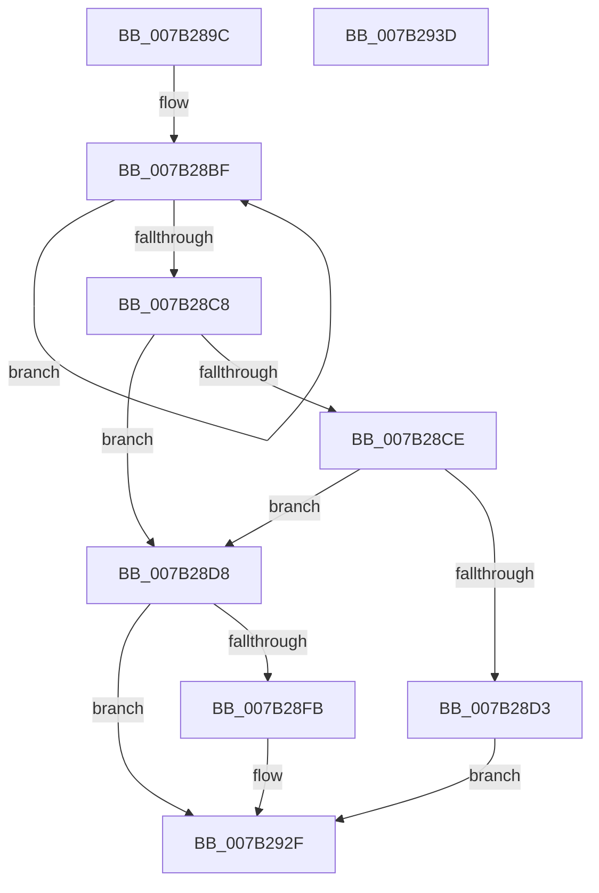

# WmipCheckSMBiosSysInfoString

- RVA: `0x007B289C`–`0x007B293E` (길이 `162` bytes)
- VA: `0x00000001407B289C`
- 실행 섹션: `PAGE`
- PDB 이름 있음: `예`; PDB Function 태그: `아니요`
- unwind 정보 RVA: `0x0008A2AC`
- 디코드: `47`개 명령, `162/162` bytes 표시
- 미해석 바이트: `0` (있으면 어셈블리에 `.byte`로 보존)

> 이 문서는 커널 이미지의 기계어와 PDB 기호를 분석해 생성했습니다. 4번과 5번은 함수 원형과 자료형을 바이너리 사용 방식에서 추정한 C 해석이며 원본 소스 복구 결과는 아닙니다.

## 1. Dependencies

- 직접 호출 지점: **4**; 고유 호출 대상: **4**
- 직접 호출자로 확인된 함수: **1**
- RIP 상대 이미지 참조: **0**

### Outgoing calls
- `0x007B28E0` → [RtlInitAnsiString](../../text/47/RtlInitAnsiString_function_00470F40.md) (function, `0x00470F40`)
- `0x007B28F2` → [RtlAnsiStringToUnicodeString](../90/RtlAnsiStringToUnicodeString_function_0090BEA0.md) (function, `0x0090BEA0`)
- `0x007B2918` → [RtlCompareUnicodeStrings](../97/RtlCompareUnicodeStrings_function_009727E0.md) (function, `0x009727E0`)
- `0x007B2924` → [RtlFreeAnsiString](../9C/RtlFreeAnsiString_function_009C0800.md) (function, `0x009C0800`)

### Direct callers
- [WmiMatchSMBiosSysInfo](WmiMatchSMBiosSysInfo_function_007B2820.md) at `0x007B2862`
- [WmiMatchSMBiosSysInfo](WmiMatchSMBiosSysInfo_function_007B2820.md) at `0x007B2876`

### Static image references
- 디코드된 RIP-relative 메모리 참조가 없습니다.

## 2. Other-region calls and transfers

- 다른 실행 섹션으로 향하는 call: **1**
  - `0x007B28E0` → [RtlInitAnsiString](../../text/47/RtlInitAnsiString_function_00470F40.md) (`PAGE` → `.text`)
- 별도 외부 분기/꼬리 이동을 확인하지 못했습니다.

## 3. Assembly (complete function range)

```asm
007B289C  48 89 5C 24 08                  mov qword ptr [rsp + 8], rbx
007B28A1  57                              push rdi
007B28A2  48 83 EC 50                     sub rsp, 0x50
007B28A6  0F 57 C0                        xorps xmm0, xmm0
007B28A9  0F 57 C9                        xorps xmm1, xmm1
007B28AC  33 FF                           xor edi, edi
007B28AE  48 8B DA                        mov rbx, rdx
007B28B1  0F 11 44 24 40                  movups xmmword ptr [rsp + 0x40], xmm0
007B28B6  48 83 C8 FF                     or rax, 0xffffffffffffffff
007B28BA  0F 11 4C 24 30                  movups xmmword ptr [rsp + 0x30], xmm1
007B28BF  48 FF C0                        inc rax
007B28C2  40 38 3C 01                     cmp byte ptr [rcx + rax], dil
007B28C6  75 F7                           jne 0x1407b28bf
007B28C8  48 83 F8 01                     cmp rax, 1
007B28CC  75 0A                           jne 0x1407b28d8
007B28CE  80 39 2A                        cmp byte ptr [rcx], 0x2a
007B28D1  75 05                           jne 0x1407b28d8
007B28D3  40 8A F8                        mov dil, al
007B28D6  EB 57                           jmp 0x1407b292f
007B28D8  48 8B D1                        mov rdx, rcx
007B28DB  48 8D 4C 24 40                  lea rcx, [rsp + 0x40]
007B28E0  E8 5B E6 CB FF                  call 0x140470f40
007B28E5  41 B0 01                        mov r8b, 1
007B28E8  48 8D 54 24 40                  lea rdx, [rsp + 0x40]
007B28ED  48 8D 4C 24 30                  lea rcx, [rsp + 0x30]
007B28F2  E8 A9 95 15 00                  call 0x14090bea0
007B28F7  85 C0                           test eax, eax
007B28F9  78 34                           js 0x1407b292f
007B28FB  44 0F B7 0B                     movzx r9d, word ptr [rbx]
007B28FF  0F B7 54 24 30                  movzx edx, word ptr [rsp + 0x30]
007B2904  4C 8B 43 08                     mov r8, qword ptr [rbx + 8]
007B2908  48 8B 4C 24 38                  mov rcx, qword ptr [rsp + 0x38]
007B290D  49 D1 E9                        shr r9, 1
007B2910  48 D1 EA                        shr rdx, 1
007B2913  40 88 7C 24 20                  mov byte ptr [rsp + 0x20], dil
007B2918  E8 C3 FE 1B 00                  call 0x1409727e0
007B291D  48 8D 4C 24 30                  lea rcx, [rsp + 0x30]
007B2922  8B D8                           mov ebx, eax
007B2924  E8 D7 DE 20 00                  call 0x1409c0800
007B2929  85 DB                           test ebx, ebx
007B292B  40 0F 94 C7                     sete dil
007B292F  48 8B 5C 24 60                  mov rbx, qword ptr [rsp + 0x60]
007B2934  40 8A C7                        mov al, dil
007B2937  48 83 C4 50                     add rsp, 0x50
007B293B  5F                              pop rdi
007B293C  C3                              ret
007B293D  CC                              int3
```

## 4. C-style interpretation (structured pseudocode)

```c
__int64 __fastcall WmipCheckSMBiosSysInfoString(__int64 a1, __int64 a2)
{
    __int64 result;
    __int64 v_rbx;
    __int64 v_rdi;
    __int64 v_rsp;
    unsigned __int64 v_stack_m18;
    unsigned __int64 v_stack_m20;
    unsigned __int64 v_stack_m28;
    unsigned __int8 v_stack_m38;
    unsigned __int64 v_stack_p8;

    v_stack_p8 = v_rbx;
    v_rsp = (v_rsp) - (80);
    v_rdi = 0;
    v_stack_m18 = v_xmm0;
    result = (result) | (-1);
    v_stack_m28 = v_xmm1;
loc_007B28BF:
    result = (result) + 1;
    if ((*(unsigned __int8 *)(a1 + result * 1)) != 0) goto loc_007B28BF;
    if (result != 1) goto loc_007B28D8;
    if ((*(unsigned __int8 *)(a1)) != 42) goto loc_007B28D8;
    goto loc_007B292F;
loc_007B28D8:
    result = RtlInitAnsiString(v_stack_m18, a1, a3, a4);
    result = RtlAnsiStringToUnicodeString(v_stack_m28, v_stack_m18, 1, a4);
    v_rbx = a2;
    v_rdi = (unsigned __int8)(result);
    if (!(sign_flag)) {
        a4 = *(unsigned __int16 *)(a2);
        a2 = v_stack_m28;
        a3 = *(unsigned __int64 *)(a2 + 8);
        a1 = v_stack_m20;
        a4 = (a4) >> (1);
        a2 = (a2) >> (1);
        v_stack_m38 = (unsigned __int8)((unsigned __int8)(result));
        result = RtlCompareUnicodeStrings(a1, a2, a3, a4);
        a1 = v_stack_m28;
        v_rbx = (unsigned int)(result);
        result = RtlFreeAnsiString(a1, a2, a3, a4);
        v_rdi = ((unsigned int)(v_rbx) == 0) ? 1 : 0;
    }
    v_rsp = (v_rsp) + (80);
    return (unsigned __int8)(v_rdi);
}
```

## 5. (Beta) C Style

```c
int64_t WmipCheckSMBiosSysInfoString(void *Arg1, void *Arg2)
{
    uint8_t *arg1 = (uint8_t *)Arg1;
    uint8_t *arg2 = (uint8_t *)Arg2;

    int64_t result;
    int64_t local_rbx;
    int64_t local_rdi;
    int64_t local_rsp;
    uint64_t v_stack_m18;
    uint64_t v_stack_m20;
    uint64_t v_stack_m28;
    uint8_t v_stack_m38;
    uint64_t v_stack_p8;

    v_stack_p8 = local_rbx;
    local_rsp = (local_rsp) - (80);
    local_rdi = 0;
    v_stack_m18 = v_xmm0;
    result = (result) | (-1);
    v_stack_m28 = v_xmm1;
loc_007B28BF:
    result = (result) + 1;
    if ((*(uint8_t *)(arg1 + result * 1)) != 0) goto loc_007B28BF;
    if (result != 1) goto loc_007B28D8;
    if ((*(uint8_t *)(arg1)) != 42) goto loc_007B28D8;
    goto loc_007B292F;
loc_007B28D8:
    result = RtlInitAnsiString(v_stack_m18, Arg1, a3, a4);
    result = RtlAnsiStringToUnicodeString(v_stack_m28, v_stack_m18, 1, a4);
    local_rbx = Arg2;
    local_rdi = (uint8_t)(result);
    if (!(sign_flag)) {
        a4 = *(uint16_t *)(arg2);
        Arg2 = v_stack_m28;
        a3 = *(uint64_t *)(arg2 + 0x8);
        Arg1 = v_stack_m20;
        a4 = (a4) >> (1);
        Arg2 = (Arg2) >> (1);
        v_stack_m38 = (uint8_t)((uint8_t)(result));
        result = RtlCompareUnicodeStrings(Arg1, Arg2, a3, a4);
        Arg1 = v_stack_m28;
        local_rbx = (uint32_t)(result);
        result = RtlFreeAnsiString(Arg1, Arg2, a3, a4);
        local_rdi = ((uint32_t)(local_rbx) == 0) ? 1 : 0;
    }
    local_rsp = (local_rsp) + (80);
    return (uint8_t)(local_rdi);
}
```

### 관측된 메모리 오프셋

구조체 형식이 확인되지 않은 접근은 인자 기준의 오프셋으로만 기록했습니다.

| 기준 인자 | 오프셋 표현 | 폭 (bit) | 접근 |
|---|---:|---:|---|
| `Arg1` | `+ 0x0` | `8` | `R` |
| `Arg1` | `+ 0x0 + rax*1` | `8` | `R` |
| `Arg2` | `+ 0x0` | `16` | `R` |
| `Arg2` | `+ 0x8` | `64` | `R` |

## 6. Execution-region graph

[열기: 2D/3D 그래프와 함수 탐색 컨트롤 패널](../../../control-panel.html?section=page&rva=0x007B289C&view=graph)

- 2D 그래프는 위에서 아래로 흐르고, 3D 그래프는 빈 공간을 드래그해 회전합니다. Shift+드래그는 이동, 휠은 확대·축소, 함수 노드 선택은 대상 보고서 이동입니다.

### Static fallback


